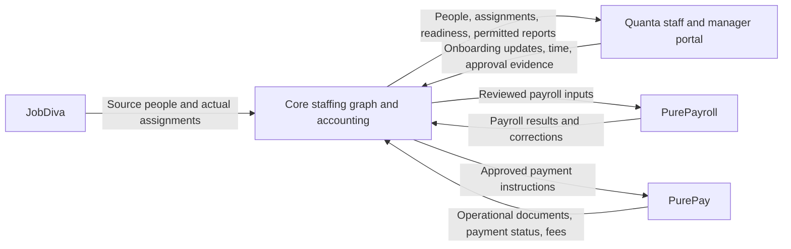

## Fresh Core production structure rehearsal passed - October 30, 2026

Candidate `07ca035e` passed CI and the read-only production preflight. A fresh
production structure-and-migration snapshot was replayed locally against all
78 pending migrations: 736 statements completed, the original migration history
was preserved, and the disposable database process stopped cleanly. The two
additions since the October 26 structure rehearsal are financial observation
captures (183) and confirmed invoice-line associations (184). No production
files, data, or runtime activation were changed by this rehearsal.

The evidence is recorded in
`deploy/core-production-structure-rehearsal-20261030.json`. Its local plan uses a
migration-only manifest and is distinct from the full release-package plan.
The complete private production-preflight report has also been recovered and
hash-recorded, avoiding redacted action-log fields. Existing-key SSH now works
as application owner UID 1004, matching the webroot and `.htaccess` ownership.
The application has no active crontab lines and its listing returns exit 1;
maintenance must distinguish an absent crontab from other scheduler failures.
This result does not establish populated conversion or production recovery
readiness. Full writer pause/drain, owner-preserving deployment rehearsal, and
matched backup/recovery still need to be completed with the coordinating
production publisher.

## Authoritative invoice currency verified; retention fix released — October 30, 2026

QuickBooks production company Thunderhawk Technology Partners LLC, realm
9341453235663641, confirms USD on all five invoices whose selected lines were
associated with P-358 / PL-864. GET-only reads used the installed PurePay
connection and its usage/backoff handling with explicit organization, realm,
environment and path guards. The fresh token was retained; the reader could not
refresh credentials, start background work or write invoices/payments. Stored
invoices had identical before/after hashes. Every selected line matched the
stored customer, item, quantity, rate, amount, description and invoice SyncToken.

The five selected lines total USD 72,128 for 736 source invoice units. All five
lack structured ServiceDate values. Descriptive May–September labels remain
source prose; they do not establish a reviewed service period or approved time.
The existing Core captures 4–8 and associations 1–5 remain unchanged, including
their original unknown-currency evidence. This new external source packet does
not silently upgrade those historical snapshots or establish payroll matching.

PurePay's invoice importer discarded CurrencyRef. Commit `e51e0d1` now retains
an explicit three-letter source currency in the invoice and its QuickBooks facts.
Absent currency stays null and clears a stale value on refresh; malformed values
refuse before invoice changes. The fix neither infers service dates nor changes
amounts, links or payment history. Eighty-six offline checks passed, with zero
network attempts. The authorized publishing chat applied the narrow delta to
its current production baseline as `cf2b3d6`, verified 198 combined checks with
zero network attempts, and released it with healthy payroll/import workers.
Production digest is `6afe17e21a3c8f791f42408658472746f90ea0b0b268828e4255089e1d7ef736`.
No source import, backfill, payment or historical snapshot rewrite was triggered;
currency is retained on subsequent ordinary source imports/refreshes.

The publishing chat separately reported verified production PurePay `94efa5c`
(read-only financial observations, preserving the earlier AP balance repair) and
Quanta `92b662e` (time display corrections). The full Core foundation upgrade and
dependent Quanta team portal remain outside that publication. Do not replace
these production releases with the older integration branches.

Evidence: `deploy/thunderhawk-qbo-invoice-currency-20261030.json`, the bounded
GET-only reader beside it, and its private source packet on the provider host.
Matching-period time/payroll reconciliation and the full production Core upgrade
remain open; the overall integration goal is incomplete.

A follow-up read found no PurePay time entries or Quanta worker link for existing
employee `emp_ea232efec736`. Thunderhawk's live Quanta workspace has zero workers,
so it cannot supply that person's historical time. The existing October 23 pay
run records 80 hours for October 5–18, with no source-time references or explicit
currency. The user was asked where the approved hours for that period are kept.
No identity or approval was inferred and no operational record was changed.

## Confirmed historical invoice lines linked to PL-864 — October 30, 2026

The user's confirmation is now applied to the five identified historical
invoice lines in isolated Core company 2002. Each links to canonical P-358 /
PL-864 under the pilot installation and retains its original invoice ID, line
ID, complete encrypted capture, reviewer, and dated review evidence. These are
Core associations; the source invoices and provider IDs remain unchanged.

Core staging runs `d8ecb77b`, including migration 184 and the native source-line
review API and controls under saved financial captures. All nine CI jobs and
staging release `41086182701` passed. The application resolves the authorized
People and Placements directories on the server, requires financial and source
module access, checks the fresh provider document against the saved capture,
locks the connection and canonical target, and saves an encrypted association
with a mandatory audit. Source/target edits invalidate review. Replay reuses
its receipt; a conflicting placement cannot silently replace it. A reviewed
revision of the same placement appends evidence. History is bounded and paged.
The dictionary covers every stored association field and grants no sync rights.

The five associations are IDs 1–5, based on source captures 4–8. All replayed
without duplication and read back through history. Protected Core business
records, including the captures themselves, stayed unchanged. Nineteen native
HTTP checks passed for financial/People/Placements permissions, company scope,
server-selected owners, confirmation, stale reviews, replay, history and access
revocation. Synthetic reviewer 59 was retired and its session removed. Local
verification passed 54 MariaDB checks and 13 interface tests; the dashboard
build passed. This does not claim interactive browser acceptance.

Evidence: `deploy/thunderhawk-confirmed-invoice-links-20261030.json` and the two
bounded application/HTTP runners beside it. The earlier invoice-context
checkpoint's pending user confirmation has therefore been resolved.

The association applies to these source lines only: it creates no future-item
rule, time match, currency conclusion, financial posting, payroll or payment.
Source period labels still lack structured service dates, and source currency
is absent. Matching historical time/payroll periods and reconciling amounts
remain required; a different-placement correction needs its own reviewed
correction workflow. The full integration goal remains incomplete.

## Historical invoice context retained and captured — October 30, 2026

Core staging now runs `5166232e`; the isolated PurePay observation module is
`c9a2db6`. All nine Core CI jobs and staging release `41081878180` passed.
The production PurePay AP/QBO correction remains unchanged.

The financial observation contract is now `2026-10-30.2`. It preserves source
item names, QuickBooks item IDs, and bounded multiline line descriptions. Core
accepts both versions; existing v1 captures are unchanged and remain readable.
The review UI searches all source lines by item, description, assignment or
line ID with bounded display pages. Source labels do not assign worker identity
or infer service dates.

Five existing invoices (112 complete source lines, five selected item lines)
were copied into the held provider pilot after read-only source checks. Native
provider HTTP matched every source hash. Core encrypted captures 4–8 retained
the full projections, replayed without duplicates, and passed three wrong-company
denials. All protected Core business tables and other pilot records stayed
unchanged. Seventeen native API checks passed, including permissions, v1 history,
v2 source labels, replay, and revocation. Synthetic HTTP actor 58 was retired and
its private session removed. This is not interactive staff-browser acceptance.

Local verification: 41 provider route tests; 80 PHP contract checks; 33 real
MariaDB capture checks; eight interface tests; dashboard build passed.
Evidence: `deploy/thunderhawk-invoice-context-20261030.json` and private source
packet on the isolated provider host. Source PII is not committed here.

The user has confirmed that the five selected source item lines belong to
PL-864. Their reviewed Core associations are the next implementation step and
are not yet applied by this checkpoint. The earlier captured AP bill belongs
to a different item; no matching person or JobDiva mirror was found in Core,
so it must not be used as PL-864 evidence. Currency and structured service dates
remain absent from the invoice source; period descriptions remain plain text.
No payroll, payment, ledger posting, or production cutover occurred.

## October 30 Quanta team reporting and onboarding summaries installed

Quanta isolated pilot now runs portal revision 95e2eb9. Approvers can choose My
team to see active/ended assignments for active workers they currently approve.
Direct assignment takes precedence over the workspace default; native self-
approval fallback is preserved. Current roles and worker relationships are read
again for each list, detail, time-status and report request. Team access does not
grant administrator controls, private onboarding submissions or document access.

Assignment cards and CSVs now include version-checked Core onboarding requirement
counts. Missing or stale publications stay unknown/needs-refresh. Reports carry a
generation timestamp separately from the last Core assignment/onboarding update.
No readiness observation grants employment, worksite or payroll authority.

Validation: 335 offline full-application checks, 14 rendered interface checks and
the frontend build passed. Twenty-eight hosted native HTTP checks passed for the
existing pilot worker, approver and administrator, including the foreign-company
and private-document denials. All provider records remained unchanged by those
reads. In Chrome, P-358 / PL-864 shows three satisfied requirements and both the
eight-hour and one-hour entries accepted in Core. Its CSV was downloaded and
parsed successfully. Manager/admin interactive browser acceptance remains open.

The first install guard comparison failed and restored the prior runtime; its
specific diff was not retained. The installer now saves before/after fingerprints.
The next exact-baseline installation passed with unchanged collections and other
services. Production, monetary execution and Arabella remained outside this work.

Evidence: deploy/thunderhawk-team-portal-20261030.json. The original full-plan
financial lineage/reconciliation, field-disposition and reverse-change acceptance
requirements remain open; this checkpoint does not declare the integration done.

## October 30 native financial review deployed and accepted over HTTP

Core staging now runs 5bd0645a with the native AP/AR review panel and encrypted
observation history. All nine CI jobs passed (41073528969); the isolated staging
release passed (41074018437). The earlier implementation-only checkpoint below
is superseded by this deployment and acceptance evidence.

One historical Thunderhawk bill and two invoices were captured in native Core
company 2002. Source hashes, all 45 lines and the two stored outgoing payments
match the frozen pilot source projection. Encryption, history and replay passed;
protected business records and other companies remained unchanged.

Fourteen native login/API checks passed, including independently missing
accounting/AP/billing grants, foreign-company refusal, explicit confirmation,
stale-review refusal, replay, history and revoked access. The test actor used
legacy admin plus the non-wildcard admin persona with explicit module grants;
no application access policy was widened. The actor was retired, both password
fields cleared, both memberships disabled and its private cookie file removed.

This verifies native HTTP, not staff-browser acceptance. Source currency remains
unknown, no Core bill/invoice identity link was established, and no bank delivery
or complete financial reconciliation is claimed. No production release, payroll,
payment or ledger posting occurred. Preserve the separate PurePay production AP
correction a154525 when assembling any later production release.

Evidence: deploy/thunderhawk-native-financial-review-20261030.json.

## October 30 native Core financial review implementation

Core now has a versioned AP/AR observation validator, encrypted immutable
captures, company-scoped history and a financial review panel under PurePay
settings. An optional existing Core bill or invoice can be selected for precise
amount comparison. Selection does not create an identity link; missing or
different currency prevents subtraction. Source line links, payments, collection
records and embedded receipts retain their original values and units.

The save path refreshes provider evidence, rejects stale reviews and connection
or Core-record changes, locks the company connection, and commits the encrypted
capture with its audit entry. Retrying reuses the capture. No obligation, payment,
payroll or journal state is changed. Permission requires accounting administration
and both AP and billing reads because source documents include cross-references.
The field dictionary now describes every AP/AR contract leaf as restricted
source evidence; the dictionary grants no write authority.

Local validation: 56 provider-contract/malformed-input checks, 29 real MariaDB
transaction/history/isolation checks, and seven rendered React interaction tests
pass. The dashboard builds with the repository's existing warnings. Hosted
release and actual-source product capture are the next checks; this paragraph
does not claim deployment or staff-browser acceptance.

Production coordination: the PurePay review chat reports production AP correction
a154525 on codex/qbo-partial-payment-repair, based on b786f4e. Future production
assembly must preserve its server.py edits and new qbo_bill_balance.py. The
isolated provider is separate and has not been replaced by that production fix.

## October 30 existing AP/AR source observations verified through Core

PurePay now exposes dedicated read-only bill and invoice observation routes in
the isolated pilot. They preserve stored lines, links, payment states and missing
values, detect source changes, and avoid invoice read paths that backfill data.
The contract names its stored sources and makes no external receipt-completeness
or bank-delivery claim. Production has not received these new routes.

One existing Thunderhawk bill, two linked invoices and two recorded payments
were copied as bounded source projections into the isolated provider. Native
HTTP hashes match the unchanged production source projections. Core's reviewed
company-2002 reader verifies the same hashes and retains an encrypted private
packet. Provider and Core replay both reuse existing evidence; protected records
remain unchanged. No payroll, payment or journal execution occurred.

This is a source-contract and transport checkpoint. Core product observation
persistence, comparison and staff review UI still need implementation. The
historical source assignment is unlinked to Core. Currency is missing from all
selected documents and payments; it remains missing pending source evidence or
explicitly attributed user confirmation. Recorded settled statuses do not prove
bank settlement, and no invoice receipt is inferred from a zero balance.

PurePay contract checks passed: 68 passed/1 existing optional skip in the first
related suite, then 32 observation tests and 57 isolation/release checks passed
in the final 89-test suite with network access blocked. Only the isolated backend
was restarted; other containers and provider business records were unchanged.
The Core private JSON envelope explicitly base64-encodes binary ciphertext;
authenticated readback and unchanged replay passed after that correction.

Next: implement native Core AP/AR observation review, complete staff-browser
acceptance and audit the original integration plan. SSH is enabled and reachable.
Evidence: deploy/thunderhawk-financial-observations-20261030.json.

## October 30 isolated financial reader connected and verified

Core's financial preview now selects the isolated PurePay host on port 19443 and
explicit simulation company 2002. A dedicated read-only provider key is stored
privately and encrypted in Core. Native company review confirms Thunderhawk's
organization org_0369a63ff2cb; retry reuses connection 1 / binding revision 1.
No bill, payment, payroll or journal transaction was created by this setup.

The preview rejects other companies before credential storage/decryption and
before any provider request. This also closes the financial-review path that
previously checked the preview company only after an identity request. All four
financial write methods remain blocked. Production routing is unchanged; the old
demo configuration and company records were retained in private recovery/history.

All 34 preview scenarios and 12 legacy configuration checks pass. Runtime
be4bb1ee passed all nine CI jobs and staging release 41002423229. The actual
PHP web process confirms the company binding, denies three other-company reviews
and all four financial write methods, and retains the 2002-only staffing gates.
The expiring authenticated probe returned 200, rejected unauthenticated access,
and was removed. Protected Core business and other-company records are unchanged.

Core SSH was already enabled. A fresh master-key connection succeeded; the Core
application user kunalverma2 still has its SSH shell and correct webroot ownership.
Application-password authentication was last verified October 27, not repeated.

Next: existing AP/AR and payment-result acceptance, Core staff-browser acceptance,
and the original-plan completion audit. This checkpoint is not a production
publication or evidence of financial-result reconciliation.
Evidence: deploy/thunderhawk-financial-reader-20261030.json.

## October 30 existing payroll actuals captured and compared in Core

The isolated provider now contains an exact observation-contract projection of
Thunderhawk's existing October 23 payroll run run_54dde5d17c05 (October 5-18,
18 employee lines). Production was read-only. Its native ID and observation
hash are preserved; provider HTTP returns the same source projection. This is
historical provider data, not another payroll execution or a synthetic paid event.
The production app does not yet contain the new observation module, so the source
capture used a bounded read-only database query. The new API was tested on the
isolated service; this is not evidence of a production publication.

Core encrypted native observation 2 preserves all 18 lines and replays without
a second record. Alexander matches P-358; the other 17 employees remain visibly
unlinked. Nine available totals match the full line totals. Seven amount categories
lack line values and one lacks its provider total. Currency, paid timestamp and
source-time references remain missing; they were not replaced with defaults.
Cash delivery and time-to-payroll matching are not established by this receipt.

Sixteen protected Core business/history sets across all tenants stayed unchanged,
including payroll, time, AP/AR and ledger tables. Both original held drafts remain
held; the browser-hour replay reused its draft and still rejected execution.
The previously downloaded worker assignment report was also checked: one row,
P-358 / PL-864, correct dates/client/worksite, and no private contact/payroll fields.

The next financial lane is PurePay AP/AR and payment-result acceptance. Its Core
financial-preview adapter still pins the former Emergent origin and needs a
reviewed isolated-host migration before that test. Core staff-browser acceptance
and the broader original-plan audit remain open. Production is unchanged.
Evidence: deploy/thunderhawk-hosted-payroll-actual-20261030.json.

## October 30 hosted provider company-isolation and conflict checks passed

105 native HTTP and data-integrity checks passed on the isolated Quanta and
PurePay services. A second synthetic company in each service used the same Core
person, placement and client numbers but retained distinct provider identities.
Both directions rejected foreign people, assignments and client reads; control
lists excluded Thunderhawk. Source time, onboarding, document contents, delivery
receipts, payroll inputs, runs, observations and reservations remained scoped.

Stale assignment, worker and onboarding updates and conflicting person links
were rejected. Rejected-request retries returned the original receipt. A second
company could neither acquire nor release Thunderhawk's payroll reservations,
and modified payroll input could not replay the original content key.

Protected Thunderhawk record hashes and counts were unchanged. Document access
was enabled briefly for the control workspace so its 404 proved ownership,
then the original private settings were restored byte-for-byte. Both temporary
control keys were revoked and failed native authentication with 401. The
synthetic control records remain for repeatable checks, with the Quanta worker
disabled; no login invitation, payroll, payment or financial posting occurred.

Core remains at runtime 43007a5a. Cloudways still shows Login, so the existing
staff-browser handoff is pending. This checkpoint closes hosted provider
isolation/conflict evidence; the original plan's remaining portal/report,
reverse-change and AP/AR/actual-result acceptance still needs a full evidence
audit. Missing WC and commission details remain explicit source gaps.
Evidence: deploy/thunderhawk-hosted-provider-isolation-20261030.json.

## October 30 browser-created hour completed its held payroll round trip

The actual Quanta worker-browser hour for October 26 completed native Core
approval, returned Accepted in Core, reached PurePayroll as a held USD 65.00
draft and reconciled into Core's encrypted result observation 4. Person P-358,
placement PL-864 and every existing provider identity were preserved. The
original eight-hour draft and source records stayed unchanged.

Core used a separate synthetic time approver (user 53, membership 39), rejected
self-approval and duplicate approval, then revoked its access. Recovery verified
the retired identity without reactivating it; the earlier test approver 52 also
remains retired. Return delivery 39, payroll input delivery 40 and source
reservation cpa_0d44c7f660e4181fd94ee6d418082e0576c0687fdbec0e0afaf6e41ab1212357
were reconciled. PurePayroll's duplicate request reused the same draft; its
execution endpoint rejected processing. The synthetic pay date is November 6.
This is automated test review, not independent human approval or real payroll.

Chrome verified both source hours as Accepted in Core, and the PurePayroll
operator screen displayed the matching Core IDs, original source entry, frozen
USD 65/hour rate, USD 65 gross preview and explicit approval/funding hold.
Quanta frontend 9d828dc also fixes duration entries falsely appearing still open
and replaces Total paid with Total hours in worker and approver views. Its build
passed and only isolated static assets were updated; the backend remains 3f0ebd3.
The worker screenshot confirms the corrected one-hour display.

Core runtime remains 43007a5a. Staff browser acceptance is still pending: Chrome
blocks the staging hostname before rendering, and the Cloudways sign-in handoff
remains open. Hosted provider second-company and ownership-conflict tests, source
WC/commission questions and production publishing remain incomplete.
Evidence: deploy/thunderhawk-browser-hour-roundtrip-20261030.json.

## October 30 persistent isolated operational controls verified

Core staging runs 43007a5a (deployment 40993604583), after all nine CI groups
passed in 40993314297. SSH remains enabled; the master connection was verified
and application account kunalverma2 retains its enabled shell.

Operational Quanta and PurePay controls are now persistent for Core's isolated
Thunderhawk company 2002 only. This covers metadata, people, customers,
assignments, onboarding/document intake, time-review return, and held payroll
input/reservation handling. It grants no additional user/provider permissions,
payroll execution or payment capability. Companies 2, 999 and 2003 remain denied.
Twenty-four real send/reservation boundary attempts from unlisted companies were
rejected, with connection and business-record snapshots unchanged.

The first environment-based configuration passed CLI but failed the PHP-FPM web
check because Cloudways disables putenv. Its prior configuration was restored
and verified over HTTPS. Private string/boolean constants now support the same
company limits without that function. Three restricted-host subprocess cases,
nine focused local suites and full CI passed. Fresh CLI and authenticated HTTPS
web checks both confirm all eleven controls enabled only for 2002. The temporary
web verifier denied unauthenticated access and was removed. No production
runtime, real payroll, payment or financial posting changed.

Actual staff-browser acceptance and hosted provider second-company/ownership
checks remain. The browser-created October 26 hour (entry 3 / timesheet 4) still
awaits independent Core review and its held payroll return. Duration-entry and
unpaid-hours display corrections, missing WC classification and commission
source questions are also open. Production publishing is not complete.
Evidence: deploy/thunderhawk-hosted-operational-enablement-20261030.json.

## October 30 worker browser, worksite revision and time return verified

Core staging runs ea23c280 (workflow 40987824641); the isolated Quanta backend
now includes 3f0ebd3. All 331 offline backend checks passed. The public static
assets needed their directory/file modes corrected before the browser could
load them; private files and enclosing directories retained their permissions.

The worker browser shows P-358 / PL-864 / CL-1280 / CO-1902, the active TEST
Rockefeller - Hamilton, NJ worksite, and three approved onboarding requirements.
Core delivered the reviewed worksite revision (36), retaining assignment ID and
history, and refreshed onboarding (37) without changing the original evidence.
Assignment version is 2; Core case version remains 11 and Quanta case version is 5.
The historical eight hours still show Accepted in Core. A defect that compared
only the latest worksite is fixed: an existing review may use its exact original
assignment revision, with unchanged identity and valid current dates. New time
cannot borrow an arbitrary historical route; changed hours or withdrawn source
approval still invalidate the review.

Through Chrome, the worker entered one explicitly synthetic hour for October 26
and submitted the October 24 week. Quanta's separate test approver approved it.
Core imported source 69f7fc04-ce35-497b-ad2d-589eabca1455 as entry 3 / timesheet 4,
using reviewed worksite route 3. Replay inserted no duplicate. Delivery 38 returned
Awaiting Core review to the actual worker screen. This hour remains pending Core
review and has not been sent to payroll. The original time, held payroll result,
identity and onboarding records were preserved. No independent human sign-off,
real payroll, payment, financial posting or production cutover is claimed.

Next: enable bounded persistent Core pilot UI access, run staff browser and hosted
second-company/ownership checks, then complete the browser hour's Core review and
held payroll return. The worker week also exposes two display defects: duration
entries say still open, and Total paid can imply completed payment. Missing WC
class and the commission due-date/payable-recipient questions remain unresolved.
Evidence: deploy/thunderhawk-hosted-worker-browser-acceptance-20261030.json.

The dated entries below are earlier checkpoints, not current inventories.

## October 30 hosted worker evidence and employer review return passed

Core staging now runs ce14a127, deployed by workflow 40985695250 after all
nine CI groups passed on that revision. The live receipt test exposed a Core
validation mismatch: Quanta accepts canonical submission UUIDs beyond version
4, while Core incorrectly treated provider request IDs as its own command IDs.
Core now validates the provider UUID shape and bound receipt without relaxing
its local case, task or command identities. Regression checks reproduced the
failure before the fix. The same original worker evidence imported afterward.

The isolated Thunderhawk worker now has a private test login. Its sign-in
message was captured locally; Alexander was not emailed. The native worker
workflow submitted one explicitly synthetic PDF and one acknowledgment. Core
imported both, verified the PDF bytes in its private S3 vault (document 2),
reviewed the two worker tasks and one staff task, and published case version
11 back to Quanta. The worker API showed all three approved decisions and
retained the two original receipts. Replays created no duplicates, changed
request bodies and stale reviews were rejected, and worker access to staff
submission, team management and workspace onboarding was denied. Quanta is
at case version 4; Core review delivery is 35. This was an operator-driven
integration test, not independent human approval of employment evidence.

A fresh read-only JobDiva query also verified the exact person, assignment
and job identities. Names/email, dates, work state/country, engagement type,
division, bill/pay rates and billing client matched the production source
records used for the pilot. JobDiva still has no WC class or phone value.
The source comparison did not import data or approve production draft rates.

Next: verify actual cross-company isolation and field ownership conflicts on
this host, configure the bounded pilot's persistent UI access, and exercise
the worker and staff browser flows. Core's onboarding flags were temporary for
this test; the normal UI is not yet persistently enabled. The INR commission
and missing WC class remain separate unresolved setup items. Production
cutover is still pending. No real payroll, payment or financial posting ran.
Evidence: deploy/thunderhawk-hosted-onboarding-acceptance-20261030.json.

The dated entries below are earlier checkpoints, not current inventories.

## October 30 hosted assignment, time approval and held payroll round trip passed

The isolated Thunderhawk copy (Core tenant 2002) now has PL-864 published in
Quanta and an active native PurePay assignment. Core approved the copied
commercial terms only in this pilot: USD 98 bill / 65 pay per hour, the stored
20% employer load, and the source operating cycles and party roles. Production
rate approval and placement data were unchanged. The missing workers
compensation class remains visible. The INR 7,500 one-time recruiter commission
has not been converted into a USD charge or assigned an invented due date.

Quanta recorded eight explicitly synthetic hours on October 19 and submitted
them through the native admin workflow. A separate test approver approved them.
Core imported exactly one entry (2, timesheet 3) as pending review, retaining
the original Quanta timesheet and workspace. Re-importing created no duplicate.
Core's separate limited test approver (52) approved the entry; self-approval and
repeat approval were rejected. The temporary Core approver was then retired.
Quanta received and reconciled both pending-review and accepted return states.
The worker directory profile is active but has no login identity or invitation.

PurePayroll received the approved source packet and reservation, then created
one held draft for USD 520.00. Repeating the request returned that same draft;
an execution attempt was rejected by the isolated environment's hold. Core
reconciled the original source components and USD 520 gross, retained an
encrypted result observation (3), and reused it on replay. This uses manual
calculation: it validates source gross, not taxes, withholding, YTD, filing,
funding, or real employee payroll. The source time remains unchanged and its
reservation remains held. No payment, invoice, bill, or financial posting was
created. Draft: run_core_792fd19f59a1a78e389b3885a4ebbf5d13e2690e223126af839f8378826045ab.

Core also published a three-task sample onboarding checklist and verified
publication replay. Document/attestation intake and employer review are still
incomplete. The draft test exposed an unused bootstrap payroll configuration
field; the pilot bootstrap now uses payroll.processing.calculation=MANUAL and
payments=RECORD_ONLY. Only the isolated company's configuration was repaired.

Next: complete portal onboarding and document review, validate field ownership
and conflict/isolation behavior on the current host, refresh JobDiva source,
and verify the user-facing operational flows. Production deployment remains
pending; the current Core runtime remains 3d9ca8a. Evidence:
deploy/thunderhawk-hosted-time-payroll-acceptance-20261030.json.

The dated entries below are earlier checkpoints, not current inventories.

## October 30 hosted Thunderhawk identity exchange passed

Core staging now contains a separate Thunderhawk isolated pilot (tenant 2002),
with source person P-358, placement PL-864 and job 1972. Its native numbering
triggers preserved the existing record numbers. The source graph keeps the
job's Thunderhawk company/client relationship separate from the placement's
Rockefeller billing client. Existing staging companies and connections were
verified unchanged during provisioning.

The private Quanta and PurePay pilots contain separate Thunderhawk source-copy
companies. Native Core review verified both company identities over TLS.
Core linked P-358 to existing PurePay employee emp_ea232efec736 and CL-1280 to
customer cus_e25f880f86. Core published one disabled Quanta worker using its
normal reviewed delivery path. Repeating the native sends retained the same
identities; replaying the actual Quanta provider request returned the same
worker and receipt. A fresh preview reports the worker profile unchanged.

Provider readback found two PurePay identity links, one employee, one customer,
and one disabled Quanta worker. There are no pilot payroll runs, payments,
payables, invoices, time entries or timesheets. Production Quanta still has
zero Thunderhawk workers. No employee login identity or invitation was created.
The separate test operator and approver accounts use private pilot credentials.

Staging's metadata endpoints now use https://helloquanta.app:19443/api/v1 and
https://purepay.online:19443/api/v1. The prior private configuration was backed
up with ownership and modes preserved. Existing demo bindings retain their
permanent identities and need explicit migration before use with these origins;
the separate financial payment-rail configuration was unchanged.

Next: review and publish the assignment, complete onboarding and controlled
time approval, create only a held payroll draft, and reconcile results. Source
rates remain unapproved and workers compensation class remains missing. This
is a stored-source snapshot, not a fresh JobDiva fetch or a completed end-to-end
Thunderhawk acceptance. Production release remains pending. Evidence:
deploy/thunderhawk-hosted-identity-acceptance-20261030.json.

The dated entries below describe earlier checkpoints.

## October 29 isolated provider pilot is running

Quanta b31607b and PurePay 2b26a2e are installed in independent pilot containers
on the current host. PurePay includes the newer vendor-access release 7b226d0.
Both applications returned healthy responses from Core over verified HTTPS on
port 19443. The pilot admits the Core host and local verification; a separate
client received HTTP 403. Production proxy configuration and production
containers were unchanged by deployment.

The pilot has independent empty databases, fresh credentials, separate file
storage, internal backend networks and no recurring workers. Actual outbound
connection probes were blocked. PurePay rejects execution, payroll approval,
funding, external messages and scheduled work before business-route handling.
Source exchange and reviewed held drafts remain available with normal
authentication and company checks. Evidence: deploy/core-provider-pilot-20261029.json.

Core endpoint admission now recognizes the new origins only in staging. Its
48 endpoint scenarios passed, including existing-origin review invalidation
and separation of the payment rail. CI 40976204647 passed for 3d9ca8a3, and
staging deployment 40976611628 completed with native acceptance on October 30
at 00:01 UTC (October 29 locally). Independent installed-file hashes match.
The saved company connections still retain their previous reviewed destinations.

The next step is an explicitly identified Thunderhawk pilot company and source
packet. Core staging tenant 2 is Beta Industries (Sandbox), not Thunderhawk;
only tenant 999 currently contains staffing test records. Preserve those demo
records and their existing links while establishing a separate Thunderhawk
identity. The actual Thunderhawk round trip remains unproven.

A fresh read-only source check verified Alexander's Core person 358, placement
864 and exact JobDiva source identifiers. PurePay already has employee
emp_ea232efec736 (Alex Serebriiskii) under org_0369a63ff2cb; normalized email
comparison matched Core without exposing the address. Preserve that employee
ID. Quanta workspace 4f93d4e7-af74-4765-b812-3464bb6d974b has zero workers.
Core's legal entity is now populated; workers compensation class remains blank.
See deploy/thunderhawk-hosted-source-identities-20261029.json. This check reads
current stored records and does not certify a fresh JobDiva response or approved
compensation.

## October 29 current host integration status

The SSH access issue is resolved. Cloudways application SSH was enabled on
October 27 and the existing application password authenticated as UID 1004,
matching Core's file owner. The application account could create and replace
private probe files without changing ownership; the probe was removed. On
October 29, a read-only check reconfirmed the application account, shell and
webroot ownership through the reachable server. No production deployment or
schedule change occurred. Evidence: deploy/core-ssh-enabled-20261027.json.

Quanta and PurePay have moved from the disconnected Emergent previews to
DigitalOcean. Do not reopen or deploy the old preview snapshots. Quanta's Core
work is now rebased onto the current hosting source and published as draft
[Quanta PR #2](https://github.com/coreflux-creator/Quanta/pull/2), commit d24ba1b.
Its 298 offline backend checks, 32 portal checks and frontend build passed.
PurePay's merge is published as draft
[PurePay PR #5](https://github.com/coreflux-creator/PurePay/pull/5), commit aba06e8,
based on the current payroll settlement release. Its 1,295 backend tests,
91 UI checks and frontend build passed, plus 43 startup/handover checks after
issuing a fresh candidate release identity. These tests included actual Core PHP
payloads and synthetic records in an owned local MongoDB, which was shut down.
Both candidates remain undeployed.

There is no persistent isolated provider pilot on the new host yet. The next
release gate is a separate pilot with independent data and credentials and held
background work, then actual Thunderhawk acceptance. Local tests and the earlier
demo-company round trip do not satisfy that gate. Core's production maintenance
adapter must also preserve an absent application crontab while coordinating the
separate master scheduler before any production cutover. Production cutover and
real payroll, payment or posting actions remain outside this pilot authorization.

The older entries below retain their original observation dates; their Emergent
and disabled-SSH statuses are historical.

## October 26 application-owner access correction

The existing application login kunalverma2 and file-owner name grcudkpvcd both
map to Unix UID 1004, group 33. Live id/getent inspection corrects the earlier
name-based conclusion in the October 24 preflight: the login is an alias for
the correct owner. Cloudways currently disables application SSH shell access.
Approval has been requested to enable that existing access and verify it;
no permission or credential change has been made.

The application cron screens are empty and Cloudways reports Supervisord is not
installed. The separate master user (UID 1003) still has nine active cron entries,
all referencing Core production. Application-owner access alone will not pause
those jobs. The current host maintenance adapter controls only its current user's
crontab, so deployment needs coordinated control of both owners plus running-work
drain and external-writer checks before any cutover. No schedule was changed.

Evidence: deploy/core-application-owner-access-20261026.json. Production and
both disconnected previews remain unchanged by this inspection.

## October 26 native recovery numbering check

The synthetic native MariaDB dump/restore fixture now verifies record-number
allocation after an interrupted upgrade, including deleted higher IDs and an
empty table with a reserved next ID. All 17 Windows checks passed. A restored
person insert received 14008 instead of reusing a previously allocated number;
the restored audit trigger received its reserved ID 7001. The local database is
stopped and temporary client credentials were removed.

This adds recovery coverage; it does not change the earlier data-only populated
rehearsal's counter limitation or establish a production cutover backup.

The existing SSH key was rejected for application-owner login. Cloudways ticket
999748 still shows the unanswered owner/scheduler follow-up. Emergent reports
no supported held-resume. PurePay's review startup holds background jobs and
cron calls, but permits ordinary manual API routes. Current hosted state remains
unverified; neither preview was reopened and production remains unchanged.

Evidence: deploy/full-core-recovery-numbering-20261026.json.

## October 26 populated Core upgrade rehearsal

The exact 4b1b7a2e candidate completed all 76 pending migrations / 734 SQL
statements on a private, encrypted copy of 4,043,709 production rows across 387
tables. Production was inspected read-only and kept running. No application or
provider execution was started against the copy.

Retained original values matched in 381 tables. Each of the six changed tables
was reconciled against a separately restored original reference: 76 migration
receipts, seven missing deposit accounts, six default rule/template label pairs,
three platform export templates and one worksite-city mapping target. Original
chart accounts, provider records, ledger entries and tenant customizations stayed
unchanged. All 4,737 person, company, placement, client and vendor numbers matched
their source IDs. Raw invoice-link tokens were intentionally removed; their
hashes and other fields were preserved. Local database processes are stopped.

This proves local populated conversion, not hosted Thunderhawk acceptance or
cutover recovery. The data-only rehearsal did not preserve source auto-increment
high-water marks beyond imported IDs. Matching files/database backups, writer
control, recovery proof and explicit production authorization remain required.

Emergent support reports no held-resume mechanism: resuming starts pod services
and reconciles scheduled work. Its account-status reply does not independently
prove current service state. Hosted testing remains held pending startup
containment and fresh service/effect evidence. No preview was opened by this
rehearsal, and no production cutover occurred.

Evidence: deploy/full-core-populated-rehearsal-20261026.json.

## October 26 Core callback fixture validation

Core's CLI-only synthetic payment fixture passed 17 contract checks and an
18-step local MariaDB 10.11.18 walkthrough. Native company binding, signature
verification and settlement processing reconciled one USD 1 test payment.
Duplicate delivery reused the receipt; changed replay content was rejected.
AP remained sent, with no bank account, clearing date or journal entry.

All 19 protected tenant-999 data sets stayed unchanged. Deliberately changing a
ledger line, neighbouring AP payment or fixture bank account caused verification
to fail. Restoring each synthetic change restored successful verification. The
local database was stopped. Host/authentication adapters and in-process receipt
handling mean this is not proof of hosted HTTP acceptance.

A private copy of the helper passed its exact-host, database, operator and
simulation-company guards on Core staging. Eighteen native source hashes matched
the reviewed checkout. The inspection was read-only: the dedicated financial
connection, callback secret, payment links and receipts are still absent. No
application runtime files or database records changed.

The hosted test still needs safe preview access and the separate human financial
key/secret handoff. The existing PurePay editor is disconnected; its cached
terminal is not a service snapshot. Merely reading the existing Emergent control
page showed a loading screen, without opening or restarting the preview. No
hosted callback, payment, cash posting or production deployment occurred.

Evidence: deploy/purepay-demo-callback-fixture-validation-20261026.json.
Core staging remains 98d1d8f7ed9d860a638b67cdf78afeecd6b7a391.

## October 26 single-payment callback recovery and commission clarification

The user confirmed Alexander's INR 7,500 recruiter commission is a one-time
placement commission. Preserve the source due month, August 2026. The recipient's
payable account and exact due day remain unconfirmed. No commission approval,
payable creation or foreign-currency settlement occurred.

PurePay's local candidate now limits manual callback recovery to one selected
company, endpoint and payment. Discovery, reconciliation and queued claims are
all constrained; existing global and company/endpoint modes retain their cursor
identities. Eighty contract cases and 24 fresh local Mongo cases passed, including
worker-process termination and recovery without duplicate delivery or changes to
neighbouring queues. Mongo 8.0.34 was shut down with its fixture evidence retained.

The reviewed destination/body guard passed 26 cases. The hosted test runner has
eight locally exercised cases for native signed response-loss retry, duplicate
receipt, rejected responses, network restrictions, final evidence publication and
timeout metadata. It reads only the selected Meridian endpoint from the app DB;
its writes use a fresh synthetic database, and the secret stays in memory. The
callback exercise is bounded to 45 seconds within a 180-second worker deadline,
plus separate 10-second termination and reap stages. A timeout leaves integrity
unverified until a separate comparison with the saved outer baseline.

Provider HEAD is 1086ca7aef8ef648971c0ac6b82745c6f0bdfd01, local only. Core staging
still runs 98d1d8f7ed9d860a638b67cdf78afeecd6b7a391. No new deployment, provider
credential, subscription, real financial execution or hosted Core callback occurred.
The existing PurePay editor stayed disconnected after one reconnect attempt, so
cached terminal state is not current service evidence. A separate chat reported
automatic Quanta preview startup on editor navigation and is containing/auditing
it; this task did not access Quanta.

Next: finish Core's synthetic payment fixture/protected-data verification, prepare
the native financial-key and webhook-secret handoff in a coordinated preview
window, then prove hosted receipt/replay and AP provider status without a cash
posting. Actual Thunderhawk acceptance and production cutover remain open.
Evidence: deploy/purepay-single-payment-callback-preparation-20261026.json and
deploy/thunderhawk-staffing-source-review-20261026.json.

## October 26 payment callback setup guard deployed to Core staging

Core staging now runs 98d1d8f7ed9d860a638b67cdf78afeecd6b7a391. A missing,
invalid or production public origin no longer produces a production callback URL
in staging. The screen disables Copy and explains the missing setup. Its event
instructions now include settled, failed, returned and cancelled outcomes. The
production default remains intact. All 89 focused PHP checks, the frontend build,
nine CI jobs and staging deployment passed; 12 files changed and no migrations
were pending. Installed source hashes matched the commit. Eight protected demo
financial/customer sets and the inspected production files were unchanged.

PurePay's local full-candidate commit 54207120 adds explicit event selection to
the native subscription form, defaults new forms to four payment events, rejects
an empty selection and displays existing selections. Existing subscriptions,
backend defaults and customer-key controls are preserved. It passed 12 UI tests,
12 key-scope tests, five native-route fixture tests, a full build and an isolated
Chrome visual review. The owner found no code blocker. This change is unpublished.

The shared preview showed only Emergent's static landing page and required a
server wake. The frontend-only reservation was released unused: no remote file,
config, service, credential or subscription changed. The native form was not
verified on that host. The separate Meridian financial connection remains absent;
the COUM staffing/customer connection and completed native customer exchange are
separate and preserved.

Source review confirms review startup holds automatic work but leaves normal
manual business routes callable. Do not use the broadcast test endpoint or the
company-wide payment scan for callback acceptance. A reviewed per-fixture delivery
guard, controlled preview window and human credential handoff are the next steps.
No real payroll, payment, financial posting or production cutover occurred.
Evidence: deploy/purepay-callback-setup-preparation-20261026.json.

## October 26 original staffing source located; commission meaning preserved

The original local Placements.xlsx resolves the previously unlabeled Alexander
row: Active Billables headings are on row 2 and its data is B37:AB37. Q37 is
derived margin, 98 - (65 * 1.2) = 20, not a referral payment. W37 is recruiter
commission 7,500 in INR, established by its rupee number format. X37 displays
Aug-26; its underlying August 1 value does not establish an exact due day.
B37 is a sequential row ordinal, not a canonical placement number. AB37 is
Centurion Category Full, not full-time employment. Blank referral fields remain
missing. The workbook dates to September 17 and was read without modification;
its full SHA-256 and targeted cell receipt are retained.

A scoped production read at 23:29 UTC identifies the existing recruiter allocation
as JobDiva 1602627, Puneet Arneja. It has no linked Core user or person and remains
informational with no settlement channel. The stored source snapshot is September
21, not a new provider read. This corroborates an attribution, not a payable
recipient. Commission frequency and payable identity still require review.

Legacy commission rows cannot preserve separate currency, payment frequency,
due-month precision or approval state. Existing one-time items do not implement
foreign-currency commission settlement. The native commission API now rejects
unsupported fields and bases on create/update before writing, instead of silently
discarding source terms. Supported legacy edits remain available. The dictionary
version 2026-10-26.2 documents ten economic fields and this remaining workflow
gap; it enables no exchange. Connector imports are outside this API guard.

Local validation passed 73 commission checks, 314 identity/dictionary checks,
54 JobDiva graph checks and 99 placement checks. Commission route tests run the
actual API source with isolated authentication/database adapters; they are not
live HTTP/database acceptance. All nine CI jobs passed for ee3edad5b177a64a2878699e0e806a18de282a1c
(run 40420932771). Staging deployment 40421251045 installed nine changed files
with no pending/applied migrations; standard acceptance passed. Independent
readback verified four runtime hashes, all ten definitions, and rejection of an
unsupported INR input by the installed validator. Customer, company, connection
and delivery fingerprints were unchanged; all eight customer payload fields remain
verified. The readback did not invoke the authenticated commission HTTP route.
Production and provider business records, the workbook, commercial approvals,
real financial execution and Arabella were unchanged. Evidence:
deploy/thunderhawk-staffing-source-review-20261026.json.

## October 26 callback contention and crash recovery verified with real Mongo

The reviewed PurePay candidate 0a053481 callback modules passed 16 assertions
against a fresh synthetic database using two independent Mongo clients. Twenty-four
concurrent enqueues persisted one callback identity; competing workers initialized
one batch lease and delivered once. A simulated lost response retried the exact
event body with a fresh native signature. A separate worker process exited after
claiming its lease; a surviving client waited for expiry and delivered the same
event without a duplicate identity. Another company queue and the global cursor
were preserved.

The test imported no application and used an in-process HTTP receiver. It did not
contact Core's callback endpoint or any financial provider. The 6,459-path source,
configuration and Git snapshot and service states matched before/after; the backend
remained stopped. This is not an all-provider business-data audit. The new random
database and private evidence were retained; all owned test processes exited and
the shared preview reservation was released at 23:14 UTC. An initial malformed
transfer was interrupted before execution and verified to have created no test
process or scratch directory. The corrected transfer passed its checksum.

This closes the real-database callback contention/process-recovery check only.
Actual Thunderhawk operational acceptance, the separately credentialed hosted Core
financial callback exchange, supported production recovery and authorized cutover
remain open. No application deployment, credential change, real payroll/payment,
financial posting or Arabella change occurred. Evidence:
deploy/purepay-payment-callbacks-real-mongo-20261026.json.

## 2026-10-26 - Actual Thunderhawk source refreshed; remaining field evidence identified

A read-only inspection at 22:46 UTC reverified Alexander P-358 / PL-864 against
the exact JobDiva candidate, Start and job. Seven placement dimensions, the
billing-client link, five draft-rate fields and the person's name/email match
the fresh source. WC and explicit end-client identity remain absent; the phone
is also absent. Core still has one draft rate version and no approved version.
Production still lacks the tested city and canonical-number schema.

Additional scoped reads found zero current commission/referral facet rows and
zero corresponding active graph roles. Recruiter and sales allocation roles
exist; those attributions do not establish commission payment terms. No native
people or legacy people/placement custom-field definitions or saved values were
found, and no enabled JobDiva mappings target commissions, referrals or custom
fields. This does not prove the provider has no custom fields. One other active
graph role remains unclassified in this inspection. The stored economics
snapshot dates to September 21; its field-presence counts are not fresh-value
verification. The original staffing sheet and headings were requested to resolve
the user's unlabeled additional amounts without inventing their meaning.

The retained CI-passed 6613a8e4 package was manifest-verified; its pilot readers
are unchanged in current branch 9ad8ac89, whose CI 40413755660 also passed.
The first attempt stopped before database access because the later staging
upload package no longer existed. Both completed inspections used an enforced
read-only transaction. No import, rate approval, source-cache write, production
runtime change, provider-record change, financial execution or Arabella change
occurred. Evidence: deploy/thunderhawk-operational-readiness-20261026.json.

Cloudways ticket 999748 remains Open with only its automated reply and the
existing request for a human procedure. The staging customer exchange and field
dictionary remain verified at 829fbe12. Actual Thunderhawk operational
acceptance, separate financial-preview callback acceptance, supported production
recovery and explicit cutover remain unfinished.

## October 26 native demo customer creation and recovery verified

The human completed the approved Meridian demo key replacement. Core's existing
company pairing is verified at revision 5; only customer creation was added to
the existing permissions. The previous demo key remains active. Synthetic CL-2
/ CO-709 now maps to customer `cus_07d433e2de0384bb516d13dea8eed6f7` through
native deliveries 22 and 23. The original CL-1 mapping remains intact. The
browser shows both synthetic customers.

The provider created one customer. Core held the deliberately interrupted local
audit as uncertain, reconciled it, and reused the original attempt on replay.
Two test-helper errors were corrected: binary history fingerprinting before any
customer write, then link-send argument order after creation/recovery. The final
continuation preserved 333 local protected sets and the other provider records;
that proof does not cover an independently saved baseline before initial creation.
Network-response loss was not injected. Persistent delivery settings were restored;
no payroll, payment, invoice or production action occurred.

The exact combined PurePay candidate 0a053481 was restored after testing: all
1,012 managed paths, protected settings, Git state, modes and prior service states
matched. Its scheduler unexpectedly restarted during the test. The actual schedule
targeted this preview at 00:00 and 11:00 UTC, outside the test window. Preserved
logs contain zero cron requests and the database has zero new cron-run receipts;
both handlers also reject review mode before launching work. The restart initiator
is unknown, and this is not a provider-wide financial mutation audit. The shared
host was released at 22:25 UTC with that limitation and the private logs preserved.

Core's field dictionary now describes all five customer source mappings and all
eight outbound fields, including the fully scoped CL- identity. Its metadata grants
no sync authority. Six local contract suites passed 236 checks. This dictionary
change is installed in staging at 829fbe1221f23ee5ed9d3d1d4fe90d159f4536fd.
All nine CI jobs passed (40412674370), and deployment plus standard accounting/
onboarding acceptance passed (40413207070). No migrations were pending. Fresh
readback verified all eight dictionary fields and unchanged fingerprints of the
customer, company, connection and both deliveries. Actual Thunderhawk acceptance,
financial reconciliation, supported production recovery and explicit cutover remain
open. Evidence: deploy/purepay-native-customer-acceptance-20261026.json.

## October 26 workflow correction installed and preserved in staging

Core staging now runs `6613a8e42eedd52b87fb83676be61cb4dbeee0e0`. All nine
CI jobs passed (40407295457); deployment and standard accounting/onboarding
acceptance passed (40408066556). Migration 182 was the only newly applied
migration. All original 508 workflow instances, 507 actions, four definitions,
328 canonical migration rows and five legacy migration rows matched their
predeployment fingerprints. Acceptance added five expected simulation-999
reviews and actions. Existing histories were neither rewritten nor removed.

The fresh complete-package production preflight passed (40407584081) with the
corrected 76-file plan. Its 103 divergent paths comprise 94 tests and the same
nine application source paths; fresh fingerprints of all nine still match the
prior source review. Production was inspected only. Its runtime, migrations,
real payroll/payments and the separate Arabella pilot remain unchanged.

Customer permission/key setup, actual Thunderhawk operational acceptance and
supported production deployment/recovery remain open. Evidence:
deploy/workflow-history-staging-release-20261026.json.

## October 26 production-structure rehearsal passed after workflow repair

The original 77-file upgrade failed on a local reconstruction of the current
production schema: migration 156 tried to remove an index that deployed migration
118 had already removed. Production was unchanged. The correction retires the
incompatible 156/158 files from new packages, preserves their successful installed
source and ledger records, and adds migration 182. Completed reviews remain intact;
only one pending review may occupy a tenant/subject slot. Existing duplicate
pending reviews cause an explicit hold before schema changes.

Candidate `3ca517137489a54d558d74f5ce4b6d4900952151` passed all 76 pending
migrations (734 SQL statements) on MariaDB 10.11.18 against 393 production schema
objects, 19 triggers and both migration histories. No business rows were copied.
The original 269 canonical and 255 legacy history rows remained unchanged. Four
workflow layouts passed 26 actual-database checks; the source/history planner
passed 50 Windows checks, including staging's known CRLF ledger fingerprint.
Read-only live inspection found zero duplicate pending subjects in production
and staging. The local fixture was stopped after completion.

This is structural compatibility evidence, not a populated-data upgrade or
production recovery proof. Core staging remains on 81779d0d; production is
unchanged. Cloudways ticket 999748 still needs a supported ownership and scheduler
procedure. Actual Thunderhawk acceptance and explicit production cutover remain
open. Evidence: deploy/core-production-structure-rehearsal-20261026.json.

The full PurePay integration candidate 0a053481 also passed exact hosted source,
review-mode health and native Core customer-contract reads in a bounded preview
window, then restored the prior preview source and configuration. This supersedes
the earlier customer-candidate blockers for that combined source. Customer writes
remain off pending the separately requested demo permission and human key setup;
no customer creation or production publication is claimed. Evidence:
deploy/purepay-full-native-customer-readiness-20261026.json.

## October 26 worker portal report and time status verified

The signed-in Acme demo worker can download its one assignment report. All 14
Core-owned fields in the 19-column CSV match the current native Core projection,
including P-15, PL-13, CL-1 and CO-449. The first download returned 404 while the
preview was unavailable; it returned 200 after the existing preview resumed.
No report-code change was needed. Scheduled work remains held in the preview.

The portal initially withheld an old time status because the authorized mailbox
setup changed worker_email. Exact source hashes prove it was the only change.
Native Core delivery 21 refreshed the existing eight-hour approval; the browser
now shows Accepted in Core. Replay preserved one delivery, 334 protected table
sets stayed unchanged, and the temporary delivery flag was restored. No new
approval, payroll/payment, permission, credential or production change occurred.

Core simulation CL-2 / CO-709 is prepared for the separate customer-creation
test; CL-1's existing PurePay identity is preserved. Customer delivery stays off.
The revised PurePay customer candidate cab0ded fixes the earlier import, credit
and payer failures, but independent review found two unresolved explicit
customer-reference conflicts. Its release owner is correcting those before
staging. Actual Thunderhawk acceptance and production cutover remain open.
Evidence: deploy/synthetic-worker-portal-acceptance-20261026.json and
deploy/synthetic-customer-fixture-20261026.json.

## October 26 customer review and preview recovery

The Quanta worker page still shows demo P-15 / PL-13 with all three synthetic
onboarding requirements approved. The prior Core intake/review/return receipt
remains the evidence; no new submission or real employment approval occurred.

The customer candidate a83819f is held after independent actual-app review found
legacy QuickBooks billing, invoice provenance, credit selection and payer duplicate
failures. The PurePay release owner is correcting a separate candidate. The live
sign-in release is verified at source 480cf149 / publisher ba2986f.

Hosted customer tests stopped before execution because the first disposable Mongo
fixture exhausted /app storage. Its process and directory were cleaned up; shared
source, configuration, Git and service states match the preserved baseline. The
next isolated check will put temporary databases, source and builds in /tmp.

Core's read-only simulation preflight confirms CL-1 retains provider customer
cus_2851af69d9, with zero new customer attempts and customer delivery disabled.
No customer publication, credential change, payroll/payment, or Core cutover was
performed. Cloudways ticket 999748 remains open without a human procedure response.
Evidence: deploy/purepay-customer-review-hold-20261026.json.

## October 26 QuickBooks/native customer race corrected locally

Further combined-source review reproduced QuickBooks linking racing with native deletion or merge: both operations could succeed and leave a dangling link. PurePay candidate a83819fe86d25f1d83f7aabfeb079d251df435f5 now shares the durable native-ID protection across Core, QuickBooks selection and saved binding/import recovery. It rechecks original native rows and changed mappings before provider access or binding writes.

All 236 combined backend checks passed, including nine new race/identity-change cases and the existing 13 actual Core PHP checks. External network attempts were zero and owned test databases stopped. Unchanged frontend/scope code retains its prior 65 interface/handler checks, 12 scope checks and build pass. A verified 32-file source-only hosted review packet is prepared with no credentials or staging/publication action.

The separate PurePay sign-in chat reports publication complete and is restoring payroll sync and the shared preview. This customer work has not changed that runtime or production. Its exact restored baseline, independent review, hosted customer exchange and reviewed demo-key capability remain open. The worker portal was rechecked and still shows all three synthetic P-15 / PL-13 requirements approved. Actual Thunderhawk acceptance, financial reconciliation, real email delivery and authorized Core cutover remain open; Cloudways ticket 999748 still has no human answer. Evidence: deploy/purepay-customer-qbo-lifecycle-20261026.json.

## October 26 native customer lifecycle and single-login combination verified locally

PurePay customer candidate 508894f now protects legacy Core-only links and pending bindings from deletion, merge and undo through a shared durable native-ID authority. Both race orderings have one winner; normal unlinked merge/undo restores original IDs. Interrupted/audit-failed writes remain held for explicit reconciliation. Merge/undo is company-scoped, including overlapping native IDs, and rejects inconsistent restoration snapshots. Blocked UI actions explain the hold and retain the visible record/review.

Customer acceptance passed 137 backend checks and 23 interface/handler checks. The isolated combination 57ee8f7bf91aaa2e95c0126ceb2974e3d7cf095d includes the peer's exact single-login source 480cf14964c3c377ebcc9a7134739376e8841595 without source conflicts: 227 backend checks including 13 actual Core PHP checks, 65 interface/handler checks and the frontend build passed. Twenty-five sign-in files and four changed server definitions were preserved exactly. External network attempts were zero and owned test Mongo processes stopped.

The shared preview/runtime/publisher remains reserved for the separate sign-in release. This combined customer branch is unpublished and has not changed hosted data, credentials, production, payroll/payments/postings or Arabella. Final published-baseline verification, independent review, hosted exchange and demo-key capability review are next. Actual Thunderhawk acceptance, financial reconciliation, real invitation delivery and authorized Core production cutover remain open. Evidence: deploy/purepay-customer-lifecycle-and-login-20261026.json.

## October 26 combined customer identity compatibility verified locally

An isolated PurePay branch now combines scoped Core customer creation with the pending general customer/QuickBooks candidate. Two actual-app tests reproduced a duplicate beside a legacy Core link and a lookup choosing a conflicting external record. Candidate 66827504473b93b8d31841fa02d6636b0ce1f209 makes both APIs respect the same durable Core reference ownership, preserving original IDs and pending/deleted-record holds. Historical opaque external IDs remain readable; new Core IDs must be canonical.

Combined acceptance passed 117 backend tests including 13 actual Core PHP checks, 18 mounted interface tests, 12 key-scope checks and the production frontend build. No external network attempts occurred. Both owned disposable Mongo processes stopped. Original candidate checkouts, shared hosted source, credentials, production systems and Arabella were unchanged.

The user-prioritized unified-sign-in work continues in the separate PurePay chat. This combined branch remains isolated and unpublished pending its exact baseline, review and hosted acceptance. Native delete/merge protection for legacy Core-only links is a remaining implementation item; current Core reads hold dangling references rather than recreate them. Actual Thunderhawk operational acceptance, financial reconciliation, real invitation delivery and authorized production cutover remain open. Evidence: deploy/purepay-customer-compatibility-20261026.json.

## October 26 scoped PurePay customer provider implemented and tested

PurePay candidate d86ac2b2c2a43a33f95494811cb1899de02a13ff is based on the coordinated live source 84042fde, in a separate local checkout. It implements the agreed customer contract 2026-10-26.1 with exact Core-reference lookup, local profile creation, explicit write:customer_inputs access, issuer permission and a separate key-form choice. Existing linked customer IDs and nullable legacy fields are preserved. A shared reference authority prevents competing scoped create and Core client-link requests from choosing different native customers.

Fifty-eight backend/contract tests passed, including actual application routes with disposable MongoDB and the existing exchange suite. Core's actual PHP client passed 13 loopback HTTP checks against that provider app, covering Unicode contact fields, original retry results, error decoding, company isolation, reviewed linking and legacy IDs. Seven mounted UI tests, 12 key-scope checks and the frontend build passed. External network attempts were zero; the dedicated local database process was stopped after acceptance.

The exact patch and commit were handed to the authorized PurePay chat for preview coordination. Shared preview source/settings and all production systems remain unchanged; Core customer delivery stays disabled. The future generic external-ID API candidate must honor the same Core-reference authority before the two candidates are combined. Hosted combined acceptance, demo-key capability review, actual Thunderhawk setup and human operational acceptance, financial reconciliation, email delivery and authorized production cutover remain open. Evidence: `deploy/purepay-customer-provider-candidate-20261026.json`.

## October 26 Core review returned to the demo worker

The native Core review and return path now passes for the existing synthetic P-15 / PL-13 case. The installed onboarding services verified the private sample PDF, approved both worker submissions, completed the TEST staff requirement, and advanced case version 7 to 11. All three requirements are satisfied for this demo. The same test operator performed the service acceptance; this does not establish independent human review or actual employment approval.

Core publication 20 delivered the decisions to the same Acme worker and current assignment. Quanta retained Core version 11 in publication version 5, and the native worker portal shows three Approved by employer labels. Review/publication replays matched, a stale review was rejected without changing the case, and all 334 protected Core table sets matched. The process-only publication flag was restored; document intake remains disabled. Evidence: `deploy/synthetic-onboarding-review-return-20261026.json`.

The browser check found obsolete upload guidance after approval. Quanta candidate 87b14b9 corrects that display and hides recovery prompts when submission is unavailable. Twenty mounted UI tests and the hosted frontend build passed. The one-file preview install preserved shared Git state, unrelated source and protected configuration, without database access or a service restart. The original worker session retained all three approvals and no longer asks for the approved document. Evidence: `deploy/quanta-onboarding-review-status-preview-20261026.json`.

This completes the synthetic worker submission, private Core intake, service review and decision-return loop. Real invitation email delivery, actual Thunderhawk source/commercial setup and human operational acceptance, customer/financial exchange, and production cutover remain open. Cloudways ticket 999748 still has no human answer. Production, payroll execution, financial postings and Arabella are unchanged.

## October 26 worker onboarding round trip accepted in the demo

The user completed password setup for the existing synthetic P-15 worker. The worker-only Quanta session shows exactly PL-13 in Acme. A stale checklist correctly refused submission until Core republished its requirements against assignment version 3 (delivery 19). The worker then submitted the acknowledgement and a harmless 1,907-byte sample PDF through the native portal.

Native Core intake imported both verified receipts into simulation 999, with one private S3-backed document and two history events. Replays created no duplicate documents, objects or imports. All 334 protected table sets matched. Case version advanced from 5 to 7; both worker tasks remain submitted, the staff task remains requested, and readiness remains incomplete (0 of 3 requirements approved). The Acme-only document window was closed and the original preview environment restored byte-for-byte; Core's process-only intake flags were also restored. This proves the synthetic worker-to-Core intake, not employer approval or actual Thunderhawk acceptance.

The missing invitation email was captured in the preview outbox because its email service key was absent. The user used that original invitation securely; no replacement password was handled by the agent. The incorrect sent message was corrected in the Quanta preview from candidate d3d7ada: 37 local backend, 12 UI and 120 hosted full-app checks passed, along with the frontend build. All 13 protected provider collections matched across the restart, and the worker session/submissions were retained. Real email delivery remains unproven. Evidence: `deploy/quanta-worker-invitation-preview-20261026.json`.

Cloudways ticket 999748 received an automated response that did not establish the required deployment procedure. The authorized human clarification was submitted and verified Open, advice only. The separate PurePay chat reports its narrow messaging/recipient-login release published; customer mapping remains excluded and Core customer delivery stays disabled. Production Core cutover, actual Thunderhawk source/commercial setup and operational acceptance remain open.

## October 26 release preparation

The production pending-migration fixture was stale at 60 files. It now covers all 77 files from preflight 40346520387, pins their reviewed bytes, and parses 729 statements (99 assertions). This proves parser coverage, not execution against a production clone. The nine known production source differences have been reviewed against candidate 81779d0d; the three historical migration files must retain their deployed bytes and successful ledger history. The country-save fix remains in the candidate.

Private connection settings for 81779d0d were prepared outside the webroot and verified through both CLI and PHP-FPM using read-only database queries. The temporary web probe was removed and production configuration was unchanged. Release-check commit e5521a4f expands the original inventory to eleven controls, including time-review delivery, document intake and customer delivery. All nine CI jobs passed (40351079908). Private settings for e5521a4f passed the hosted CLI/PHP-FPM verification (40351607472), with all eleven inspected controls disabled. Worker process environments remain unverified.

A fresh ownership check still shows deployment UID 1003 versus application-file UID 1004, with no supported owner identity available to the deployment account. The user authorized and we submitted advice-only Cloudways ticket [999748](https://tickets.cloudways.com/hc/en-us/requests/999748), verified Open; no permission reset, ownership change, scheduler pause or production upgrade is authorized by that request. Evidence: `deploy/core-release-preparation-20261026.json`.

## Scoped customer exchange installed in Core staging - October 26, 2026

Read-only production preflight 40346520387 completed for the same candidate. It found 77 pending migrations and three applied migration variants retained by the reviewed plan, with no migration-plan blockers. Fresh fingerprints for nine differing runtime/migration files all match known repository history; preservation review, current backup/recovery, web/worker controls and explicit production cutover authorization still apply. Production remained unchanged. Evidence: `deploy/core-production-preflight-20261026.json`.

Core staging now runs `81779d0d8ec1831140019f0a78e394d76890d0a7`. All nine CI jobs passed in 40345346110, including 32 customer identity/recovery checks, 49 disposable-MariaDB delivery checks, and nine focused UI checks. Deployment 40345947763 and standard staging acceptance passed. Six installed runtime hashes match the committed build; a fresh runtime check confirms customer creation remains disabled. Evidence: `deploy/purepay-customer-core-staging-20261026.json`.

The native Core connection now has a version-gated client review/create/recovery workflow. It preserves the installation/directory/client-number namespace, checks the existing Core link ledger first, retains generated provider IDs, and recovers lost responses through an exact read without another write. The dedicated connection never falls back to general customer APIs or the separate AP credential. Successful replay snapshots are followed by a current identity read; banking, QuickBooks linking, invoice actions and payroll execution are outside this customer operation.

The matching PurePay scoped routes and new capability are agreed but not yet implemented or deployed. The provider does not advertise the required contract, so this panel cannot activate against its older runtime. Fixture tests and a Core staging install do not establish a hosted customer round trip or actual Thunderhawk acceptance. Full production cutover, actual pilot source/commercial and worker/time evidence, and financial-result acceptance remain open.

The separate Thunderhawk API-key rotation completed on October 25: the old key ending q9eE was revoked, replacement be2c passed a subsequent Core connection probe, Core remains read-only, and the webhook was preserved. This supersedes pending key-rotation statements in older checkpoints below. The synthetic payroll round trip and cancellation below are also complete; neither proves the actual Thunderhawk workflow. No production runtime, real financial execution or Arabella change occurred in this staging release.

## Synthetic payroll round trip accepted - October 25, 2026

The authorized Acme / Core simulation 999 / Meridian demo completed source reservation, native PurePayroll held-draft creation, Core result reconciliation and permanent cancellation. P-15 / PL-13 retained the original October 19 Quanta time, eight regular hours and USD 30 hourly snapshot, producing USD 240 gross. The native UI used an October 30 pay date and the existing biweekly demo group. This supersedes earlier pending demo-key and held-result checkpoints below.

The human-entered replacement demo key is installed in the original Core connection at revision 4; company pairing, 334 protected local sets and original provider records were unchanged. The local handoff's Origin error was corrected by retaining same-origin referrers, exact Origin and CSRF checks. Its encrypted backup now preserves binary ciphertext. The previous demo key remains available for rollback; the separate Thunderhawk production-key installation is still pending.

[Reservation acceptance](https://github.com/coreflux-creator/CoreFlux/actions/runs/40241704514) retained one source claim and one audit through native and provider replay. [Held-result acceptance](https://github.com/coreflux-creator/CoreFlux/actions/runs/40242444564) stored one encrypted original result and reused it on repeat. [Cancellation acceptance](https://github.com/coreflux-creator/CoreFlux/actions/runs/40242549366) verified the permanent provider fence before releasing all source claims. Both original and void observations remain, with unchanged figures and provenance; 334 protected Core sets and 50 other provider runs were unchanged during cancellation. The original employee and assignment were unchanged.

Meridian's calculation field was temporarily changed from GUSTO to MANUAL for the bounded test; payment and tax-filing settings stayed GUSTO. Its exact original configuration was restored. The temporary draft pilot flag was removed, broad gates remain unset, and 147 collections were unchanged across the restricted backend restart. The preview scheduler's autostart and autorestart are now disabled with an exact backup; a future platform rebuild still requires revalidation. Chrome confirmed the cancelled input and void run history remain visible and new draft creation is disabled.

All three acceptance runs used CI-passed 21ca1a0 against staging runtime e8974bd7. No application release, production publication, actual Thunderhawk record change, payroll execution, payment, financial posting or Arabella change occurred. Manual net/tax figures are not payroll-calculation acceptance. Core service tests and native PurePayroll UI proof do not replace actual Thunderhawk human approval, onboarding, financial callbacks or the production release review. Evidence: `deploy/synthetic-payroll-roundtrip-20261025.json`.

## Placement company graph ownership and rollback installed - October 25, 2026

Core staging runs `e8974bd7c9f1af4ed697add05582e279d35b61c2`. All nine CI jobs passed in 40233885553; deployment and standard staging acceptance passed in 40234151507. Native directory coverage is now 38 real-database checks, plus 20 new graph checks. Eleven focused local smoke suites passed. Evidence: `deploy/placement-company-graph-staging-20261025.json`.

This corrects one overly permissive case in the preceding editor checkpoint: an isolated child company catalog cannot supply a company to a parent-shared placement. Such links now require sharing setup review instead of exposing private company data in the shared graph. Shared Companies with isolated Placements continues to work. The graph resolves company ownership from its placement owner, not from whoever views it. Detail/list/search/count and referral reads use canonical company identities; debtor and work recipient remain separate; corporation, chain and referrer backfill creates companies in that same directory while vendors stay placement-owned.

The database rehearsal verifies graph replay, canonical referral rename, all three automatic company paths, and unchanged participant identities when the viewing workspace changes. A late foreign-company failure rolls back a 13-table row snapshot, preserving the caller transaction; a deleted debtor holds the rebuild without retiring its receivable. All fixture data rolls back. This is service/database coverage and standard staging acceptance, not native editor HTTP submission, every cross-module company join, or a migration of previously misplaced business records.

The demo key creation/installation handoff remains pending. Held payroll draft/result/cancellation, actual Thunderhawk operational acceptance, financial callbacks and an authorized production release remain open. This release changes no production, provider business records, credentials or Arabella data.

## Placement company save paths installed in staging - October 25, 2026

Core staging runs `2a65068e02321eb29379c3dfb473b8ea367e78cf`. CI 40232874257 passed all nine jobs, including 40 real-database directory checks (21 new placement cases), and deployment/standard staging acceptance passed in 40233070598. Native overview/bulk, chain, referral, CSV and manual economic-party saves now use the configured Companies directory for selection and creation. Authenticated workspace and placement write scope remain unchanged. Background callers retain their explicit owner behavior.

The new service/database tests cover shared Companies with isolated Placements, the inverse, and both shared: selected/foreign company lookup, overview resolution, create replay, manual company-to-vendor linking, deleted selection, and a subsequent placement insert in the correct catalog. All fixture writes roll back. Local checks passed: companies 133, workflow wiring 17, client save 21, CSV 62. This is not native placement HTTP submission or full acceptance of every mixed-scope workflow: company-aware reads and automatic graph reconciliation still need coverage, and existing misplaced records/merge references are not migrated. Evidence: `deploy/placement-company-directory-staging-20261025.json`.

The prepared demo key still awaits the human creation step. No source reservation, held payroll draft, result or cancellation has been created by this release. Actual Thunderhawk acceptance, financial callbacks and an authorized production release remain open. Production, provider records, credentials and Arabella are unchanged.

## Native company directory ownership installed in staging - October 25, 2026

Core staging now runs `eeb9c4b4b1a169c2a4f10368817e74eaca73ba05`. All nine CI jobs passed in run 40231792149, including 19 real-database checks for the native Companies workflow. Deployment and the existing full staging acceptance suites passed in run 40232040028. The Companies API still uses its normal People route and permission checks, but resolves company data ownership independently. List/detail/typeahead and explicit create/upsert/delete owners now agree with the configured Companies directory; authentication and audit remain in the selected workspace.

The database fixture verifies shared Companies with isolated People and the inverse, stable numbers on repeated reads, create/upsert/edit, contacts/addresses, and rejection of writes to another directory. All fixture changes roll back. Local company contract/workflow checks passed (133 and 8). This is service/database coverage and route wiring, not native Companies browser/HTTP submission or an audit of every cross-module company join. Existing misplaced business rows were not migrated. Evidence: `deploy/native-company-directory-staging-20261025.json`.

The demo payroll key handoff remains pending; the prior source-reservation run correctly stopped before mutation. Held payroll result/cancellation, actual Thunderhawk acceptance, financial callbacks and authorized production release remain open. Production, provider business data, credentials and Arabella were unchanged by this release.

## Demo assignment activated; source reservation permission still required - October 25, 2026

The coordinated PurePay preview candidate `07256681a09a43492334930a1df47c0f001e034a` is installed on the exact demo host. Its install and recovery checks retained all 145 collections; background processing and the broad provisioning/draft gates remain off. The narrow pilot gate allows only the reviewed Meridian assignment and payroll input. Native UI review and activation now show P-15 / PL-13 active, with the approved October dates, $30 hourly pay, $60 hourly bill rate, and automatic billing off. This is synthetic operator review, not independent human acceptance.

Core run [40231024688](https://github.com/coreflux-creator/CoreFlux/actions/runs/40231024688), on CI-passed `441293d0`, stopped before the reservation mutation: the existing dedicated preview key lacks `write:payroll_authority`. No source reservation or payroll draft was created. The failure receipt is retained in `deploy/synthetic-payroll-reservation-preflight-20261025.json`; the final protected-state comparison was not reached, so this is not a passed round trip.

A replacement demo-key form is prepared with the existing capabilities plus source-reservation receipt/cancellation. Human key creation and secure connection handoff are pending. The original connection identity and received payroll packet must be preserved. Next: repeat source reservation acceptance, create one native held draft, reconcile its original result, and verify permanent cancellation before releasing source claims. No production release, actual Thunderhawk payroll, payment, financial posting, or Arabella change is included.

## Payroll reservation operator controls installed in staging - October 25, 2026

Core staging now runs 75601b61f2b885d4a02f9dfdf43447c130d4aed0. All nine runtime CI jobs passed (40228003167), and full deployment/acceptance passed (40228218476), including accounting lifecycle, credits, billing delivery and onboarding. The payroll input review now exposes separate reservation history, reviewed reservation/share, receipt recovery and permission-gated cancellation. Durable request IDs and company pinning protect retries and company switches; cancellation still requires the provider's permanent fence before releasing source claims. The current assignment contract is now accepted by the placement review panel. Changes remain default-off in the environment.

Seven component checks, one contract-display check and 17 new MariaDB operator checks passed, retaining the existing source-authority database suite. CI caught a missing secondary bundle, which was added before installation. A later runner CI found a pre-existing time-sensitive payment assertion; it now checks conflict isolation before the deliberate receipt refresh updates timestamps, and all nine jobs passed at 58da503419398ba888e6ddbb80c3505e9c10fa1d (40228701590). No product payment behavior was changed by that fixture correction.

In Meridian's native demo UI, the existing Core-linked synthetic employee is active with NJ work state, October 1 start, USD 30 hourly pay and record-only payment. A dedicated biweekly demo group matches the Core graph; the initial weekly selection was corrected, and no payday anchor was invented. No bank/government identifiers or portal invitation were entered, and this does not establish completed personal onboarding. PL-13 remains draft because its preview activation gate is disabled. The reviewed source and automatic-billing hold were visible in Chrome.

The exact-input Core reservation runner is CI-passed but has not yet run against the preview. PurePay's separate coordinator is preparing narrowly scoped demo assignment/draft guards; broad preview flags remain off. Native reservation sharing, held draft/result/cancellation acceptance, actual Thunderhawk acceptance and production publication remain open. Operator HTTP submission has not been exercised by the service/component fixtures. No real payroll, payments, postings, production or Arabella changes occurred. Evidence: `deploy/payroll-reservation-operator-staging-20261025.json`.

## Approved demo hours received in PurePayroll - October 25, 2026

Core's approved eight-hour Quanta demo reached the native PurePayroll review queue for Meridian Holdings LLC. P-15, PL-13, original Quanta workspace/entry/component/revision and the frozen USD 30.0000 hourly rate survived delivery. PurePayroll returned an immutable received-for-review receipt and a USD 240.00 earnings preview; can_apply, payroll_created and source_time_reserved remained false. No draft was created.

Native delivery replay reused the same result. Two provider receipt reads matched the exact source packet. One local input and one audit receipt remained; source time, rates, existing integration history, retired reviewer, protected Core records, provider employee/assignment and validated payroll-run inventory were unchanged. The process-only delivery flag was restored. Existing staffing receipts were also reverified with 12 native lookups. Chrome showed the packet, IDs, hours, rate and gross preview in PurePayroll's Core payroll inputs section.

Evidence: `deploy/synthetic-payroll-input-review-20261025.json`; [acceptance](https://github.com/coreflux-creator/CoreFlux/actions/runs/40226611810); [all nine CI jobs](https://github.com/coreflux-creator/CoreFlux/actions/runs/40226390660); [existing receipt replay](https://github.com/coreflux-creator/CoreFlux/actions/runs/40226072928). Core staging runtime remains daf386d0a40ff08f11a0934beef4517a6bfe6314; this helper did not install application changes or publish provider code. Actual Thunderhawk acceptance and production release remain open.

## Native synthetic time approval reconciled - October 25, 2026

The existing eight-hour Quanta/Acme demo for Core workspace 999, P-15/PL-13, is now approved by the separate synthetic reviewer. Core rechecked the source workspace, original approval evidence, unchanged hours/routing and the unique approved USD 60/30 hourly rate before the native approval. The original creator was rejected by the self-approval control; a second approval was rejected without another transition. The native source proof and a separate automated-test audit receipt were retained.

Core returned accepted status to Quanta, repeated the same delivery with its original receipt, and verified a fresh unchanged provider comparison. Other simulation business tables and unrelated time records remained unchanged. The temporary reviewer was then disabled, its membership revoked and its time grant removed, with the user identity and audit history retained.

All nine CI jobs passed for `3bbe7dfca240d6c4800cb0b3d986462e0a2a1dc4`. Initial hosted run 40224595207 completed those operations but failed its final assertion because the legacy membership update during retirement was not excluded from protected business rows. The corrected read-only verifier passed in run 40225228310, proving the original native and synthetic audit receipts, accepted provider status, two identical original provider receipt reads, and the inactive account with no active membership or module grant. This exercises native services, not browser approval submission or independent human Thunderhawk approval. Actual Thunderhawk onboarding, time/payroll/result exchange and financial reconciliation remain open. No real payroll, payment, posting, production or Arabella action occurred. Evidence: `deploy/synthetic-time-approval-reconciled-20261025.json`.

## Synthetic time approver created - October 25, 2026

The user-authorized Core Pilot Test Approver now exists only in isolated simulation workspace 999. Native membership provisioning wrote both permission models; the account has time-review access, no other module grants, no global-admin status and no other active workspace membership. Its identity differs from the pilot time creators. A mandatory audit receipt identifies the automation test and records that it is not independent human sign-off. No password or invitation was issued.

All nine CI jobs passed for `3744d2d60f1d3c78eaf07eb7b9c98560d80742f9`; the MariaDB fixture covered creation, replay, audit-failure rollback, foreign membership and permission drift. Hosted provisioning and repeat verification passed in run 40223461462, reusing the same account without additional grants or audit rows. Existing time, identity and operator records were unchanged. No time was approved and no payroll, payment, posting, production or Arabella record changed. The next step is the native synthetic approval and Quanta status reconciliation, followed by disabling this temporary reviewer. Actual Thunderhawk human approval remains open.

Evidence: `deploy/synthetic-time-approver-created-20261025.json`.

## Company directory ownership installed in staging - October 25, 2026

Core staging runtime `daf386d0a40ff08f11a0934beef4517a6bfe6314` passed all nine CI jobs and full staging deployment/acceptance in runs 40221830453 and 40222049319. Quanta/PurePayroll assignment company references, company numbering and custom values now resolve the explicit Companies directory independently from People. Legacy receipt reads preserve their original body and require compatible ownership; changed/deleted companies and directory drift hold new sends. Tests exercise separate owners and unchanged receipt recovery.

Hosted PurePay replay run 40222301303 failed at the provider company-context read before any send or original receipt comparison. That hosted proof remains open pending preview recovery; staging installation alone does not establish the actual Thunderhawk round trip. Native Companies UI joins were not part of this correction. Production runtime and Arabella were unchanged. Evidence: `deploy/company-directory-exchange-staging-20261025.json`.

## Actual Thunderhawk party alignment - October 25, 2026

[Read-only inspection 40220845582](https://github.com/coreflux-creator/CoreFlux/actions/runs/40220845582) compared the actual P-358 / PL-864 source and Core identities using candidate `6ecdf6a7176af63cccd117b1225f6090a0901cbd`. [All nine CI jobs passed](https://github.com/coreflux-creator/CoreFlux/actions/runs/40220584649), including 54 new database checks and 44 comparison variations that preserved all fixture rows; the combined directory fixture passed 169 checks. The initial candidate stopped on an incorrect test-case count assertion; the corrected exact candidate passed before inspection.

The existing W2 labor party matches the selected person and payroll/payable route, with no contradictory company or AP-vendor link. No corporate facet exists, and this source classification does not require a subcontract vendor. Fresh JobDiva assignment evidence contains no explicit end-client identity or name, so that role remains unverified; the billing company is not substituted for the work recipient. Company/client canonical numbering schema remains unavailable in production. Existing Core end-client values were not changed and no vendor or number was created.

This was an inspection, not a runtime deployment. Core staging remains `4aa62cba50c77085985c64cb13a7c3b632730253`. No production, provider, credential, source-snapshot or Arabella records changed. The public candidate hash was partially redacted in GitHub logs; its visible characters agree with the independently retrieved workflow head. Evidence: `deploy/thunderhawk-party-alignment-20261025.json`.

End-client and custom-value review, additional economic parties, production release, WC and normal commercial approval, worker/document actions, independent time review, financial callback acceptance and the actual Thunderhawk payroll/reconciliation round trip remain open. The replacement PurePay key still awaits human installation and verification in Core.

## Staffing company-to-vendor identity correction - October 25, 2026

Core staging is installed at `4aa62cba50c77085985c64cb13a7c3b632730253`. All nine CI jobs passed (`40219118096`), including 20 new database checks against the fully migrated disposable database. Deployment `40219400566` verified runtime/schema and served assets and passed the full-Core accounting, credit, billing-delivery and onboarding acceptance.

Company-role inspection exposed a native resolver bug: when an explicit company had no linked vendor, the name fallback could return a vendor already owned by another company. Resolution now requires the exact active company in the authorized company directory, holds duplicate company vendors and conflicting or unreviewed name matches, and never assigns a company based on a vendor name alone. A person-only payee cannot adopt a company-bound vendor by name. Existing company-bound vendors keep their IDs, canonical numbers, tax settings, terms and paid-when-paid defaults when source labels change. New resolution uses a company lock and vendor row locks; writes are atomic and preserve an enclosing caller transaction.

Tests verified conflicts, unlinked-name holds, foreign/deleted companies, exact-company reuse after a label change, duplicate-company holds, new-vendor numbering, replay and rollback. Separate multi-process contention has not been exercised. This correction does not establish the remaining actual Thunderhawk company/custom-field alignment or a live operational round trip. No production runtime, business records, credentials or Arabella records changed; no payroll, payment or posting ran.

Evidence: `deploy/staffing-vendor-identity-staging-20261025.json`. The remaining company comparison and live pilot handoffs remain open.

## Native candidate review installed and exact source verified - October 25, 2026

Core staging is installed at `25fc1a252becac610202827fb29287a1ea44742d`. All nine CI jobs passed (`40217833015`), including 35 native-source checks, 65 bounded source-inspection checks and 45 database-backed candidate-review checks. Deployment `40218133956` verified runtime/schema and served assets and passed the existing full-Core accounting, credit, delivery and onboarding acceptance. No production runtime was installed.

The app's candidate-link review now shares the exact-candidate reader used in the pilot. An unavailable or empty candidate search uses the existing BI route for the same single candidate. Provider authorization/service failures, wrong or conflicting identities, malformed responses and conflicting contacts remain held. BI previews and source-drift rejection, unchanged people/provider IDs, one durable receipt and offline replay passed in the database fixture.

Read-only actual Thunderhawk inspection `40218143253` exercised that shared reader and native review projection against Alexander's exact candidate. First name, last name and email match P-358 / PL-864; no supported primary-phone alias was returned. The native profile is ready for review, but this is not an actual browser link submission, approval or provider round trip. It changed no production business records, credentials or saved source snapshots.

Evidence: `deploy/jobdiva-native-person-review-staging-20261025.json`. Remaining actual pilot requirements and existing human handoffs remain open; the goal is not complete.

## Exact candidate fallback and current contact evidence - October 25, 2026

Read-only production inspection `40217104289` passed at `5ac3bd16`, including the existing `primary email` and `phone 1` aliases. Alexander's exact JobDiva candidate matches Core P-358 / PL-864 on first name, last name and returned email. No primary phone was returned under the supported aliases; that is missing evidence, not a verified phone match or proof about every custom field. No business records, saved source snapshot, credentials or production runtime changed. This supersedes the incomplete phone interpretation below.

The normal candidate-link review is being updated to share the proven exact-candidate reader. It falls back to the existing single-ID BI route only for unavailable/empty search, retains original source IDs, rejects conflicting identities or contacts, and does not overwrite profiles. Local native-source checks: 35 passed; existing source-inspection checks: 63 passed. Added database checks cover BI preview, contact drift, one durable receipt, unchanged profiles and replay without provider access. CI and staging installation of this native correction are pending.

The actual Thunderhawk round trip, commercial approval/WC evidence, independent time reviewer, document/worker flow and financial credential handoffs remain open. Production cutover and real payroll, payments and postings remain unauthorized.

## Actual pilot person comparison and corrected company-field guidance - October 25, 2026

Isolated Core staging runs `4f1c08443bd41efd3b447ddba800e498cc4b5f74` after all nine CI jobs (`40216285612`) and deployment `40216535287` passed. No migrations were applied. The field dictionary now maps JobDiva billing-company evidence to the bill-to client and explicit end-client evidence to the work recipient, matching the already implemented workflow. Eighteen assignment-party checks cover that distinction; unrelated person, rate and company records are not rewritten by this metadata correction.

Read-only live inspection `40216500907` used the exact P-358/PL-864 identities. The candidate search returned 404; the existing single-ID BI candidate-detail route returned one exact candidate with HTTP 200. First name, last name and the returned email match Core. The inspected phone aliases were absent, but the existing importer also recognizes `phone 1`; its absence was not checked in that run and no complete primary-phone result is claimed. Branch `5ac3bd16` adds the missing legacy aliases, with 63 local source-reader checks and all nine CI jobs passed (`40216898542`). Follow-up read-only comparison `40217104289` is running. The deployed reader had 62 source checks and 115 database checks, including explicit owner and unchanged-row guards.

This is read-only field evidence, not a new candidate link or profile import. The normal candidate-link flow still requires review of its search-route fallback. Remaining company/custom-field values, supported WC evidence, commercial and independent time approvals, credentials, worker/document submission, financial callbacks and the actual Thunderhawk round trip remain open. No production runtime, source snapshot, credential, real payroll/payment, cutover or Arabella record changed. Evidence: `deploy/thunderhawk-person-alignment-checkpoint-20261025.json`.

## Native demo assignment revision accepted and Core replay verified - October 25, 2026

PurePay accepted the existing P-15/PL-13 location-contract revision through its native revision handler. The guarded helper retained the same draft assignment, identities, parties and commercial values, appended exactly one review-history entry, and returned an identical result on repeat. Both original input records and every other collection remained unchanged across 144 collections. The provisioning switch was process-only and restored; live provisioning and activation remain off. This verifies the native handler, not browser submission. A fresh browser read shows the accepted draft and disabled activation.

Core read-only run `40214868206` passed at verifier `e3a7ceb092c50228349ef45f5c96a6ef99541ac9` after all nine CI jobs passed (`40214603751`). Twelve provider lookups recovered the five original staffing deliveries and their exact accepted successor with stable receipts and unchanged Core history, staffing connection and separate AP connection. Original assignment delivery 5 now correctly reads `superseded`; successor delivery 12 reads `created` for the same draft assignment. The verifier permits only the reviewed version/null-city change and rejects changed parties, commercial values, ownership or native identity. Twenty-eight targeted guards passed. The original receipt set is checked independently of later deliveries, and the complete current history remains protected; the earlier frozen migration guard had correctly stopped run `40214364243` before any provider receipt calls.

The earlier readback run `40213536544` passed its first invocation but failed its second provider read. Before this successful recovery, the preview backend was observed stopped and resumed under its unchanged review configuration, preserving all 144 collections. Background jobs, startup migrations, scheduled operations and webhook dispatch remain held. No new assignment publication was needed.

Fresh read-only readiness run `40214763802` reached both providers, verified three original Quanta metadata receipts twice, and matched the current assignment location. It confirms 1,346 field definitions, eight hours still pending review with zero independent eligible reviewers, no separate financial credential, and ready private storage with document transfer still disabled. The separate financial destination remains the reviewed preview.

Evidence: `deploy/purepay-native-revision-accepted-20261025.json`. This supersedes the native revision-pending status below. The observed unrelated payroll run still does not prove a staffing payroll round trip. Actual Thunderhawk acceptance, independent time approval, worker/document submission, the separate financial credential and callback/recovery checks, and production release remain open. No credentials, real financial execution, production cutover or Arabella records changed.

## Demo assignment location delivered and replayed - October 25, 2026

Core staging runs `e34e413e9fbc57003bda8b164ceb4690e5672a55` after nine CI jobs (`40212056417`) and deployment `40212296171` passed. The real Quanta publication first exposed a null-location compatibility bug in older assignments; the comparison now handles absent/null provider locations. Seventy-one contract checks cover old and current records, including unchanged replay and preservation when older sources omit location.

Quanta run `40212818094` sent only the existing P-15/PL-13 assignment's location (`city=null`, `state=NJ`, `country=US`) and repeated it without another update. Original provider receipt reads were identical, worker/person relationships and all other assignment fields remained unchanged, and Core business/connection rows plus completed and non-pilot delivery history were preserved.

PurePay run `40211912453` delivered and replayed location-contract revision 2026-10-25.1 as delivery 12, retaining the same draft assignment and all commercial values. The new input is `revision_ready`; the native assignment has not accepted it. Browser review compared the prior and proposed identities, dates, approved economic graph and current work details. The Apply revised terms control remains disabled by the existing provisioning hold. No persistent flag was changed. This distinguishes successful input delivery from native acceptance.

Before that delivery, PurePay's unchanged backend was resumed in host-bound review mode. Protected source/settings and records across 144 collections were unchanged; background jobs, migrations, scheduled operations and the webhook scheduler remain held. This resolves the temporary PurePay unavailability in the metadata-readiness observation below; its fresh commercial-source check passed during publication.

Evidence: `deploy/assignment-refresh-preview-20261025.json`. Actual Thunderhawk acceptance, native demo revision acceptance, independent time approval, worker/document submission, financial callback/recovery and production release remain open. No credentials, real financial execution, production cutover or Arabella records changed.

## Original metadata receipt recovery installed - October 25, 2026

Core staging now runs `b064dcb26a839ebd21f89fd3a1112beb188f6029` after all nine CI jobs passed (`40209561098`) and deployment `40209772738` passed the five staging acceptance suites and verified four served assets. Quanta's held preview runs metadata-receipt candidate `bf1ce7d34cf82c2a33fb2b72e3a40738b9d05ad3`. Its frontend and full-application/startup checks passed; installation preserved protected configuration and all records across 80 collections. Waking the editor restarted its webhook scheduler; the preflight stopped it again before acceptance and installation, and the final check confirmed it stopped.

Core now retains an uncertain identity/assignment delivery and retrieves its original receipt through a company/key-scoped read-only route. Recovery remains discoverable after source deletion or provider-catalog failure; stale company/connection responses cannot enter the UI. Original request hashes, typed identities, workspace, target and conditional versions must match. Missing or unfinished receipts keep the send hold. The assignment review displays city/state/country.

Read-only hosted inspection `40210018518` verified 2 existing demo receipts with identical repeated provider reads and unchanged Core delivery history. This proves existing receipt compatibility; it does not constitute a new location delivery or the actual Thunderhawk round trip. The demo commercial packet is complete and its PurePay company review is verified. Location publication, independent time approval, documents, financial callbacks and actual Thunderhawk acceptance remain open. No credentials, production, financial execution or Arabella records changed. Evidence: `deploy/quanta-metadata-recovery-preview-20261025.json`.

## PurePay demo location review refreshed and original receipts verified - October 25, 2026

Run `40207378442` refreshed only Meridian's existing company review for assignment contract 2026-10-25.1. The helper first proved that the saved company, credential, connection revision, permissions and all other context still match the previous reviewed contract, then checked nine original provider identities and receipts. Native confirmation added one audit event; an exact repeat added none. No provider business record, separate AP connection, credential or runtime setting changed.

The same run recovered all five original staffing deliveries with ten identical native repeat reads. The existing payroll observation remains readable, but both lines still lack linked Core people; this is not a payroll round trip. All nine CI jobs passed at `a275343b30b9b72b3c794d315caa0b52a1c337de`, including 24 targeted review guards. See `deploy/purepay-demo-location-review-20261025.json`.

The stale PurePay company-review hold below is resolved. Hosted revised assignment delivery, independent time approval, worker/documents, financial callbacks/recovery, actual Thunderhawk acceptance and authorized production release remain open. The independent reviewer has been requested; no permissions or approval bypass was introduced.

## Assignment location installed in the three pilot environments - October 25, 2026

Core staging run `40205505707` installed `adc8b1e9f48d2dc762e0c42f34d724dfaead252b`, applied migration 181, verified four served assets and passed the five acceptance suites, including 18 onboarding HTTP checks and explicit city/state/country persistence. All nine CI jobs passed before deployment.

The existing Quanta and PurePay previews now have the reviewed location extension from `3e253563ac5205537fdd31b08929605dc09ae885` and `f921ed5eaa182f0735e574a878b97bbd4b42170d`, respectively. Both frontend builds and isolated full-application/startup tests passed with external sockets blocked. Installation verified all four changed files per provider, unchanged protected settings and unchanged records across 80 Quanta and 144 PurePay collections. Both services are running; webhook schedulers remain stopped. The first PurePay attempt safely restored its prior source after an incorrect installer health URL; the corrected installation passed.

This supersedes the pending-install status below. Read-only inspection `40206145442` verified both new provider location capabilities and the unchanged Quanta pairing. PurePay correctly reports its company review as stale for the new assignment contract; a refresh and hosted location-delivery/replay acceptance remain next. The field dictionary now covers 1,346 fields. The eight-hour synthetic entry still has no independent eligible reviewer, and the separate financial connection remains absent. Actual Thunderhawk acceptance, independent approval, documents, financial callbacks/recovery and production release remain open. No credentials, production, real financial execution or Arabella data changed. Evidence: `deploy/assignment-location-preview-release-20261025.json`.

## Assignment location extension prepared - October 25, 2026

The current source adds explicit placement city across JobDiva ingestion, Core
editing/CSV and provider assignment packets. Quanta receives city/state/country
as reviewed assignment metadata and displays them in worker/staff views and CSV.
PurePayroll receives city in a new 2026-10-25.1 commercial packet; older versions
remain unchanged. This does not infer a worker address, grant worksite access,
or authorize payroll. Quanta requires its new additive capability; PurePayroll
requires company-context review again because its advertised version changed.

Local contract, PHP bridge, portal, commercial, full-application and startup
checks passed. Migration 181, hosted provider install and the Core staging release
remain pending. Evidence: deploy/assignment-location-local-20261025.json.

## 2026-10-25 - Separate billing client and work recipient installed in Core staging

Release `ae5af205a73df3f56aabe73615a6b85fd6c3afd1` is installed in isolated Core staging by run `40202029104`. The JobDiva adapter, manual/API/CSV placement edits and repair paths now retain separate bill-to and end-client identities. AR participants, invoice grouping, time-approval dimensions and accounting counterparties use the bill-to company. Explicit recipient evidence cannot silently retarget a billing mapping. New approved snapshots retain the billing profile; existing approved snapshots and obligations remain unchanged. Legacy user-reviewed debtor terms survive for review, and conflicting receivables block a new contract.

All nine CI jobs passed in `40201802034`, including 23 real-database role checks, 28 commercial projection checks, frozen billing dimensions at time approval, and CSV time through independent invoice approval, ledger, logged delivery and bank receipt. Synthetic browser review verified client-number labels and retained current selections. Staging applied no migrations, verified runtime/schema and four served assets, and passed accounting lifecycle, split receipt, 61 credit checks, log-only billing delivery and 17 onboarding checks. See `deploy/bill-to-company-staging-release-20261025.json`.

This is an isolated staging release. No production runtime, Arabella data, real payroll or payments changed. Provider publication, full Thunderhawk acceptance, remaining field evidence/approvals and financial callback/recovery acceptance remain open. The replacement Thunderhawk key is retrieved but consumer credential entry and verification are still pending; the old key remains active until verified.

## 2026-10-25 - Hybrid audit compatibility installed in isolated Core staging

Staging run `40198303037` installed `9b527b1b602bdda332927aa812f4bd54670d887b` in the isolated Core application, replacing the prior d68a4a7d staging release. The native audit writer now fills mandatory legacy `action` and `entity_id` columns alongside canonical `event` and `target_id` columns on mixed schemas. Real-database tests cover canonical, legacy and the observed mixed schema, including transactional rollback. All nine CI jobs passed; the pilot fixture has 105 checks and the native audit writer has three schema cases.

The installation changed 14 package files, applied no migrations, verified the runtime/schema and four served assets, and passed the accounting lifecycle, split receipt, 61 credit application checks, log-only billing delivery and 17 onboarding checks. Portal delivery was not checked and payroll authorization was not evaluated. See `deploy/core-audit-compatibility-staging-release-20261025.json`. The live Core runtime remains unchanged; the separately verified PL-864 entity correction is recorded below. The full Thunderhawk round trip, credentials, independent time review, remaining placement setup/approvals and production release remain open.

## 2026-10-25 - Selected Thunderhawk placement inherits the existing THUN entity

Following the user's instruction to follow the existing sync alignment, run `40198138420` set only PL-864's empty `accounting_entity_id` to the uniquely active existing entity THUN (id 2). The transaction revalidated exact workspace, person, placement and provider IDs, effective accounting ownership, the unchanged entity identity, and the absence of a manual override. It wrote a system audit receipt atomically and verified that the person and rate records did not change. Independent read-back confirmed the placement's active THUN reference, the still-empty person reference, and unchanged source identity links. See `deploy/thunderhawk-entity-alignment-20261025.json`.

All nine CI jobs passed for `9b527b1b602bdda332927aa812f4bd54670d887b`, including 105 database checks with 23 added mutation, audit, rollback and isolation cases. No runtime installation, migration, compensation approval, payroll, payment, production cutover or Arabella change occurred. WC evidence, remaining field review, normal rate approval and the full authorized operational round trip remain outstanding.

## 2026-10-25 - Thunderhawk draft rates and billing-client identity match fresh source

Read-only inspection `40195230206` verified the exact P-358 / PL-864 JobDiva assignment again. The current Core draft matches its bill rate, pay rate, bill/pay units and currency. The billing-client company also matches its exact provider identity in the selected company directory, including the reverse mapping. Core has one current draft and zero current approved rate versions. The net invoice amount is computed at approval and remains pending; additional-cost fields lack source values to compare. Matching these terms does not approve them or establish the legal employer. See `deploy/thunderhawk-commercial-alignment-20261025.json`.

The inspector preserves draft/approved distinctions, excludes expired/future/superseded and foreign-company rows, and reports overlapping current versions as ambiguous. It reuses the native rate proposal and flags unresolved currency, unit or classification evidence. All nine CI jobs passed for `5e9d6e522a823a8eebac7a8e3880cb30b2271e15`, including 23 comparison checks and 74 database checks. No production runtime, record, rate approval, credential, payroll, payment or Arabella change occurred. Remaining work includes normal legal-entity alignment, source WC evidence, other identity/custom-field comparisons and the complete authorized operational exchange.

## 2026-10-25 - Explicit source approval checks installed in Core staging

Release `d68a4a7d01db82924028eba11cce8e2a92c11562` passed all nine CI jobs and is installed in the isolated `muzqvdvqbx` staging application. Deployment `40192060429` verified 17 changed files, zero pending migrations, four served assets and all five staging acceptance suites. Credit applications passed 61 checks with rollback; onboarding passed 17 checks, while portal delivery and payroll authorization remain outside that acceptance. See `deploy/core-source-approval-staging-release-20261025.json`. This supersedes the earlier installed Core revision, without a production publication.

Active assignment classification now requires explicit BILLING and SALARY approval, and compound detail records cannot conceal conflicting Start/person/job identities. Fresh read-only inspection `40191772512` verified the selected P-358 / PL-864 assignment and both approvals, with actual start and no actual end or closed flags. The same seven placement dimensions match; source WC remains absent and production still lacks the city column. No record import or production mutation was performed.

Correction to the earlier next-step assessment: ordinary sync already drains a resumable detail-review queue for Starts without lifecycle status. `jobdivaSyncReviewAssignmentContractsBatch` removes cached financial detail and requires fresh contract evidence before projection. A second normal-import pipeline is not needed. The separate exact Start lookup remains held for review when its status is absent; read-only observation does not authorize import.

Initial post-deployment inspection `40192367094` returned Quanta HTTP 404. The same Quanta environment subsequently resumed with all 15 reviewed source files intact; inspection `40193680103` confirms Core can reach it again. PurePay also resumed with all 6,324 source files and demo records unchanged. Both restarted schedulers were stopped, and PurePay retains review mode with background jobs, startup migrations and scheduled operations disabled. Its native replay check `40194032390` verifies all five original deliveries through ten repeat reads. One native payroll run is readable, but its two lines have no linked Core people, so no payroll round trip is claimed. See `deploy/provider-preview-recovery-20261025.json`. The independent reviewer, financial credential/callback, worker/document delivery, remaining Thunderhawk field values and complete actual round trip remain outstanding. No real payment, payroll, production cutover or Arabella change occurred.

## 2026-10-25 - Fresh Thunderhawk assignment identity and seven placement fields verified

Read-only inspection `40190477595` matched the selected P-358 / PL-864 person, job and assignment IDs in both the live Start response and assignment-detail response. The first response omits lifecycle status; the inspector now distinguishes permission to read the exact record from eligibility to import it. Fresh matching fields: branch, worksite_state, worksite_country, engagement_type, start_date, end_date, status. WC remains missing in the current source contract; production has no worksite-city column. See `deploy/thunderhawk-fresh-field-alignment-20261025.json`. This supersedes the earlier source-read hold, without authorizing imports or replacing the saved snapshot.

The standalone contract reader now loads the shared date normalizer directly, so elapsed assignment end dates remain authoritative outside the sync driver. All nine CI jobs passed at `ba28b7b7c35cbcf86b2ce6914d26f85757561027`, including 34 exact-source checks and 65 MariaDB inspection checks. The only difference from the inspected revision is the old sync smoke test, updated to verify shared date behavior rather than its former source-file location. No production runtime, record, connection setting, saved session token, financial action or Arabella data changed.

Next: resolve the normal import/repair path for missing Start status using verified detail lifecycle evidence, compare the remaining person/company/rate/custom fields, and complete the authorized integration round trip. Employer/WC evidence, production schema release, independent approval and the pending credential handoffs remain open.

## 2026-10-25 - Fresh Thunderhawk source lookup held at exact identity check

Read-only inspection `40189499660` authenticated to JobDiva and received HTTP 200 for the bounded original person/job Start search. No row passed every selected assignment identity and lifecycle check, so the inspector stopped before detail lookup or field comparison. This is not evidence that the assignment is absent; safe response-shape and identity/lifecycle diagnostics are the next step. The September stored snapshot remains historical evidence. See `deploy/thunderhawk-fresh-source-inspection-20261025.json`.

All nine CI jobs passed for `b45713df65213b881c19278291c9e83adf1602cd`, including 25 exact-source inspection checks and 65 MariaDB directory/comparison checks. The inspector uses the existing credentials with an in-memory session and the production read-only transaction. No connection setting, saved token, worker record, source snapshot, production runtime, financial posting or Arabella record changed.

## 2026-10-25 - Actual Thunderhawk stored-value alignment inspected

Read-only production inspection `40188370446` compared nine dimensions of the selected P-358 / PL-864 pair with its exact stored JobDiva assignment contract. Matching fields: worksite_state, worksite_country, engagement_type, start_date, end_date, status. The source snapshot was last synced at `2026-09-21 10:02:10`; it is not fresh source acceptance. Branch and WC lack values in that stored contract, and production has no worksite-city column. Employer references remain empty and persisted person/placement numbering tables remain unavailable. See `deploy/thunderhawk-field-alignment-inspection-20261025.json` for per-field statuses and limits.

All nine CI jobs passed for inspector `603a7fe2bf9f9da790bb7dd52439c0f47dca96ac`, including 61 MariaDB directory/field-comparison checks. The comparison preserves business dates from JobDiva timestamps, recognizes country aliases, rejects ambiguous classification and uses the documented assignment-division branch default. The field dictionary also now describes the existing country normalization accurately. No production runtime, records, credentials, financial actions or Arabella data changed. Fresh exact-source reads, remaining field/custom-value verification, employer/WC resolution, production release readiness and the complete Thunderhawk exchange remain open.

## 2026-10-25 - PurePay reservation candidate installed and real Mongo contention verified

The existing PurePay review preview now runs the two backend changes from candidate `cff7b26013d9b820a2a3c7d13ddf24b63e7fb713`. Its full verifier confirms 6,324 source files, unchanged protected configuration and unchanged demo records. All 171 full-application checks passed against both the candidate and installed source with external network disabled. Two independent Mongo clients then passed 25 contention checks in a newly named synthetic database, including duplicate/competing requests, native payment locks, cancellation races, changed source data, isolation and interrupted execution without resend. No payment or accounting record was created by those contention tests. Evidence: `deploy/purepay-bill-reservations-preview-20261025.json`.

The preview remains in review mode with background jobs, startup migrations and scheduled operations disabled; its webhook scheduler was stopped after wake-up. No production, real financial execution, credential or Arabella change occurred. Core's matching changes are already installed in isolated staging. The separate Meridian read-only financial key form is prepared for the user's required creation step; signed callbacks and combined hosted Core/provider acceptance remain pending, along with independent time approval, document exchange, Thunderhawk key verification and the full Thunderhawk round trip.

## 2026-10-25 - Core candidate installed in isolated staging

Release `bef076f38c0ec14164de59b0adea1229645f6ec8` is now installed and verified in Core's isolated `muzqvdvqbx` staging application. Deployment `40186439935` created the private backup, applied migrations 178, 179 and 180, verified the runtime, and passed the accounting lifecycle, split receipt, credit application, log-only billing delivery and staffing onboarding acceptance suites. Payroll authority remains disabled. These tests exercised synthetic records; no real payment, payroll, production or Arabella change occurred. See `deploy/core-staging-release-20261025.json`.

This supersedes the earlier Core-candidate-not-installed status below. PurePay's later bill-reservation candidate remains uninstalled in its held review preview, so combined hosted acceptance is still outstanding. The separate demo financial credential/callback setup, independent reviewer, worker/document acceptance, financial recovery, full Thunderhawk round trip and production publication remain open. The replacement Thunderhawk key ending be2c is copied for the user's Core entry; Core is currently signed out, and old q9eE remains active until consumer verification.

## 2026-10-25 - Quanta preview resumed and reverified

The same Quanta environment resumed through its existing Emergent project. All 15 reviewed source files match the saved hashes. The platform restarted its webhook scheduler; that scheduler is now stopped again, and backend configuration retains `DISABLE_BACKGROUND_WORKERS=1`. Read-only Core inspection `40185656354` confirms HTTP 200 for the original workspace binding and onboarding endpoints; document context still matches and transfer remains disabled. No source files, production publication or business-record mutations were requested. This resolves the temporary 404 reported below. See `deploy/synthetic-integration-readiness-20261025.json` for the dated before/after evidence.

Core's code and evidence head `e14f1d15e97d5f16db2bb811f871652ee8f6992b` also passed all nine CI jobs (`40185522522`). Candidates remain uninstalled. Next requirements include the separate financial demo credential/callback setup, independent time reviewer, worker/document acceptance, verified financial recovery and the full Thunderhawk round trip. The new production key ending be2c has been restored to the clipboard for the pending user handoff; old q9eE remains active.

## 2026-10-25 - Original bank delivery recovery and Mercury AP lifecycle verified

Core source `91359012339757cfddea4222fcb7b9debe454e44` passed all nine CI jobs in run `40185170962`, with 161 real-MariaDB allocation/recovery/Mercury/bank checks. The earlier bank-dispatch source `46470b5d8083839752b70283d9df79a0f524f8da` passed all nine jobs in run `40184548859` and six bank-delivery component checks. Original encrypted NACHA files commit with their AP claims, online claims precede provider access, and a lost response cannot cause a new dispatch. The generic AP CSV remains a report with no recipient-bank fields. Mercury allocation/void/clear now verify the original instruction; only an audited cancellation before approval permits explicit AP void. Failed or uncertain bank outcomes remain reserved, and status labels do not prove settlement.

Evidence: `deploy/ap-bank-dispatch-candidate-20261025.json` and `deploy/mercury-ap-actions-candidate-20261025.json`. All candidate changes remain uninstalled and unpublished. No real payment, payroll, accounting posting or Arabella change occurred.

Fresh read-only staging inspection `40185201834` verified the simulation identity, Meridian staffing binding and private document storage. The Quanta endpoint now returns 404, the demo financial connection is absent, onboarding/document exchange is disabled, and the eight-hour time entry has no independent eligible reviewer. The existing Quanta code-editor host also returns Not Found. See `deploy/synthetic-integration-readiness-20261025.json`. Restore the provider preview and required demo setup before hosted acceptance. Uncertain-funding and verified bank-result recovery, credential rebinding, full Thunderhawk field/onboarding/time/payroll/financial acceptance and controlled publication remain open. Key be2c is copied for the user's Core handoff; old q9eE remains active.

## 2026-10-25 - Mercury/PurePay AP creation race verified in source

Core candidate `af2a1d89c19d224539584776c051a7b01a09429b` passed all nine jobs in CI `40182604361`, including 100 allocation/recovery/Mercury checks against MariaDB. Evidence: `deploy/mercury-ap-claims-candidate-20261025.json`. Both actual Mercury AP entry points now lock the original AP payment and commit their draft plus reverse reference together. Canonical source identity and full vendor names are aligned; historical attempts remain claims even when a reverse reference is missing. Failed single-payment results do not erase an existing service claim.

Two SQL sessions verify mutual exclusion, stale snapshots and rollback. A race during PurePay's unlocked bill review prevents its later reservation commit. Mercury transport attempts are blocked and asserted zero; no real funding, payout, payroll or accounting operation was performed. Core and provider candidates remain uninstalled and unpublished, and Arabella is untouched.

Next: durable Plaid/NACHA claims and original-result recovery, then remaining uncertain-funding and action controls, combined hosted/real-Mongo verification, financial credential rebinding and the full Thunderhawk staffing-to-financial-result acceptance. Thunderhawk key be2c still requires the user's Core entry and connection verification; old q9eE has not been revoked. This is progress on the integration goal, not completion or release approval.

## 2026-10-25 — Audited payment review and recovery candidate (not deployed)

Core backend candidate `208ce25a4f67792e114c9c584612c3853be18591` adds per-bill review, explicit resume, cancellation and immutable operator events. Migration 179 commits cancellation intent before provider access; every later reserve/execute checks it. PurePay candidate `cff7b26013d9b820a2a3c7d13ddf24b63e7fb713` records the original request as permanently released when cancellation arrives before reserve, without changing native or other reservation locks. A contradictory execution after cancellation remains held for review.

All nine jobs passed in [CI 40180313598](https://github.com/coreflux-creator/CoreFlux/actions/runs/40180313598), including 74 allocation/recovery MariaDB checks. PurePay passed 171 isolated actual-app tests with memory Mongo and zero external network attempts. Six React component checks cover confirmation, reasons, read-only viewers, company changes and lost responses; the actual screen was also exercised in Chrome using local synthetic responses. An operator-history wording correction followed the CI run and passed all six component checks again. Evidence: `deploy/purepay-operator-recovery-candidate-20261025.json`.

No hosted deployment, production change or live financial execution occurred. Next: complete uncertain-funding and credential-rebinding recovery, audit concurrent origination across other Core rails, then verify the combined candidate against the held preview and real Mongo contention. The full Thunderhawk staffing/onboarding/time/payroll/financial round trip, key consumer verification and publication remain incomplete. Arabella remains separate.

## 2026-10-25 — Core original-bill dispatch candidate (not deployed)

Core source `eea4aa215ecfe405ab278629516b8b1c757043cf` now consumes PurePay's original-bill reservation contract. Fresh payments use the reviewed supplier bills, with a separate durable allocation and receipt for each bill. The parent settles only when every allocation settles; partial outcomes and later terminal conflicts remain held. Polling and signed callbacks reconcile the original reservations without executing another payment or posting accounting entries. Historical attempts retain their separate read and reconciliation path.

All nine jobs passed in [CI 40178001665](https://github.com/coreflux-creator/CoreFlux/actions/runs/40178001665), including 51 new allocation checks, 105 historical-receipt checks, 31 financial-company checks, 37 bill-identity checks and 87 money-evidence checks. MariaDB tests use the real driver, transactions and two independent SQL sessions, with synthetic provider responses. These results do not prove the combined hosted contract or real Mongo concurrency. Evidence: `deploy/purepay-core-allocations-candidate-20261025.json`.

No staging, preview or production deployment occurred. Next: add operator review/resume/release controls, complete audited uncertain-funding and credential-rebinding recovery, then validate the combined candidate in the held preview. The Thunderhawk key handoff and full staffing/onboarding/time/payroll/financial round trip remain incomplete. Arabella remains separate.

## 2026-10-25 — Original-bill reservation source candidate (not deployed)

PurePay source `ed40d8dbb5581730136b9563d37c02871262c730` adds durable original-bill reservations shared with native wallet, Mercury, QuickBooks recording and NACHA paths. The candidate passed 163 isolated full-application checks and 82 source-level payment checks; no real database or financial provider was used. Core staging and the held PurePay preview were not changed. Evidence: `deploy/purepay-bill-reservations-local-20261025.json`.

Next: connect Core per-bill dispatch, receipt aggregation and AP/callback guards to this contract; complete provider-change conflicts and audited uncertain-funding recovery; then validate the combined candidate in the held preview. The full Thunderhawk round trip, production publication and key rotation are not complete.

## Reviewed supplier bill identity — October 25, 2026

Core pilot runtime `52585f7a1417e04ffd7cfc7f6e6a13a3a05d7b70` includes an explicit comparison between the original Core AP bill and an existing PurePay bill. It shows the Core legal entity and both vendor/bill identities, checks invoice number, dates, original total, currency and remit identity, and saves a permanent exclusive provider-bill claim with immutable review history. Confirmation re-reads provider evidence and locks/rechecks local records; rotation requires fresh review without retargeting the saved bill.

All nine CI jobs passed (40173281094), including 37 bill-identity, 31 company-binding and 301 payment-delivery MariaDB checks. Initial deployment 40172971742 applied migration 177; final deployment 40173466268 passed isolated staging acceptance with the audit-reconfirmation fix. The actual UI component was exercised with synthetic local responses, including explicit confirmation and a locked saved identity. Evidence: `deploy/purepay-bill-identity-staging-20261025.json`.

This saves identity only. Payment dispatch still needs to consume the canonical mapping; shared reservations, partial/multi-bill allocations and reviewed historical AP receipt rebinding remain incomplete. Missing historical provider currency blocks review instead of being inferred. A hosted financial-key/bill walkthrough and actual Thunderhawk round trip are not proved. No provider source, production or live financial action changed.

## Reviewed financial company connection — October 25, 2026

Core pilot runtime `ebf75db102ad118d91178aa2755e1b9dfd2b8d21` requires an explicit review of the financial API key’s company. The read-only provider context reports its stable organization ID, name and actual key permissions. Core checks this against the chosen local access. Wallet reads, financial attempts and callback consumption require confirmation. One provider origin/organization has one permanent Core-company owner; disconnecting or rotating keys does not free that claim. Rotation requires fresh confirmation and does not automatically rebind old AP receipts.

All nine CI jobs passed (40170974024), including 31 company-binding and 301 payment-delivery MariaDB checks. Staging deployment 40171311811 applied migration 176 and passed acceptance. PurePay’s held preview installed the matching identity endpoint; 23 installed-source full-app checks passed with isolated data and zero network attempts. The new UI was exercised with synthetic companies. Read-only readiness 40172042291 confirms the original Quanta workspace, Meridian staffing binding revision 3 and unchanged private configuration. Evidence: `deploy/purepay-financial-company-staging-20261025.json`.

The financial preview still needs its dedicated read-only credential and hosted callback test. The production Thunderhawk replacement key remains a separate pending user handoff. Actual Thunderhawk values, independent time review, shared supplier-obligation reservations and reviewed AP rebinding remain incomplete. No production cutover or live financial action occurred.

## Provider payment receipt ownership — October 25, 2026

Core pilot runtime `098997ac0e4c1e37b8b1f97e45ce144c9edd6c5d` reserves each provider payment receipt to one Core AP attempt per company. An existing provider bill/payment cannot be adopted by a second attempt to clear another bill. Receipt validation also refuses historical shared receipts before replay, clearance or reservation release. Migration 175 adds a case-sensitive unique owner and stops on existing conflicts without choosing a winner or changing evidence. Credential rotation does not create another receipt namespace.

All nine CI jobs passed (40168772740), including 301 payment-delivery MariaDB checks. Two independent database sessions prove first-binding exclusion before and after commit. Isolated staging deployment (40168942036) applied migration 175 and passed runtime/schema acceptance. Read-only readiness (40169357076) confirms unchanged private settings, the original Quanta workspace and Meridian binding revision 3. Evidence: `deploy/purepay-receipt-ownership-staging-20261025.json`.

Quanta had returned 404 after preview sleep; its original environment was resumed, 15 reviewed source files matched and the platform-restarted scheduler was stopped again. No source or business records changed. Preview availability remains an operational limitation.

Shared supplier-obligation reservations remain incomplete: verified financial organization binding, canonical bill mapping, partial/multi-bill allocations and reviewed AP rebinding are still required. Hosted signed callbacks and the actual Thunderhawk round trip remain unproved. Production publishing and live financial execution remain unauthorized.

## Reserved payment amount — October 25, 2026

Core pilot runtime `628dbf43b22fe8cc0632e88c6c084c2194e35c0a` now sends the reserved gross amount in its PurePay wallet request. Previously an omitted amount let a provider installment plan choose a smaller payment; validating the result afterwards was too late. All nine CI jobs passed (40167642205), including 279 delivery database checks, and isolated staging deployment passed (40167821777). Post-release read-only readiness (40168107529) preserved private configuration, original company bindings and Quanta HTTP 200.

All 101 checks against installed PurePay source passed with review startup, isolated database fixtures and zero network attempts. Provider application source was unchanged; four additional regressions verify native defaults, explicit whole/cents amounts and rejection before payment creation when the open balance is insufficient. Runtime inspection matched 6,322 source files and confirmed held workers, unchanged demo data and configuration. Evidence: `deploy/purepay-reserved-amount-staging-20261025.json`.

This fixes outgoing amount selection, not shared cross-system obligation reservations. Hosted signed callbacks and the actual Thunderhawk round trip remain unproved. Isolated Core still has no financial connection or callback secret; production publishing and live financial execution remain unauthorized.

## Isolated Core payment route installed and enabled — October 25, 2026

Core staging now runs `85a3ec60b78e90e8e90c6f20f0ae48ee5a384fb1`. All nine CI jobs and staging acceptance passed. The approved simulation financial route is enabled for read-only access to the reviewed PurePay preview, with CLI and PHP-FPM checks and a private recovery copy. Setup created no credential or financial record.

Final inspection `40166970543` confirms the configured destination and empty financial connection tables, original Meridian staffing binding revision 3, and restored Quanta HTTP 200. Quanta resumed with the same 15 reviewed source hashes; the platform had restarted its scheduler, so the existing stopped state was restored. The demo API key, callback secret/subscription and hosted signed callback/replay remain outstanding. Core still reports no independent reviewer for the eight pending hours. Production and actual Thunderhawk acceptance remain open. Evidence: `deploy/purepay-financial-preview-enabled-20261025.json`.

## Scoped payment callback recovery — October 25, 2026

PurePay source `e9a98f59469a4556baedc4cd1848a2e042b20857` is installed in the held preview. Manual recovery now selects one organization and one active endpoint, keeps its own scan cursor, leaves other subscriptions and the global cursor untouched, and shares delivery claims with the normal worker. No autonomous worker was enabled.

All 97 installed-source full-application checks passed with review startup, an isolated database fixture and zero network attempts. Separate runtime inspection verified 6,322 source files, review mode, a stopped webhook scheduler and unchanged demo payroll/configuration. These checks do not prove hosted signed callback delivery or the actual Thunderhawk round trip. Evidence: `deploy/purepay-payment-scope-preview-20261025.json`.

## 2026-10-25 Incoming payment-result recovery and isolated financial routing

- Core runtime `4891a9a71fa07b1875beb36caec052c26a105c3a` passed all nine CI jobs ([40164545508](https://github.com/coreflux-creator/CoreFlux/actions/runs/40164545508)) and staging deployment/acceptance ([40164717305](https://github.com/coreflux-creator/CoreFlux/actions/runs/40164717305)). The financial preview route is limited to the reviewed host in staging and blocks outbound financial writes. It is implemented but not configured.
- PurePay source `4d2335ab94a22ca6d53e5321b6fbbe81e0faf10f` is installed in the held preview. Incoming Moov receipts now retain completion/phase evidence, resume guarded status updates on redelivery, serialize transfer events and hold uncertain financial effects for reconciliation. Legacy receipt-only events do not prove completion.
- The installed application passed 48 isolated checks without overlays, live database or network use. Its running review mode, 6,322 source files, unchanged configuration and demo records were independently checked. Waking the sleeping workspace restarted its scheduler and left the backend stopped; the review backend was restored and scheduler stopped before installation. No production publication or financial execution occurred.
- [Post-deployment inspection](https://github.com/coreflux-creator/CoreFlux/actions/runs/40164994733) confirms Quanta HTTP 200 and saved Meridian staffing binding revision 3. There are no financial connections anywhere in the isolated Core installation, and no tenant-999 callback secret, payment links or callback events. Eight hours still await independent Core review; worker document intake remains disabled.
- Receipt: `deploy/purepay-moov-inbox-preview-20261025.json`. Next: configure the isolated financial observation/callback connection and prove hosted signed delivery/replay. Actual Thunderhawk and production cutover requirements remain open; Arabella remains separate.

## 2026-10-25 Saved payment recovery follow-up

- PurePay source `20b21f9bf0939a9479adfb5329d3edc8fe591e46` is installed in the held preview. A bounded cyclic scan now recovers valid saved terminal results when the separate event-log write was lost. It also revisits older changed rows and later subscriptions; stable event identity prevents duplicate delivery.
- All 88 isolated checks passed against the installed sources, including missing-log recovery, bounded cursor wrap, interrupted enqueue and late subscription. The source hash matches, 6,321 source files and unchanged demo counts were checked, and the worker remains disabled. Receipt: `deploy/purepay-payment-recovery-preview-20261025.json`.
- Core runtime remains `8fd81fc5`. The callback-evidence documentation commit passed all nine CI jobs in [40162460733](https://github.com/coreflux-creator/CoreFlux/actions/runs/40162460733). No live callback, payment, payroll, posting or production publication occurred. An incoming rail result that was never saved is outside this recovery and still requires replay hardening; actual Thunderhawk round-trip gates remain open.

## 2026-10-25 Durable payment callbacks installed in the pilot

- Core runtime `8fd81fc550232c2582dd7bd645e65f4d42458053` passed all nine CI jobs ([40161581668](https://github.com/coreflux-creator/CoreFlux/actions/runs/40161581668)), including 87 money-evidence and 278 MariaDB delivery checks. Its isolated staging deployment and acceptance passed ([40161770960](https://github.com/coreflux-creator/CoreFlux/actions/runs/40161770960)).
- PurePay source `41805a6317f6cda38fa59766c0adcea2df4c1cb7` is installed in the existing held preview. Payment callbacks now recover missed enqueue attempts, retry with stable event IDs, validate current company/payment/endpoint evidence and distinguish returns/cancellations. Core rejects changed-content reuse and holds later reversals for reconciliation. Genuine Moov delivery can coexist with a bookkeeping reference.
- The actual installed provider sources passed 84 isolated full-application checks, including mock signed HTTP retries and review startup. All five changed source hashes match; 6,321 source files and unchanged demo counts were verified. The callback worker remains disabled. This is not live Thunderhawk callback evidence.
- Receipt: `deploy/purepay-payment-callbacks-staging-20261025.json`. Existing endpoint subscriptions and a real cross-system callback/replay remain to be verified. Historical missing currency remains unresolved. Production publication, actual Thunderhawk setup/worker/time-review gates and the complete round trip remain open.

## 2026-10-25 PurePay wallet evidence preview increment

- Provider source `30ccb2a` is installed in the existing held PurePay preview. New wallet records store the execution contract currency and gross cents; immediate terminal callbacks require matching current stored money and identity.
- The 54 isolated full-application checks passed again against installed sources, without overlays or network calls. Three source hashes match the receipt; 6,320 source files and the existing demo counts were verified. Review-mode jobs, migrations and scheduled operations remain disabled.
- Receipt: `deploy/purepay-wallet-evidence-preview-20261025.json`. Core runtime remains `ea1241f2`; its follow-up documentation CI 40159094378 succeeded. No production publication or real financial execution occurred.
- The financial compatibility gate stays open: asynchronous callbacks/replay and genuine Moov payments carrying a QuickBooks bookkeeping reference still require implementation/verification. Historical missing currency remains unresolved. Actual Thunderhawk round-trip and the previously recorded setup/release requirements remain incomplete.

## Payment result evidence — October 24, 2026

Core pilot runtime `ea1241f23d15196e6eee508b84ab92dad0d6d998` now requires exact payment money and identity evidence before treating a provider result as settlement or release. A partial $40 payment cannot clear a $125 reservation. Compact history only finds the payment; Core reads its full detail, checks currency and adjustment semantics, and retains a review hold for conflicting or unavailable evidence. AP cancellation and clearance recheck the saved verified receipt. No payment was executed.

All nine CI jobs passed ([run 40158700686](https://github.com/coreflux-creator/CoreFlux/actions/runs/40158700686)), including 76 pure evidence checks and 273 MariaDB delivery checks. The existing isolated pilot deployment and acceptance passed ([run 40158836250](https://github.com/coreflux-creator/CoreFlux/actions/runs/40158836250)); its matching backup is recorded in `deploy/purepay-money-evidence-staging-20261024.json`.

PurePay source/runtime was unchanged in this increment. Its current wallet rows lack explicit currency, and terminal callbacks omit money evidence. They remain unresolved under this contract until a separate provider change establishes and returns that evidence; no historical money was inferred. See `spec/purepay_docs/payment-evidence.md`.

The Thunderhawk replacement key ending be2c was retrieved privately and copied to the user's clipboard. Core sign-in/manual key submission and replacement verification remain pending; the old key has not been revoked. The production publication, actual Thunderhawk employer/WC, worker login/document intake, independent time approval and full live round-trip gates remain open.

## Bill payment history installed in the integration pilot - October 24, 2026

Core runtime ab61b0ba949171f545c1306dcac3056878c9f832 and PurePay source
01515145805ee30054e25e77c06538adfa68db14 now support a complete, bounded
bill-specific payment read. Histories beyond the organization list's 1,000-row
cap can be reconciled without treating a truncated list as empty. Ambiguous,
oversized or changing reads retain the hold; missing evidence stays unknown.
The observation does not reserve an obligation or prove bank settlement.

All nine Core CI jobs passed in 40155184240, including 114 MariaDB delivery
checks. Staging deployment 40156210579 passed acceptance and retained its
file/database backup. The installed PurePay application passed 24 isolated
checks without source overlays or network access. Its prior 50 payroll runs,
inactive employee, draft assignment and execution holds remained unchanged.
The new anonymous endpoint returns 401; no real Thunderhawk bill was read.

Native replay 40156432983 recovered the same five existing delivery receipts
twice and read the same payroll observation twice. Its two lines remain
unlinked to Core; it establishes no time, settlement or tax-remittance match.
Quanta was asleep during the initial readiness read. The same preview was
resumed, its ten reviewed source files checked, and its scheduler hold restored.
Final readiness 40156884220 confirms the original Quanta workspace, person,
placement, onboarding plan and pending time. Independent approval is still open.

The PurePay index-byte discrepancy after waking is recorded separately from
the verified current staged-content equality; no index reset or historical
baseline replacement occurred. Production publication, the real Thunderhawk
round trip and the remaining release requirements below are still open.
Evidence: deploy/bill-payment-history-staging-20261024.json.

## Real Thunderhawk pilot identity and setup inspection - October 24, 2026

Read-only production inspection 40154202080, using inspector revision
ad0ac12be48e3d2ae959c4ff000ad9e7ab95f264, verified tenant 2 and the exact
P-358 / PL-864 pair in Thunderhawk's own people directory. The JobDiva candidate,
assignment and source job all match the previously selected opaque IDs. The
internal requisition is linked separately. Branch, client, end client, worksite,
classification and dates are populated; this check does not certify their values.

The placement legal-entity reference is empty, and the person-level entity
fallback is also empty. The WC class is empty. Production has no shared
persisted-number registry, so its displayed P/PL references do not prove the
new canonical numbers have been installed. Seventy migrations remain pending.
No production records, runtime files, integration settings or credentials changed.

All nine CI jobs passed in 40154120153. The disposable MariaDB fixture passed
39 checks covering exact source IDs, separate source/internal jobs, shared person
ownership, wrong-company and inactive employer references, duplicate mappings,
number aliases, missing schema and read-only execution. The installed pilot
runtime remains b3013ea8; this inspection did not deploy a new application version.

Evidence: deploy/thunderhawk-pilot-identity-inspection-20261024.json. Resolve the
employer/WC from reviewed source information and finish the supported release
procedure before the numbering migration. Controlled worker access, independent
time review and the complete real Thunderhawk exchange remain unverified.

## Stable custom-field identities installed in the pilot - October 24, 2026

Runtime b3013ea847b724cb043cf09b9bd0ed3c5d6f2782 corrects the integration
field dictionary's legacy fallback from an editable label to a mapping key.
Every custom definition now carries its owning directory, entity, definition
table and original definition ID. Dedicated field_key/field_name paths remain
available; a missing or invalid key has a null lookup path and an explicit
review requirement. Duplicate or renamed labels cannot redefine the identity.
Existing custom values, provider IDs, visibility and PII restrictions are retained.

All nine CI jobs passed in 40152568293, including 60 real MariaDB checks; the
local field/number suite passed 304 checks. Staging deployment 40152721273
installed seven changed files, applied no migrations and passed native
accounting, billing, 61 rollback-finance and 17 onboarding HTTP checks. Private
configuration and integration identity were retained; payroll authority remains
disabled. Read-only inspection 40152948009 reports dictionary 2026-10-24.2,
1,345 standard/workflow fields and HTTP 200 from the expected Quanta workspace
and onboarding context. P-15/PL-13, case version 5/confirmed plan 4, the eight
pending hours and Meridian binding revision 3 remain intact. No independent
eligible time reviewer exists for that entry; document transfer/intake stay off.

Evidence: deploy/staffing-custom-field-identities-staging-20261024.json. Legacy
custom-field behavior is verified in disposable database fixtures; the hosted
inspection verifies the installed version and existing demo records. Complete
actual Thunderhawk field alignment, worker login, independent review, the
payroll round trip and production release remain open. Production is unchanged.

## Native PurePayroll read and capture verified in the hosted pilot - October 24, 2026

Core runtime ca97741738d8c4a3bd543ce99c533cea3ffa7572 passed CI 40149282370
and isolated staging deployment 40149514001. Migration 174 stores encrypted,
reviewed copies of independently operated provider payroll. History loads one
verified capture per page, including after a reviewed key rotation. Validation
includes 41 MariaDB checks, 38 contract checks, 9 company-binding checks and
11 screen tests, plus the existing CI and hosted acceptance suites.

PurePay preview source cc64360b20e446d4e1674b51a25a3fec3f7e2416 passed 113
hosted checks. The two runtime hashes and 6,319 source files were verified;
protected configuration and all 50 existing demo payroll runs were unchanged.
The final provider check at 2026-10-25T01:09:41Z confirmed review mode with
background jobs, startup migrations and scheduled operations disabled.

Hosted workflow 40149435092 read one existing Meridian payroll twice with an
identical review hash and replayed all five original integration deliveries.
Its two employee lines remain unlinked because no completed Core identity
receipts match them. The read check used Core runtime 87d8b902 and saved no
capture. Workflow 40150447182 subsequently used runner 04219c17 (CI 40150263563)
against installed runtime ca977417 to save capture 1 and exactly one audit.
The reviewed observation was pinned by its prior hash. Existing operator
permissions and directory ownership were checked before saving. Replay reused
the same capture, encrypted history matched, and existing integration, time,
payroll-authority and connection rows were unchanged. The first attempt had
stopped before saving because its comparison helper tried to JSON-encode an
encrypted BLOB; the corrected runner fingerprints binary records directly.

Neither native/manual origin, Core time/rate matching, settlement nor tax
remittance is inferred from the provider ledger. No provider record was written,
no payroll or payment was executed, and no journal was posted. This demo result
does not establish the actual Thunderhawk round trip or independent time approval.

Evidence: deploy/native-payroll-observations-staging-20261024.json and
 deploy/synthetic-payroll-capture-20261024.json. Production is unchanged.
Thunderhawk's replacement key ending be2c was copied privately; Core still shows
q9eE in read-only mode, pending the user's entry and submission. The old key
remains active until its replacement is verified.

## Core time-review return verified in the hosted demo - October 24, 2026

The installed Core release 0477c6308f673ed358d2a4034d6f6fd23f54f433 and
Quanta preview now complete the pending-review return path for the existing
Acme/Meridian demo. Workflow 40145474814 used runner revision
10528e51b24f509ed589f6361bf9a315948daf8a; it compared the relevant source files
with the installed runtime before calling native Core services. Delivery 11
was acknowledged, original-receipt recovery and replay passed, and a fresh
comparison reported unchanged. Existing time, person, placement and import
records were unchanged. The process-only publication flag was restored.

The actual Quanta owner/admin portal shows PL-13 / P-15, assignment version 2,
and October 19's 8.00 hours as Awaiting Core review, last shared at
2026-10-25T00:08:27.113284+00:00. This proves the demo portal observation; it
does not establish worker login, independent approval, or Thunderhawk acceptance.
The complete Quanta candidate passed 98 isolated full-app cases with no network
attempts and a successful frontend build before installation. Core's CI and
staging deployment passed in runs 40143979012 and 40144183981. The installed
Quanta source hashes and background/document-transfer holds were rechecked after
its preview resumed; the existing demo records were retained.

Evidence: deploy/synthetic-time-review-delivered-20261024.json; Quanta-source
verification/time-review-delivered-20261024.json,
verification/time-review-resume-20261024.json and
verification/time-review-portal-delivered-20261024.png. GitHub masked part of the
remote review ID, so the saved receipt explicitly leaves that ID null.

Outstanding acceptance remains the controlled worker inbox/login and document
submission, an independent Core time reviewer, the held payroll-input/result
round trip, the actual Thunderhawk cohort and production release gates. The
Thunderhawk PurePay replacement ending be2c has been copied for the user; Core
still shows q9eE in read-only mode. The production-session hold remains in force.
No real payroll, payment, financial posting or production cutover occurred.

## Existing Core worker portal access installed in Quanta preview - October 24, 2026

An active imported Quanta worker could not receive a login through the native
add-person flow: it rejected the existing profile as a duplicate. Source candidate
79332871db81acf99ac2d7637870d8dbe061605c adds an explicitly targeted administrator
action on the assignment setup panel. The review shows the worker, Core person
number and email. It attaches login access to that existing worker while retaining
provider IDs, roles, worksite and placement links. It rejects changed targets,
profile edits, elevated roles, disabled workers and already-linked identities.
Mail delivery failure is reported separately from the access change.

Local validation passed 50 backend and 11 UI cases. Hosted full-app acceptance
passed 112 cases with zero network attempts and an isolated database; the complete
frontend build succeeded. Four runtime files were installed in the named Quanta
development preview. Health returned 200; all 12 inventoried collections, protected
configuration, shared HEAD/index and unrelated source were unchanged. Background
workers and document transfer remain disabled. Backup:
/tmp/quanta-onboarding-preview-install-ur7r4fzr.

Chrome visibly showed P-15 / PL-13 and the new review action. The review was
cancelled; no login, invitation, access grant or email was created. A test mailbox
and approval to enable worker access are pending. Independent Core time review,
worker/document submission, PurePay preview restoration, the payroll round trip
and actual Thunderhawk acceptance remain open. No publication or production
cutover occurred. Evidence: deploy/quanta-worker-portal-access-staging-20261024.json,
deploy/quanta-worker-portal-access-20261024.patch and
quanta-worker-portal-access-review-20261024.png.

## Onboarding and payroll-result field inventory installed - October 24, 2026

Runtime 37ee60b78d95aaabecc9a935e00446267c021e13 closes a dictionary omission:
the newer onboarding, document-transfer and payroll-result storage was absent
from the shared field review. The inventory now includes those physical schemas
and 150 logical exchange fields: 24 onboarding-publication fields, 22 worker or
document receipt fields and 104 payroll-result fields. Each description records
its actual envelope path, storage container, owner, type, direction, source
implementation and workflow restrictions. Raw evidence containers remain
restricted. Metadata export neither decrypts records nor enables sync or approval.

CI 40115064411 passed all nine jobs, including 54 real MariaDB number/dictionary
checks, 25 onboarding-contract checks, 56 document checks and 37 payroll-result
receipt checks. The dictionary paths are compared with native generated and
validated messages. Actual migration tests distinguish missing storage columns
from installed containers and verify that private record values are not exported.

Staging deployment 40115288043 installed nine changed files with no pending or
applied migrations. Full native acceptance passed, including 61 rollback finance
and 17 onboarding HTTP checks. Backup:
/home/master/.coreflux-integration-backups/muzqvdvqbx/37ee60b78d95aaabecc9a935e00446267c021e13-20261024171721.
Read-only inspection 40115522185 reports dictionary version 2026-10-24.1 with
1,193 fields and no unverified workflow storage containers. One per-workflow
count was masked by GitHub; the receipt preserves that observation as null and
records the independent source count separately. P-15/PL-13, case version 5 /
confirmed plan 4, TS-2's eight pending hours and Meridian binding revision 2 are
unchanged. Acme's workspace and onboarding context return HTTP 200.

Use Integration field map > Download field dictionary in the pilot. Evidence:
deploy/staffing-workflow-dictionary-staging-20261024.json. Complete live
Thunderhawk field/custom-field acceptance remains open, as do independent time
review, worker/document intake and the held payroll round trip. PurePay's preview
restoration remains with the separate release owner; its source/settings freeze
is unchanged. No provider settings, real financial transaction or Core production
cutover was changed by this increment.

## PurePay attempts retain native AP reservations - October 24, 2026

Runtime 4af9cd3d8053a1b016773fbdc1c778a516c22958 passed all nine CI jobs
(40113628654) and isolated staging acceptance (40113882012). Native AP void,
reallocation and clear now consult the durable provider attempt, including when
the original request lost its response. Dispatch locks and rechecks the current
payment and bill allocations before committing the attempt. A cached failure
label cannot release its reservation. A reconciled failure permits cancellation
only with the same amount and original current company connection; settlement
cannot authorize ordinary cancellation, and cleared returns still need a linked
accounting correction.

The real MariaDB suite passed 108 driver checks, with simulated provider IO,
plus 19 two-session AP reservation checks and 27 collection checks. The added
settlement test verifies eligibility for the existing ledger-clear checks; it
does not post a settlement journal or prove all concurrent webhook lock schedules.
The installation changed seven files, applied no migrations, retained private
configuration and passed 61 rollback finance and 17 native onboarding HTTP checks.
Backup: /home/master/.coreflux-integration-backups/muzqvdvqbx/4af9cd3d8053a1b016773fbdc1c778a516c22958-20261024165917.

Inspection 40114117424 preserved P-15/PL-13, case version 5 / confirmed plan 4,
TS-2's eight pending hours without an approver and saved Meridian binding revision
2, but Quanta's preview was asleep (404). Chrome's Wake up servers and Code controls
resumed that existing environment without source or settings changes. Inspection
40114375457 then returned HTTP 200 for the expected Acme workspace and onboarding
context. Chrome again showed assignment version 2, CL-1/CO-449, Acme Northside and
all three original requirements. Document transfer/intake remain off; private
storage is ready and the worker still has no login identity.

Evidence: deploy/purepay-ap-reservation-holds-staging-20261024.json and
core-quanta-after-ap-hold-release-20261024.png. No real payroll/payment, provider
source/settings change or Core production cutover occurred. PurePay's separate
release owner still needs its pending admin sign-in, worker restoration and final
live checks. Its original preview is unavailable after replacement; Core retains
its saved binding and has not retargeted it during the freeze.

This closes the tested native AP release paths. Cross-system obligation
reservations, a complete provider payment-read contract for large histories,
reviewed AP rebinding, independent time review, worker/document intake, held
payroll exchange, actual Thunderhawk acceptance and separately authorized Core
production cutover remain open.

## AP reservation race reproduced, repaired and installed - October 24, 2026

A two-session MariaDB regression reproduced the stale-snapshot defect on
2e2aa4d7 (CI 40111636444): an older transaction could lock the current bill but
read an outdated reservation total after another payment had claimed its balance.
The correction reads current locked reservations. Automatic FIFO chooses current
bill candidates and consumes their available capacity in order, continuing to the
next bill when a competing request claims the earlier one.

Runtime 77967e7e817156419475aa557b4d04f684bcd29b passed all nine CI jobs
(40111748074). Its 19 native database checks cover draft/queued/sent claims with
explicit and FIFO allocation, partial and released reservations, repeated targets,
caller transactions, tenant/entity isolation and unchanged bill balances. These
use two actual database sessions and the native allocation service; no provider
IO or browser workflow is claimed. Existing local source smoke checks also passed
(28 AP workflow, 60 payment-run and 3 release-scope checks).

Staging deployment 40111958306 installed five changed files, with no pending or
applied migrations, and passed full native acceptance, including 61 rollback
finance checks and 17 onboarding HTTP checks. Private backup:
/home/master/.coreflux-integration-backups/muzqvdvqbx/77967e7e817156419475aa557b4d04f684bcd29b-20261024163436.
Read-only inspection 40112263532 confirms the active P-15/PL-13 records, onboarding
case version 5 / confirmed plan 4, eight pending hours with no approver, saved
Meridian binding revision 2 and expected Acme HTTP 200 context are preserved.
Document transfer/intake remain off; private storage is ready. No provider source,
settings or Core production changed. Evidence:
deploy/ap-payment-reservations-staging-20261024.json.

This closes the demonstrated Core allocation snapshot race, not the entire
provider payment lifecycle. Next verify that an interrupted provider request cannot
release its bill reservation through voiding or reallocation before reconciliation.
Provider payment-list completeness, reviewed AP rebinding, payroll/document return,
actual Thunderhawk acceptance and separate Core production cutover remain open.

## Complete AP collection checks installed in Core pilot - October 24, 2026

Runtime 9c0ac698948f050c324e84fa892eac366867ce36 passed all nine CI jobs
(40110083765), including 27 collection checks and 78 real MariaDB driver checks
with synthetic provider IO. Isolated staging installation 40110338891 succeeded:
16 changed files, no pending or applied migrations, full native acceptance,
61 rollback finance checks and 17 native onboarding HTTP checks. Private backup:
/home/master/.coreflux-integration-backups/muzqvdvqbx/9c0ac698948f050c324e84fa892eac366867ce36-20261024161259.

Vendor matching reads all supported pages; the adapter also checks bill pagination.
Malformed, repeated,
interrupted or ambiguous lists cannot establish absence. The captured provider's
unpaged payment list is refused at its 1,000-row cap; incomplete polling returns
unknown and preserves the durable hold. This closes the Core first-page decision
gap. A provider pagination or bill-specific completeness contract for large payment
histories, cross-request obligation reservations and reviewed AP rebinding remain
open. A complete observed list is not a reservation against concurrent payment.

Read-only inspection 40110601985 found the existing P-15/PL-13 records, confirmed
onboarding plan and eight pending hours intact, but Quanta's preview returned 404.
Chrome showed Emergent's sleeping-server page. After waking only that demo preview,
inspection 40111055364 confirmed HTTP 200 for the expected Acme workspace and
onboarding contract. Chrome again showed PL-13 version 2, Acme Northside membership,
CL-1/CO-449 and all three original tasks. Core case version 5 / confirmed plan 4,
TS-2's 8.00 hours pending_review with no approver, and the saved Meridian binding
revision 2 are preserved. Document-transfer and Core intake switches remain off;
private storage is ready. The read-only inspector source is 57676cc8 and was not
installed as a new application runtime.

Evidence: deploy/purepay-collection-completeness-staging-20261024.json and
core-quanta-preview-recovered-20261024.png. No PurePay source/settings or Core
production were changed. The separately authorized PurePay release owner reports
its combined publication completed and the live API is healthy. Its admin session
was cleared; user sign-in is pending before restoring paused workers and finishing
authenticated live checks. Those production observations are attributed to that chat. The pending second-reviewer
choice, worker/document intake, payroll round trip, actual Thunderhawk employer/WC
alignment, financial attribution and separately approved Core cutover remain open.

## Acme worksite and native onboarding publication verified - October 24, 2026

The approved simulation now shows P-15 / PL-13 assigned to Quanta's active
Acme Northside worksite. The native Worksites assignment preserved the existing
worker and did not create a login, invitation, role or approval grant.

Core created and confirmed a synthetic three-task onboarding requirement list
through its installed native services using the existing simulation operator's
real legacy and membership permissions. Case 480d78b8-8de0-4e80-a5dd-0c7fe98ec42c
is version 5, plan version 4, with three required and zero satisfied tasks.
Core delivery 10 published it to Acme's actual preview API; provider case
cfo_5b1a321d6a94717b873ac0606d70d876c5b240a4aa1ec5d4f7cc7213008e476c
is version 1. Every native command replay returned its original receipt; delivery
replay did likewise, and a fresh comparison returned unchanged. Chrome then
visibly showed all three requirements beneath P-15 / PL-13.

The read-only capability check confirms the workspace, document contract, size
limit and existing document-read permissions match. Quanta's Acme document-transfer
switch is off. Core document intake is also off; private S3/KMS configuration is
ready. P-15 has no worker sign-in identity. Worker submission and actual document
intake remain unverified. No worker identity, invitation, permission grant, evidence
approval, time approval, payroll or financial result was created by this test.

Acceptance runner ce40c9ef9183e243ab415ffa42eeccbb408185d7 passed all nine CI jobs
(40108546563), then hosted acceptance 40108754174. It used a process-local
publication switch and restored it; persistent settings and installed runtime
99e16c7ff011a85b88ec09d2bf904477885662bd remain unchanged. This establishes native
service publication plus browser verification, not Core browser-action coverage.

Evidence: deploy/synthetic-integration-readiness-20261024.json,
deploy/synthetic-onboarding-acceptance-20261024.json,
core-quanta-worksite-aligned-20261024.png and
core-quanta-onboarding-published-20261024.png.
The second-reviewer choice for TS-2, actual Thunderhawk employer/WC alignment,
worker/document intake, payroll round trip and production release remain open.

## Combined provider build passed; publication source remains unverified - October 23, 2026

Immutable combined ref codex/support-core-reviewed-20261023 resolves to
eb906a3e5406d053bd26836530c302f966d58f43. Its complete frontend build passed
with exit 0 and 35 output files, including the public PNG assets. The hosted
receipt and ref were read back; the full receipt is saved in
deploy/purepay-combined-frontend-build-20261023.json.

The working preview retains two protected modified .emergent/cron files while
that candidate retains their published baseline. No verified Re-publish source-ref
selector or cron-file packaging exclusion has been established. The immutable Git
ref and successful build alone do not prove what Emergent will publish.

[Emergent's preview/published documentation](https://help.emergent.sh/preview-vs-deployed-separate)
describes Re-publish as copying preview code, configuration and assets;
[publishing types](https://help.emergent.sh/deployment-types) describes a single
mutable preview. The [GitHub integration guide](https://emergent.sh/glossary/github-integration)
documents saving/pulling branches, not publication from an immutable ref. Publication
still requires resolving this source-packaging gate. Protected cron files remain
unchanged. A separate release job with Replace/keep-existing-database remains an
alternative to investigate; the release owner is handling its user approval.
No release job, settings save or production cutover was performed in this check.

## Coordinated PurePay preview merge verified - October 23, 2026

The support release owner applied candidate 45a4f73 to the shared development
preview, preserving 34 Core companion files and intentionally merging server.py
and assignments.py. The saved receipt and both regression receipts were read back:
17 workflow/startup cases and 20 API/setup cases passed with zero network attempts
and no real database. Both suites bind to merged server SHA 3dbeb40421a667e2563ff13e5f67b5774a6ebfbb7a75b1d63907a131fbd18bed;
the workflow suite binds to assignments SHA faa0dc31b7d82b12730b639d3b4452959d557ff73757449876bee0b1247f1225.
All five protected configurations, HEAD/index and every non-session business
collection were preserved. Record counts stayed 20,606. The original session hash
difference remains unresolved at field level because its baseline was collection-only;
a subsequent interval showed one last_seen update and no added/removed sessions.
Review health still holds background jobs, startup migrations and scheduled operations.

The companion may be included in the combined review candidate with provisioning,
payroll drafts and native assignment automation disabled. This is not approval to
publish or enable the integration. Emergent still shows Live startup mode review;
Live full / Test review is a required but unapproved correction. The PurePay support
chat owns the single combined publication/configuration approval after binding the
complete frontend build and rollback plan to an immutable combined source manifest.
Core production accounting cutover is separate. The synthetic eight hours and pending
second-reviewer choice are unchanged; no cross-system writes resumed after the handoff.

Receipt and combined expected source hashes:
deploy/purepay-support-merge-handoff-20261023.json. The older d942c386-only restoration
manifest is superseded for future preview source checks; do not revert the accepted
support merge merely to satisfy that older hash set.

## Authenticated demo person, assignment and approved-time exchange - October 23, 2026

The user confirmed pairing isolated Core simulation tenant 999 with Quanta Acme
Construction and PurePay Meridian Holdings LLC. Both company bindings are verified.
Core's encrypted connections now deliver synthetic P-15, PL-13, CL-1 and CO-449
references through the real preview APIs. Quanta has the worker and active assignment
at revision 2; a fresh comparison reports unchanged. PurePay has the received
person/assignment packets, an inactive record-only employee, a draft native
assignment, and reviewed person/client/placement links recorded in Core. The native
assignment displays the approved $60/hour bill and $30/hour pay terms. Replays
return the original worker, assignment and link receipts without duplicates.

Quanta's native admin submission and approval handlers approved the synthetic
480-minute October 19 entry. Core imported one eight-hour entry into TS-2 and retained
the original workspace, worker, entry, timesheet and approval evidence. Replaying
that import inserted zero rows and reported the existing entry. Core correctly
blocks the importer from approving their own entry and blocks payroll export while
it remains pending review. The simulation currently has one reviewer; the user's
choice of a non-login synthetic second reviewer is pending. No payroll input packet,
payroll run, payment, accounting posting or provider publication was created.

The real import exposed a migration-order defect: core migration 147 ran before
time module 001 created its legacy source enum. New module migration 012 appends
Quanta while preserving existing enum members, defaults, nullability, collation and
comments. Placement audit writes now use the column-aware platform writer rather
than naming the absent legacy request_id column. Runtime
99e16c7ff011a85b88ec09d2bf904477885662bd passed all nine CI jobs
([40055629231](https://github.com/coreflux-creator/CoreFlux/actions/runs/40055629231)),
including 14 new MariaDB regressions, and full isolated staging acceptance
([40055807786](https://github.com/coreflux-creator/CoreFlux/actions/runs/40055807786)).
The new migration is applied and the original approved entry now imports successfully.

PurePay's preview host restarted during acceptance. The guarded restoration checked
all reviewed source and protected settings, kept all 20,599 existing documents
unchanged during startup, and confirmed review mode with background jobs, startup
migrations and scheduled operations disabled. A provider receipt lookup established
that the interrupted native-profile action had not run before it was retried.
Native provisioning and Quanta approval were service-handler tests using existing
scoped demo owners; they do not establish browser-action coverage. No invitation or
real worker login was created. Persistent provisioning and financial authority
flags remain off; only the isolated test processes enabled their needed operations.

Evidence: deploy/synthetic-integration-acceptance-20261023.json,
deploy/quanta-time-import-staging-20261023.json, core-purepay-native-person-20261023.png,
core-purepay-native-assignment-20261023.png and core-quanta-active-assignment-20261023.png.
This is demo acceptance; the Thunderhawk round trip, document intake, reviewed payroll
input/draft/result handoff, employer/WC alignment and production cutover remain open.
Arabella and production are unchanged.

## Quanta preview credential connected to isolated Core - October 23, 2026

Cloudways sign-in is restored. The existing user-created Acme preview key was
verified from Core, transferred over host-verified SSH, and stored with Core's
existing AES-256-GCM field encryption in simulation tenant 999. The private
staging configuration now selects the reviewed Quanta preview URL. No key was
written to chat, repository, workflow logs or an unencrypted credential file.

Both CLI and the actual PHP web process resolved Acme Construction workspace
0598d4ef-3075-4289-9714-c93f904aa85d and verified approved-time access. The temporary
web probe required its token (anonymous 404), returned 200 and was removed.
Document intake and payroll authority remain off. The new connection is not yet
workspace-confirmed; no remote record was written. PurePay key creation remains
pending. This is authenticated demo connectivity, not Thunderhawk round-trip
acceptance. Receipt: `deploy/quanta-preview-connection-20261023.json`.

## Quanta key creation corrected; preview routing staged - October 23, 2026

Quanta's preview returned HTTP 500 because its API-key persistence model omitted
three separately selected onboarding scopes already supported by the UI and API.
Unpublished review 4f7bca6c277876ff62e99389a4f736ee0a11ea5b corrects that model.
All 111 full-application checks passed; existing records/configuration/shared
HEAD and index were preserved. The user retried Create successfully. Its one-time
credential is retained privately pending transfer to isolated Core.

Core runtime 163a08e524454fc5d6b4c1bc390fb572e0540d17 now supports the exact
reviewed Quanta preview origin only in staging. All nine CI jobs (40049443874)
and full staging acceptance (40049649900) passed. Ten packaged files changed,
no migrations were pending, and the permanent integration identity was retained.
The setting itself is not yet configured and no provider key is installed.
Document intake and payroll authority remain disabled. The receipt is
`deploy/quanta-preview-endpoint-staging-20261023.json`.

PurePay's stopped review backend was resumed after verifying source/configuration;
all 20,596 records across 112 nonempty collections were unchanged. Its review
mode keeps background jobs, migrations and scheduled operations off. The existing
Meridian demo key form remains prepared but unsubmitted. Cloudways sign-in expired
and Google sign-in stalled; user completion is pending. Neither provider candidate
was published and the actual Thunderhawk round trip remains outstanding.

## Division alignment staged and verified - October 23, 2026

Runtime 58b9d732dbb172f2cf310ae9e8ba0c81cbb0bb3e passed all nine CI jobs
(40045657064) and full isolated staging installation/acceptance (40045911533).
Thirteen packaged files changed, no migrations were pending, and the permanent
Core integration identity was retained unchanged. Private local settings are
excluded from package replacement; the prior S3 acceptance is not being claimed
as a new test. The private file/database backup is recorded in
`deploy/thunderhawk-division-staging-20261023.json`.

Native onboarding passed all 17 HTTP checks; accounting lifecycle, split receipt
and correction, 61 credit checks, and log-only invoice/statement delivery passed.
Document intake remains disabled before provider/storage IO and payroll authority
remains false. This stages the branch-division correction described below; live
Core runtime and the actual provider round trip remain unchanged/unverified.
The user-directed remaining sync alignment continues independently of employer/WC.

## Thunderhawk source alignment resumed - October 23, 2026

The user directed: "follow the rest of the sync alignment". Continue independent
alignment work; do not infer the missing employer or WC class or repeatedly ask
the same question. Core's authenticated session was restored and the operational
workspace was verified as Thunderhawk (tenant 2, its own people directory).

PL-864 / P-358 retains actual JobDiva Start 57862243, job 27926305 and candidate
18424007240614. Only its branch was saved as Jen/Saurabh, matching the displayed
exact assignment JOB division (ID 285519). It is currently a Core field override;
this was not an automatic mapping change. The other visible placement details
were unchanged. Employer and WC class remain explicit setup exceptions. A job
company label does not establish the employer and WC code 0 supplies no class.
The private local browser screenshot is intentionally excluded from this repo.

A concrete adapter gap was corrected in the review branch: the exact Start's
unambiguous JOB.DIVISIONNAME / JOB.DIVISION label is now a default branch fallback.
Explicit branch fields and tenant mappings take precedence; existing Core field
overrides remain protected. Numeric IDs, placeholders, conflicting labels and
unrelated Starts cannot supply that dimension. The field dictionary records the
same precedence and keeps division separate from legal employer and WC class.
This change is not yet deployed. Five targeted suites passed, including 84
assignment-contract checks. Local pure/source checks report the absent MySQL
extension; they do not constitute database-backed acceptance.

The existing JobDiva credential was refreshed using Test connection. Status is
Connected, with the ping at 20:26:09 and the token valid through October 24 at
20:26:09. No new credential or scope was created. Alignment health reports 67
linked rows needing attention across seven blocker types: source/job/client
links, draft/approved rates and lifecycle differences. Read-only lifecycle
preview would mark twelve placements ended; it was not applied. General Repair
alignment includes lifecycle and People retirement, so it was not blindly run.
Live Quanta still shows zero linked workers/routes. PurePay remains connected in
read-only monitoring; the new staffing controls are in the candidate/previews.

Read-only production preflight 40044783352 passed for b247f8ee. Production still
serves index-95sB_8ni.js and has 30 accounting schema gaps plus the incompatible
bank uniqueness constraint. The plan has 68 pending migrations, retains three
historical migration sources, and has no source-review blockers. All eight
inspected CLI delivery/authority flags are false. Production storage remains
local; the separately verified S3 configuration is only in the isolated pilot.
See deploy/core-production-preflight-20261023.json. This inspection predates the
new division patch and is not a release execution identity.

Remaining: reviewed provider publication/settings and authenticated exchange,
production maintenance/backup/recovery/cutover gates, and the actual Thunderhawk
round trip. No real payroll, payments or financial postings ran. Arabella stays
separate. Earlier sign-in/blocker statements below are historical.

## PurePay integration installed in guarded preview - October 23, 2026

The accepted setup/webhook candidate d942c386a008455e4c5a80e478e253aceb9efa6d
is now installed in the existing beautiful-kalam-6 development preview. Fresh
source inspection and coordination with the release owner preceded the seven
runtime-file changes. Shared HEAD remains 9cd71c83, its index and unrelated
pending source are unchanged, and protected environment/supervisor/cron hashes
match the preflight. The backend was stopped before this operation and now runs
with the frontend in host-bound review mode. Scheduled operations, background
jobs and startup migrations remain disabled. All 20,596 documents across 112
nonempty collections matched exactly before and after startup. The private
rollback directory is /tmp/purepay-integration-preview-install-vbnlph62.

Chrome acceptance in the existing Meridian demo workspace confirms that the
Core records permission form defaults all additional scopes off, setup access
requires payroll read access but remains separately unchecked, and the Quanta
settings show the signing-secret requirement. No key was created, settings
saved, or sync action triggered. The demo's pre-existing Quanta connection still
points to helloquanta.app with automatic workflow/catch-up configured; global
review mode prevents scheduled processing. Do not mistake this demo setup for
Thunderhawk's reviewed connection or trigger that automatic sync for testing.

Evidence: verification/integration-preview-{preflight,install,browser}-20261023.json
and the two browser screenshots in the PurePay companion mirror. Core's compact
receipt is deploy/purepay-integration-preview-20261023.json. Both provider
previews are now installed. Authenticated Core exchange, actual Thunderhawk
placement readiness and the full round trip remain open. Core still shows its
login page. Live/Test setting corrections and provider publication remain
unapproved and were not performed. No real payroll, payment or posting ran.

## Quanta onboarding preview browser acceptance - October 23, 2026

The reviewed Quanta onboarding/document candidate is now installed in the
existing clockin-hub-16 development preview. The final unpublished review is
ef354ff52a3dc389a412152ac7557fcd99765ce9. The guarded restart preserved shared
HEAD/index, unrelated source, protected settings and existing records across
ten collections. No provider production publication occurred.

An existing Acme demo worker submitted a synthetic PDF and acknowledgement in
Chrome. The exact 722-byte PDF checksum, one retained upload and two pending
receipts were verified through native storage. Reload preserves the receipts;
staff-only review remains unavailable to the worker. A misleading resubmission
prompt after intake was disabled was fixed; all twelve existing mounted UI
checks pass and the corrected screen was verified. Intake was enabled only
for Acme during the test, then the original environment was restored exactly.
Background jobs remain disabled. No key, permission, invitation or financial
record was created by this acceptance. The fixture adds a synthetic onboarding
case, its two receipts, one upload request and one private file.

This proves the worker-side browser flow in Quanta. It does not establish Core
API delivery, authenticated retrieval into Core S3 or the actual Thunderhawk
round trip. Those remain open, along with the PurePayroll preview installation,
reviewed release settings and actual pilot placement readiness. Core private
storage activation below remains valid. Evidence is saved in
deploy/quanta-onboarding-preview-20261023.json and the companion source mirror.

## AWS private storage active in isolated Core pilot - October 23, 2026

The user-approved no-console identity and user-created access key are now in
use by the isolated Cloudways pilot app 6707602 / muzqvdvqbx. Credentials were
delivered over SSH to a private 0640 file outside the webroot; no secret was
printed, committed, downloaded locally or sent through GitHub.

Cloudways PHP-FPM disables putenv. The first environment-based activation was
rolled back, then the private-configuration adapter was tested and installed
without changing host security. CI 39985491754 passed all nine jobs for commit
58b2eda8822c70ed97f8142c79fd875b37653416. The deployment is a narrow patch of
StorageService and Quanta document readiness over the existing 9f656c59 runtime,
plus the private host bootstrap; it is not a new full-Core release. Private
rollback copies and the activation receipt remain on the pilot host.

Fourteen actual S3 checks passed from CLI and PHP-FPM using the active backend:
encrypted/versioned uploads, bounded reads, reserved-write replay protection,
signed/expired/anonymous downloads, HTTP/encryption rejection, presigned POST
and key binding, and version-preserving soft deletion. Registry and module
document references were zero before activation. All 42 invoice-cache PDFs
were hashed under PHP-FPM and remained readable with unchanged hashes.
Temporary web probes were token-protected and removed. Synthetic S3 historical
versions are retained; no permanent deletion was performed.

Quanta storage readiness now passes, but document intake remains disabled.
Real browser CORS/portal and tenant/permission document checks, provider release
gates, pilot placement setup, and the full Thunderhawk/PurePayroll round trip
remain outstanding. Production and the Arabella pilot were not changed.
Non-secret evidence: deploy/aws/coreflux-documents-pilot.receipt.json.
Older setup checkpoints below are historical.

## AWS pilot storage created - October 23, 2026

The recovered AWS account 041304781980 is active. The user selected the Free
plan, which shows $100 in credits and expires April 23, 2027 or earlier when
credits run out. A paid-plan upgrade has not been authorized.

CloudFormation stack coreflux-documents-pilot in us-east-1 completed at
2026-10-23 11:40:39 -04:00. Its five resources are the private versioned bucket,
KMS key/alias, restrictive bucket policy, and unattached runtime policy.
AWS template validation and change-set deployment validations passed.
Termination protection was enabled separately after execution because the
change-set creation flow did not preserve the selected setting.
Non-secret account, stack, bucket, key ARN and policy ARN outputs are recorded in
deploy/aws/coreflux-documents-pilot.receipt.json.

The Core service identity is prepared at AWS Review and create, with no console
password and only the pilot runtime policy. Creation awaits action-time user
confirmation for the new security-sensitive access. No service user or access
keys have been created. No Core host settings changed; storage acceptance and
real document exchange remain outstanding. Keep Quanta document intake off.
The older preparation checkpoint below is historical; storage is now provisioned.

## Private storage setup prepared - October 23, 2026

The user answered "no, there isnt'" to the existing AWS account/bucket question.
Private document storage is confirmed absent; do not repeat that question.
Provisioning and account access are now the next storage prerequisite.

deploy/aws/private-documents.cloudformation.json prepares an isolated pilot
bucket, KMS key/alias, bucket policy, and unattached server access policy.
cfn-lint 1.58.0 passed for us-east-1. No account-level validation, cloud resource
creation, credentials, host settings, or live document acceptance occurred.
The existing SDK package smoke could not run in this local checkout because its
Composer dependencies are not installed; this is not a new runtime failure.
The previously green staged runtime remains 9f656c59.

memory/AWS_SETUP_GUIDE.md now explains exact configuration, server credential
delivery, existing local-file inventory/migration, and synthetic acceptance.
STORAGE_DRIVER is global: pointing existing registry keys at an empty bucket is
not a safe per-worker enablement. Keep Quanta document intake off until the
private vault and its web-process access have been verified. The template does
not grant an identity access, activate a legal retention period, or establish
malware scanning or production compliance.

Release settings, pilot placement classification, accessible Core session,
Quanta signing configuration, and the real cross-system round trip remain open.
The overall integration goal remains blocked and is not complete.

## Quanta webhook contract correction - October 23, 2026

The latest unpublished PurePay review is d942c386a008455e4c5a80e478e253aceb9efa6d
on codex/coreflux-quanta-webhooks-20261023, above setup review
aca0895ce9c42d376183b2d3435e3ed6582ddeb0. The eight-file review uses a private
Git index. Shared release 9cd71c83, working source/index, prior review refs and
protected configuration remain unchanged. No deployment or settings save ran.

The actual Quanta dispatcher uses X-CH headers and signs timestamp + '.' + raw
canonical JSON with HMAC-SHA256. The old PurePay receiver read different headers
and accepted unsigned notifications if no secret was configured. The candidate
requires the signing secret and a matching configured workspace ID; rejects
missing/invalid/stale signatures, foreign workspaces, mismatched event headers,
malformed/ambiguous JSON and streamed bodies over 256 KiB before receipt/import
effects; and preserves review/select and automatic-sync policy. The settings
screen explains that missing signing configuration blocks notifications. A
background task is reported as queued, not already synced.

All 39 checks passed against the full hosted app with synthetic in-memory data
and zero external socket attempts. This includes signed retries in reviewed mode
without worker/time/payroll writes or another company's receipt changes. The
complete 448-file frontend compiled without warnings in a private source copy.
The unchanged sender produced the golden signature fixture. These tests establish
authentication and reviewed-mode behavior, not live automatic-import delivery or
exactly-once execution; the existing background sync/catch-up mechanism remains.
Evidence is in PurePay-current-source/verification/quanta-webhook-*-20261023.*.

A fresh read-only live check still found two Thunderhawk Quanta administrators
and no workers. PurePayroll remained connected in review/select mode with auto
catch-up off, no imported workers/time, and 33 employees not in Quanta; the signing
secret and workspace ID were unset. Those settings were not changed. The Core
pilot still redirected to login in the accessible Chrome session. The existing
questions for release settings, pilot employing entity/business unit/WC class,
Core access and private document storage remain pending. Shared-directory JobDiva
projection is not a blocker for Thunderhawk's verified tenant-2 directory.

Core's staged runtime remains 9f656c59a256514bb5ddbca6a2b51e17ed085857. Quanta's
latest unpublished review remains a0ff1371274f35c84a831fd61958b0a9cab4ee92.
Next: resolve the existing operational prerequisites and demonstrate the actual
Thunderhawk round trip; do not substitute more unrelated refactoring for it.

## Quanta upload recovery checkpoint - October 23, 2026

Quanta's current unpublished hosted review is
`a0ff1371274f35c84a831fd61958b0a9cab4ee92` on
`codex/coreflux-onboarding-document-recovery-v2-20261023`, based on the prior
document review `acee0f1a5592ccb2bb46a965fe50671b393076b9`. Local mirror:
`31419ecd3ff4902af6086f2e9b4a628c1fe3095b`. Every saved source matches the local
UTF-8 candidate. The earlier retained recovery ref `6d9844ca` is superseded
because its frontend transfer had an encoding mismatch.

The full hosted application passed 165 backend checks and frontend compilation
with zero external socket attempts and no live database. Local checks passed
164 backend cases, including native Core PHP attestation/document boundaries,
and 12 mounted portal cases. Shared development HEAD, source, index and protected
configuration were preserved; no checkout, deployment or permission change.
Receipts live in Quanta-source/verification/onboarding-document-recovery-v2-*
20261023.json (acceptance and review).

Each Quanta upload request and physical GridFS attempt is durably recorded before
IO. Completed copies are verified before reuse; a lost write acknowledgement or
failed receipt checkpoint can recover the original copy. A lease expiry permits
a new physical ID without overwriting an interrupted writer. Late/partial writes
remain private and attributable, with one selected file and one case receipt.
Missing or altered selected copies cannot be recreated silently. The worker can
refresh and resume the original request with the same file, and read safe transfer
history even after upload is disabled or the publication is withdrawn.

This completes the new-upload recovery counterpart to Core's staged reservation
and atomic vault import. Legacy untracked files and retention/purge policy remain
open, along with malware scanning and actual provider-to-private-S3 acceptance.
Core staged runtime remains `9f656c59a256514bb5ddbca6a2b51e17ed085857`; this
checkpoint changes documentation only. Production is unchanged.

The available Chrome session still redirects PL-864 to Core sign-in after the
latest user response. Existing questions about release settings, PL-864 legal
entity/business unit/WC class and the intended private S3 account/bucket remain
unanswered. The Thunderhawk live round trip remains incomplete. No real payroll,
payment, financial posting, document purge or production cutover occurred.

# Thunderhawk: Core with Quanta, PurePay, and PurePayroll

## Durable document transfer recovery - October 23, 2026

Core runtime `9f656c59a256514bb5ddbca6a2b51e17ed085857` passed all nine
[CI jobs](https://github.com/coreflux-creator/CoreFlux/actions/runs/39888945027).
[Isolated staging acceptance](https://github.com/coreflux-creator/CoreFlux/actions/runs/39889272095)
also passed for this exact revision, including 17 native onboarding HTTP checks,
accounting lifecycle, split receipts, 61 credit checks and log-only delivery.
The retained-file HTTP history read works without provider or storage access.
Bundle: `index-DE24O-6a.js`.

Migration 173 adds a tenant/case/person/worker-receipt transfer record committed
before file IO. It reserves one physical key and binds the receipt, descriptor,
provider connection and storage namespace/encryption configuration. Rotating S3
credentials does not change storage identity; changing the bucket or KMS key does.
Retries freshly validate provider authority, then verify and reuse the reserved
copy. Conditional writes never overwrite a file. A lost object-write response is
reconciled through exact stored-byte verification. Missing or altered previously
verified copies are held for reconciliation; retries do not replace them.

The stored-file checkpoint commits separately from business registration.
Registry/document/case/history/transfer registration still commit together; a
business rollback leaves the verified copy attributable and reusable. Interrupted
source fetches and failed file checkpoints keep the original reservation. New
Core copies can therefore be traced even when the final import fails. This does
not make physical storage and SQL one distributed transaction.

The People onboarding panel can read retained transfer history directly from
Core, including when Quanta is unavailable. It shows unconfirmed, prepared and
registered states without file paths, signed URLs or storage/binding fingerprints.
The read requires the current case and directory scope. No file is deleted or
approved by this recovery/history workflow. Retention/purge policy and Quanta's
own unreferenced GridFS attempts remain separate open work.

Native MariaDB checks now pass 104 document-intake assertions, including committed
reservations visible to an independent connection before physical writes,
source-fetch failure, lost PUT acknowledgement, checkpoint interruption, altered
or missing objects, backend changes, migration replay, tenant/directory isolation
and concurrent import. All 110 UI checks pass, including provider-independent
history and stale case-response rejection. Local storage checks pass 39 assertions.
The packaged S3 SDK checks namespace/encryption identity and conditional encrypted
writes without network IO. UI proof: `quanta-document-recovery-synthetic-20261023.png`.

Live intake remains disabled. Core S3/KMS configuration and real object access
are unverified; the user has been asked which existing AWS account/bucket to use
or whether setup is still required. The existing Core sign-in, release-setting
confirmation and PL-864 field questions remain pending. No provider candidate,
protected setting, production release, access grant or financial execution changed.
The previous checkpoint below remains valid for the initial import implementation;
its untracked-Core-copy caveat is superseded for the new reserved-write path.

## Quanta document vault intake - October 23, 2026

Core runtime `4ae64ebef77506621d0dc94504405d4112fdd37a` implements the
previously open document-to-vault step. All nine
[CI jobs](https://github.com/coreflux-creator/CoreFlux/actions/runs/39886695711)
passed. [Isolated staging acceptance](https://github.com/coreflux-creator/CoreFlux/actions/runs/39886917779)
also passed for that exact runtime: 16 native onboarding HTTP checks, accounting
lifecycle, split receipts, 61 credit checks and log-only delivery. The new route
rejects browser-supplied storage identity and stays disabled before provider or
storage IO. Deployed bundle: `index-Cf-okM0C.js`.

The employer selects an authenticated Quanta document receipt. Core rechecks the
worker, person, placement, workspace binding and delivered requirement before
retrieval, after physical storage, and under the final database locks. Bounded
PDF/PNG/JPEG bytes must match receipt size, type and SHA256. The private storage
write uses a generated person-owned path and refuses overwrite. The original
Unicode filename is retained as display metadata. Registry entry, person document,
onboarding evidence, case revision and durable import receipt commit together.
An identical retry returns the committed document without another file transfer;
concurrent commits produce one registered document and one history event.
Imported evidence remains submitted for separate employer review. No signature,
document classification, worker activation or payroll authority is inferred.

Native MariaDB acceptance passes 53 document-intake checks, including changed
worker/directory/connection/placement authority, withdrawal, altered stored bytes,
transaction rollback and overlapping requests. The existing real-storage vault
suite now passes 30 checks. Local checks pass 55 bounded-transfer checks, 33
vault-input checks, 33 storage checks and nine mounted portal UI checks. The
packaged AWS SDK verifies encrypted conditional byte-upload requests with no
network IO. Three native PHP-to-Quanta HTTP cases pass PDF/PNG/JPEG transfer with
scope and identity revocation. Dashboard build and all 108 mounted UI checks pass.
Synthetic UI evidence: `quanta-document-intake-synthetic-20261023.png`.

Document intake remains default-off with exact Core tenant and Quanta workspace
allowlists, explicit document-management authority and a separately scoped
provider capability. HTTP intake additionally requires configured private S3
storage and KMS. Production CLI inspection still reports local storage and no
bucket/KMS key; web configuration and real object access remain unverified.
Quanta's hosted document review remains unpublished at
`acee0f1a5592ccb2bb46a965fe50671b393076b9`; its runtime was not changed here.
The prior read-only adapter notes below describe the earlier checkpoint.

Physical storage and SQL are not a distributed transaction. Failed, uncertain or
concurrent attempts can leave private unreferenced objects. Reconciled cleanup,
malware scanning and an actual provider-to-Core-vault live transfer remain open.
No production activation, provider publication, new access grant, real payroll,
payment or financial posting occurred. The existing release-settings confirmation
is still pending. Core redirected PL-864 to sign-in again; a fresh login was
requested. Its employing legal entity, business unit and WC class remain unconfirmed.

## Quanta private document candidate and Core reader - October 23, 2026

Quanta's unpublished hosted review `codex/coreflux-onboarding-documents-20261023`
is `acee0f1a5592ccb2bb46a965fe50671b393076b9` (parent `7bdfa656c34143a469119178618ddf514c800332`).
Its full application passed 152 isolated backend checks and the complete frontend
build, with zero external socket attempts. The shared development checkout and
configuration were preserved. The local mirror is `7a694de`; acceptance/review
receipts are retained in its verification directory. No provider publication,
new API-key grant, invitation, payroll or financial execution occurred.

The candidate adds authenticated worker PDF/PNG/JPEG upload, private GridFS storage,
conditional submission receipts, and separately scoped Core retrieval. It defaults
off, with an exact provider-workspace allowlist. Signature checking is not malware
scanning. Failed writes or concurrent submissions can leave private unreferenced
objects; reconciliation/cleanup remains open. Worker uploads do not approve tasks.

Core's matching read-only adapter is `core/quanta/onboarding_documents.php`.
It requires `COREFLUX_QUANTA_ONBOARDING_DOCUMENTS=1` and exact numeric operating
workspace IDs in `COREFLUX_QUANTA_ONBOARDING_DOCUMENT_TENANTS`; neither is enabled.
It validates worker/case/task/publication identity before private retrieval,
checks the separate document capability, bounds bytes and headers, rejects
redirects, and verifies exact size, format, receipt ID and SHA256. Existing
attestation import still rejects document receipts. There is no UI activation
or database write in this increment.

Validation: 55 PHP document checks, 23 existing onboarding contract checks, ten
mounted worker UI checks, and four native PHP-to-Quanta HTTP cases (attestation
plus three document formats, with scope removal and identity revocation).
Provider checks use isolated Mongo/GridFS fixtures; no live database is claimed.

Next: compose vault registration, onboarding evidence, history and the import
receipt in one Core transaction after file retrieval/storage, with authority
rechecks and replay/rollback tests. Hosted private S3 configuration/object access,
provider release/scopes/bindings and the real Thunderhawk round trip remain open.
The earlier Live/Test setting confirmation and PL-864 employer/branch/WC details
remain outstanding. Core runtime 441bc48fb7c65c28d72dc3adb0071bd9a75ad0af passed all nine
[CI jobs](https://github.com/coreflux-creator/CoreFlux/actions/runs/39884215613)
and [isolated staging acceptance](https://github.com/coreflux-creator/CoreFlux/actions/runs/39884474048).
Staging includes the reader, with document intake disabled and no vault import
endpoint. Existing onboarding HTTP, accounting lifecycle, split receipt, credit
and log-only delivery acceptance passed. Production remains unchanged. The
integration goal remains active.

## Person document vault fixes staged - October 22, 2026

Runtime 56bc0b53004055e5d7ae87aa17ce0e99b06ed98b passed all nine
[CI jobs](https://github.com/coreflux-creator/CoreFlux/actions/runs/39880381963)
and [isolated staging acceptance](https://github.com/coreflux-creator/CoreFlux/actions/runs/39880650289).
The People vault now binds uploads and registration to the current directory
owner and exact person. It verifies stored bytes before registration, preserves
idempotent retries, rejects stale ownership or retired objects, and commits
document/registry/resume changes together. Metadata edits cannot reassign
identity or storage. The browser upload response and packaged S3 loading/signing
contract are repaired, including bucket-owner-enforced compatibility.

CI passed 30 input/ownership checks and 27 MariaDB checks against actual local
stored files, alongside the existing 60 onboarding and 29 portal-exchange checks.
The installed AWS SDK passed signing checks without object IO. Staging passed
14 native onboarding HTTP checks, accounting lifecycle, split receipts, 61 credit
checks and log-only delivery. This is not hosted S3 or live Thunderhawk acceptance.

The [read-only production storage inspection](https://github.com/coreflux-creator/CoreFlux/actions/runs/39880275057)
on d40f7364 reports a local driver and no configured S3 bucket or KMS key in CLI.
Web configuration and real object access remain unverified. Full Core browser
document upload requires configured private S3 storage; no local fallback was
enabled. Quanta worker file upload/transfer is still open. Production was not
activated, and provider candidates remain unpublished.

The existing Live/Test setting confirmation remains pending; both browser forms
are preserved unsaved. PL-864 still needs its legal entity, branch/business unit
and WC class. The user's admin tab displayed a cached workspace, then redirected
to login when placements loaded. No usable Core session is claimed. These
release and pilot requirements remain open; the integration goal is active.

## Core-to-Quanta onboarding exchange staged - October 22, 2026

Core runtime ce7d2b3bca55f98a96d893084628ebb06de4ea56 passed all nine
[CI jobs](https://github.com/coreflux-creator/CoreFlux/actions/runs/39876630812)
and [isolated staging acceptance](https://github.com/coreflux-creator/CoreFlux/actions/runs/39876938832).
The People onboarding screen now reviews and publishes exact requirements,
recovers uncertain acknowledgements, and imports authenticated Quanta worker
attestations as submitted evidence for a separate employer decision. Current
workspace, person, assignment, source and task versions are checked before
exchange. Replay preserves the original receipt even after employer review.
Outbound publication defaults off. Private documents remain in Core's vault;
portal file upload/transfer and hosted object verification are still open.

The database fixture passes the existing 60 onboarding checks plus 29 new portal
delivery/import checks. Twelve Core UI checks, 23 pure contract checks and the
actual PHP-to-Quanta HTTP bridge pass. Native staging's 14 HTTP onboarding checks,
accounting lifecycle, split receipts, 61 credit checks and log-only delivery pass.
No new migration was needed for this exchange. Payroll authority remains off.
The local onboarding-exchange-synthetic-20261023.png demonstrates the new screen
with synthetic records, not live Thunderhawk data.

Quanta's unpublished hosted review is
7bdfa656c34143a469119178618ddf514c800332 on
codex/coreflux-onboarding-20261023, above 8f67fc33892a9060c1c35de03bc9b84753896637.
It captures 17 runtime/test/harness files. Actual full-application startup and
120 checks passed with memory-only data and zero network attempts; the complete
frontend compiled successfully. Local API suites pass 91 checks and portal UI
suites pass 13. Shared source, HEAD, index and protected configuration were
preserved; this review was not checked out, pushed or published. Receipts are
saved in Quanta-source/verification/onboarding-acceptance-20261023.json and
onboarding-review-20261023.json; the matching local mirror is f9fc567.

The ce7d2b3b [read-only production inspection](https://github.com/coreflux-creator/CoreFlux/actions/runs/39877910889)
completed without activation. Production still serves index-95sB_8ni.js; staged
Core uses index-D2UJYu_-.js. The report found 411 changed files and 4,673 added
packaged files. Its seven reported outbound/authority controls were false.
Follow-up 4e7513a58c20bdec839caab94edc10ae3d934c3d adds the omitted onboarding
control to both CLI and web release reports, with a real HTTP regression check.
It passed all nine [CI jobs](https://github.com/coreflux-creator/CoreFlux/actions/runs/39878325180),
including actual HTTP verification of all eight controls. The fresh
[production preflight](https://github.com/coreflux-creator/CoreFlux/actions/runs/39878329714)
also passed: all eight inspected CLI controls are false, migration source
review is ready, and activation is neither authorized nor performed.
Production still has 30 accounting schema gaps and the incompatible bank
uniqueness constraint. The private unmasked inspection receipt is retained
at /tmp/core-integration-39878329714/production-preflight.json. Masked
GitHub log fragments must not be used as execution identities. The staged
business runtime remains ce7d2b3b; 4e7513a5 changes release reporting only.

The live Thunderhawk round trip is not complete. Provider publication, reviewed
live scopes/company binding, and PL-864's legal entity, branch/business unit and
WC class still require resolution. A fresh Core check returned to sign-in after
the user's login reply; the session is not assumed usable. The previously
prepared Live/Test setting forms remain unsaved pending their existing user
confirmation. PurePay source/configuration was unchanged this turn; its other
chat acknowledged the release coordination update. Production maintenance,
writer drain, backup/recovery and owner coordination remain separate release
gates. Arabella remains separate. See docs/staffing-onboarding.md.

## Core onboarding staged - October 22, 2026

Runtime 209fd027c963fae9de800ad8b310303c01547349 passed all nine CI jobs
([39872618074](https://github.com/coreflux-creator/CoreFlux/actions/runs/39872618074))
and isolated hosted staging acceptance
([39872941045](https://github.com/coreflux-creator/CoreFlux/actions/runs/39872941045)).
The native HTTP walkthrough passed all 14 checks through temporary synthetic
maker/reviewer sessions: person and draft placement creation, case/retry,
requirements, confirmation, submission, stale-review rejection, review, history
and revision. Person/placement activation stayed unchanged. Accounting lifecycle,
split receipts, 61 credit checks and log-only delivery also passed. Payroll
authority remains disabled.

Core now has employer-reviewed, placement-linked onboarding cases in the People
record. An empty case is never complete. Confirmed requirements, current evidence,
explicit decisions/waivers and append-only history determine readiness. Source
setup changes, document changes and expiry invalidate prior completion. The
MariaDB fixture passes 60 checks, including two genuinely overlapping retries;
six UI behavior checks pass. A local synthetic visual review is retained in
onboarding-review-synthetic-20261022.png. Hosted document-object verification is
not claimed: the hosted walkthrough uses attestation, while document version and
access cases use an injected storage-head fixture in MariaDB.

Native acceptance exposed old installation gaps. Placement migration 009 repairs
missing graph-source columns without remapping cycle IDs or changing negotiated
values. People migration 009 preserves both document-table generations without
inventing person or storage links. Core migration 172 makes the existing shared
storage registry part of canonical installation and release verification. These
repairs are applied in staging; production has not been migrated.

The matching read-only production preflight
([39872962766](https://github.com/coreflux-creator/CoreFlux/actions/runs/39872962766))
completed at 23:42 UTC for the same 209fd027 runtime. Production still serves
index-95sB_8ni.js; the candidate uses index-DD7X6JD2.js. It found 411 changed files,
4,667 added packaged files, 67 pending migrations, 30 accounting schema gaps
(including the two shared storage tables) and the existing incompatible bank
uniqueness constraint. Migration source review is ready with no blockers;
activation_authorized and activation_performed are false. All seven outbound and
payroll-authority flags remain false in the inspected CLI configuration. The
unmasked receipt is retained privately at
/tmp/core-integration-39872962766/production-preflight.json; masked log values are
not valid execution identities. Production maintenance, writer drain, matching
backup/recovery and owner coordination remain outstanding.

The Core task/evidence workflow is implemented. Quanta portal publication, worker
submission exchange, provider publication and real Thunderhawk round-trip
acceptance remain open. PurePay and Quanta review refs and unsaved Live/Test forms
remain unchanged. PL-864 was observed Active with legal entity, branch/business
unit and WC class still blank; this chat did not change it. A later fresh Core
reload redirected to sign-in. Neither the session nor the missing setup is
assumed resolved by this synthetic walkthrough. See docs/staffing-onboarding.md.

## Employee setup read staged and companion reviewed - October 22, 2026

Core runtime b7579c33d83fc60db09130a53e2659df77a4fa18 passed all nine CI jobs (39865016278) and isolated staging installation/acceptance (39865683398). No migrations were pending; payroll authority remains disabled. The added read-only employee setup view requires exact confirmed person links and separately reviewed capability. It reports native indicators without private values or onboarding/payroll approval. The 71-check MariaDB link fixture includes eight new access, identity and concurrent-change cases.

PurePayroll hosted review aca0895ce9c42d376183b2d3435e3ed6582ddeb0 on codex/coreflux-setup-20261022 adds 11 source/test files above 7dbab9b0. Twenty full-app route cases passed using candidate overlays, memory-only data and zero network attempts. A complete 448-file frontend compilation passed without warnings. Shared source, HEAD, index, configuration and the prior review ref were preserved; no checkout, service restart or publication occurred. Existing development preview still runs the earlier source.

Core live sign-in is restored in Thunderhawk. PL-864 now displays Active; legal entity, branch/business unit and WC class are still blank. This chat did not change its status or fill those fields. Quanta native checklists are clock-in tasks, and PurePayroll detailed new-hire onboarding is SurePayroll-specific; neither establishes generic completed onboarding. Full task/evidence review, portal delivery and real Thunderhawk round-trip acceptance remain open. Both prepared Live/Test corrections are still unsaved pending the existing confirmation question. See docs/purepay-employee-setup-exchange.md for contract and evidence details.

## Release routing activation verified - October 22, 2026

Core revision f83349ec70717f0464b3229a7446247b54ae7d5c passed all nine CI jobs
in run 39861995816. The native host fixture passes 47 checks. Successful release
activation now installs the reviewed candidate routing, bound to its revision and
manifest, while recovery restores the original routing. Both preserve UID/GID/mode.
A durable recovery request prevents a stale activation retry from reopening a
rolled-back release. New-process recovery from a simulated candidate-installed,
scheduler-held boundary passes; no forced crash inside the native call is claimed.

This is a private library with no production activation entry point. The live
file-owner/scheduler-owner coordination, writer drain, matching final backup and
cutover approval remain open. Existing staged business runtime ae411200 is unchanged.
No production routing, scheduler, database or operational provider record changed.
PurePay and Quanta's prepared Live/Test corrections still await user confirmation.
The draft PR now reflects the exact hosted companion revisions and acceptance limits.

## Quanta immutable candidate and combined environment correction - October 22, 2026

Quanta hosted review commit 8f67fc33892a9060c1c35de03bc9b84753896637 captures 27
source/test files without checking out the branch or changing shared source,
index, HEAD or protected configuration. All captured runtime hashes match prior
acceptance. Three pre-existing artifact logs remain excluded. No publish or push
occurred; evidence is in the Quanta mirror verification/review-commit-20261022.json.

Live and Test both currently carry Quanta's new DISABLE_BACKGROUND_WORKERS=1
setting, marked not live yet. The candidate would disable Live scheduling,
webhooks and usage processing if published with it. Live blank / Test 1 is now
prepared and UNSAVED. A combined confirmation request covers this correction and
the already prepared PurePay Live full / Test review correction. It does not
authorize publication or financial execution. Both settings dialogs are preserved
for the reply; the PurePay release chat has been notified.

## Provider release checkpoint and live pilot setup - October 22, 2026

PurePay's actual preview renders the Core input, people and placement review
panels in the existing Meridian demo account. Their current empty states load
without errors; no record, access or execution setting was changed. The complete
frontend compilation passed from an isolated copy of 448 source files. The
shared source/index/status and protected configuration remained unchanged.

The hosted review branch codex/coreflux-companion-20261022 points to
7dbab9b0c0f694c5b3bf24f19c951370c79443f1, with exactly 33 companion source/test
files. Its separate temporary Git index leaves the shared HEAD at 9cd71c83 and
all 35 pending paths intact. The two pre-existing cron files are excluded. This
branch was not checked out, pushed or published. The release owner was notified.
Receipts are retained in the PurePay mirror's verification directory.

A subsequent read-only Emergent inspection found Live and Test startup mode both
set to review with the development-host binding. The currently published source
predates the guards, but the integration candidate would fail its production
host check. Live full / Test review is prepared in the settings form and awaits
user confirmation; it has not been saved. No publication, restart or worker change
occurred. The coordinating release chat was notified. This configuration correction
must precede companion publication; past releases did not prove environment separation.

Core's latest production inspection 39857631281 is source-review ready, with
63 pending migrations and unchanged live accounting gaps. Maintenance/recovery,
final snapshot binding and cutover authorization remain open. See the current
accounting release readiness checkpoint for exact evidence.

The user supplied a pilot source row. Its worksite, start, classification and
bill/pay rates agree with the current pilot; the row does not label the legal
employer, workers compensation class or an additional INR amount's purpose.
These remain unresolved and no approval or posting was inferred. Core sign-in
was restored and this tab returned to Thunderhawk. The entity selector contains
Thunderhawk (THUN); no entity or other placement field was saved. Actual
Thunderhawk exchange remains pending; preview acceptance is not live acceptance.

## PurePay restored baseline verified and review preview resumed - October 22, 2026

The released 9cd71c83 handoff was independently checked against all 35 preserved
files and protected configuration. Seventeen actual full-app workflow/startup/cron
cases passed with memory-only data and zero network attempts. The guarded preview
was then restarted; all 20,596 documents across 112 nonempty collections were
unchanged during startup. Source, staged entries and configuration were preserved.
Health confirms review mode with background jobs, startup migrations and scheduled
operations disabled. The other chat was notified. The local PurePay source mirror
now matches restored server bd01afff and retains the 9cd71c83 receipts.

Core runtime ae411200 is deployed to isolated staging with all nine CI groups and
staging acceptance passed. Quanta development source 7451c60 remains installed,
verified and unpublished. Provider publication, reviewed live company/capability
bindings and Thunderhawk's actual round trip remain open. No production Core
cutover, real payroll or payment was performed. This supersedes the stopped
PurePay preview status below.

## Source guards deployed to staging; PurePay hold released - October 22, 2026

Runtime ae411200940fbc52e400d559eca8e44668b083e1 passed all nine [CI jobs](https://github.com/coreflux-creator/CoreFlux/actions/runs/39853929574) and [isolated staging acceptance](https://github.com/coreflux-creator/CoreFlux/actions/runs/39854380249) on October 22 at 21:08 UTC. Sixteen changed files were installed and verified; there were no pending migrations. Accounting lifecycle, split receipts, 61 credit checks and log-only delivery passed. Payroll authority remains disabled. Core production was not deployed.

Quanta companion commit 7451c60 captures the installed development endpoint and
17-case acceptance evidence. This remains unpublished and synthetic-only.

Review and harden Pure//Pay confirmed production release f8a87b9 from source
9cd71c83e5569e029d2ef55054be5d0d1e6e15cd and workers AVAILABLE. The coordinating
status chat verified live report counts Open 205 / Paid 150 / All 355, working
filters and the mixed charge/deduction net without writes. All 35 pending source
files and guards/configuration were restored; preview remains STOPPED. The hold
is released. Next, validate the restored guarded preview against this baseline
before startup. This supersedes the source-hold and staging status below.

## Current Quanta source guards implemented and verified - October 22, 2026

Quanta's development endpoint now answers exact entry IDs with fresh request and
workspace evidence, including unavailable states for revoked/deleted/excluded
time. Candidate and installed full-app runs pass 17 tests; 9 new regressions fail
the preceding version. Source SHA is
6be25c99ddab759eefd1a1999847bb33dc2856cb168031fa9783106515ecd30d.
No publication, access expansion, real time mutation, or service command occurred.
The Quanta mirror retains source-state acceptance/install receipts and screenshot.

Core rechecks original Quanta hours, classification, route, source IDs, approval
evidence and verified workspace under the consuming transaction. This covers
individual/staffing/email approvals, existing-target extraction, automatic
bill/invoice/payroll drafts, direct time-entry invoices and AP bills, and
PurePayroll input preview/send/reservation rebuild. Durable import associations
prevent relabeling imported time as native to bypass checks. Connection revocation
during the check is fenced before commit. Native time does not contact Quanta.
Legacy aggregate bundle consumption refuses Quanta rows and directs operators to
per-entry Time Settlement; native bundles continue normally.

Database checks pass: source provenance/current-state 53, combined verified
Quanta-to-held-PurePayroll input 7, PurePayroll authority 85 and results 20. The
combined test preserves original IDs, split hours and rates, rejects approval
revoked after preview before any provider write, and deduplicates replay. Other
relevant parser/approval/settlement/invoice checks pass. These are synthetic
fixtures, not a live Thunderhawk acceptance run.

Core changes are prepared for CI and staging; deployed staging remains e97fa704
until a later deployment receipt below supersedes this statement. Payroll
authority stays disabled. Source checks do not lock future Quanta edits or replace
revalidation before later payroll execution. Actual Thunderhawk people,
assignment, time and held-result exchange remains open.

PurePay preview/source remains on the release owner's hold for 9cd71c83. The
owner reports 35 pending files restored and hash-verified (server bd01afff, cron
c2d6a42e), preview STOPPED; publication, production worker restoration and live
PWP validation must be confirmed before this chat resumes preview work.

## PurePay preview startup verified; Quanta export classification repaired - October 22, 2026

Review and harden Pure//Pay confirmed release da85a19/e84aacd publication,
production worker restoration and successful live checks, then released the
preview startup window. The prepared host-bound review installation started
successfully: 20,594 documents in 112 nonempty collections were unchanged before
and after startup; source, environment, supervisor settings and staged Git entries
were preserved. Health reported review mode with background jobs, startup
migrations and scheduled operations disabled. PurePay local commit a2372ef and
verification/preview-activated-da85a19-20261022.json retain the receipt. Browser
sign-in reached the existing Meridian demo workspace, not Thunderhawk.

The release owner subsequently requested a temporary source/preview hold for an
independently reviewed PWP report correction. The hold was granted after all our
PurePay work finished. The owner may preserve/stop the guarded preview for isolated
release work and is responsible for publication, worker restoration and returning
a source-restoration receipt. No PurePay preview/source work should resume until
that handoff. This chat did not publish PurePay or alter production workers.

Independent Quanta inspection reproduced a material export error: the same
50-hour approved FLSA week returned 40 regular / 10 overtime hours in one page but
50 regular / 0 overtime in one-entry pages. Output worksite/changed-since filters
had the same defect. Quanta now classifies from the complete scoped closed worker
week, then selects response rows. Mixed punch/duration and local-week handling are
covered; an over-10,000-row week fails rather than silently using partial context.
This retains existing policy/rounding semantics, not a complete pay-policy audit.

All eight actual-app pagination/classification cases pass both candidate and
installed source; the four new regressions fail the previous source. Test storage
is memory-only, network attempts are zero, unrelated sources and staged Git state
are unchanged. Development source SHA:
7b3da82f2680f88fbf37ab52af3a350d0de751aa712e38ff002c296fb5dce794.
Quanta local commits c61655e and bab37e7 capture the dependencies, fix and receipts
in verification/week-context-*.json. No Quanta publication, credential or live
time mutation occurred. Preview wake-up discarded old /tmp files but retained
installed sources; current backup: /tmp/quanta-week-context-install-2qt_kfxy.

Next: exact-ID source-state reconciliation must detect imported entries whose
Quanta approval is later revoked, whose source row changes, or which disappears.
The approved-only changed-since feed alone cannot establish those states. This
check is not yet implemented. Scoped live publication/binding and the actual
Thunderhawk people/assignment/time/held-payroll return remain open. Core staging
still runs e97fa704 with payroll authority disabled; this checkpoint changes docs
only. The goal remains active, and Arabella's pilot stays separate.

## PurePay preview guards installed on restored release - October 22, 2026

Review and harden Pure//Pay restored all 34 pending shared files after packaging
release da85a1908633d1931da1217729487cd1d8cd43bd and explicitly handed over a
source-only window, with the backend required to stay stopped. Restoration hashes
were independently verified. The server has three release changes; the other
22 previously checked backend runtime files are unchanged. The startup and cron
guards were rebased onto the exact restored server; 17 real full-application,
startup and scheduled-operation cases pass with zero outbound network attempts.
The test also verifies 29 combined integration and release dependency hashes.

The two guards and host-bound review settings are now installed in the development
preview. The installer defaults to preparing a stopped backend. Its receipt
confirms prepared_stopped, no service start/stop, no database read/write and no
publication. Shared pending files, unrelated settings and staged source were
preserved. Installed server SHA is
9eeabe7df3da21cc9320a8eb363583934a8ed87113a102f9e9d7eac5dbab0283;
cron guard SHA is c2d6a42ed377851b71584444f8a78f31f2e7e55ef3e8d62222c9f28a2f08ddf9.
Local PurePay commit 146fe77 and verification/preview-prepared-da85a19-20261022.json
record this installation. Backups are /tmp/purepay-preview-review-install-xshdrp__.

Publication was still building when the other chat confirmed the installation;
it retains responsibility for production worker restoration and will release the
preview start window afterward. The separate activate_prepared_review.py helper
is prepared and syntax checked but has not run. It verifies source/configuration,
starts only the bound development backend, compares database document fingerprints
and requires all review health flags; failures stop the backend for inspection.
Hosted/browser acceptance and the live Thunderhawk round trip remain open.
Core's latest test/documentation commit bb1111a5 has also passed all CI jobs
(run 39845654605); staging remains runtime revision e97fa704.

## Core approval evidence deployed; Quanta pagination repaired - October 22, 2026

Core revision e97fa704f3a77dada45aa39e6a46ac372764671a passed all CI jobs
(run 39843459497) and was deployed only to full-Core integration staging
(run 39844363589). Migration 170 was applied, the schema reported ready,
and all staging acceptance workflows passed. Payroll authority remains disabled.
This establishes staging delivery of the approval-evidence work below, not a
production rollout or a live Thunderhawk round trip.

Quanta's approved-time export could silently stop at a full filtered page or
an empty bounded scan while later approved entries remained. The repair carries
a progress cursor for both cases and resumes at the last emitted row when
approved rows overflow. Four actual full-application HTTP cases pass with the
candidate and all four fail against the unchanged baseline. Cases cover later
approved rows, cursor replay, company/worker/worksite/exclusion filters, revoked
keys and termination. Tests use memory-only data and zero outbound sockets.

The exact accepted source hash 08917f62ca20210d5fe576dfb61dbf178edb8a9bb03e67a921476c9c684543f7
is now installed in Quanta's development preview. The installed source passes
the same four cases without a candidate override; the other sixteen checked
source files, HEAD and staged Git index were preserved. No service command,
credential change or publication was performed. The reversible backup and
receipt are in /tmp/quanta-pagination-install-2edjf3np; local evidence is
Quanta verification/pagination-installed-20261022.json. Source commit 1542937
records the fix and failing-baseline comparison. Core's connector now has 77
passing checks, including empty-page continuation, repeated-cursor rejection
and no partial result if access is revoked after an earlier successful page.

PurePay shared writes remain held for Review and harden Pure//Pay, which is
publishing da85a190 with Nordic bank recovery and ordinary AP/AR corrections.
Refresh its restored baseline and receive the coordinated source window before
installing this integration's preview guards. Source approval revocations,
timesheet revision identity and live return-status exchange remain open.

## PurePay scheduler hold verified and release coordination - October 22, 2026

The restored shared PurePay source was independently verified at 9995b676:
34 pending paths were preserved and only the merged server changed among the
19 previous Core runtime files. The local startup guard was rebased without
replacing the duplicate-bill release. A separate active webhook-crond scheduler
was found; a companion authentication-preserving guard now holds both PWP
auto-batching and AP-digest requests before writes or tasks in preview review
mode. All 17 full-application tests passed with in-memory data and zero outbound
network attempts. PurePay local commit d9bbaa3 records the two-file candidate
and verification/startup-cron-acceptance-9995b67-20261022.json.

The user explicitly authorized coordination with Review and harden Pure//Pay.
That chat owns the current Nordic bank-recovery release window. No shared source
or service changes were made here. Both preview guards remain uninstalled;
refresh the restored baseline and coordinate the handoff before installation.
This does not establish hosted acceptance or a live Thunderhawk round trip.

The source approval-evidence gap identified here is addressed by the local
candidate described below; live acceptance remains open.

## Quanta source approval evidence candidate - October 22, 2026

The actual Quanta approved-entry serializer was captured from preview HEAD
90ed420b, normalized SHA e460d1f5d55d19b6557f46601dff22be782ef28c6a718441da22485835c07559.
It reports the source timesheet, approval date, approver email and entry update
date. Core now retains these fields separately from its own approval, preserves
subsecond timestamps, and rejects malformed evidence. Entry update time is not
represented as a timesheet revision or as a stable approver identity.

Migration 170 adds nullable current evidence and append-only observation receipts.
New or revised imports save evidence atomically with time, scoped to the verified
source company and connection. Replays preserve the original receipt; changed
source approval details require review even with unchanged hours, and cannot
rewrite already-approved or downstream-used Core time. Old imports remain
explicitly unknown rather than being backfilled from the current source.

Time preview and stored timesheet detail expose the captured fields with a clear
separation between Quanta and Core approval. Local checks: 22 approval scenarios,
74 existing integration checks, 37 disposable MariaDB provenance/receipt checks,
and three rendered-component cases pass. Targeted lint, PHP syntax and the
complete dashboard production build pass (existing asset/CSS/chunk warnings
remain). This candidate is now deployed to integration staging as recorded above. Source revocation/delta completeness, a
stable source approver ID, timesheet revision and return-status exchange remain
separate open work; full live approval provenance is not claimed.

## Quanta connection setup verified - October 22, 2026

The API-key screen now offers the existing Core read and write permissions,
unchecked by default, with guidance about the separate worker permissions. Six
authenticated browser checks in Acme cover selection, warnings, cancellation and
reset behavior. No key was created or changed. The assignment unmount cleanup
was simplified and all seven existing React behavior checks pass.

The final hosted normal production build passes, with sixteen source hashes and
the staged index unchanged during verification. The assignment warning is gone;
twenty-three other existing files retain warnings, so the whole-app strict CI
gate is not clear. A direct standalone lint invocation encountered the existing
ESLint configuration mismatch; it is not reported as a passing check. Evidence
is in Quanta's verification/core-setup-final-20261022.json and
verification/core-setup-browser-20261022.json.

Thunderhawk is absent from this development preview. The user does not need to
log into or create Thunderhawk there. This is verified preview setup, not live
Thunderhawk exchange. Publication readiness, reviewed live connection scopes and
the actual people/assignment/time/payroll round trip remain open. PurePay shared
source is held while the separate duplicate-bill release is in progress.

## PurePay preview startup candidate verified - October 22, 2026

The hosted PurePay checkout is release 031c7b2. Nineteen Core runtime files still
match the accepted restored baseline; 34 pending source paths and the staged
index remain captured. Code access recovered after a temporary editor outage,
and the preview backend was verified STOPPED without restarting the application.

A host-bound review-startup candidate now passes fourteen full-application checks:
seven native/held-payroll scenarios and seven startup cases. Actual lifespan
runs preserve access, provider IDs and financial documents across repeated starts,
reject incorrect host bindings and required-index failures, and retain normal
authentication. The default startup path retains its prior operations. Tests ran
from a temporary candidate outside application source with in-memory storage and
outbound sockets blocked; zero network attempts occurred.

Review startup holds account bootstrap, external storage setup, data migrations,
invoice deduplication, backfills and background jobs. It is a startup control,
not a blanket restriction on authenticated requests. The guarded installer checks
source, staged index, database binding, supervisor settings and document hashes,
and leaves the backend stopped on failure. The candidate is local and tested;
it has not been installed or published. Shared-source coordination is pending
while the other PurePay chat develops duplicate-bill work. Exact results are in
PurePay's verification/startup-candidate-acceptance-20261022.json.

Read-only inventory found twelve preview organizations, one sandbox and no
Thunderhawk. No user setup of Thunderhawk in preview is needed. Provider preview
installation/browser acceptance, reviewed live connections and the real
Thunderhawk round trip remain open. Production, native records, permissions and
financial execution are unchanged.

## Quanta authenticated portal acceptance - October 22, 2026

The development preview has no Thunderhawk workspace. The user does not need to
create it or sign into it there. Existing Acme Construction administrator and
worker sessions now pass eleven browser checks: assignment cards, canonical
person/placement/client/vendor/company numbers, Quanta setup details, search,
status filters, personal-view isolation, role-appropriate controls and navigation
to weekly time. Actual downloaded CSV files match the administrator's four-row
view, one searched placement and the worker's two active/ended assignments.

One synthetic person link and four clearly labeled assignment metadata records
were seeded under a fresh test Core instance. Native user, identity, worksite
membership, key, invitation, rate and time collections match before/after hashes.
Existing accounts were used without credential resets or new permissions. The
fixture manifest, eleven-check receipt, CSV reports and screenshots are in
Quanta's `verification/browser-acceptance-20261022.json` and referenced files.
These display fixtures prove browser behavior, not Core API delivery or a live
Thunderhawk round trip. The preview background-worker hold remains enabled.

Quanta release review and the scoped live Thunderhawk connection remain open.
PurePay startup/browser acceptance and production accounting readiness also
remain open. No live payroll, payment, financial posting or cutover occurred.

## Quanta guarded preview startup verified - October 22, 2026

The two-file Quanta startup correction is installed in the development preview.
Normal boot no longer reseeds configured master/demo passwords, roles, memberships
or keys, and required schema failures now abort startup. The corrected source-time
partial unique index and the Core identity unique index are present in the actual
preview database. Health is 200. Background jobs are disabled through an explicit
preview environment setting; authentication and routes still run normally.

Eighty-five checks passed using hosted dependencies and candidate source outside
application files: the 80 integration/portal cases plus five actual lifespan cases.
They cover fresh/repeated boots, preserved credentials/revocations/provider IDs,
required-index failure and background suppression outside pytest. Those tests used
an in-memory database with external sockets blocked. Seven separate real-Mongo
checks established duplicate protection and legacy-row compatibility.

The guarded preview install verified 12 source baselines, preserved the existing
Git index, and compared protected fields before/after restart. Hashes and counts
match across 150 identities, 136 memberships, 372 API keys, 2,282 sessions and three
webhook subscriptions. Original provider source backups remain outside application
files. Exact receipts are in Quanta's `verification/startup-full-app-acceptance-20261022.json`
and `verification/preview-startup-install-20261022.json`.

This resolves the identified Quanta preview startup/schema gate. The preview still
contains five test workspaces and no Thunderhawk; the user needs no preview login.
Authenticated Acme browser acceptance is recorded above; the reviewed live
Thunderhawk connection and production publication remain open. PurePay's
separate startup/browser acceptance remains
open as well. No live payroll, payment, posting, invitation or access grant ran.

## Full PurePayroll workflow and Core return proof - October 22, 2026

Seven scenarios now pass through the full restored provider application using
real sessions, roles, feature checks, native assignment handlers and native/manual
payroll calculation. Both captured service namespaces use the same isolated
in-memory database. Employee preparation creates inactive records; it preserves
existing provider IDs and grants no access. The actual Core PHP commercial packet
survives reviewed assignment creation/activation. Concurrent replay, stale reviews,
revoked sessions, changed permissions/features and company isolation are covered.

The two approved time components reconcile to USD 479.17 in each calculation mode
without taking the employee's default rate. Actual approval, funding and payment
functions reject the execution hold. Cancellation leaves a void run and permanent
release proof. Core's own PHP validators accepted the returned manual/native
results and cancellation receipt. The source packet, seven-case provider receipt,
19 matched runtime hashes, five dependency hashes and both sides of the return
validation are recorded in PurePay's `verification/full-workflow-20261022/`.

This is a synthetic cross-application round trip. No application source was
changed remotely, startup or workers ran, external call was attempted, live
Thunderhawk record was transferred, or financial record was posted. Startup/index
migration, browser acceptance and authorized live pilot release remain open.

## PurePay restored baseline and Core API composition - October 22, 2026

The restored PurePay server and its new usage dependency were captured read-only
and matched the release restoration hashes. The local integration copy now
preserves all five reviewed usage hunks. Nineteen runtime files matched before
15 Core API checks passed through the actual full server: authentication/scopes,
company isolation, links, replay/recovery, pagination and payroll-result reads.
The fixture uses in-memory data and synthetic feature settings, disables dotenv,
blocks external sockets and omits startup/lifespan. No network attempts occurred.
Test dependencies live in a separate temporary directory. The preview backend
remains stopped, and no remote application or live record was changed.

This is API composition evidence, not acceptance of native review/provisioning,
held-payroll application, startup migrations, browser UI or the real Thunderhawk
workflow. PurePay's `full-app-acceptance-20261022.json` contains exact hashes and
scope. The Core companion remains unpublished.

## Quanta preview correction and full-app composition - October 22, 2026

The configured Quanta development database contains five test workspaces and
no Thunderhawk. This was verified by a read-only tenant inventory. The earlier
request for the user to sign into Thunderhawk in preview is withdrawn. Live
Core and Quanta Thunderhawk sessions are separate from this development database.
No preview company, membership, invitation or API key was created.

Eighty metadata, worker-profile and portal cases now pass through the actual
hosted development `server.app`, including mounted routes and middleware. Eight
runtime files matched the local Quanta candidate's normalized-LF hashes before
execution. The runner used an in-memory database, disabled dotenv loading,
blocked external sockets and omitted lifespan/startup; zero network attempts
were observed. Tests and receipts were staged outside application source. This
proves full-app composition, not full application regression, startup migrations,
browser-session acceptance or a live Thunderhawk round trip. Exact hashes and
scope are retained in Quanta's `full-app-acceptance-20261022.json`.

The next Quanta gate is release readiness followed by reviewed capabilities and
binding in the existing live Thunderhawk workspace. Synthetic preview records
must not be presented as real pilot evidence. The separately coordinated PurePay
usage release has restored its pending Core source and lifted its source hold;
its updated server baseline must be captured before any later Core companion save.
The PurePay preview backend remains stopped pending safe full-app acceptance.

## Authenticated pilot and subcontract-party correction - October 22, 2026

Candidate `5e041d16859da48f6514297c0518495772804385` passed all nine
[CI jobs](https://github.com/coreflux-creator/CoreFlux/actions/runs/39807003231)
and [staging acceptance](https://github.com/coreflux-creator/CoreFlux/actions/runs/39807627666)
at 15:49 UTC. GitHub's CI listing initially lagged the successful run, so the
first deployment attempt stopped before installation; the unchanged candidate
passed on retry. Seven files changed, no migrations were pending, all four
served assets matched their installed hashes, and accounting lifecycle, split
receipts, 61 credit checks and log-only delivery passed. Payroll authority stayed
disabled and production was skipped. The new 29-case disposable subcontract
fixture and existing 43-case source-value fixture passed. No live placement was
reprojected. The remaining authenticated provider pilot is still open.

Live Core and Quanta sign-ins are confirmed in Thunderhawk. Core's existing
Quanta connection passed Check access. Quanta has two administrators and no
workers; the empty worker lists are real. The existing Core key lacks the new
Core-contract scopes. A read-only preview database inventory confirmed five test
workspaces and no Thunderhawk; the earlier preview-login request is withdrawn.
No key, scope, membership or invitation changed.

A read-only comparison found a JobDiva person/placement matching an existing
PurePayroll employee, plus a separate provisional spreadsheet duplicate.
No identity was merged or automatically linked. The reviewed W2 placement has
an unapproved rate and missing reporting fields. It also exposed an erroneous
unresolved C2C participant produced from JobDiva's zero subcontract-company ID.

The candidate correction treats zero as no company and resolves subcontract
payees only from explicit C2C evidence. Reprojection retires obsolete source-owned
informational vendor review rows only when the current placement classification
agrees. Missing/conflicting classification, partial C2C evidence, operator-owned
rows, manual terms, settlement parties, other workspaces and financial snapshots
remain protected. Genuine unresolved C2C vendors still require review. This is
source code and disposable-fixture validation, not a claim that the live placement
has been repaired. No operational transfer or financial execution occurred.

## Live pilot directory baseline - October 22, 2026 10:23 UTC

The [read-only production inspection](https://github.com/coreflux-creator/CoreFlux/actions/runs/39762486572)
ran from candidate `c70ec3bd` after all nine [CI jobs](https://github.com/coreflux-creator/CoreFlux/actions/runs/39761987398)
passed. No install, migration, activation or production data write ran.
Thunderhawk is workspace 2, an active master workspace with no parent and no
module-scope overrides. It owns 230 nondeleted people and 191 nondeleted
placements. All 191 placements resolve to nondeleted people in directory 2.
Its JobDiva person mappings also resolve only to directory 2; the mapping count
was partially redacted in the workflow log and is not asserted or reconstructed.
Thunderhawk has 1,000 nondeleted company records carrying the client role.
These are inventory counts across statuses, not an active-payroll headcount.

Shared-directory JobDiva projection remains a product gap, but is not a blocker
for this Thunderhawk pilot. Do not change its directory configuration or create
parent/child duplicates to bypass integration checks. The inspector reports
configured policy and actual relationship owners without exporting person data.
Twelve disposable MariaDB checks cover parent/child isolation, dangling and
deleted relationships, missing schema and read-only execution.

Production still serves `index-95sB_8ni.js`; this inspection found 62 pending
migrations, 28 accounting schema gaps and one incompatible key. At that inspection the
staged runtime was `7d2caa8f`; the newer acceptance is recorded above.
Public Quanta v1.1.0 (31 routes) and PurePay ERP v1.0.0 (19 routes) specifications
remain unchanged; their absence of Core-specific routes does not establish the
state of private endpoints or hosted companion code.

The next required work is authenticated hosted acceptance, not a broader shared
directory rewrite. Emergent access is restored, and the prepared Quanta worker
companion is now saved and hash-verified (receipt below). Live Core and Quanta
are signed in. Quanta full-app synthetic composition checks now pass as recorded
above; Thunderhawk is absent from its development preview. Establish safe full-app
PurePay acceptance, verify actual workspace bindings and capabilities, then run the
Thunderhawk person/placement/time/held-payroll/result cycle with onboarding,
replay, conflict and reconciliation checks. Existing provider IDs and the
separate Arabella pilot remain intact. No new permissions were granted.

## Explicit assignment classification � October 22, 2026 UTC

JobDiva preview, API projection, controlled CSV reconciliation and configured
field mappings now share one classification resolver. Exact Assignment SALARY
categories take priority, followed by explicit assignment evidence. A current,
enabled workspace mapping may fill a missing category, but cannot override an
ambiguous or conflicting authoritative category. Mapping evidence is re-read
for preview and apply; disabling a mapping invalidates cached evidence.

No W2, C2C or 1099 classification is inferred from missing values, negative flags,
cost/overhead profiles, company names, candidate preferences or substring matches.
Conflicting observations require review regardless of field order. Assignment
classification is checked before person creation, placement identity repair,
placement changes or mapped rate writes. The review shows the actual observations;
hourly cost and margin remain unavailable until classification and rate basis
are both resolved. The shared field dictionary is version `2026-10-22.6`.

Local validation: 52 classification cases, 43 disposable MariaDB checks,
53 JobDiva/field-mapping regression suites, 292 numbering/dictionary checks,
PHP syntax and workflow YAML checks, and the production dashboard build.
The minimal MariaDB fixture verifies write boundaries and workspace isolation;
it is not a complete staffing-graph or real Thunderhawk acceptance run.

Runtime `7d2caa8f` passed all nine [CI jobs](https://github.com/coreflux-creator/CoreFlux/actions/runs/39760034658)
and [isolated staging acceptance](https://github.com/coreflux-creator/CoreFlux/actions/runs/39760480561)
at October 22 10:08 UTC. The 6,784-file package had no pending migrations.
Served bundles `index-Cii8YBsS.js`, `index-CpPytuwY.js` and both stylesheets
matched installed SHA-256 values. Accounting lifecycle, split receipts,
61 credit checks and log-only delivery passed. The permanent Core installation
identity was retained, payroll authority stayed disabled and production deployment
was skipped. This is the current staged runtime. Browser inspection of the actual
review component used synthetic conflicting categories and verified readable
source evidence, blocked classification and no fabricated hourly margin.

GitHub rejected the earlier light-deployment workflow before any job ran because
its embedded script exceeded the expression limit. The unchanged 152-file PHP
lint list is now a packaged manifest; all 11 deployment-dependent regression
suites pass. No production light deployment was dispatched. Core, Quanta preview
and Emergent still showed sign-in during the final access check. The live
Thunderhawk round trip and production accounting cutover remain outstanding.

## JobDiva source country and rate basis — October 22, 2026 UTC

Runtime `592b8815` replaces country-name truncation and inferred hourly/USD
rate metadata with a shared source-value validator. Preview, API import, mapped
rate writes and controlled CSV reconciliation retain uncertain values for review.
The assignment adapter preserves raw rate descriptors and separate bill/pay
currencies, so conflicting source evidence cannot disappear during normalization.
Placement preflight runs before identity repair or placement mutation; invalid
metadata cannot alter existing rate drafts or approved snapshots. CSV rate
changes require explicit source units and currency instead of inheriting old
values. Generic mapped rate creation also requires a complete source basis.

The canonical review includes country, both rate units and currency. Hourly cost
and margin are unavailable when the basis is unresolved. Automatic JobDiva
economics currently require hourly bill/pay rates; recognized daily, weekly,
monthly or project bases require a reviewed conversion, which is still pending.
The UI uses the verified currency rather than labeling every amount USD.
Recognized country/territory aliases come from pinned Unicode CLDR data and
currency codes from SIX's September 17, 2026 ISO 4217 list. Provenance and the
Unicode license are stored with the offline lookup data; no runtime network
lookup is used. Historical/unsupported codes are held for review.

Local checks cover 53 source-value cases, 25 disposable MariaDB checks, two
money-display tests and the existing JobDiva/field-mapping regression suites.
The database checks include replay, immutable approved history, preflight before
identity repair, CSV inheritance rejection and mixed-currency mapped writes.
This is implementation evidence; real Thunderhawk round-trip acceptance and
production accounting cutover remain outstanding.

All nine [CI jobs](https://github.com/coreflux-creator/CoreFlux/actions/runs/39753759055)
passed for this runtime. Its [isolated staging installation and acceptance](https://github.com/coreflux-creator/CoreFlux/actions/runs/39754140741)
completed at October 22 09:19 UTC from a 6,781-file package. No migrations were
pending. Both served JavaScript bundles (`index-CEx7BZw6.js` and
`index-B0nBxAR2.js`) and both stylesheets matched installed SHA-256 values.
Accounting lifecycle, split receipts, 61 credit checks and log-only delivery
passed. The permanent Core installation identity was retained, payroll authority
remained disabled and production deployment was skipped. This preceded the classification release above. Core, Quanta preview and Emergent were rechecked during that turn
and still displayed sign-in; no real provider write was made.

## Reviewed JobDiva person links — October 22, 2026 UTC

JobDiva settings now provides a candidate-ID / Core person-number review. It
reads the current candidate, shows both identities and contact fields, and
requires explicit confirmation. Apply rereads JobDiva and verifies the reviewed
Core record, connection, installation identity, actor and workspace. It preserves
contact fields and every existing provider ID. Migration 169 stores encrypted
review evidence and the original result in the same transaction as the link;
response-loss recovery reads that receipt without a provider call, and replay
cannot recreate a subsequently removed link.

The importer no longer adopts email or spreadsheet matches automatically or
deletes a durable person mapping because names/emails changed. Competing durable
IDs are blocked and preserved. Generic JobDiva person mapping writes also refuse
to move either side of a link. New person creation, number allocation and its
mapping commit together. Existing conflicting links require separate repair;
this screen intentionally cannot move a candidate or replace another person's
link. JobDiva's placement joins still assume tenant-local people and placements;
shared-directory configurations now fail explicitly rather than creating hidden
child-directory duplicates. Shared-directory projection is still required work.

Local validation: 39 disposable MariaDB checks, six rendered-component checks,
the relevant JobDiva regressions, dashboard build and visual synthetic review
passed. The live Core tab still showed sign-in when checked at approximately
08:31 UTC. No real candidate link or provider write was made. Runtime `e37ceb3a`
passed all nine [CI jobs](https://github.com/coreflux-creator/CoreFlux/actions/runs/39748907209),
including the new database review step. Its
[isolated staging installation and acceptance](https://github.com/coreflux-creator/CoreFlux/actions/runs/39749304677)
completed at 08:41 UTC: 23 changed files from a 6,777-file package, migration 169
applied, all four served asset hashes matched, and accounting lifecycle, split
receipts, 61 credit checks and log-only delivery passed. The runtime bundles are
`index-CoXlHm-B.js` and `index-B5u69yI-.js`. Payroll authority remained disabled;
production deployment was skipped. This was the preceding staged runtime, not live
Thunderhawk pilot proof. Core, Quanta preview and Emergent sign-ins remain pending.

## JobDiva field-alignment audit — October 22, 2026 UTC

The shared field dictionary now includes 49 JobDiva adapter mappings across 41
Core fields, bringing the complete inventory to 203 mappings across 123 fields.
It distinguishes Start, candidate, job, billing-company and subcontract-company
identities, maps their canonical graph relationships, and preserves Core business
numbers separately. Billing/Salary lifecycle, dates, work context, rates, units,
gross/net discounts, cadence, payment terms and overhead transformations name the
actual adapter paths and intermediate contract fields. This is metadata for
review; the dictionary never writes records or enables a connection.

JobDiva mappings explicitly use `adapter_source_verified_live_cohort_pending`.
At audit time, they disclosed email-based person adoption and replacement of
conflicting mappings; the reviewed-link change above closes those paths.
Country-name truncation and hour/USD/classification fallbacks still need
implementation/review before source assumptions can become trusted downstream
facts. An imported value alone is not source verification or Core approval.
The earlier JobDiva graph and source tests are representative synthetic evidence,
not a complete live field-by-field acceptance record.

The audit also reproduced and corrected a cadence bug: canonical `biweekly`
was reduced to `weekly`, and `semimonthly` to `monthly`, by substring matching.
Both compact labels now retain their frequencies, including source qualifiers.
Ambiguous `bimonthly` remains unresolved instead of silently becoming monthly.
Billing and Salary are checked together to retain separate cycles in the actual
assignment-contract builder. Existing stored rows are not rewritten by this fix.

Validation: 292 number/field checks, 73 assignment-contract checks, 18 canonical
projection checks, 36 rate checks and 47 deep-field resolution checks pass. The
existing download API includes the inventory without a frontend source or schema
change. Combined runtime `2f624738` passed all nine
[CI jobs](https://github.com/coreflux-creator/CoreFlux/actions/runs/39744695915)
and [isolated staging installation and acceptance](https://github.com/coreflux-creator/CoreFlux/actions/runs/39744970124)
at October 22 08:06 UTC. Five changed files were installed from the 6,771-file
package; no migration was pending. Both JavaScript bundles and both stylesheets
matched their served hashes. Accounting lifecycle, split receipts, 61 credit
checks and log-only delivery passed. Payroll authority remained off and production
deployment was skipped. This replaces `6c61f608` as the staged runtime.

The live cohort check reached expired sessions in Core, Emergent and the Quanta
preview. Core's cached dashboard reported a degraded JobDiva connection, but a
fresh placement read redirected to sign-in; no current source health or real
placement selection is claimed. Sign-in handoffs remain open. No live record,
mapping, connection permission, payroll or payment changed during this audit.

### Current PurePay / PurePayroll read-only observations

The existing PurePay tab was paused because its account changed in another tab.
Reloading its own account-context prompt opened **Thunderhawk Technology Partners**
with the explicit read-only viewing banner. The Quanta settings page reports a
connection to `helloquanta.app`, review-and-select mode, hourly catch-up off and
no prior sync. After the worker-catalogue refresh, it still reports zero Quanta
workers, linked people, mapped clients, worksites and imported entries, plus 33
payroll employees not in Quanta and six departments not mapped to worksites.
Federation workspace ID/shared secret are unset; no access setup was performed.

The native payroll employee list independently reports 33 active employees out
of 89 total. Its displayed build is `nogit-1021.2151`; this is not proof that the
saved development companion is installed. These are current UI observations,
not acceptance of Core's provider API, a complete data export or matching proof.
No employee was selected for sending, no auto-link ran, and no invite, sync write,
financial action or API-permission change occurred. Actual person/Start/placement
and provider IDs still require explicit matching after Core access is restored.

## Reviewed Quanta-to-Core intake — October 22, 2026 UTC

The existing worker creation/linking forms now open a server-backed comparison
before applying anything. The encrypted, expiring review binds the reviewer,
Core workspace/directory, permanent installation identity, verified Quanta
connection and exact source/target observations. Changed contacts, a changed Core
target, key rotation, directory-policy changes and competing links require a
fresh review. Names are explicitly reviewed; existing Core contact fields and
JobDiva/provider IDs are not overwritten by linking.

Core migration 168 adds encrypted local intake receipts and original source
workspace/hash provenance. A provisional person, registry-allocated P number,
worker link, reviewed observations and receipt commit together. A lost response
can be recovered from Core without another Quanta request. Replaying a committed
review never creates another person or restores a link removed later. Source
email collisions require linking review; same-name people require explicit
distinct-person review. Disabled/invited Quanta members create inactive Core
candidates. This flow does not create Quanta access, invitations or placements.

Validation: 37 disposable MariaDB intake assertions, the existing 60 worker-send
assertions, 51 numbering MariaDB assertions, 243 number/field checks, 74 connector
smoke checks and all 79 dashboard tests pass. The dashboard build passes with 61
existing lint warnings. Chrome inspection exercised the actual review component
with synthetic records, including a lost response and local receipt recovery.
The field dictionary now has 154 mappings over 117 fields, with explicit per-path
inbound/outbound direction and limits. No actual Thunderhawk person was created.

Core runtime `6c61f608` passed all nine
[CI jobs](https://github.com/coreflux-creator/CoreFlux/actions/runs/39741177461)
and [full isolated staging installation and acceptance](https://github.com/coreflux-creator/CoreFlux/actions/runs/39742206226)
at October 22 07:43 UTC. The installer applied migration 168 and verified 15
changed files from the 6,770-file package. Both `index-CgyXQKgU.js` and
`index-DvvEMVfV.js`, and both stylesheets, matched their installed SHA-256 values
when served. The permanent Core installation identity was preserved. Accounting
lifecycle, split receipts, all 61 credit-application checks and log-only invoice
delivery passed. Payroll authority remained disabled and production deployment
was skipped. This replaces `a034af01` as the staged runtime; earlier checkpoints
below are historical evidence.

This candidate is not yet a hosted Thunderhawk round trip. Quanta's tested worker
companion remains local pending Emergent sign-in/source save; the authenticated
portal preview and the PurePay full-app acceptance constraints remain open.

## Quanta worker onboarding candidate — October 22, 2026 UTC

Core now connects the worker-profile transport to reviewed preview/send/status
and delivery-history actions. A dedicated `COREFLUX_QUANTA_WORKER_DELIVERY` flag
defaults off. The review shows current/proposed contact fields, requires explicit
confirmation, pins the Core workspace and discards stale browser replies. New
workers remain disabled; native activation/invitation is a separate workflow.

Quanta adds an API-key/workspace-scoped receipt lookup by the original delivery
key. Core verifies its exact request hash and response before recording the
confirmed receipt and local worker link in one transaction. Lost responses,
missing/in-progress/uncertain receipts and competing links never trigger a resend.
Source, connection and directory-policy changes block completion; recovery uses
the original receipt after the identity conflict has been resolved.

Validation passes 60 disposable MariaDB worker-delivery assertions, the existing
117 delivery assertions, 238 number/field checks and 51 numbering MariaDB checks,
72 dashboard tests, and the full dashboard build. The actual component was
inspected in Chrome with synthetic data through review, interrupted response and
receipt recovery. This is not hosted Thunderhawk acceptance. The field dictionary
now contains 149 mappings over 116 fields, including five worker-profile paths.

Core runtime `a034af01` passed all nine
[CI jobs](https://github.com/coreflux-creator/CoreFlux/actions/runs/39737844267).
The first package omitted a secondary JavaScript bundle; the corrected revision
includes both runtime bundles and passes recursive asset-manifest validation.
Quanta companion `fac667a` preserves the tested receipt-lookup candidate locally.
The same Core revision passed
[full isolated staging installation and acceptance](https://github.com/coreflux-creator/CoreFlux/actions/runs/39738170438)
at October 22 07:08 UTC. Both `index-cVk-Wg-U.js` and `index-DAxyVQm_.js` matched
their installed SHA-256 values when served. No new migration was needed; payroll
authority stayed disabled. Accounting lifecycle, split receipts, credit
applications and invoice-delivery checks passed. Production deployment was
skipped. This replaces `f279ef84` as the staged Core runtime; the commercial
checkpoint below is retained as earlier evidence.

The next local candidate adds a dedicated worker-profile contract. Core's actual
PHP transport passes an isolated HTTP round trip for disabled worker preparation,
canonical person/worker linking, conditional name/phone updates, exact receipt
replay, stale-review rejection and tenant/scope isolation. Its separate 19-check
boundary test rejects provider-ID/access fields and unconfirmed responses.

Quanta preparation requires both worker-write and Core-metadata permissions.
It creates no login identity, credentials, invitation, worksite grant or active
membership. Native Team onboarding later attaches the identity to the same worker.
The native reactivation fix preserves provider IDs and omitted roles/approver,
checks current administrator authority and identity consistency, and rejects a
concurrent member change before sending mail. The integrated fixture verifies
that preparation and later native activation preserve the same Core person link.
All 100 isolated provider/portal/native/cross-language pytest cases pass, including
12 assertions through the actual Core PHP HTTP client and Unicode request hashes.

Candidate `fac667a` is now **saved and hash-verified in Emergent development**.
Restored sign-in opened GL Accounting / Clockin Hub 15 / Watch Agent /
clockin-hub-16 / Code. Both existing runtime files matched their captured
baselines before editing, and all three files matched their tested normalized-LF
hashes after reloading the editor. Source Control has 16 entries (one staged and
15 unstaged), preserving the prior staged server file and three artifact logs.
The companion's `worker-source-save.json` records the exact readbacks.

The running preview registers worker preparation, worker read and original-key
receipt recovery. Health returns 200; context, worker POST/read, receipt lookup
and portal list/export return 401 without credentials. These are hosted route
and authentication-boundary checks, not authenticated Thunderhawk acceptance.
Core and Quanta still show separate sign-in pages; the user has been asked to
restore both while source work continues. PurePayroll remains signed in for
Thunderhawk: its native Quanta connection reports zero worker links, worksites
and imported entries, with automatic catch-up off and federation unset.

Core's sender remains gated off until authenticated provider capabilities and
pilot binding are verified. No real worker, identity, API permission, invitation
or financial record was changed. No remote Quanta commit or production
publication was performed. Production accounting is unchanged; the existing
maintenance/upgrade blockers below remain open.

## Quanta staff portal — October 22, 2026 UTC

Quanta candidate `3e87965` adds the `/app/assignments` page and session-scoped
assignment list/detail/CSV routes. Workers see their own active and ended
placements; current administrators can review the workspace, including drafts.
Canonical P/PL/CL/CO/V numbers, placement dates, worksite access observations and
admin-only native setup diagnostics remain distinct from access grants or
onboarding completion. CSV reports refuse more than 5,000 matches instead of
silently truncating, and escape spreadsheet formulas.

The provider checks current tenant, identity, membership and roles on every
request. Browser workspace/filter changes discard old replies; an old workspace
report cannot download after a switch. Eighteen isolated real-session tests,
the existing 38 Quanta contract tests and seven mounted React/SSR checks pass.
The actual page was inspected in Chrome with synthetic data and preview-only
styles. Eight current native/frontend sources were captured before editing;
the existing server, RBAC and contract matched the previous baseline.

All five runtime files are saved and their hashes verified in clockin-hub-16.
The running preview exposes all three routes in OpenAPI, returns 200 health and
401 for unauthenticated list/export, and renders the login page for the browser
route. Source Control shows 14 entries, including server.py in both staged and
unstaged groups; the prior staged source and three artifact logs were preserved.
The user has been asked to sign in to the preview and select Thunderhawk if
available. No remote commit or production publication, access/key change,
invitation or financial action was performed. Hosted authenticated acceptance
is still open.

Onboarding inspection found a concrete next gap: the generic worker API does not
attach the current global login identity, while native direct-add can overwrite
provider IDs on an inactive membership and sends email. Core-to-Quanta worker
onboarding must preserve those IDs and separate profile review from activation
and invitation. The new portal does not claim to complete that workflow.

## Complete commercial snapshot candidate — October 22, 2026 UTC

Core runtime `f279ef84` passed all nine CI jobs in run
[`39728968199`](https://github.com/coreflux-creator/CoreFlux/actions/runs/39728968199).
The same 6,762-file revision passed full isolated staging installation and
acceptance in run
[`39729324857`](https://github.com/coreflux-creator/CoreFlux/actions/runs/39729324857).
Served bundle `index-CsOKh-iL.js` matched its installed hash; no new migration was
needed, payroll authority remained disabled, and production deployment was skipped.
CI first caught a stale three-destination person-mapping assertion; the corrected
51-check MariaDB fixture verifies all four exact routes and payload paths.

Provider runtime `1f816f4` is saved in Beautiful Kalam 6 development source.
All three existing files matched their baselines; all five final files matched
the tested normalized-LF hashes. Source Control shows 34 pending paths. Local
provenance commit `deab41f` records the save; no remote commit or publication was
performed. The public preview still returned HTTP 502 at 05:40:35 UTC. The other
PurePay workstream confirmed that its isolated imports/routes and fake-backed
tests do not establish safe full-app startup or hosted acceptance. No worker,
key/scope, integration flag or business record was changed.

The `2026-10-22.2` assignment contract now carries the approved economic graph for
every effective rate period, separately from current editable configuration.
Core builds it from scoped SQL rows and frozen approval JSON: pay/bill rates and
units, exact OT/DT products, distinct fee bases and parties, bill adjustments,
explicit versus inherited overheads, resolved costs, saved model estimates,
historical cycle identity/cadence, current cycle anchors/offsets, active and void
one-time items, and placement work context. Null overrides remain distinct from
zero waivers. Current unset payment terms and raw PWP settings remain distinct
from their effective inherited values. Unsupported/incomplete sources fail as a
whole; approved periods must cover the placement without gaps or overlaps.

Core exposes encrypted preview/send/status/history through the dedicated Core
connection. Every referenced P/PL/CL/CO/V identity must be current and canonical
in its authorized module directory. Source, connection or company changes block
stale sending; uncertain attempts reconcile the original provider receipt without
automatic resending. The commercial review requires placement-financial, people,
AP and payroll viewing permissions in addition to connection-management access.
`write:assignment_inputs` is separate from identity-link and payroll-input scopes.
`COREFLUX_PUREPAY_ASSIGNMENT_DELIVERY` defaults off and is included in deployment,
web and worker flag inspections. These changes introduce no schema migration.

PurePay retains the complete packet in its immutable inbox and native assignment
review. Reviewers see approved periods separately from current settings, and see
previous and proposed packets when revising. Separate native creation/activation
remains gated by `COREFLUX_ASSIGNMENT_PROVISIONING`; legacy automatic billing,
catalog pricing and employee base pay cannot consume or rewrite these terms.
V1 simplified receipts remain readable and are explicitly labeled as incomplete
commercial coverage. Core verifies the accepted PL identity/revision on readback
but does not silently adopt a local record link for payroll.

Historical limitation: old approvals retained the end-client company, not its CL
reference, cycle anchor/offset or override intent. The adapter only maps the
standard unchanged end-client relation to the current placement client and marks
its basis `current_placement`. The UI exposes that basis and the absent historic
fields. It never fabricates historic settings from today's directory.

Validation: 24 pure projection checks, 24 disposable MariaDB source/delivery
checks, 83 targeted provider tests followed by all 34 commercial tests after final
validation tightening, the actual 37-assertion PHP-to-provider HTTP exchange,
9 provider assignment UI checks and 3 Core preview UI checks pass. Existing Core
connection, links, people, payroll-input and delivery fixtures also pass. The field
dictionary now contains 144 mappings over 116 source fields, including 100
commercial mappings checked against the actual PHP output. Both actual review
components were inspected in Chrome using synthetic data and preview-only CSS.
The dashboard compiled; a transient Windows bundle-copy failure succeeded on the
post-build retry. This is source/isolated validation, not hosted acceptance.

The provider preview backend remains deliberately stopped because ordinary
startup runs migrations and operational workers. Source-save provenance,
publication and hosted acceptance must be tracked separately. Complete portal
onboarding/access, primary-party changes, live Thunderhawk acceptance and the
production accounting release remain open. No live delivery flag, operational
record, payroll, payment, financial posting or production cutover was changed.

The following sections retain earlier implementation checkpoints.

## Reviewed W-2 profile intake — October 22, 2026 UTC

The candidate now sends a reviewed Core person and current W-2 placement through
`people.inputs`. Only the typed person reference, name, optional email/phone,
explicit W-2 classification and source revision reach the provider. Core retains
the originating placement reference in its encrypted review. Source or ownership
drift blocks sending. A durable receipt proves inbox delivery, not employee
creation. Status checks verify the original packet and any created native identity;
lost responses reconcile without resending.

PurePayroll's separate signed-in review can create one inactive native employee
profile and immutable Core identity link. Deterministic IDs recover interrupted
employee/link inserts. Existing identities or matching emails require review;
email is never an automatic identity match. Later retries preserve native edits.
No invitation, compensation/tax defaults, bank setup or payroll run is created.
The ordinary activation handler requires explicit pay setup and start date and
refuses a concurrent setup change for these imported profiles. Complete payroll
onboarding remains open. Core's existing-record link review must still adopt the
provider identity before approved time can be sent.

`write:people_inputs` is a separate opt-in key capability. Both new environment
flags, Core `COREFLUX_PUREPAY_PEOPLE_DELIVERY` and provider
`COREFLUX_PEOPLE_PROVISIONING`, default OFF. Production/web/cron inspection now
includes the Core flag. No live key, flag or operational employee was changed.

Validation: 29 new disposable MariaDB checks, 82 targeted provider tests including
the actual 32-assertion Core PHP HTTP consumer (Unicode, slash and line-separator
hash agreement), and 19 provider UI/scope checks pass. Existing connection/link,
input/delivery and numbering fixtures also pass; the record/field smoke count is
132. The previous Core revision `2f29ad77` passed all nine CI jobs in run
39715295635. Current candidate validation and deployment remain separately tracked.

This profile slice is saved locally while the provider development API returns
HTTP 502 and its editor attempts to reconnect. It is not yet saved to that editor,
published, or accepted in the full provider app. The prior 23 saved provider paths
remain the remote boundary. Core's live pilot session also remains at sign-in.
Native commercial assignments, portal onboarding/access, the hosted Thunderhawk
round trip and the full live accounting release are still unfinished.

## Field alignment checkpoint

The field dictionary export now includes 44 implemented payload mappings across
35 source fields, with sender/receiver source evidence, transformations,
immutable or conditional write rules, and source verification separated from
hosted acceptance. It covers typed person/placement/client/vendor/company
references, Quanta assignment metadata, PurePay links and PurePayroll
approved-time/frozen-rate inputs including persisted Quanta origin, and reviewed
W-2 contact snapshots. It remains
metadata-only: loading or downloading it cannot activate a sync. Restricted,
unknown, approval and unsupported fields do not receive inferred mappings.
Complete native onboarding, portal access, commercial term changes and
complete settlement/liability attribution remain open. This is an intermediate
field-alignment milestone, not completion of the operating pilot.

The invoice candidate also displays the workspace and explains client search
versus the initial suggestions. Production still runs the earlier accounting
bundle. Local record/field checks (126), disposable record-number MariaDB checks
(51), delivery MariaDB checks (117, including actual sender/dictionary agreement),
syntax validation and the frontend build pass; hosted verification remains separate.

## Live accounting release gap — October 21, 2026

The user's "still nowhere" report is now traced to two concrete causes:
the invoice page was scoped to charge d'Affaires, and the newer accounting
release has never been activated in production. The open invoice page was
switched to Thunderhawk and its clients verified; production has 1,000 client
records there. The older accounting dashboard is accessible at `/modules/accounting/bookkeeping`,
but the newer overview URL is blank on the live bundle. The candidate now
opens the overview from the main Accounting sidebar.

See [live release readiness](core-live-accounting-release-readiness.md) for
the read-only production comparisons, 60 reviewed pending migrations, actual
schema gaps, reviewed historical source fingerprints and the configuration
preservation requirement. Production activation is not yet ready or authorized.
The private connection gate is now complete: candidate `fa8a1cfc` passed eight
CI jobs and 35 settings/HTTP checks, then passed actual production CLI and
PHP-FPM read-only verification. The settings were preserved privately and the
temporary probe removed; live configuration and data were not changed.
Database upgrade, writer maintenance and recovery preparation remain open.
The package now includes the updated accounting workers. Runtime `27b4d729`
passed all eight CI jobs and staging acceptance (run 39701429307); production
was skipped. The live operations inventory found nine scheduled Core jobs and
about 7.71 GB of database data/index allocation. Verified removal of three
superseded upload packages recovered about 2.06 GB, leaving about 3.24 GB free.
Cloudways access has been recovered. Daily off-site backups are configured;
Core's latest listed restore point was October 19. The first on-demand backup
ended without a newer restore point; Cloudways reports recent backups failing
for lack of disk space. A reviewed source-only cleanup (run 39707329532) removed
eight obsolete upload copies after complete hash checks, leaving about 7 GiB
free while preserving current/configuration packages and private backups. The
Core-only backup succeeded: the actual restore point and Last Backup Date are
October 22, 2026 01:50:47 UTC (October 21 at 21:50:47 Eastern). Final cutover
backup/recovery binding and writer maintenance remain.
Core's Cloudways application scheduler is verified empty in both Basic and
Advanced views; nine SSH-user entries remain active. Maintenance preparation
now passes 17 checks and a real Apache/PHP rehearsal: 17 blocked requests, no
handler execution, exact restoration and resumed GET/POST. All nine CI jobs
passed for 1140eef7 and workflow follow-up d6097362. The later native database
restore fixture passed 14 Windows and 15 Linux checks after a partially committed
upgrade, including original balances, binary/text values, both ledgers, views
and executable triggers. All nine CI jobs passed for dbb1cef3.
The first hosted web-maintenance rehearsal blocked and restored staging requests
but stopped on a removed API probe returning the router's normal 400 instead
of 404. Read-only inspection confirmed original configuration restored and all
probe files absent. The response-baseline correction passes 22 preparation
checks. All nine CI jobs for f0c41bca passed, followed by successful hosted run
39710272928: six held requests, six restored handler responses, six absent-file
checks, exact configuration restoration and all probes removed. This verifies
staging web ingress; production scheduler pause and writer drain remain open.
No production guard or scheduler pause has been activated.
Native Linux scheduler/file recovery now passes 24 checks in an isolated
container (all nine CI jobs passed in 39711830944): exact bytes and UID/GID/mode,
concurrent-edit refusal, private receipts and recovery by a new process after
an interrupted pause. Production audit 39711314199 found the web files owned
by a different UID from the deployment login; read-only checks confirmed that
login cannot act as the file owner. The current adapter refuses that mismatch.
The production owner handoff, actual worker drain and final snapshot/activation
binding remain open; no permissions or live schedules were changed.
The provider development API most recently returned a plain HTTP 404 after
earlier 502 responses. Emergent still labels its page a static preview while
resuming, and the source editor is reconnecting with 23 pending paths shown.
The provider source/publication boundary remains unchanged; no service restart
or republish was performed.
The goal is active again; the earlier usage-limited note below is historical.
The exact migration-plan checkpoint now passes against production at candidate
`3b117355`: 60 pending migrations, three source exceptions retained, 18 retired
ledger records and 13 earlier legacy versions preserved, with no unresolved
source-history blockers. All eight CI jobs passed. See the release-readiness
record for the exact plan hash and private receipt. This was a read-only audit;
backup/recovery, writer maintenance and guarded activation remain unfinished.
The separate PurePay approval-return release chat confirmed all 18 integration
paths restored byte-for-byte and provider workers available after release
87e2aee. Its remote `/app` write hold is lifted; no integration edits occurred
during either coordinated release.

## Attributed payroll result checkpoint — October 21, 2026

Provider candidate `577222a` adds a read-only result for an exact source authority.
It retains the full original person/placement references, provider IDs, Core and
Quanta source IDs, revisions and frozen rates. Wages are reported per component;
bonuses, reimbursements, withholding, deductions, employer costs, net and funding
remain employee-level figures. The complete result has a stable content hash and
a separate observation timestamp. Missing or unbalanced amounts, altered source
or a concurrent run/grant change refuse the result.

Core validates the exact packet and independently recalculates component cents,
then checks employee and run totals. Migration 167 adds encrypted immutable
observations with replay deduplication and audit rollback. The existing input
history now opens result history and offers an explicit provider refresh. It
explains draft/void/archived/recorded-paid status without claiming cash delivery.
The intake receipt no longer states that no later payroll exists. Result reads
do not release reserved time, execute payroll or post accounting entries.

Both provider files were saved and read-back verified in Beautiful Kalam 6 after
the existing exchange file matched its baseline. There are 23 pending paths;
the source boundary chat received their exact hashes. Source save is not provider
publication. No central server, worker or execution-flag changes were made.

Validation: 224 provider tests (19 new result cases), including actual provider
HTTP results through Core's PHP parser; 36 Core parser checks; 20 result-storage
and 33 input MariaDB assertions; five tenant checks and five actual UI component
renders. The Core dashboard compiled with the existing 61 lint warnings; a
Windows interruption during the final generated-file copy was resolved by
rerunning that copy. Full provider startup, tax accuracy, hosted payroll and
settlement delivery remain unverified. Core runtime
`27b4d7292f59f2698c47d214917c144667e1a9d7` passed all eight
[CI jobs](https://github.com/coreflux-creator/CoreFlux/actions/runs/39701131724)
and [hosted staging acceptance](https://github.com/coreflux-creator/CoreFlux/actions/runs/39701429307).
The 6,739-file package applied migration 167; schema and payroll source guards
were ready, payroll authority remained disabled and production was skipped.
Accounting lifecycle, split receipts, credits and log-only delivery passed.
The provider preview's public integration schema returned HTTP 502 on two
checks. Its existing log showed shutdowns without a matching application
exception; the Emergent page reports that the preview is resuming. These
observations do not establish full provider startup or hosted payroll acceptance.

Next: hosted source-to-held-draft-to-result acceptance and reviewed provider
publication/connection capability setup; actual employee/tax settlement evidence
and liability-level deduction attribution for accounting comparison;
onboarding/access and commercial-term exchange. The separate live accounting
backup/upgrade/activation gates remain. The integration goal is active.

## Earlier allocated cancellation checkpoint — October 21, 2026

Provider candidate `717c64a` closes allocated cancellation and the native
archive/restore/reopen gaps described in the earlier checkpoint below. A
cancelling grant keeps its source reserved until a permanent void record exists
under the original deterministic run ID. That record survives archive and trash
expiry, so delayed draft inserts cannot recreate it. Interrupted cancellation
writes recover without freeing uncertain source. Processing or money-movement
evidence requires reconciliation before release.

Restoring cancelled history cannot reactivate payroll. Active restore/reopen
validates the current grant, employee membership and original component earnings
and source attribution, then refuses a concurrent cancellation or archive. The
screen explains held/cancelled status and removes unavailable execution controls.
Core now validates typed allocation receipts and permanent cancellation proof
before releasing its own time claims. An allocated receipt never frees time;
response loss, invalid proof or audit failure retains the hold.

All six provider runtime files were saved and read-back verified in Beautiful
Kalam 6 after the five existing files matched preserved baselines. There are 22
pending paths. The source preview had gone idle and was resumed through Emergent;
central server and unrelated cron content were untouched. `CORE-EXCHANGE.md` in
the provider checkout records the exact hashes; the shared release chat received
the source boundary update. This is a saved development candidate, not a provider
production publication or hosted payroll acceptance.

Validation: 205 isolated provider tests and 15 Node checks pass. The tests cover
delayed inserts/claims/ready/ack writes, concurrent and interrupted cancellation,
money-evidence refusal, actual native archive/restore/reopen functions, trash
expiry and missing/duplicate/detached/changed source lines. Actual provider HTTP
receipts pass Core's PHP validator. Core passes 21 receipt checks, 85 authority
and 33 input MariaDB assertions, and five tenant checks. The provider's unavailable
tax adapter remains isolated, so full-app startup and tax accuracy are unverified.

Core runtime `9337bfff654bbea05503115db78f4a8d63d38cfa` passed eight CI jobs
([run 39698994420](https://github.com/coreflux-creator/CoreFlux/actions/runs/39698994420))
and full-Core hosted staging acceptance
([run 39699288911](https://github.com/coreflux-creator/CoreFlux/actions/runs/39699288911)).
The 6,734-file package passed accounting lifecycle, split receipts, credits and
log-only delivery checks; payroll authority stayed disabled and production was
skipped. These accounting checks do not establish the hosted provider round trip.

Next: complete financial-result lineage and the hosted Thunderhawk held-draft
round trip, then onboarding/access and commercial-term exchange. Native employee
activation and assignment billing defaults still require review. Core's separate
live accounting release awaits Cloudways backup/restore verification and the
remaining migration/activation controls. No real payroll, payment, financial
posting or production cutover occurred; the integration goal remains active.

## Earlier held payroll draft checkpoint — October 21, 2026

This historical checkpoint is superseded by the allocated-cancellation section
above where it describes missing lifecycle or allocation-receipt support.

Provider candidate `585a3c1` now creates one recoverable native/manual draft
from an exact Core source grant. It checks current links, active hourly W-2
employees, assignment dates/status, one pay group, pay date and payroll settings.
The review binds those records, YTD and calculated figures; changes require
another review. Placement rates and original Core/Quanta source identities
remain attached to every earning component.

The grant is atomically allocated before a deterministic preparing run is
saved. That non-executable run retains ownership across partial claim writes;
retry completes the same draft, without releasing time or creating another run.
A fresh browser can recover the original request from the session status API.
The input screen shows review figures, draft/recovery status and the existing
pay-run destination. Read-only users can inspect status but cannot create or
recover a run. Voided, removed and missing allocated runs are not recreated.

All created runs are explicitly held. Actual approval, funding and payment
functions reject the hold before banking adapters. `COREFLUX_PAYROLL_DRAFTS`
defaults OFF and has not been enabled. Core's authority and live-delivery gates
also remain OFF. Existing authority receipts deliberately refuse allocated
states, so Core continues to hold the original source claims.

Seven files were saved and read-back verified in Beautiful Kalam 6; there are
21 pending source paths. This includes fixing a full-app router-ordering bug:
Core review routes had been added after the main API was copied into the app.
Only those two server registration lines moved; unrelated server and cron
content was preserved. The shared release chat received the new exact hashes.
Provider `CORE-EXCHANGE.md` records the source manifest and browser interruption
recovery. Source save does not establish deployment or hosted acceptance.

Validation: 177 provider tests and 14 Node checks pass. The 31 new draft tests
cover concurrent creation, five interrupted-write boundaries, cancellation
races, stale reviews, permissions/companies, Quanta overlap, reload recovery,
execution holds and actual server-router mounting. Native function tests still
isolate the tax adapter; full-app startup and tax correctness remain unverified.

Next: allocated cancellation with durable fencing against delayed writes;
restore/reopen authority validation; typed allocation/result receipts in Core;
complete result lineage; then the hosted Thunderhawk draft round trip. Onboarding,
access and commercial-term exchange also remain open. No real payroll, payment,
financial posting or production cutover occurred. The integration goal stays
active. Core's accounting release still awaits Cloudways sign-in for verified
backup/restore and the remaining migration/activation controls.

## Earlier frozen placement earnings checkpoint — October 21, 2026

PurePayroll's development source now calculates hourly USD earnings from each
Core placement/time component and displays the per-component amounts and gross
preview. Unsupported components withhold the complete total. Native and manual
recalculation preserve those approved rates and source identities, re-read the
original immutable packet, and refuse manual changes to imported hours or
placement earnings. Separate bonus/tax edits remain possible. Tally checks the
original packet; Pace does not replace Core time with another import.

Four runtime files were saved and read-back verified in Beautiful Kalam 6 after
the existing files matched their preserved baselines. The source editor now has
19 pending paths. The central server, worker controls and production were not
changed. Provider `CORE-EXCHANGE.md` records the exact file hashes and checks.
146 isolated provider tests (including the real Core PHP HTTP round trip) and
ten Node checks pass. The native function tests isolate the tax adapter, so they
do not establish tax accuracy or full-app acceptance. Browser policy refused
the local file preview; the actual component passed local rendering checks, but
hosted visual verification remains outstanding.

At this earlier checkpoint, native draft creation from the grant was still
open; the held-draft checkpoint above supersedes that status. Allocated release,
complete result lineage and the hosted Thunderhawk round trip remain open.
Draft apply and live delivery remain disabled. Cloudways sign-in is still
pending for Core's separate live accounting backup/recovery gate.

## Payroll reservation delivery and cancellation — October 21, 2026

Core can now deliver and recover the immutable source grant through the
dedicated provider connection. Cancellation sends the complete original grant
and only unlocks Core source after validating a permanent provider cancellation
receipt. Unknown responses, provider 404s, mismatched receipts, connection
changes and audit failures retain the claims. Core stores the successful receipt
encrypted; the original request can never reactivate a released authority.
These services remain internal and gated OFF pending the native draft workflow.

The companion provider implementation requires a separate
`write:payroll_authority` capability, in addition to payroll read/input access.
Creating that capability requires payroll approval permission and a separate
unchecked UI choice. No existing key receives it automatically. The provider
binds grants to the exact company, installation, time owner and complete input
packet. Cancellation before delivery creates a permanent tombstone, so a
delayed or repeated delivery cannot resurrect it. Unknown/future allocated
states cannot produce cancellation evidence. Receiving a grant creates no
payroll run, time claim, payment or employee.

Validation: 118 provider contract tests, including 28 real PHP-to-FastAPI HTTP
assertions; seven key UI tests and JSX parsing; 83 Core authority MariaDB checks
plus 33 input checks; 40 connection regression checks. The cancellation race is
explicitly interleaved in the provider test.

Runtime `7eab2f57f1cc386a0e11173db31cc4fa813d39e3` passed all eight
[hosted CI jobs](https://github.com/coreflux-creator/CoreFlux/actions/runs/39664909262)
and [isolated staging acceptance](https://github.com/coreflux-creator/CoreFlux/actions/runs/39665422221).
The staging log at 2026-10-21 19:55:19 UTC confirms the schema and payroll
source guards are ready, with payroll authority disabled. Production was
skipped. The first CI attempt caught an insufficiently tenant-scoped claim
delete; release now binds both authority ID and the locked time-owner ID, and
the five local tenant checks plus 83 authority assertions passed again.

Provider candidate `57ecc24` is saved in the Beautiful Kalam 6 Emergent source.
During the separately authorized QBO Retry publication, the coordinating chat
verified all 18 pending paths and all 16 candidate normalized-LF hashes,
including the complete server file. It preserved the two existing cron changes
and made a byte-for-byte snapshot at
`/tmp/purepay-before-qbo-retry-20261021-cgfgm7bi` plus recoverable stash
`9f64d8feb737a20d7c4f7acee55c00684b39bbcb`. These backup results are reported
by that coordinating chat. The shared `/app` workspace is temporarily isolated
for its four-file Retry release; all integration writes remain held until exact
restoration is confirmed. This does not establish integration publication or
hosted provider acceptance.

Native draft application, exact placement earnings through recalculation,
allocated-run cancellation and live Thunderhawk acceptance remain unfinished.
The integration goal is currently usage-limited. Resume at this checkpoint
after verifying the shared workspace restoration; do not mark the goal complete.

## Core payroll source authority — October 21, 2026

Core now has a durable source-reservation service, gated by
`COREFLUX_PUREPAY_PAYROLL_AUTHORITY` (default OFF) and not yet exposed through
the API/UI. It requires a delivered, matching provider input receipt, a fresh
verified connection, authorized module owners and a stable per-review request
ID. A short transaction locks the connection, input receipt, time, rates and
identity links, rebuilds the current packet and inserts every claim atomically.
The same request replays the same authority; another packet cannot claim its
hours. Audit failure rolls back the entire reservation.

Core migration 166 stores encrypted authority packets and unique time-owner /
entry claims. Time 011 and Placements 008 add database guards that keep the
approved payroll fields and pay rate unchanged while a claim exists. They use
locking reads, including against transactions with older read snapshots.
Core payroll extraction, source corrections, approval removal and deletion are
refused while held; billing extraction and billing-only rate fields remain
available. Claims have no automatic expiry and do not mark time extracted.

The intended provider contract is a durable delegation: Core checks current
approval while reserving it, and keeps that approval stable until the provider
confirms release. PurePayroll must receive the grant through its dedicated
authenticated channel, bind it to the exact input and native run, and refuse
release while a usable run still holds the hours. This avoids introducing a
general-purpose inbound Core credential. Provider grant/release transport,
review controls, native component calculation and result lineage are still
required. No live authority is issued by this increment.

The disposable MariaDB fixture passes 48 new checks plus the existing 33 input
checks: source/rate drift, source lock contention, old-transaction fencing,
atomic rollback, replay, tenant isolation, protected edits/deletion/extraction,
independent billing and migration replay. Runtime
`d7163287217e9f8428839635c48324ac9414ef57` passed all eight
[hosted CI jobs](https://github.com/coreflux-creator/CoreFlux/actions/runs/39550272133)
and [isolated staging deployment/acceptance](https://github.com/coreflux-creator/CoreFlux/actions/runs/39550474098).
The staging log at 2026-10-21 05:38:11 UTC confirms Core 166, Placements 008 and
Time 011 applied, `payroll_source_guards: ready` and
`payroll_authority_enabled: false`. Production was skipped. An earlier CI
attempt caught a collision between disposable fixture database names; the
authority fixture now uses its own database. This is not live Thunderhawk
acceptance and native draft application remains disabled.

## Provider source-time reservations — October 21, 2026

PurePayroll partial-source runtime `98ded09` is saved/read-back verified in
the current Beautiful Kalam 6 Emergent project. Shared original-entry claims
now cover native Quanta time and future Core input references, retaining old
claim IDs and checking existing runs without requiring a historical backfill.
Duplicate imports through different native IDs, mixed direct/Core routes,
overlapping components and cross-employee sources are refused. Different
Core regular/OT components can share one original entry in the same run.
Legacy direct imports without a verified workspace use a conservative
organization-scoped original-entry alias; same IDs across workspaces need review.

Uncertain saves remain held even after their timer expires. Draft creation,
Pace, restore and reopen acquire shared claims; restore is company-scoped and
cannot overwrite an existing run. Prefill excludes already-used originals.
Fresh Quanta checks also detect changed OT split/worker and invalid hours.
The 35 new source/reservation/lifecycle tests and full 99-test provider suite
pass, including the real Core PHP fixture's 20 HTTP assertions. This is isolated
test evidence, not a full-app or live Thunderhawk round trip.

Eight existing provider reservation regression tests also pass after aligning
successful save/OT-split expectations with the new contract; the updated test
file is saved/read-back verified in Emergent. Its original FakeDB fixture was
captured read only. The editor's final count is 17 pending files, including the
two preserved cron changes. Backend logs still end with clean shutdown.

The five runtime files are saved in Emergent; two unrelated existing cron
changes are preserved. No remote commit or production publish occurred.
Resuming the preview restored the editor, but the Core-context API still
returned HTTP 502 at 2026-10-21 05:16:58 UTC. Proof is the local provider
artifact `payroll-reservation-source-saved.png`.

Native Core input application remains disabled. Fresh Core authority and
Core-side reservations, placement-level calculation and result lineage are
still required; a snapshot cannot authorize payroll. No live credential,
Thunderhawk data transfer or financial execution occurred. Core's staged
runtime remains `05b9ddfb` with migration 165 and outbound delivery flags off.

## Original Quanta company on time — October 21, 2026

Time preview/import now requires the explicitly verified Quanta organization.
The same reviewed credential fetches the worksite and approved-time data; a
connection/binding recheck rejects rotation or disconnect before import, and
the connection and source rows stay locked during the local transaction.
Migration 165 adds original workspace ID, connection proof, reviewer/time and
attribution method. New imports persist them; later imports cannot replace an
existing workspace identity. The Quanta import writer now uses its actual
`imported_at` schema instead of the generic helper's absent `created_at` column.

Historical rows are not automatically backfilled. Exact source-hash, worker,
worksite, person, placement, date, hours, category and current Core time matches
offer a separate original-company confirmation. Its review hash binds the
fresh source, local rows, route and connection. Source drift, a missing old
worksite or a superseded time row requires correction review. Confirmation
updates attribution only; approved hours, frozen rates and extraction state
stay intact. Any later conflict rolls back the whole selected batch.

Validation: 28 new MariaDB checks cover actual preview/import, immutable source
identity, company isolation, connection locking/rotation, historical review,
changed source/Core rows, atomic rollback, replay and migration replay. The 93
shared delivery and 33 payroll-input checks remain passing, as do 74 Quanta
integration and 40 workspace checks. The dashboard build passes with its 61
existing warnings. A local Chrome walkthrough of the actual React page verifies
selection, disabled Apply before confirmation, explicit company confirmation
and an imported result without new hours; its API is synthetic, not a hosted
Thunderhawk acceptance test. Proof: `quanta-origin-synthetic-review.png`
(local untracked artifact).

Runtime `05b9ddfb3a09d6d95e4b3b591493d06cebcd801f` passed all eight
[CI jobs](https://github.com/coreflux-creator/CoreFlux/actions/runs/39546313837)
and [isolated staging deployment/acceptance](https://github.com/coreflux-creator/CoreFlux/actions/runs/39546604966).
The staging log confirms migration 165 applied and schema ready. Production
was skipped; existing outbound flags stay off. Provider source checkpoint
`f601971` captures the current automatic/reviewed Quanta writers and workspace
surface for the native bridge. The provider Core-context API still returned
HTTP 502 at 2026-10-21 04:53:30 UTC; no hosted provider acceptance is claimed.

The native PurePayroll draft/application and shared source reservations remain
the next implementation work. No provider source or real data changed in this
increment. This import path requires Quanta's shared Core contract to be
available and its organization to be reviewed before live adoption.

## Approved payroll input review — October 21, 2026

Core now assembles one person's approved W-2 time across placements into a
reviewed PurePayroll input packet. Each component retains canonical P-/PL-
references, separate directory/time owners, the immutable provider link receipts,
the original time identity/revision, and the frozen placement rate, unit,
currency and multiplier as exact decimal strings. Employee default rates are
never substituted. Already-extracted, unpaid, unapproved, unmapped or unsupported
categories fail review. Source/rate/link drift before send invalidates review.

Delivery uses the encrypted ledger and a committed claim before IO. The packet
content hash is the provider idempotency key; receipt identity is deterministic.
Lost or malformed responses remain held. Input history recovers attempts after
reload; receipt reconciliation is read-only and works after a reviewed key
rotation within the same provider company. The independent delivery flag
`COREFLUX_PUREPAY_PAYROLL_INPUT_DELIVERY` defaults OFF. No live credential,
source export, payroll draft or financial action has been performed.

PurePayroll has a separate `write:payroll_inputs` capability, requiring payroll
read access and native payroll-create permission when granting a key. Its
immutable inbox validates existing employee/assignment links, scopes every read
to the authenticated company, preserves the complete packet and returns an
explicit received-for-review receipt. The native Pay runs screen includes input
review with placement detail. Receiving inputs does not reserve time or create
a pay run. The API and UI expose no apply/approve operation in this increment.

Validation: 33 new MariaDB input checks; 40 connection, 63 identity-link and 93
shared-delivery checks remain passing. The real Core PHP client completed 20
HTTP assertions against the authenticated provider FastAPI router, including
input hashing, replay, readback and scope refusal. The provider's 23 new input
tests cover permissions, source/link/content conflicts, malformed provenance,
non-hourly preservation, pagination and absence of payroll side effects.

Provider source checkpoint `37fcb60` is fully saved and read-back verified in
Emergent: the new input module, exchange registration, server permission/route
registration, key capability helper/settings, review component and Pay runs
mount. Two pre-existing cron files were preserved. Opening GL Accounting's
Beautiful Kalam 6 project resumed its sleeping editor, but its API still
returned HTTP 502 at 2026-10-21 04:33:57 UTC. No remote commit, full-app acceptance
or production publish is claimed. A local Chrome fixture opened the provider
packet detail and verified both placement rates/revisions; it is not the hosted
app. The Core form's browser date-entry walkthrough remains unverified.

All 64 provider tests (including the 20-assertion actual PHP HTTP fixture), six
key-UI checks and JSX parsing pass. Core runtime
`bd8072d811579b51e3a06331dbbd098e49bd4e64` passed all eight
[CI jobs](https://github.com/coreflux-creator/CoreFlux/actions/runs/39544233249)
and [isolated staging deployment/acceptance](https://github.com/coreflux-creator/CoreFlux/actions/runs/39544639984).
The production job was skipped; outbound flags remain off. No source data or
provider credentials were introduced by the deployment.

Original Quanta provenance is now implemented above; historical adoption still
requires the operator's source-company review. Remaining: implement reviewed native payroll draft application with
fresh Core approval validation and the existing shared source-time reservation
mechanism, including aliasing direct-Quanta and Core-imported time; preserve
component attribution through recalculation/results; verify full provider app
behavior; complete the real Thunderhawk lifecycle. Synthetic receipt tests do
not satisfy the overall integration goal.

## Reviewed provider record links — October 20, 2026, latest checkpoint

Core now implements explicit P-/PL-/CL-/V- linking to existing PurePay and
PurePayroll records. The operator selects a provider record, enters its Core
number and reviews both records before confirming. Source numbers are resolved
from the current authorized module directory; merged aliases and deleted
sources cannot silently become new links. Provider IDs are preserved. API
access requires connection management plus the relevant directory read
permission, and employee access also requires payroll viewing.

The provider link contract `2026-10-21.1` adds opaque record versions and a point
lookup that checks both identities. A provider record changed or recreated
after review is rejected. An existing immutable receipt remains available after
later profile edits. The updated module was saved in the existing Emergent
editor and read back exactly, preserving the other pending source changes.
Its stopped preview and full-app acceptance remain outstanding.

Core's encrypted delivery ledger is also the durable local link registry.
Claims commit before provider IO, and confirmed receipt plus audit commit
together. Unknown outcomes stay held; receipt reconciliation never repeats
the POST. The history view supports pagination and recovery after page reload,
including when the native record is no longer listed. Existing provider links
can be explicitly reviewed and recorded without another provider mutation.
Reconciliation can survive a verified key rotation within the same permanent
company binding; changed directory ownership requires review.

`COREFLUX_PUREPAY_CORE_LINK_DELIVERY` defaults off. No live key, provider link,
employee, assignment or financial transaction was created. This code uses
existing migrations 156/158/162/164; it adds no schema migration. Runtime
`9bcaa787d8e1cd81eb0753e69fb06dda7879f6ac` passed all eight
[CI jobs](https://github.com/coreflux-creator/CoreFlux/actions/runs/39540985562)
and [isolated staging deployment and acceptance](https://github.com/coreflux-creator/CoreFlux/actions/runs/39541272639).
The production job was skipped. The provider source checkpoint is `481fb0f`
in the separate local captured-source repository; its runtime module is saved
in Emergent. No provider production publish or full-app acceptance is claimed.

Validation: 63 new MariaDB link/history assertions, 40 connection assertions
and 93 existing shared delivery assertions pass. The provider has 40 isolated
tests plus an optional cross-repository test: the actual Core PHP client
completed 16 checks over HTTP against the authenticated FastAPI router with
synthetic Mongo records. All four types link and replay without changing native
records. Dashboard build passed with existing warnings. Chrome exercised the
required confirmation, uncertain result, history recovery and confirmed receipt
states using a local synthetic fixture. These checks do not establish live
Thunderhawk or full provider-app acceptance.

Next: complete provider runtime/key acceptance, then implement and validate
controlled onboarding/provisioning and operational time/result exchange.
Native assignment auto-billing and payroll execution remain separate reviewed
workflows. The real Thunderhawk round trip and reconciliation remain required
for completion of the active goal.

The current captured PurePayroll `quanta_payroll.py` confirms a specific next
gap: `approved_hours` aggregates eligible rows by `person_id` and ISO week;
`entry_ref` retains only source/local time IDs, person, date and hours/OT. It
does not retain a placement reference, source revision, rate snapshot or
currency. `EmployeeBody` has employee-level pay configuration and `RunCreateBody`
accepts hours keyed by employee. The Core input/actuals contract must therefore
preserve assignment-level components and original approved versions explicitly,
including multiple placements for one person. Do not infer allocation from a
matching employee total or silently replace approved Core rates with a provider
employee default. Native employee creation activates the employee and requires
pay configuration; native assignments default to automatic linking and bills.
Provisioning needs an explicit review boundary before those existing behaviors.

## Dedicated provider connection — October 20, 2026, late evening

The current Emergent `beautiful-kalam-6` project now contains the callback
helper, scoped Core exchange module and updated server registration. The
server and exchange module were read back through the editor and matched the
tested local source after line-ending normalization. The initial backend save
preserved two pre-existing cron-file changes.
No provider production publish or live key was created. All 38 local provider
contract tests pass. The provider key-settings component, capability helper
and developer documentation are also saved and read back against their local
source. The new Core option starts with record viewing; link and payroll
capabilities require separate selections. Five JavaScript capability tests and
JSX parsing passed; a full frontend build and rendered provider acceptance are
still required. The editor now shows eight pending files (six integration files
plus two pre-existing cron files). The preview currently returns HTTP 502; its backend log
ends with clean shutdown messages. The user has been asked to start that
preview. Full-app and preview acceptance remain pending.

Core migration 164 adds a separate encrypted credential for this contract.
The existing PurePay settings screen now supports connecting that key, checking
its organization and capabilities, explicitly confirming the company, and
reviewing paginated assignments, clients, vendors and (with payroll access)
employees. It does not yet send record links or provision native records.

Company confirmation pins the Core installation, provider organization and
provider environment. Key rotation or a capability change requires a fresh
review; disconnect retains the permanent identity. One provider organization
cannot be silently assigned to another Core company. Reads are refused before
confirmation and after concurrent connection changes. Provider and consumer
field projections keep bank/tax secrets out of this view. The endpoint requires
`accounting.bank.manage`, with an additional `payroll.view` check for employees.
Connection mutations and their audit events commit together.

`PUREPAY_CORE_API_BASE` can target an HTTPS provider preview independently of
the AP rail; it must end in `/api/v1`. Changing an established provider
environment requires migration review. The deployment creates no credential,
binding, record, payment or payroll run.

Validation: 40 new disposable-MariaDB connection checks, 66 existing PurePay
delivery checks, 47 payload checks and 39 wiring checks passed. The dashboard
build passed with existing lint/bundle warnings. A local browser fixture
verified connection, required confirmation, record pagination and refresh;
it uses synthetic data and is not live Thunderhawk acceptance. Runtime
`b97ad278` passed all eight [CI jobs](https://github.com/coreflux-creator/CoreFlux/actions/runs/39537194872).
Its [first staging attempt](https://github.com/coreflux-creator/CoreFlux/actions/runs/39537555407)
failed while uploading the private package, before installation. Read-only inspection found
the host disk full (79 GB filesystem, zero available). Six temporary packages
from verified successful deployments were removed by a dedicated, guarded
[cleanup run](https://github.com/coreflux-creator/CoreFlux/actions/runs/39538210774),
restoring 3.9 GB free. Installed applications and private rollback backups were
preserved. Successful staging runs now remove their own temporary package.
Revision `19eb2f66` passed all eight
[CI jobs](https://github.com/coreflux-creator/CoreFlux/actions/runs/39538219217).
The [staging retry](https://github.com/coreflux-creator/CoreFlux/actions/runs/39538543633)
then passed deployment and acceptance for `19eb2f66`. Migration 164 and the
new Core connection UI are installed in isolated staging. The production job
was skipped. No provider credential or company binding was created by deployment.

## Payment result correction — October 20, 2026

The current PurePay Emergent source confirmed that the public bill-pay route
emitted `payment.failed` for in-progress wallet payments and `payment.settled`
for a Mercury request acknowledgement. Core now requires explicit agreeing
terminal status plus both bill and payment identities before applying a signed
callback. Missing, malformed or contradictory evidence stays in the webhook
review queue; it cannot release an in-flight AP obligation. Accounting payment
records and submission acknowledgements do not establish cash delivery.
Legacy callbacks without this evidence require detail reconciliation.

The provider patch returns durable payment IDs from wallet/QBO result paths
and emits minimal terminal callbacks only for consistent evidence. Twenty-four
isolated tests execute the captured provider functions; 66 Core disposable
MariaDB checks, 40 callback evidence checks and the existing 47 payload/39 wiring
checks pass. These do not constitute a live payment or full provider-app test.
The helper was initially saved separately while browser interruptions delayed
the server update. The subsequent save and read-back are recorded above;
no provider production publish or full-app test pass is claimed.

The newly captured native PurePay assignment model can create bills and link
invoice lines automatically. Placement exchange must control those settings
explicitly and preserve its existing financial rules. PurePayroll's employee
routes still require a session. A dedicated service contract is now implemented
locally in the captured provider source; acceptance and rollout remain pending.

Provider source commit `2a54ff9` adds a dedicated Core key type with explicit
read/link/payroll capabilities. It cannot access the legacy ERP routes, and
existing ERP keys gain no payroll access. Organization and payroll-feature
checks apply before reads. Cursor-paginated metadata and payroll snapshots use
database/response field projections that omit SSNs, bank fields, DOBs, tax forms
and internal tokens. Snapshots preserve explicit Quanta time IDs and do not
claim that a payroll run's `paid` label confirms delivery of funds.

Immutable Core references link to existing employee, assignment, customer and
vendor IDs, retaining all native fields. Concurrent retries return one receipt;
retargeting, mismatched number types, duplicate native IDs and cross-company
lookups are refused. Fourteen isolated HTTP/auth/model tests cover this contract,
including recovery after a lost insert response, bringing the provider suite to
38 tests. The implementation is now saved in the provider editor, with runtime
acceptance pending. It does not yet provision employees, onboarding,
assignments, time or payments. Native provisioning, Core-side record linking,
provider key-management acceptance, full-app tests and the live round trip remain
outstanding; the Core connection/review UI is described above.

Core runtime `eac339b7` passed all eight
[CI jobs](https://github.com/coreflux-creator/CoreFlux/actions/runs/39533242698)
and [isolated staging acceptance](https://github.com/coreflux-creator/CoreFlux/actions/runs/39533737236).
Follow-up runtime `dcd1b646` also preserves callback review reasons instead of
marking held events successfully processed. It passed all eight
[CI jobs](https://github.com/coreflux-creator/CoreFlux/actions/runs/39534264599)
and [isolated staging deployment/acceptance](https://github.com/coreflux-creator/CoreFlux/actions/runs/39534626249).
Production remains unchanged. Provider local checkpoint `dc6f4fe` contains the
38 passing tests and the verified remote-save state described above.

## Implementation checkpoint — October 20, 2026, evening

The user requested an active goal to complete this integration. The goal is
active; the end-to-end operational pilot is not complete.

Live checks in the authorized Chrome sessions established:

- Core's Thunderhawk placement page shows 120 active placements (38 W-2 and
  80 C2C; those two categories do not account for every placement).
- PurePay's Thunderhawk Technology Partners organization is present. Its
  setup page says payroll processing has not been connected and 28 active
  employees need onboarding review. These are displayed readiness indicators,
  not an audited payroll or headcount reconciliation. No settings were changed.
- The [live PurePay API specification](https://purepay.online/api/v1/openapi.json)
  reports ERP API v1.0.0 and publishes AP/AR, payments, batches and wallet
  routes. It publishes no employee or payroll-run routes. The
  [developer reference](https://purepay.online/developers) documents stronger
  durable idempotency for invoice creation/sending than for its other POST
  routes. The latter cache completed requests only, without comparing bodies
  or serializing concurrent requests. Core must retain its own durable attempt
  and reconciliation controls; a provider idempotency key alone is insufficient.
- Quanta's signed-in session currently shows Driscoll Law. Selecting Master
  did not establish a Thunderhawk workspace. Remote organization verification
  for outbound Core delivery remains outstanding.
- The user identified Emergent as Quanta's editable source. The open
  `clockin-hub-16` project reports the Phase 37 commit `8457190`; the editor
  has three pending changes, so this is not a claim of a clean exact revision.
  The `backend/app/routers/v1/workers.py` source was read through that editor.
- The [live Quanta OpenAPI document](https://helloquanta.app/api/v1/openapi.json)
  reports v1.1.0 and documents worker POST/PATCH plus worksite memberships. It
  exposes no first-class placement/assignment endpoint or namespaced Core-ID
  field. Worker source requires `read:workers` / `write:workers` scopes,
  preserves `external_id` and `employee_id` as independent fields, and accepts
  an inactive worker without a password. An email collision returns 409.
  This evidence verifies the worker request/response shape; it does not verify
  the pilot key's permissions or the remote organization's identity.

This increment adds a Core people-to-Quanta review panel and an encrypted,
tenant-scoped durable delivery ledger. Repeated identical previews reuse an
envelope and idempotency key. Reviews expire; connection/source/remote drift
blocks claims; one active attempt per record is enforced; an unknown outcome
blocks another envelope for that record. Provider errors are retained as safe
codes rather than raw responses containing credentials or contact data.

The worker planner requires explicit identity links, flags existing emails,
preserves both provider ID fields, and proposes only name/phone updates or an
inactive new worker for onboarding. The narrow writer validates the confirmed
response and treats timeouts, unexpected success responses, redirects and
ambiguous provider responses as uncertain. It has no sending API or scheduled
caller yet. The UI explicitly says previews do not send records. This is
deliberate until the Quanta workspace and shared identity/assignment contract
are verified and implemented on both sides; no live records moved in this
increment.

Validation for this increment: 45 worker-publication assertions, 35 isolated
MariaDB delivery assertions, 74 existing Quanta integration assertions and 64
numbering/field-dictionary assertions pass locally. The React production build
passes. These checks use synthetic data or local fixtures; they are not proof
of a live Thunderhawk round trip.

Core runtime commit `4481d969885131e97958aff081a0c25d4b4ee64e` passed all
eight [CI checks](https://github.com/coreflux-creator/CoreFlux/actions/runs/39522153263)
and [isolated staging deployment/acceptance](https://github.com/coreflux-creator/CoreFlux/actions/runs/39522652801).
This includes migration 158 and the earlier numbering migrations. Production
was not updated.

Selected Quanta source files were downloaded through the Emergent editor into
the sibling `Quanta-source` checkout, preserving a baseline before edits.
Six changed files are saved back in Emergent: the CoreFlux contract service,
versioned routes, focused tests, API scope registry, API-key scope model and
server registration. The three existing untracked artifact logs are untouched.
The [Quanta preview API](https://clockin-hub-16.preview.emergentagent.com/api/v1/docs)
now displays all nine new CoreFlux operations and durable-receipt documentation.
No production publish, API-key provisioning or remote commit is claimed.

The contract stores namespaced Core references separately from PurePayroll's
existing `external_id`, supports explicit one-to-one person links and versioned
assignment metadata, and holds unknown write outcomes for reconciliation.
Thirty-eight isolated HTTP/model tests pass locally with real authentication
and scope checks, including tenant isolation, concurrent claims, payload drift,
conditional edits and preservation of access/provider IDs. The remote editor's
Python runner did not start; full-app regression and authenticated preview
acceptance remain outstanding. Registration alone is not a live round trip.

Core now implements a permanent installation namespace and an explicit Quanta
organization confirmation screen. Migration 159 stores the remote workspace
identity and advances a connection revision on reconnect/disconnect. Binding
includes the installation, directory context, key digest, contract and provider
host; an old confirmation cannot survive even a reconnect with the same key.
Identity retargeting is refused once established. Publication previews require
a fresh matching provider context and store the typed person reference.
This increment passes 40 focused checks, 54 disposable MariaDB delivery/binding
checks and the existing 45 publication and 74 Quanta checks. The dashboard
build passes with existing warnings. Commit `9edaad80bd3e30c137dae404c322b5fe323ae79f`
passed [hosted CI](https://github.com/coreflux-creator/CoreFlux/actions/runs/39527038590)
and [isolated staging deployment](https://github.com/coreflux-creator/CoreFlux/actions/runs/39527685302).

The next increment connects Core to the shared metadata contract: a reviewed
person link, then assignment creation and conditional title/date/status edits.
It reads canonical registry numbers from separately authorized people,
placement, client, company and vendor directories. Immutable relationships
cannot be silently replaced. Each send rechecks the binding and both snapshots,
commits an exclusive claim before provider IO, validates the complete response,
and stores the provider receipt atomically with its result (migration 162).
A timeout cannot be bypassed with another click or a changed preview.

The review UI exposes these operations, including ended/cancelled placements.
`COREFLUX_QUANTA_METADATA_DELIVERY` remains off unless explicitly enabled in
that environment; it enables only reviewed identity/assignment metadata.
Worker creation/activation, operational access, onboarding, rates and execution
remain separate. No live provider records have been sent by this increment.
Validation: 62 contract checks and 88 disposable MariaDB checks pass. A local
cross-repository test runs the actual Core PHP client through Quanta's real
authenticated FastAPI handlers with an isolated Mongo mock: 12 exchange,
readback, replay, conflict and isolation checks pass. Quanta's suite now passes
39 tests with that optional companion checkout configured. This is synthetic
contract validation, not a live Thunderhawk acceptance result.

Runtime `8f68486b1aa0bf82732d52aa62875fb8f0b1430a` passed all eight
[CI jobs](https://github.com/coreflux-creator/CoreFlux/actions/runs/39528571278)
and [isolated staging deployment/acceptance](https://github.com/coreflux-creator/CoreFlux/actions/runs/39528812913).
The deployment applied migration 162 and initialized the permanent staging
identity; provider sending remains disabled. The review/confirmation/result UI
was exercised in Chrome using synthetic data and a local response fixture.

Before binding, set one permanent lowercase UUID v4 as
`COREFLUX_INTEGRATION_INSTANCE_ID` in each installation's private configuration
or environment. Staging and production must use different UUIDs; never copy
this value when cloning an environment or change it after publishing records
without a migration review. Missing configuration disables binding/publication,
while the read-only organization check remains available. The isolated staging
installer now has a guarded one-time initializer that stores its UUID in
`private_html/coreflux.integration.php`, retains it on subsequent releases and
includes it in private release backups. It refuses replacement or generation
when prior bindings/attempts exist without their identity. Provider delivery
stays disabled. No API key is provisioned by this setup.

The Quanta Chrome session returned `Not authenticated` when opening Master.
The user has been asked to restore a session with Thunderhawk access; that
reply remains pending. PurePay/PurePayroll source was subsequently located
through the already-open Emergent project, as recorded below.

The next Core increment completes the older Quanta screen's reference alignment:
people search, worker links, creation notices, placement completion links,
routes and time previews use stored P-/PL- numbers. Missing numbers remain
unavailable, and joins respect the authorized people/placement directory.
Fixtures intentionally use P-9001/PL-9002 for database IDs 101/201; the rendered
page and number search were checked in Chrome with synthetic data.

PurePay's existing AP driver now commits its claim before provider IO and only
the fresh claimant may create/pay. Confirmed replays return stored references
without provider IO; interrupted/ambiguous attempts stay in review. Changed
amounts, recipients, effective dates, invoices and credentials conflict. A
separate durable vendor attempt prevents another payment reference from
repeating an uncertain vendor creation. Status polling is tenant-scoped and
checks payment/bill identities. Serialized result updates preserve settlements
and unresolved post-settlement failures. Signed callbacks reject contradictory
IDs, ambiguous matches, changed connections and unbound historical records.
Redirects and unknown collection shapes cannot be treated as success/absence.

Migration 163 adds connection fingerprints to payment/vendor records and a
vendor-attempt ledger. Existing rows deliberately remain unbound: review their
organization and reconcile prior attempts before enabling financial execution.
There is no automatic adoption, expiry or retry of these historical rows.
The binding proves credential continuity, not remote organization identity;
PurePay still needs a verified organization contract and a reviewed rebind flow.

Local validation: 56 real MariaDB driver/callback assertions, 47 payload/error
checks, 38 existing integration checks and 93 delivery/binding/numbering checks
pass. The dashboard builds with its 61 existing lint warnings. Provider IO is
synthetic in these fixtures; no live payment was executed. Runtime
`96ecd35d5b4e852a92391b730bbfa4aa1576efe0` passed all eight
[hosted CI jobs](https://github.com/coreflux-creator/CoreFlux/actions/runs/39531045472)
and [isolated staging deployment/acceptance](https://github.com/coreflux-creator/CoreFlux/actions/runs/39531315383),
including migration 163. Production was not changed.

The current PurePay/PurePayroll source is now located in Emergent's
`beautiful-kalam-6` project, whose Manage screen identifies `purepay.online`
and published revision `8eb8dc9`. The editor branch is
`codex/release-signed-bill-lines-2026-10-15`; the two pending changes are
`.emergent/cron/applied.hash` and `.emergent/cron/webhook-crons`. Selected
current files were preserved in the sibling `PurePay-current-source` checkout;
this is a partial source capture, not an independently verified full release.
No provider runtime change was retained or published.

Source confirms separate session-protected employee/run routes and the public
ERP API-key routes. The integration needs dedicated scoped payroll endpoints,
not a copied human session. Quanta time already retains explicit daily source
references and excludes used/review-held history; preserve that provenance.
Public vendor/bill lists support limit/skip, but payments stop at 1000 rows
without a continuation argument. The wallet payment response omits its payment
ID. Also, `v1_pay_bill` emits `payment.failed` for non-settled wallet responses,
including in-progress results. Correct that event classification and validate
actual financial-result payloads before any live payment acceptance.

Next: verify Thunderhawk's remote organization and configure the authorized
environment for authenticated provider acceptance. Assignment commercial terms,
portal onboarding, time routing and PurePayroll exchange remain unfinished.
PurePay still needs verified complete pagination/response contracts, installation
namespacing, organization acceptance/rebinding, and obligation-level reservation
so an uncertain payment cannot be bypassed by a new Core payment for the same
bill. Provider work can now use the located current source after a fresh
baseline check; preserve its existing work and complete full-app regression.

Decision date: October 20, 2026.
Status: numbering and field-inventory foundation implemented in draft PR #146; the complete live
round trip has **not** been demonstrated. This document does not enable a
connection, provision people, approve time, or run payroll/payments.

## Outcome

Thunderhawk operates through Quanta, PurePay, and PurePayroll while Core proves
it can maintain the complete staffing record, coordinate the workflow, and
reconcile the resulting financial activity. Staff use Quanta to onboard, see
their assignments, enter time, obtain approvals, and access permitted reports.
Core connects those activities to people, employers, placements, clients,
vendors, contract terms, payroll, receivables, payables, and the ledger.

The user's direction is: "use core in parallel with other systems to harden
it. this time for thunderhawk" and "push people and assignment data OR pull
from quanta." The named payroll execution application is **PurePayroll**.

Quanta is the operational front door to this shared record. Core is the
canonical hub for identity, staffing relationships, and consolidated financial
lineage. Bidirectional integration means each app can originate the actions it
owns; it does not mean every app can overwrite every field.

These arrows describe the target. Existing direct Quanta-to-Pure flows may
continue during the pilot, with their events also visible to Core. Financial
execution ownership must be explicit before Core starts sending the same work.

## What exists and what remains

| Area | Evidence in inspected source | Remaining work / verification |
| --- | --- | --- |
| JobDiva into Core | Canonical graph, external identity mapping, native assignment import and reconciliation | Validate the selected Thunderhawk cohort and its real Start/Assignment IDs; report missing relationships and stale records |
| Quanta into Core | Catalog reads, reviewed worker-to-person links, provisional Core person creation, effective-dated placement routes, approved-time import with source lineage | Verify nonempty Thunderhawk records and approved hours in the deployed version; expand beyond time to controlled onboarding/assignment changes |
| Core into Quanta | Reviewed worker proposals, encrypted delivery ledger and narrow writer implemented; no delivery caller enabled | Verified remote workspace, shared identity and assignment endpoints, reviewed sending and reconciliation, access/onboarding status, correction feedback and portal reports |
| Core and PurePay | Connection management, AP payment driver, vendor/bill/payment validation, idempotency, status polling and webhooks | Verify Thunderhawk organization/permissions; reconcile PurePay-originated documents and results, including fees/returns, to Core. AR/collection exchange needs its own verified contract |
| PurePayroll and Quanta | Preserved PurePay repository contains people linking/push, approved hours, payroll prefill, contractor billing, customer invoicing, worksite/client exchange, PTO and approval operations | Match source to the deployed release and inspect Thunderhawk's enabled flows before changing them |
| Core and PurePayroll | No complete dedicated Core-to-PurePayroll service contract established by this audit | Confirm or implement organization-scoped employee, assignment, payroll-input and payroll-result APIs; add Core adapter and reconciliation |
| Cross-app control | Core has external mappings and source history | Field ownership, durable delivery, workspace identity, per-workflow execution owner, conflict queue, and a shared reconciliation view |

Core source audited at `43b987313f1d5d24c05e902dac7c0b16d836e2dd`.
PurePay/PurePayroll source audited at
[`cc2bbf07692bb6e0f7bd960dd8640bfc8b038592`](https://github.com/coreflux-creator/PurePay/tree/cc2bbf07692bb6e0f7bd960dd8640bfc8b038592).
That repository's README explicitly calls it preserved source, not a deployed
release. The live PurePay page inspected on October 20 displayed build
`nogit-1020.2042`; no correspondence to that Git commit was established. Its
selected account was the platform workspace, not Thunderhawk, so this was not
a verification of Thunderhawk's integration settings or execution mode.

Local baseline checks passed: Quanta integration 74, PurePay payload contract
41, and PurePay integration 38 assertions. They use test seams with database
access disabled. They do not prove live write access or a production round trip.

## Record and workflow ownership

| Record or action | Authoritative responsibility | Exchange and conflict rule |
| --- | --- | --- |
| Person identity | Core canonical person with external references | Bootstrap from JobDiva or reviewed Quanta data; link existing PurePayroll employees and Quanta workers before creating records. Email/name can suggest a match, never silently merge |
| JobDiva assignment identity | JobDiva actual Start/Assignment record | Preserve its opaque ID. A candidate, requisition, application, or inferred person/job pair cannot become a JobDiva assignment |
| Placement and commercial terms | Reviewed Core staffing graph | Preserve employer/legal entity, end client and vendor chain, worksite, classification, manager, dates, pay/bill rates and their effective dates. Quanta/Pure updates to these terms become reviewable proposals |
| Quanta-origin assignment | Core reviewed placement after source validation | Import the source work context, then link to an existing placement or create a reviewed Core-origin placement. Do not fabricate JobDiva provenance or infer commercial terms from a worksite name |
| Onboarding | Quanta interaction; Core readiness record; PurePayroll payroll setup | Exchange completion/expiry/status and restricted document references. Keep task history and the responsible reviewer. A completed portal checklist alone cannot activate payroll |
| Profile changes | Field-level policy | Worker self-service contact changes can return from Quanta with actor/version evidence; identity, employment, rates and bank/tax changes follow the responsible system's review process |
| Time and source approval | Quanta source events and authorized approver | Core retains time components, work dates, assignment route, approver and revision. Existing import remains pending review until an explicit trusted approval mapping is implemented |
| Payroll execution | PurePayroll | Core supplies reviewed assignment/rate/time inputs and receives actual run/employee results. Core estimates are comparisons, not replacements for the executed payroll |
| Payment execution | PurePay for the selected workflow | Retain approved Core instruction, provider bill/payment IDs and all status changes. Submission/acceptance is not settlement; failure, return, refund and reversal remain distinct |
| Financial records and reporting | Core canonical accounting engine with linked subledgers | Import observed actuals into the comparison workflow, then post only through the normal approved accounting protocol. No direct GL table writes |
| Portal visibility | Core permissions plus Quanta portal roles | Staff see their permitted details; managers see assigned teams/clients. Pay rates, bill rates, margin and sensitive onboarding information require separate authorization |

Use the existing StorageService, MailService, RBAC and accounting posting
protocol. Bank credentials, tax identifiers and private payroll documents are
not general portal fields. Synchronize only required status or authorized
references; do not copy every sensitive field into every app.

## Identity and delivery contract

### Standard numbers and party identity

The October 20 scope addition requires field alignment across all five apps,
including standardized person and placement numbers. The approved client
and vendor design uses unique role numbers attached to the existing canonical
identity. The implemented prefixes below preserve existing `P-` and `PL-` values. Examples are illustrative, not newly assigned records.

| Business reference | Example | Identity and lifetime |
| --- | --- | --- |
| `person_number` | `P-333` | One canonical person; remains the same across assignments, classification changes and rehire |
| `placement_number` | `PL-810` | One assignment/engagement; a different assignment gets a new number. Rate changes and amendments preserve the number and add effective-dated versions |
| `company_number` | `CO-145` | One canonical company; shared across its client, vendor, MSP, referral and other roles |
| `client_number` | `CL-87` | A stable client-role record linked to the company; distinct from a billing-account or end-client relationship on a particular placement |
| `vendor_number` | `V-53` | A stable payable-party record linked to the company, or to the canonical person for an individual vendor |

A company that is both client and vendor can therefore have `CO-145`, `CL-87`
and `V-53` without being duplicated as two unrelated companies. A 1099
individual must not acquire a fictitious company merely to receive a vendor
number. Multiple remittance accounts, client sites, contracts or employer
relationships remain separate linked records, not extra identities inferred
from matching names.

The current source already has numeric IDs for `people`, `placements`,
`companies`, `staffing_clients` and `ap_vendors_index`; `company_roles` supports
multiple company roles. Client and business-vendor records have company
bridges. At the initial audit, `P-<id>` and `PL-<id>` were assembled by UI/export
code; this draft now persists them as governed business references. The existing
`people_employees.employee_number` is a separate employment/payroll reference,
not a substitute for the canonical person number.

Implementation requirements:

- Keep existing database keys and foreign keys. Expose explicit, read-only
  business-number fields through APIs, screens, search, exports and reports.
  Backfill established person/placement labels without renumbering them.
  Persist assigned numbers so migrations do not redefine them from a new key.
- Numbers are immutable and never recycled. Enforce uniqueness in the owning
  directory/workspace plus entity type, including archived records. A shared
  people directory supplies the person number; consumers do not allocate a
  second number for that person. Cross-app references also carry the Core
  instance, owning workspace and entity type, so a bare number never resolves
  across tenants or test/production environments.
- Allocate atomically with database uniqueness protection; concurrent imports
  must not use an unprotected `MAX + 1`. Sequences may have gaps. Do not encode
  year, name, client, worker classification or mutable employment details.
- Preserve JobDiva IDs, Quanta worker/worksite IDs, PurePayroll employee IDs
  and PurePay vendor/customer IDs separately, scoped to the source connection
  and record type. Do not replace provider IDs or use a single `external_id`
  slot to represent all systems. A legacy placement reference such as
  `PL-2004` is not automatically the Core placement number `PL-810`.
- Core supplies its number as a dedicated supported reference in the other
  apps. If the destination lacks such a field, retain the cross-reference in
  Core and specify the required API change. Do not overwrite an existing
  Quanta `external_id` used by PurePayroll, or insert IDs into a person's name.
- Merges retain the retired number as an audited lookup alias to the survivor;
  no number is reassigned. Keep historical document snapshots and external
  lineage. Ended placements are not reopened just to reuse their numbers.
- IDs are references, not credentials or permission grants. Resolve them only
  within the authenticated tenant/directory and the caller's permitted scope.

### Field alignment contract

Field alignment is a prerequisite to writes, not a promise that every field
belongs in every app. Maintain a versioned dictionary with **one row per
field and destination**. The groups below define coverage; they are not a
claim that a complete deployed field-by-field mapping already exists.

Each dictionary row records the canonical field and definition, current Core
storage/API path, actual source and destination paths, type/unit/enum,
required stage, null/clear behavior, owner and permitted editors, direction,
effective dates, validation/conversion, sensitivity, conflict rule, verified
API version and sample-based test evidence. Give every field an explicit
disposition: mapped, transformed, retained only at source, restricted, or
unsupported with a tracked gap. No silent omissions or invented remote paths.

| Coverage group | Fields and distinctions to align |
| --- | --- |
| Identity and references | Person, placement, company, client and vendor numbers; internal references; remote organization/record IDs; employment/employee number; job/requisition, assignment, PO and VMS references |
| Person and employment | Legal/preferred names, contact details, status, employer, employment dates, worker classification, manager and payroll-employee link. Keep person, employment and placement status distinct |
| Companies and roles | Legal/trading names, aliases, company roles, client/vendor links, contacts, addresses, status and contract references. End client, bill-to customer, prime vendor, MSP, subcontractor and employer must remain distinct relationships |
| Placement | Person, actual assignment identity, job/title, employer/legal entity, client/vendor chain, start/end/actual-end dates, status, recruiter, account manager, approver, worksite and remote policy |
| Dimensions | Branch/business unit, department, service line, cost center, work country/state, workers-comp class and source worksite/dimension codes; preserve IDs, codes and labels separately |
| Economics | Effective pay/bill rates, rate unit, currency, OT/DT treatment, fees, adders, referrals, commissions, payment terms, paid-when-paid rules and operating cycles; approved rate snapshot and correction reason |
| Onboarding and documents | Required task, owner, completion/review/expiry state, document reference/version, onboarding readiness and payroll readiness; distinguish invite, login access and business approval |
| Time and approvals | Source entry/component ID, worker/placement, work date/time zone, minutes, regular/OT/DT/PTO categories, billability, pay period, submission/approval state, approver, approved revision and correction links |
| Payroll | Payroll-employee link, run/period IDs, earnings, deductions, employer costs, taxes/liabilities, payment status, actual results, pay-stub reference and correction versions |
| Billing, AP and payments | Customer/vendor and placement references, invoice/bill/line IDs, quantities/rates/currency, service periods, due dates, payment allocation/status, fees, credits, returns, reversals and ledger links |
| Audit and custom fields | Source/actor/revision, effective dates, last successful sync, field provenance, exceptions, stable custom-field key, type and option codes; localized labels are not mapping keys |

Conversions must be explicit. For example, display `United States` while
exchanging the agreed country code `US`; do not put a display name or foreign
numeric country ID into Core's two-character country column. Keep absent,
explicit null, empty string, false and zero distinct. An absent source field
does not erase a known value; explicit clearing follows field ownership and
required-field validation. Never fill missing rates with zero to pass import.

Dates, timestamps/time zones, decimal money, currency, rate units, percentage
scales and time units must have documented transformations and precision.
Unknown statuses or option codes become visible exceptions. An employee's
default rate cannot flatten multiple placement rates. Customer and end-client
fields cannot be collapsed because one source calls both a "client."

Reuse Core's existing integration field-map infrastructure and writable-target
registry where applicable. Add the ownership, coverage and validation metadata
needed by this contract; do not create disconnected mapping rules for each
screen. New canonical number fields must be protected from arbitrary source
field mappings and normal user edits.

Acceptance requires a complete inventory disposition for all scoped standard
and custom fields, zero missing/duplicate canonical numbers in the pilot
cohort, unchanged legacy references, preserved dual-role company and individual
vendor links, collision-safe concurrent allocation, tenant-isolated lookup,
and round-trip tests for enums, units, nulls and effective-dated changes.

The staffing graph is the backbone: person -> effective-dated placement ->
employer/client/vendor relationships -> terms -> time -> financial documents
and execution results. A person may have multiple placements. A worksite or
client is not itself a placement, and a single employee default rate cannot
replace assignment-specific history.

Every exchange must identify the Core tenant, owning legal entity, remote
organization/workspace, connection, entity type, opaque external ID, and
canonical Core ID. Shared people directories do not grant access to another
tenant's placements or financial records.

Core's `external_entity_mappings.direction` values include `two_way`, but that
field is informational, not a functioning conflict policy or sync engine.
Its current uniqueness is tenant/source/type, with at most one external ID per
internal record. Verify connection/workspace scoping before reusing it for
multiple remote organizations. Generic mapping upserts can move identity;
portal sync must instead reject a conflicting link and require reviewed merge.

PurePayroll's preserved Quanta worker push sets Quanta `external_id` to the
PurePayroll employee ID. Preserve existing references and add a namespaced
Core cross-reference; never overwrite that field with a Core person ID or
create a second worker because the ID conventions differ.

Deliveries require durable inbox/outbox records, stable idempotency keys,
source event/revision and payload hash, originating app/actor, correlation ID,
attempt history, and final acknowledgement. A timestamp alone cannot resolve
concurrent edits. Reject stale revisions, suppress echoes, and put conflicting
changes into review. A timeout after a remote write has an uncertain outcome:
look up the existing result before issuing another create.

Incremental polling needs complete pagination and persisted cursors, with
webhooks where supported and periodic reconciliation for missed events.
Expose failures, stalled records and freshness to operators. End/archive
records with effective dates; do not cascade a source deletion through payroll
or accounting history.

## Parallel operation without duplicate financial effects

The preserved PurePayroll connector can turn Quanta time into payroll prefill,
contractor bills **and** customer invoices. Merely adding Core's downstream
generators to those same hours is not a safe parallel test.

Maintain one recorded execution owner for each tenant/legal entity, cohort,
period and destination workflow: payroll, contractor AP, client AR, and payment
release. Also retain source entry/component/revision IDs to detect duplicate
effects across periods, overlapping batches and both integration paths.

Initially, the current operational path continues executing. Core observes
the same source events, produces comparisons and exceptions, and reconciles
the existing results. Core can publish reviewed catalog/assignment changes
once ownership is established; monetary execution does not have to move at
the same time.

To make Core the sender for a selected workflow, first demonstrate matching
inputs/results, drain or reconcile in-flight work, disable the corresponding
automatic generation for that cohort in the former path, and record the
effective cutover boundary. If the apps cannot isolate generation by cohort,
Core remains in comparison mode for that destination until that capability
exists. No blanket disconnection of the live operational layer is required.

Approval evidence in Quanta may satisfy a Core time approval only after the
approver, permitted placement scope and approved source revision are verified.
Payroll approval, invoice release and payment release remain separate business
decisions. Post-approval time or rate corrections use superseding versions and
the applicable reversal/adjustment workflow, never silent history rewrites.

## Delivery sequence

1. **Establish the Thunderhawk baseline.** Verify the Core tenant and legal
   entity, Quanta workspace, PurePay organization and PurePayroll organization;
   confirm deployed versions, credentials/scopes and actual payroll provider
   configuration. Inventory people, assignments, links and currently active
   automatic generation. Record counts, control totals and exceptions in a
   private evidence packet. Do not put worker PII or credentials in this repo.
   Inventory all standard/custom fields and record each field's disposition
   under the field alignment contract above. Reconcile canonical company,
   client and vendor links, then add/backfill governed business numbers and
   expose them consistently. This is required before outbound activation.
2. **Publish and receive people and assignments.** Add a reviewed Core -> Quanta
   preview showing create/link/update/blocked results before sending. Reuse
   existing workers and preserve PurePayroll links. Publish effective-dated
   assignment context through a verified assignment contract; if Quanta only
   exposes worksites/dimensions, specify and implement the missing assignment
   representation in Quanta instead of treating a worksite as the assignment.
   Add the reverse intake path for Quanta-origin onboarding/profile/assignment
   proposals. Persist delivery receipts and make replay safe.
3. **Make the portal useful.** Connect onboarding readiness, permitted
   assignment details, document status and Core-backed reports. Provide
   drill-through and an as-of timestamp. Implement worker/manager access and
   offboarding behavior, including employment end dates and access revocation.
4. **Close the time loop.** Map one source approval to one reviewed assignment
   revision and Core time record. Return accepted/rejected/needs-correction
   status to the portal. Keep regular, overtime, double-time and PTO components
   distinct; reconcile time zones, work dates, pay periods and rate snapshots.
5. **Connect PurePayroll inputs and actuals.** Verify or implement authenticated,
   organization-scoped service APIs in PurePayroll. Core's PHP adapter sends
   reviewed employee/assignment/time inputs with preview support and receives
   run/employee IDs, earnings, deductions, employer costs, taxes/liabilities,
   payment status and correction versions. Preserve restricted pay-stub
   references. Reconcile totals before approved accounting posting.
6. **Complete PurePay document and result exchange.** Reuse the existing AP
   payment rail and settlement controls. Link Pure-originated bills/invoices
   to the same staffing/time lineage. Verify the customer/AR contract
   separately; do not assume AP endpoints cover collections. Reconcile fees,
   partial payments, returns and corrections into the appropriate subledger.
7. **Run and expand the operational pilot.** Use the evidence below to repair
   discrepancies, then expand by cohort and workflow. The pilot is successful
   only when an operator can explain every count/amount difference and trace
   a portal event through the staffing graph to its financial result.

Step 1's numbering and Core field inventory are now implemented in this draft.
Provider identity, endpoint and field ownership verification remains before
step 2's reviewed people/assignment exchange. The acceptance demonstration
below defines the evidence needed for that next slice.

## First end-to-end demonstration

Choose one real active Thunderhawk W2 placement and, if available, one C2C
placement for the AP path. Record exact source IDs and the chosen pay period in
the private evidence packet; no particular worker is selected by this plan.

| Demonstration | Required evidence |
| --- | --- |
| JobDiva -> Core | Real assignment linked to the correct person, employer, client/vendor chain and effective terms |
| Core -> Quanta | Preview and applied result show the same person/assignment; existing PurePayroll worker references survive; replay creates zero duplicates |
| Quanta -> Core | A reviewed Quanta-origin profile/onboarding change returns once, with actor/revision and a visible conflict if Core changed the same owned field |
| Portal | Staff and manager views show permitted assignment details, onboarding readiness and downloadable reports; another tenant/person cannot read them |
| Time | Actual approved source entries map to the correct placement/date and component totals; the approval and rate snapshot can be traced |
| PurePayroll | Draft payroll inputs match Core's approved hours/rates; an existing or normally approved run's actual totals return and reconcile without a second run |
| PurePay | A reviewed AP draft/preview or existing operational bill links to the same work; an existing or normally approved payment's state and fees return without a second payment |
| Core accounting | Comparison report explains payroll cost, liabilities, AP/AR and margin differences, with links to source results and approved posting/reversal records where applicable |

Failure cases are part of acceptance: simultaneous creates; repeated or
out-of-order events; network timeout after a successful write; two assignments
for one worker; backdated rate change; changed/end-dated assignment; missing
worksite/dimension route; changed time after payroll; reversed/failed payment;
wrong workspace; missing permissions; worker offboarding; incomplete pagination.
No unresolved duplicate or cross-tenant effect is acceptable. Count/minute/
currency differences must be zero or individually explained and reviewed.

The demonstration uses real operational inputs and returned results. Synthetic
contract tests are necessary failure-path coverage, not evidence that the
live flow works. Financial actions continue through their normal human
approval and execution steps.

## Source references

- JobDiva: `core/jobdiva/canonical_graph.php`, `assignment_identity.php`,
  `assignment_contract.php`, `sync_placements.php`, `placement_reconciliation.php`.
- Identity: `core/integrations/entity_mappings.php`, migration
  `core/migrations/022_external_entity_mappings.sql`.
- Core Quanta: `core/quanta/client.php`, `identity.php`, `sync.php`,
  `api/quanta.php`, `dashboard/src/pages/QuantaSettings.jsx`,
  [implemented connector notes](quanta-time-integration.md).
- Core PurePay: `core/purepay_adapter.php`, `core/purepay_service.php`,
  `core/purepay_webhooks.php`, `core/payment_rails/purepay_driver.php`,
  `api/purepay_connection.php`, `spec/purepay_schema.json`.
- Preserved PurePay/PurePayroll: `backend/quanta.py`, `backend/quanta_sync.py`,
  `backend/payroll.py`, `backend/native_payroll.py`, and `frontend/src/App.js`
  at the commit linked above. Their presence does not identify the live
  Thunderhawk provider, enabled flows, service credentials or release.

## Implemented foundation — October 20, 2026

Draft code now persists business references in `core_record_numbers`, separately
from every provider's external ID. Existing numeric IDs and P-/PL- references
remain unchanged. Company references use CO-; existing C- searches and typed
company CSV references remain accepted. Client profiles use CL- and AP vendors
use V-. A company may carry both roles; individuals do not require a company.
Numbers are unique within the record directory's tenant and entity type, not
across independent Core installations. Connectors must carry the directory
owner and instance/connection context alongside the displayed number.

Database insert triggers cover manual, CSV and connector writers. Numbers are
reserved even if a source record is deleted. Person/company merges retain the
retired number for exact directory searches and move its alias to the survivor
inside the merge transaction. Imports still require a current target record;
retired IDs are not silently rewritten during CSV updates. Provider IDs are
unchanged. Main directory APIs, UI badges, Quanta's Core lookup lists, raw CSVs
and governed export datasets expose the references. Clipboard badges retain the
legacy numeric ID for existing imports. Tenant-authored export templates keep
their current column selections; platform defaults gain reference columns.

Typed CSV lookups accept the correct number prefix or a bare positive ID.
Mismatched prefixes, conflicting ID/number columns, and values outside the
supported integer range fail preview and commit. Standard CRUD and integration
field mapping cannot assign canonical numbers. Optional broken relationships
return no related number instead of guessing a match in another tenant.

Integration Field Map settings now provide **Download field dictionary**. It
inventories actual columns of the staffing, time, payroll and financial tables
listed in `staffingFieldContractTables`, plus visible active person, company
and placement custom definitions. Missing tables are reported explicitly. The
inventory identifies reviewed Core definitions, types/enums, units, system and
restricted fields, absent/null rules, conflict review and effective-date needs.
Unknown definitions and all remote paths remain marked for review. This is a
metadata inventory and proposed mapping policy; it does not activate new sync
behavior or claim that existing connectors implement every policy already.

### Migration and release order

Apply core migrations 156 (registry) and 157 (platform export columns), then
People 008, Placements 007, Staffing 007 and AP 026. The normal migration runner
orders core before module migrations. Pause writers during migration/trigger
replacement and complete all migrations before serving this code. If any
migration fails, retain the previous application release and resolve the error;
a partially applied number registry is not a supported serving state. Do not
remove registry rows or reset their associated source ID sequences. This draft
has not been deployed to production or the Thunderhawk live workspace.

### Next integration slice

Verify each provider's actual schema, IDs, workspace and supported operations;
complete the field dictionary's remote paths and ownership decisions. Then
rehearse one Thunderhawk person and assignment through JobDiva → Core → Quanta,
return onboarding/time events to Core, and reconcile PurePay/PurePayroll results.
Outbound provisioning, retries/conflict queues and the complete live round trip
remain work to implement and test. Sensitive payroll and bank fields require
specialized access; this dictionary exposes metadata, never those values.

### Validation of this foundation

- 60 focused number/import/mapping assertions passed.
- 48 disposable MariaDB checks passed: backfill, insert triggers, rollback,
  cross-tenant lookup/merge refusal, retired-number lookup, replay, batched
  reads, export-template preservation and custom-field metadata visibility.
- All 112 relevant existing/new smoke scripts and 56 dashboard unit tests passed.
- The full dashboard build passed; existing lint/build warnings remain.
- Hosted deployment and the provider round trip are not validated by these tests.

### 2026-10-24 — Return Core time review status to Quanta (candidate)

Core can prepare a reviewed observation for one original Quanta entry and all
its imported components. It checks the company binding, typed assignment and
person references, original source approval, complete hours, native Core review
state, and approval/rate evidence. The exchange carries no approval command,
rates, private review notes, payroll instruction, or payment instruction.

The portal reports the last shared observation as awaiting Core review,
accepted in Core, or needs correction. Changed source hours, classification,
approval, or assignment revision instead display source changed. The original
operating Core time owner cannot be replaced by another workspace sharing the
directory.

Encrypted review, a locked final source check, one provider attempt, conditional
publication version, and original receipt recovery protect this return path.
An uncertain receipt remains recoverable after refresh and source changes.
COREFLUX_QUANTA_TIME_REVIEW_DELIVERY defaults off. The field dictionary describes
every transmitted observation field.

Local contract checks and the dashboard build passed. Quanta's initial full-app
candidate passed 97 tests with network blocked and an isolated database, plus
its portal build. The later original-owner guard is undergoing the same hosted
acceptance. Core's new disposable MariaDB lifecycle test is included in CI.
The feature is not yet enabled in a live workspace; pilot publication and the
portal walkthrough remain required.