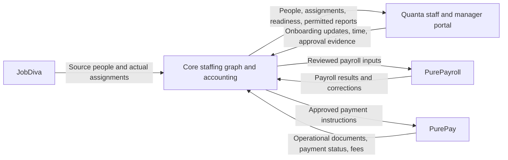

# Thunderhawk: Core with Quanta, PurePay, and PurePayroll

## Payment result correction — October 20, 2026

The current PurePay Emergent source confirmed that the public bill-pay route
emitted `payment.failed` for in-progress wallet payments and `payment.settled`
for a Mercury request acknowledgement. Core now requires explicit agreeing
terminal status plus both bill and payment identities before applying a signed
callback. Missing, malformed or contradictory evidence stays in the webhook
review queue; it cannot release an in-flight AP obligation. Accounting payment
records and submission acknowledgements do not establish cash delivery.
Legacy callbacks without this evidence require detail reconciliation.

The provider patch returns durable payment IDs from wallet/QBO result paths
and emits minimal terminal callbacks only for consistent evidence. Twenty-four
isolated tests execute the captured provider functions; 62 Core disposable
MariaDB checks, 40 callback evidence checks and the existing 47 payload/38 wiring
checks pass. These do not constitute a live payment or full provider-app test.
The helper was saved and read back in Emergent. Chrome disconnected during the
server update attempt, so the server buffer must be checked before further
remote editing; no provider publish or full-app test pass is claimed.

The newly captured native PurePay assignment model can create bills and link
invoice lines automatically. Placement exchange must control those settings
explicitly and preserve its existing financial rules. PurePayroll's employee
routes still require a session; dedicated service scopes and safe projections
remain the next implementation work.

## Implementation checkpoint — October 20, 2026, evening

The user requested an active goal to complete this integration. The goal is
active; the end-to-end operational pilot is not complete.

Live checks in the authorized Chrome sessions established:

- Core's Thunderhawk placement page shows 120 active placements (38 W-2 and
  80 C2C; those two categories do not account for every placement).
- PurePay's Thunderhawk Technology Partners organization is present. Its
  setup page says payroll processing has not been connected and 28 active
  employees need onboarding review. These are displayed readiness indicators,
  not an audited payroll or headcount reconciliation. No settings were changed.
- The [live PurePay API specification](https://purepay.online/api/v1/openapi.json)
  reports ERP API v1.0.0 and publishes AP/AR, payments, batches and wallet
  routes. It publishes no employee or payroll-run routes. The
  [developer reference](https://purepay.online/developers) documents stronger
  durable idempotency for invoice creation/sending than for its other POST
  routes. The latter cache completed requests only, without comparing bodies
  or serializing concurrent requests. Core must retain its own durable attempt
  and reconciliation controls; a provider idempotency key alone is insufficient.
- Quanta's signed-in session currently shows Driscoll Law. Selecting Master
  did not establish a Thunderhawk workspace. Remote organization verification
  for outbound Core delivery remains outstanding.
- The user identified Emergent as Quanta's editable source. The open
  `clockin-hub-16` project reports the Phase 37 commit `8457190`; the editor
  has three pending changes, so this is not a claim of a clean exact revision.
  The `backend/app/routers/v1/workers.py` source was read through that editor.
- The [live Quanta OpenAPI document](https://helloquanta.app/api/v1/openapi.json)
  reports v1.1.0 and documents worker POST/PATCH plus worksite memberships. It
  exposes no first-class placement/assignment endpoint or namespaced Core-ID
  field. Worker source requires `read:workers` / `write:workers` scopes,
  preserves `external_id` and `employee_id` as independent fields, and accepts
  an inactive worker without a password. An email collision returns 409.
  This evidence verifies the worker request/response shape; it does not verify
  the pilot key's permissions or the remote organization's identity.

This increment adds a Core people-to-Quanta review panel and an encrypted,
tenant-scoped durable delivery ledger. Repeated identical previews reuse an
envelope and idempotency key. Reviews expire; connection/source/remote drift
blocks claims; one active attempt per record is enforced; an unknown outcome
blocks another envelope for that record. Provider errors are retained as safe
codes rather than raw responses containing credentials or contact data.

The worker planner requires explicit identity links, flags existing emails,
preserves both provider ID fields, and proposes only name/phone updates or an
inactive new worker for onboarding. The narrow writer validates the confirmed
response and treats timeouts, unexpected success responses, redirects and
ambiguous provider responses as uncertain. It has no sending API or scheduled
caller yet. The UI explicitly says previews do not send records. This is
deliberate until the Quanta workspace and shared identity/assignment contract
are verified and implemented on both sides; no live records moved in this
increment.

Validation for this increment: 45 worker-publication assertions, 35 isolated
MariaDB delivery assertions, 74 existing Quanta integration assertions and 64
numbering/field-dictionary assertions pass locally. The React production build
passes. These checks use synthetic data or local fixtures; they are not proof
of a live Thunderhawk round trip.

Core runtime commit `4481d969885131e97958aff081a0c25d4b4ee64e` passed all
eight [CI checks](https://github.com/coreflux-creator/CoreFlux/actions/runs/39522153263)
and [isolated staging deployment/acceptance](https://github.com/coreflux-creator/CoreFlux/actions/runs/39522652801).
This includes migration 158 and the earlier numbering migrations. Production
was not updated.

Selected Quanta source files were downloaded through the Emergent editor into
the sibling `Quanta-source` checkout, preserving a baseline before edits.
Six changed files are saved back in Emergent: the CoreFlux contract service,
versioned routes, focused tests, API scope registry, API-key scope model and
server registration. The three existing untracked artifact logs are untouched.
The [Quanta preview API](https://clockin-hub-16.preview.emergentagent.com/api/v1/docs)
now displays all nine new CoreFlux operations and durable-receipt documentation.
No production publish, API-key provisioning or remote commit is claimed.

The contract stores namespaced Core references separately from PurePayroll's
existing `external_id`, supports explicit one-to-one person links and versioned
assignment metadata, and holds unknown write outcomes for reconciliation.
Thirty-eight isolated HTTP/model tests pass locally with real authentication
and scope checks, including tenant isolation, concurrent claims, payload drift,
conditional edits and preservation of access/provider IDs. The remote editor's
Python runner did not start; full-app regression and authenticated preview
acceptance remain outstanding. Registration alone is not a live round trip.

Core now implements a permanent installation namespace and an explicit Quanta
organization confirmation screen. Migration 159 stores the remote workspace
identity and advances a connection revision on reconnect/disconnect. Binding
includes the installation, directory context, key digest, contract and provider
host; an old confirmation cannot survive even a reconnect with the same key.
Identity retargeting is refused once established. Publication previews require
a fresh matching provider context and store the typed person reference.
This increment passes 40 focused checks, 54 disposable MariaDB delivery/binding
checks and the existing 45 publication and 74 Quanta checks. The dashboard
build passes with existing warnings. Commit `9edaad80bd3e30c137dae404c322b5fe323ae79f`
passed [hosted CI](https://github.com/coreflux-creator/CoreFlux/actions/runs/39527038590)
and [isolated staging deployment](https://github.com/coreflux-creator/CoreFlux/actions/runs/39527685302).

The next increment connects Core to the shared metadata contract: a reviewed
person link, then assignment creation and conditional title/date/status edits.
It reads canonical registry numbers from separately authorized people,
placement, client, company and vendor directories. Immutable relationships
cannot be silently replaced. Each send rechecks the binding and both snapshots,
commits an exclusive claim before provider IO, validates the complete response,
and stores the provider receipt atomically with its result (migration 162).
A timeout cannot be bypassed with another click or a changed preview.

The review UI exposes these operations, including ended/cancelled placements.
`COREFLUX_QUANTA_METADATA_DELIVERY` remains off unless explicitly enabled in
that environment; it enables only reviewed identity/assignment metadata.
Worker creation/activation, operational access, onboarding, rates and execution
remain separate. No live provider records have been sent by this increment.
Validation: 62 contract checks and 88 disposable MariaDB checks pass. A local
cross-repository test runs the actual Core PHP client through Quanta's real
authenticated FastAPI handlers with an isolated Mongo mock: 12 exchange,
readback, replay, conflict and isolation checks pass. Quanta's suite now passes
39 tests with that optional companion checkout configured. This is synthetic
contract validation, not a live Thunderhawk acceptance result.

Runtime `8f68486b1aa0bf82732d52aa62875fb8f0b1430a` passed all eight
[CI jobs](https://github.com/coreflux-creator/CoreFlux/actions/runs/39528571278)
and [isolated staging deployment/acceptance](https://github.com/coreflux-creator/CoreFlux/actions/runs/39528812913).
The deployment applied migration 162 and initialized the permanent staging
identity; provider sending remains disabled. The review/confirmation/result UI
was exercised in Chrome using synthetic data and a local response fixture.

Before binding, set one permanent lowercase UUID v4 as
`COREFLUX_INTEGRATION_INSTANCE_ID` in each installation's private configuration
or environment. Staging and production must use different UUIDs; never copy
this value when cloning an environment or change it after publishing records
without a migration review. Missing configuration disables binding/publication,
while the read-only organization check remains available. The isolated staging
installer now has a guarded one-time initializer that stores its UUID in
`private_html/coreflux.integration.php`, retains it on subsequent releases and
includes it in private release backups. It refuses replacement or generation
when prior bindings/attempts exist without their identity. Provider delivery
stays disabled. No API key is provisioned by this setup.

The Quanta Chrome session returned `Not authenticated` when opening Master.
The user has been asked to restore a session with Thunderhawk access; that
reply remains pending. PurePay/PurePayroll source was subsequently located
through the already-open Emergent project, as recorded below.

The next Core increment completes the older Quanta screen's reference alignment:
people search, worker links, creation notices, placement completion links,
routes and time previews use stored P-/PL- numbers. Missing numbers remain
unavailable, and joins respect the authorized people/placement directory.
Fixtures intentionally use P-9001/PL-9002 for database IDs 101/201; the rendered
page and number search were checked in Chrome with synthetic data.

PurePay's existing AP driver now commits its claim before provider IO and only
the fresh claimant may create/pay. Confirmed replays return stored references
without provider IO; interrupted/ambiguous attempts stay in review. Changed
amounts, recipients, effective dates, invoices and credentials conflict. A
separate durable vendor attempt prevents another payment reference from
repeating an uncertain vendor creation. Status polling is tenant-scoped and
checks payment/bill identities. Serialized result updates preserve settlements
and unresolved post-settlement failures. Signed callbacks reject contradictory
IDs, ambiguous matches, changed connections and unbound historical records.
Redirects and unknown collection shapes cannot be treated as success/absence.

Migration 163 adds connection fingerprints to payment/vendor records and a
vendor-attempt ledger. Existing rows deliberately remain unbound: review their
organization and reconcile prior attempts before enabling financial execution.
There is no automatic adoption, expiry or retry of these historical rows.
The binding proves credential continuity, not remote organization identity;
PurePay still needs a verified organization contract and a reviewed rebind flow.

Local validation: 56 real MariaDB driver/callback assertions, 47 payload/error
checks, 38 existing integration checks and 93 delivery/binding/numbering checks
pass. The dashboard builds with its 61 existing lint warnings. Provider IO is
synthetic in these fixtures; no live payment was executed. Runtime
`96ecd35d5b4e852a92391b730bbfa4aa1576efe0` passed all eight
[hosted CI jobs](https://github.com/coreflux-creator/CoreFlux/actions/runs/39531045472)
and [isolated staging deployment/acceptance](https://github.com/coreflux-creator/CoreFlux/actions/runs/39531315383),
including migration 163. Production was not changed.

The current PurePay/PurePayroll source is now located in Emergent's
`beautiful-kalam-6` project, whose Manage screen identifies `purepay.online`
and published revision `8eb8dc9`. The editor branch is
`codex/release-signed-bill-lines-2026-10-15`; the two pending changes are
`.emergent/cron/applied.hash` and `.emergent/cron/webhook-crons`. Selected
current files were preserved in the sibling `PurePay-current-source` checkout;
this is a partial source capture, not an independently verified full release.
No provider runtime change was retained or published.

Source confirms separate session-protected employee/run routes and the public
ERP API-key routes. The integration needs dedicated scoped payroll endpoints,
not a copied human session. Quanta time already retains explicit daily source
references and excludes used/review-held history; preserve that provenance.
Public vendor/bill lists support limit/skip, but payments stop at 1000 rows
without a continuation argument. The wallet payment response omits its payment
ID. Also, `v1_pay_bill` emits `payment.failed` for non-settled wallet responses,
including in-progress results. Correct that event classification and validate
actual financial-result payloads before any live payment acceptance.

Next: verify Thunderhawk's remote organization and configure the authorized
environment for authenticated provider acceptance. Assignment commercial terms,
portal onboarding, time routing and PurePayroll exchange remain unfinished.
PurePay still needs verified complete pagination/response contracts, installation
namespacing, organization acceptance/rebinding, and obligation-level reservation
so an uncertain payment cannot be bypassed by a new Core payment for the same
bill. Provider work can now use the located current source after a fresh
baseline check; preserve its existing work and complete full-app regression.

Decision date: October 20, 2026.
Status: numbering and field-inventory foundation implemented in draft PR #146; the complete live
round trip has **not** been demonstrated. This document does not enable a
connection, provision people, approve time, or run payroll/payments.

## Outcome

Thunderhawk operates through Quanta, PurePay, and PurePayroll while Core proves
it can maintain the complete staffing record, coordinate the workflow, and
reconcile the resulting financial activity. Staff use Quanta to onboard, see
their assignments, enter time, obtain approvals, and access permitted reports.
Core connects those activities to people, employers, placements, clients,
vendors, contract terms, payroll, receivables, payables, and the ledger.

The user's direction is: "use core in parallel with other systems to harden
it. this time for thunderhawk" and "push people and assignment data OR pull
from quanta." The named payroll execution application is **PurePayroll**.

Quanta is the operational front door to this shared record. Core is the
canonical hub for identity, staffing relationships, and consolidated financial
lineage. Bidirectional integration means each app can originate the actions it
owns; it does not mean every app can overwrite every field.

These arrows describe the target. Existing direct Quanta-to-Pure flows may
continue during the pilot, with their events also visible to Core. Financial
execution ownership must be explicit before Core starts sending the same work.

## What exists and what remains

| Area | Evidence in inspected source | Remaining work / verification |
| --- | --- | --- |
| JobDiva into Core | Canonical graph, external identity mapping, native assignment import and reconciliation | Validate the selected Thunderhawk cohort and its real Start/Assignment IDs; report missing relationships and stale records |
| Quanta into Core | Catalog reads, reviewed worker-to-person links, provisional Core person creation, effective-dated placement routes, approved-time import with source lineage | Verify nonempty Thunderhawk records and approved hours in the deployed version; expand beyond time to controlled onboarding/assignment changes |
| Core into Quanta | Reviewed worker proposals, encrypted delivery ledger and narrow writer implemented; no delivery caller enabled | Verified remote workspace, shared identity and assignment endpoints, reviewed sending and reconciliation, access/onboarding status, correction feedback and portal reports |
| Core and PurePay | Connection management, AP payment driver, vendor/bill/payment validation, idempotency, status polling and webhooks | Verify Thunderhawk organization/permissions; reconcile PurePay-originated documents and results, including fees/returns, to Core. AR/collection exchange needs its own verified contract |
| PurePayroll and Quanta | Preserved PurePay repository contains people linking/push, approved hours, payroll prefill, contractor billing, customer invoicing, worksite/client exchange, PTO and approval operations | Match source to the deployed release and inspect Thunderhawk's enabled flows before changing them |
| Core and PurePayroll | No complete dedicated Core-to-PurePayroll service contract established by this audit | Confirm or implement organization-scoped employee, assignment, payroll-input and payroll-result APIs; add Core adapter and reconciliation |
| Cross-app control | Core has external mappings and source history | Field ownership, durable delivery, workspace identity, per-workflow execution owner, conflict queue, and a shared reconciliation view |

Core source audited at `43b987313f1d5d24c05e902dac7c0b16d836e2dd`.
PurePay/PurePayroll source audited at
[`cc2bbf07692bb6e0f7bd960dd8640bfc8b038592`](https://github.com/coreflux-creator/PurePay/tree/cc2bbf07692bb6e0f7bd960dd8640bfc8b038592).
That repository's README explicitly calls it preserved source, not a deployed
release. The live PurePay page inspected on October 20 displayed build
`nogit-1020.2042`; no correspondence to that Git commit was established. Its
selected account was the platform workspace, not Thunderhawk, so this was not
a verification of Thunderhawk's integration settings or execution mode.

Local baseline checks passed: Quanta integration 74, PurePay payload contract
41, and PurePay integration 38 assertions. They use test seams with database
access disabled. They do not prove live write access or a production round trip.

## Record and workflow ownership

| Record or action | Authoritative responsibility | Exchange and conflict rule |
| --- | --- | --- |
| Person identity | Core canonical person with external references | Bootstrap from JobDiva or reviewed Quanta data; link existing PurePayroll employees and Quanta workers before creating records. Email/name can suggest a match, never silently merge |
| JobDiva assignment identity | JobDiva actual Start/Assignment record | Preserve its opaque ID. A candidate, requisition, application, or inferred person/job pair cannot become a JobDiva assignment |
| Placement and commercial terms | Reviewed Core staffing graph | Preserve employer/legal entity, end client and vendor chain, worksite, classification, manager, dates, pay/bill rates and their effective dates. Quanta/Pure updates to these terms become reviewable proposals |
| Quanta-origin assignment | Core reviewed placement after source validation | Import the source work context, then link to an existing placement or create a reviewed Core-origin placement. Do not fabricate JobDiva provenance or infer commercial terms from a worksite name |
| Onboarding | Quanta interaction; Core readiness record; PurePayroll payroll setup | Exchange completion/expiry/status and restricted document references. Keep task history and the responsible reviewer. A completed portal checklist alone cannot activate payroll |
| Profile changes | Field-level policy | Worker self-service contact changes can return from Quanta with actor/version evidence; identity, employment, rates and bank/tax changes follow the responsible system's review process |
| Time and source approval | Quanta source events and authorized approver | Core retains time components, work dates, assignment route, approver and revision. Existing import remains pending review until an explicit trusted approval mapping is implemented |
| Payroll execution | PurePayroll | Core supplies reviewed assignment/rate/time inputs and receives actual run/employee results. Core estimates are comparisons, not replacements for the executed payroll |
| Payment execution | PurePay for the selected workflow | Retain approved Core instruction, provider bill/payment IDs and all status changes. Submission/acceptance is not settlement; failure, return, refund and reversal remain distinct |
| Financial records and reporting | Core canonical accounting engine with linked subledgers | Import observed actuals into the comparison workflow, then post only through the normal approved accounting protocol. No direct GL table writes |
| Portal visibility | Core permissions plus Quanta portal roles | Staff see their permitted details; managers see assigned teams/clients. Pay rates, bill rates, margin and sensitive onboarding information require separate authorization |

Use the existing StorageService, MailService, RBAC and accounting posting
protocol. Bank credentials, tax identifiers and private payroll documents are
not general portal fields. Synchronize only required status or authorized
references; do not copy every sensitive field into every app.

## Identity and delivery contract

### Standard numbers and party identity

The October 20 scope addition requires field alignment across all five apps,
including standardized person and placement numbers. The approved client
and vendor design uses unique role numbers attached to the existing canonical
identity. The implemented prefixes below preserve existing `P-` and `PL-` values. Examples are illustrative, not newly assigned records.

| Business reference | Example | Identity and lifetime |
| --- | --- | --- |
| `person_number` | `P-333` | One canonical person; remains the same across assignments, classification changes and rehire |
| `placement_number` | `PL-810` | One assignment/engagement; a different assignment gets a new number. Rate changes and amendments preserve the number and add effective-dated versions |
| `company_number` | `CO-145` | One canonical company; shared across its client, vendor, MSP, referral and other roles |
| `client_number` | `CL-87` | A stable client-role record linked to the company; distinct from a billing-account or end-client relationship on a particular placement |
| `vendor_number` | `V-53` | A stable payable-party record linked to the company, or to the canonical person for an individual vendor |

A company that is both client and vendor can therefore have `CO-145`, `CL-87`
and `V-53` without being duplicated as two unrelated companies. A 1099
individual must not acquire a fictitious company merely to receive a vendor
number. Multiple remittance accounts, client sites, contracts or employer
relationships remain separate linked records, not extra identities inferred
from matching names.

The current source already has numeric IDs for `people`, `placements`,
`companies`, `staffing_clients` and `ap_vendors_index`; `company_roles` supports
multiple company roles. Client and business-vendor records have company
bridges. At the initial audit, `P-<id>` and `PL-<id>` were assembled by UI/export
code; this draft now persists them as governed business references. The existing
`people_employees.employee_number` is a separate employment/payroll reference,
not a substitute for the canonical person number.

Implementation requirements:

- Keep existing database keys and foreign keys. Expose explicit, read-only
  business-number fields through APIs, screens, search, exports and reports.
  Backfill established person/placement labels without renumbering them.
  Persist assigned numbers so migrations do not redefine them from a new key.
- Numbers are immutable and never recycled. Enforce uniqueness in the owning
  directory/workspace plus entity type, including archived records. A shared
  people directory supplies the person number; consumers do not allocate a
  second number for that person. Cross-app references also carry the Core
  instance, owning workspace and entity type, so a bare number never resolves
  across tenants or test/production environments.
- Allocate atomically with database uniqueness protection; concurrent imports
  must not use an unprotected `MAX + 1`. Sequences may have gaps. Do not encode
  year, name, client, worker classification or mutable employment details.
- Preserve JobDiva IDs, Quanta worker/worksite IDs, PurePayroll employee IDs
  and PurePay vendor/customer IDs separately, scoped to the source connection
  and record type. Do not replace provider IDs or use a single `external_id`
  slot to represent all systems. A legacy placement reference such as
  `PL-2004` is not automatically the Core placement number `PL-810`.
- Core supplies its number as a dedicated supported reference in the other
  apps. If the destination lacks such a field, retain the cross-reference in
  Core and specify the required API change. Do not overwrite an existing
  Quanta `external_id` used by PurePayroll, or insert IDs into a person's name.
- Merges retain the retired number as an audited lookup alias to the survivor;
  no number is reassigned. Keep historical document snapshots and external
  lineage. Ended placements are not reopened just to reuse their numbers.
- IDs are references, not credentials or permission grants. Resolve them only
  within the authenticated tenant/directory and the caller's permitted scope.

### Field alignment contract

Field alignment is a prerequisite to writes, not a promise that every field
belongs in every app. Maintain a versioned dictionary with **one row per
field and destination**. The groups below define coverage; they are not a
claim that a complete deployed field-by-field mapping already exists.

Each dictionary row records the canonical field and definition, current Core
storage/API path, actual source and destination paths, type/unit/enum,
required stage, null/clear behavior, owner and permitted editors, direction,
effective dates, validation/conversion, sensitivity, conflict rule, verified
API version and sample-based test evidence. Give every field an explicit
disposition: mapped, transformed, retained only at source, restricted, or
unsupported with a tracked gap. No silent omissions or invented remote paths.

| Coverage group | Fields and distinctions to align |
| --- | --- |
| Identity and references | Person, placement, company, client and vendor numbers; internal references; remote organization/record IDs; employment/employee number; job/requisition, assignment, PO and VMS references |
| Person and employment | Legal/preferred names, contact details, status, employer, employment dates, worker classification, manager and payroll-employee link. Keep person, employment and placement status distinct |
| Companies and roles | Legal/trading names, aliases, company roles, client/vendor links, contacts, addresses, status and contract references. End client, bill-to customer, prime vendor, MSP, subcontractor and employer must remain distinct relationships |
| Placement | Person, actual assignment identity, job/title, employer/legal entity, client/vendor chain, start/end/actual-end dates, status, recruiter, account manager, approver, worksite and remote policy |
| Dimensions | Branch/business unit, department, service line, cost center, work country/state, workers-comp class and source worksite/dimension codes; preserve IDs, codes and labels separately |
| Economics | Effective pay/bill rates, rate unit, currency, OT/DT treatment, fees, adders, referrals, commissions, payment terms, paid-when-paid rules and operating cycles; approved rate snapshot and correction reason |
| Onboarding and documents | Required task, owner, completion/review/expiry state, document reference/version, onboarding readiness and payroll readiness; distinguish invite, login access and business approval |
| Time and approvals | Source entry/component ID, worker/placement, work date/time zone, minutes, regular/OT/DT/PTO categories, billability, pay period, submission/approval state, approver, approved revision and correction links |
| Payroll | Payroll-employee link, run/period IDs, earnings, deductions, employer costs, taxes/liabilities, payment status, actual results, pay-stub reference and correction versions |
| Billing, AP and payments | Customer/vendor and placement references, invoice/bill/line IDs, quantities/rates/currency, service periods, due dates, payment allocation/status, fees, credits, returns, reversals and ledger links |
| Audit and custom fields | Source/actor/revision, effective dates, last successful sync, field provenance, exceptions, stable custom-field key, type and option codes; localized labels are not mapping keys |

Conversions must be explicit. For example, display `United States` while
exchanging the agreed country code `US`; do not put a display name or foreign
numeric country ID into Core's two-character country column. Keep absent,
explicit null, empty string, false and zero distinct. An absent source field
does not erase a known value; explicit clearing follows field ownership and
required-field validation. Never fill missing rates with zero to pass import.

Dates, timestamps/time zones, decimal money, currency, rate units, percentage
scales and time units must have documented transformations and precision.
Unknown statuses or option codes become visible exceptions. An employee's
default rate cannot flatten multiple placement rates. Customer and end-client
fields cannot be collapsed because one source calls both a "client."

Reuse Core's existing integration field-map infrastructure and writable-target
registry where applicable. Add the ownership, coverage and validation metadata
needed by this contract; do not create disconnected mapping rules for each
screen. New canonical number fields must be protected from arbitrary source
field mappings and normal user edits.

Acceptance requires a complete inventory disposition for all scoped standard
and custom fields, zero missing/duplicate canonical numbers in the pilot
cohort, unchanged legacy references, preserved dual-role company and individual
vendor links, collision-safe concurrent allocation, tenant-isolated lookup,
and round-trip tests for enums, units, nulls and effective-dated changes.

The staffing graph is the backbone: person -> effective-dated placement ->
employer/client/vendor relationships -> terms -> time -> financial documents
and execution results. A person may have multiple placements. A worksite or
client is not itself a placement, and a single employee default rate cannot
replace assignment-specific history.

Every exchange must identify the Core tenant, owning legal entity, remote
organization/workspace, connection, entity type, opaque external ID, and
canonical Core ID. Shared people directories do not grant access to another
tenant's placements or financial records.

Core's `external_entity_mappings.direction` values include `two_way`, but that
field is informational, not a functioning conflict policy or sync engine.
Its current uniqueness is tenant/source/type, with at most one external ID per
internal record. Verify connection/workspace scoping before reusing it for
multiple remote organizations. Generic mapping upserts can move identity;
portal sync must instead reject a conflicting link and require reviewed merge.

PurePayroll's preserved Quanta worker push sets Quanta `external_id` to the
PurePayroll employee ID. Preserve existing references and add a namespaced
Core cross-reference; never overwrite that field with a Core person ID or
create a second worker because the ID conventions differ.

Deliveries require durable inbox/outbox records, stable idempotency keys,
source event/revision and payload hash, originating app/actor, correlation ID,
attempt history, and final acknowledgement. A timestamp alone cannot resolve
concurrent edits. Reject stale revisions, suppress echoes, and put conflicting
changes into review. A timeout after a remote write has an uncertain outcome:
look up the existing result before issuing another create.

Incremental polling needs complete pagination and persisted cursors, with
webhooks where supported and periodic reconciliation for missed events.
Expose failures, stalled records and freshness to operators. End/archive
records with effective dates; do not cascade a source deletion through payroll
or accounting history.

## Parallel operation without duplicate financial effects

The preserved PurePayroll connector can turn Quanta time into payroll prefill,
contractor bills **and** customer invoices. Merely adding Core's downstream
generators to those same hours is not a safe parallel test.

Maintain one recorded execution owner for each tenant/legal entity, cohort,
period and destination workflow: payroll, contractor AP, client AR, and payment
release. Also retain source entry/component/revision IDs to detect duplicate
effects across periods, overlapping batches and both integration paths.

Initially, the current operational path continues executing. Core observes
the same source events, produces comparisons and exceptions, and reconciles
the existing results. Core can publish reviewed catalog/assignment changes
once ownership is established; monetary execution does not have to move at
the same time.

To make Core the sender for a selected workflow, first demonstrate matching
inputs/results, drain or reconcile in-flight work, disable the corresponding
automatic generation for that cohort in the former path, and record the
effective cutover boundary. If the apps cannot isolate generation by cohort,
Core remains in comparison mode for that destination until that capability
exists. No blanket disconnection of the live operational layer is required.

Approval evidence in Quanta may satisfy a Core time approval only after the
approver, permitted placement scope and approved source revision are verified.
Payroll approval, invoice release and payment release remain separate business
decisions. Post-approval time or rate corrections use superseding versions and
the applicable reversal/adjustment workflow, never silent history rewrites.

## Delivery sequence

1. **Establish the Thunderhawk baseline.** Verify the Core tenant and legal
   entity, Quanta workspace, PurePay organization and PurePayroll organization;
   confirm deployed versions, credentials/scopes and actual payroll provider
   configuration. Inventory people, assignments, links and currently active
   automatic generation. Record counts, control totals and exceptions in a
   private evidence packet. Do not put worker PII or credentials in this repo.
   Inventory all standard/custom fields and record each field's disposition
   under the field alignment contract above. Reconcile canonical company,
   client and vendor links, then add/backfill governed business numbers and
   expose them consistently. This is required before outbound activation.
2. **Publish and receive people and assignments.** Add a reviewed Core -> Quanta
   preview showing create/link/update/blocked results before sending. Reuse
   existing workers and preserve PurePayroll links. Publish effective-dated
   assignment context through a verified assignment contract; if Quanta only
   exposes worksites/dimensions, specify and implement the missing assignment
   representation in Quanta instead of treating a worksite as the assignment.
   Add the reverse intake path for Quanta-origin onboarding/profile/assignment
   proposals. Persist delivery receipts and make replay safe.
3. **Make the portal useful.** Connect onboarding readiness, permitted
   assignment details, document status and Core-backed reports. Provide
   drill-through and an as-of timestamp. Implement worker/manager access and
   offboarding behavior, including employment end dates and access revocation.
4. **Close the time loop.** Map one source approval to one reviewed assignment
   revision and Core time record. Return accepted/rejected/needs-correction
   status to the portal. Keep regular, overtime, double-time and PTO components
   distinct; reconcile time zones, work dates, pay periods and rate snapshots.
5. **Connect PurePayroll inputs and actuals.** Verify or implement authenticated,
   organization-scoped service APIs in PurePayroll. Core's PHP adapter sends
   reviewed employee/assignment/time inputs with preview support and receives
   run/employee IDs, earnings, deductions, employer costs, taxes/liabilities,
   payment status and correction versions. Preserve restricted pay-stub
   references. Reconcile totals before approved accounting posting.
6. **Complete PurePay document and result exchange.** Reuse the existing AP
   payment rail and settlement controls. Link Pure-originated bills/invoices
   to the same staffing/time lineage. Verify the customer/AR contract
   separately; do not assume AP endpoints cover collections. Reconcile fees,
   partial payments, returns and corrections into the appropriate subledger.
7. **Run and expand the operational pilot.** Use the evidence below to repair
   discrepancies, then expand by cohort and workflow. The pilot is successful
   only when an operator can explain every count/amount difference and trace
   a portal event through the staffing graph to its financial result.

Step 1's numbering and Core field inventory are now implemented in this draft.
Provider identity, endpoint and field ownership verification remains before
step 2's reviewed people/assignment exchange. The acceptance demonstration
below defines the evidence needed for that next slice.

## First end-to-end demonstration

Choose one real active Thunderhawk W2 placement and, if available, one C2C
placement for the AP path. Record exact source IDs and the chosen pay period in
the private evidence packet; no particular worker is selected by this plan.

| Demonstration | Required evidence |
| --- | --- |
| JobDiva -> Core | Real assignment linked to the correct person, employer, client/vendor chain and effective terms |
| Core -> Quanta | Preview and applied result show the same person/assignment; existing PurePayroll worker references survive; replay creates zero duplicates |
| Quanta -> Core | A reviewed Quanta-origin profile/onboarding change returns once, with actor/revision and a visible conflict if Core changed the same owned field |
| Portal | Staff and manager views show permitted assignment details, onboarding readiness and downloadable reports; another tenant/person cannot read them |
| Time | Actual approved source entries map to the correct placement/date and component totals; the approval and rate snapshot can be traced |
| PurePayroll | Draft payroll inputs match Core's approved hours/rates; an existing or normally approved run's actual totals return and reconcile without a second run |
| PurePay | A reviewed AP draft/preview or existing operational bill links to the same work; an existing or normally approved payment's state and fees return without a second payment |
| Core accounting | Comparison report explains payroll cost, liabilities, AP/AR and margin differences, with links to source results and approved posting/reversal records where applicable |

Failure cases are part of acceptance: simultaneous creates; repeated or
out-of-order events; network timeout after a successful write; two assignments
for one worker; backdated rate change; changed/end-dated assignment; missing
worksite/dimension route; changed time after payroll; reversed/failed payment;
wrong workspace; missing permissions; worker offboarding; incomplete pagination.
No unresolved duplicate or cross-tenant effect is acceptable. Count/minute/
currency differences must be zero or individually explained and reviewed.

The demonstration uses real operational inputs and returned results. Synthetic
contract tests are necessary failure-path coverage, not evidence that the
live flow works. Financial actions continue through their normal human
approval and execution steps.

## Source references

- JobDiva: `core/jobdiva/canonical_graph.php`, `assignment_identity.php`,
  `assignment_contract.php`, `sync_placements.php`, `placement_reconciliation.php`.
- Identity: `core/integrations/entity_mappings.php`, migration
  `core/migrations/022_external_entity_mappings.sql`.
- Core Quanta: `core/quanta/client.php`, `identity.php`, `sync.php`,
  `api/quanta.php`, `dashboard/src/pages/QuantaSettings.jsx`,
  [implemented connector notes](quanta-time-integration.md).
- Core PurePay: `core/purepay_adapter.php`, `core/purepay_service.php`,
  `core/purepay_webhooks.php`, `core/payment_rails/purepay_driver.php`,
  `api/purepay_connection.php`, `spec/purepay_schema.json`.
- Preserved PurePay/PurePayroll: `backend/quanta.py`, `backend/quanta_sync.py`,
  `backend/payroll.py`, `backend/native_payroll.py`, and `frontend/src/App.js`
  at the commit linked above. Their presence does not identify the live
  Thunderhawk provider, enabled flows, service credentials or release.

## Implemented foundation — October 20, 2026

Draft code now persists business references in `core_record_numbers`, separately
from every provider's external ID. Existing numeric IDs and P-/PL- references
remain unchanged. Company references use CO-; existing C- searches and typed
company CSV references remain accepted. Client profiles use CL- and AP vendors
use V-. A company may carry both roles; individuals do not require a company.
Numbers are unique within the record directory's tenant and entity type, not
across independent Core installations. Connectors must carry the directory
owner and instance/connection context alongside the displayed number.

Database insert triggers cover manual, CSV and connector writers. Numbers are
reserved even if a source record is deleted. Person/company merges retain the
retired number for exact directory searches and move its alias to the survivor
inside the merge transaction. Imports still require a current target record;
retired IDs are not silently rewritten during CSV updates. Provider IDs are
unchanged. Main directory APIs, UI badges, Quanta's Core lookup lists, raw CSVs
and governed export datasets expose the references. Clipboard badges retain the
legacy numeric ID for existing imports. Tenant-authored export templates keep
their current column selections; platform defaults gain reference columns.

Typed CSV lookups accept the correct number prefix or a bare positive ID.
Mismatched prefixes, conflicting ID/number columns, and values outside the
supported integer range fail preview and commit. Standard CRUD and integration
field mapping cannot assign canonical numbers. Optional broken relationships
return no related number instead of guessing a match in another tenant.

Integration Field Map settings now provide **Download field dictionary**. It
inventories actual columns of the staffing, time, payroll and financial tables
listed in `staffingFieldContractTables`, plus visible active person, company
and placement custom definitions. Missing tables are reported explicitly. The
inventory identifies reviewed Core definitions, types/enums, units, system and
restricted fields, absent/null rules, conflict review and effective-date needs.
Unknown definitions and all remote paths remain marked for review. This is a
metadata inventory and proposed mapping policy; it does not activate new sync
behavior or claim that existing connectors implement every policy already.

### Migration and release order

Apply core migrations 156 (registry) and 157 (platform export columns), then
People 008, Placements 007, Staffing 007 and AP 026. The normal migration runner
orders core before module migrations. Pause writers during migration/trigger
replacement and complete all migrations before serving this code. If any
migration fails, retain the previous application release and resolve the error;
a partially applied number registry is not a supported serving state. Do not
remove registry rows or reset their associated source ID sequences. This draft
has not been deployed to production or the Thunderhawk live workspace.

### Next integration slice

Verify each provider's actual schema, IDs, workspace and supported operations;
complete the field dictionary's remote paths and ownership decisions. Then
rehearse one Thunderhawk person and assignment through JobDiva → Core → Quanta,
return onboarding/time events to Core, and reconcile PurePay/PurePayroll results.
Outbound provisioning, retries/conflict queues and the complete live round trip
remain work to implement and test. Sensitive payroll and bank fields require
specialized access; this dictionary exposes metadata, never those values.

### Validation of this foundation

- 60 focused number/import/mapping assertions passed.
- 48 disposable MariaDB checks passed: backfill, insert triggers, rollback,
  cross-tenant lookup/merge refusal, retired-number lookup, replay, batched
  reads, export-template preservation and custom-field metadata visibility.
- All 112 relevant existing/new smoke scripts and 56 dashboard unit tests passed.
- The full dashboard build passed; existing lint/build warnings remain.
- Hosted deployment and the provider round trip are not validated by these tests.
