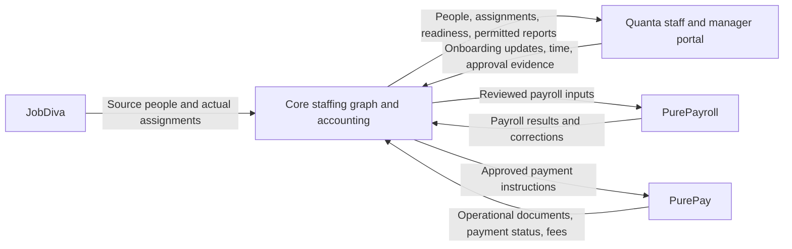

## Quanta onboarding preview browser acceptance - October 23, 2026

The reviewed Quanta onboarding/document candidate is now installed in the
existing clockin-hub-16 development preview. The final unpublished review is
ef354ff52a3dc389a412152ac7557fcd99765ce9. The guarded restart preserved shared
HEAD/index, unrelated source, protected settings and existing records across
ten collections. No provider production publication occurred.

An existing Acme demo worker submitted a synthetic PDF and acknowledgement in
Chrome. The exact 722-byte PDF checksum, one retained upload and two pending
receipts were verified through native storage. Reload preserves the receipts;
staff-only review remains unavailable to the worker. A misleading resubmission
prompt after intake was disabled was fixed; all twelve existing mounted UI
checks pass and the corrected screen was verified. Intake was enabled only
for Acme during the test, then the original environment was restored exactly.
Background jobs remain disabled. No key, permission, invitation or financial
record was created by this acceptance. The fixture adds a synthetic onboarding
case, its two receipts, one upload request and one private file.

This proves the worker-side browser flow in Quanta. It does not establish Core
API delivery, authenticated retrieval into Core S3 or the actual Thunderhawk
round trip. Those remain open, along with the PurePayroll preview installation,
reviewed release settings and actual pilot placement readiness. Core private
storage activation below remains valid. Evidence is saved in
deploy/quanta-onboarding-preview-20261023.json and the companion source mirror.

## AWS private storage active in isolated Core pilot - October 23, 2026

The user-approved no-console identity and user-created access key are now in
use by the isolated Cloudways pilot app 6707602 / muzqvdvqbx. Credentials were
delivered over SSH to a private 0640 file outside the webroot; no secret was
printed, committed, downloaded locally or sent through GitHub.

Cloudways PHP-FPM disables putenv. The first environment-based activation was
rolled back, then the private-configuration adapter was tested and installed
without changing host security. CI 39985491754 passed all nine jobs for commit
58b2eda8822c70ed97f8142c79fd875b37653416. The deployment is a narrow patch of
StorageService and Quanta document readiness over the existing 9f656c59 runtime,
plus the private host bootstrap; it is not a new full-Core release. Private
rollback copies and the activation receipt remain on the pilot host.

Fourteen actual S3 checks passed from CLI and PHP-FPM using the active backend:
encrypted/versioned uploads, bounded reads, reserved-write replay protection,
signed/expired/anonymous downloads, HTTP/encryption rejection, presigned POST
and key binding, and version-preserving soft deletion. Registry and module
document references were zero before activation. All 42 invoice-cache PDFs
were hashed under PHP-FPM and remained readable with unchanged hashes.
Temporary web probes were token-protected and removed. Synthetic S3 historical
versions are retained; no permanent deletion was performed.

Quanta storage readiness now passes, but document intake remains disabled.
Real browser CORS/portal and tenant/permission document checks, provider release
gates, pilot placement setup, and the full Thunderhawk/PurePayroll round trip
remain outstanding. Production and the Arabella pilot were not changed.
Non-secret evidence: deploy/aws/coreflux-documents-pilot.receipt.json.
Older setup checkpoints below are historical.

## AWS pilot storage created - October 23, 2026

The recovered AWS account 041304781980 is active. The user selected the Free
plan, which shows $100 in credits and expires April 23, 2027 or earlier when
credits run out. A paid-plan upgrade has not been authorized.

CloudFormation stack coreflux-documents-pilot in us-east-1 completed at
2026-10-23 11:40:39 -04:00. Its five resources are the private versioned bucket,
KMS key/alias, restrictive bucket policy, and unattached runtime policy.
AWS template validation and change-set deployment validations passed.
Termination protection was enabled separately after execution because the
change-set creation flow did not preserve the selected setting.
Non-secret account, stack, bucket, key ARN and policy ARN outputs are recorded in
deploy/aws/coreflux-documents-pilot.receipt.json.

The Core service identity is prepared at AWS Review and create, with no console
password and only the pilot runtime policy. Creation awaits action-time user
confirmation for the new security-sensitive access. No service user or access
keys have been created. No Core host settings changed; storage acceptance and
real document exchange remain outstanding. Keep Quanta document intake off.
The older preparation checkpoint below is historical; storage is now provisioned.

## Private storage setup prepared - October 23, 2026

The user answered "no, there isnt'" to the existing AWS account/bucket question.
Private document storage is confirmed absent; do not repeat that question.
Provisioning and account access are now the next storage prerequisite.

deploy/aws/private-documents.cloudformation.json prepares an isolated pilot
bucket, KMS key/alias, bucket policy, and unattached server access policy.
cfn-lint 1.58.0 passed for us-east-1. No account-level validation, cloud resource
creation, credentials, host settings, or live document acceptance occurred.
The existing SDK package smoke could not run in this local checkout because its
Composer dependencies are not installed; this is not a new runtime failure.
The previously green staged runtime remains 9f656c59.

memory/AWS_SETUP_GUIDE.md now explains exact configuration, server credential
delivery, existing local-file inventory/migration, and synthetic acceptance.
STORAGE_DRIVER is global: pointing existing registry keys at an empty bucket is
not a safe per-worker enablement. Keep Quanta document intake off until the
private vault and its web-process access have been verified. The template does
not grant an identity access, activate a legal retention period, or establish
malware scanning or production compliance.

Release settings, pilot placement classification, accessible Core session,
Quanta signing configuration, and the real cross-system round trip remain open.
The overall integration goal remains blocked and is not complete.

## Quanta webhook contract correction - October 23, 2026

The latest unpublished PurePay review is d942c386a008455e4c5a80e478e253aceb9efa6d
on codex/coreflux-quanta-webhooks-20261023, above setup review
aca0895ce9c42d376183b2d3435e3ed6582ddeb0. The eight-file review uses a private
Git index. Shared release 9cd71c83, working source/index, prior review refs and
protected configuration remain unchanged. No deployment or settings save ran.

The actual Quanta dispatcher uses X-CH headers and signs timestamp + '.' + raw
canonical JSON with HMAC-SHA256. The old PurePay receiver read different headers
and accepted unsigned notifications if no secret was configured. The candidate
requires the signing secret and a matching configured workspace ID; rejects
missing/invalid/stale signatures, foreign workspaces, mismatched event headers,
malformed/ambiguous JSON and streamed bodies over 256 KiB before receipt/import
effects; and preserves review/select and automatic-sync policy. The settings
screen explains that missing signing configuration blocks notifications. A
background task is reported as queued, not already synced.

All 39 checks passed against the full hosted app with synthetic in-memory data
and zero external socket attempts. This includes signed retries in reviewed mode
without worker/time/payroll writes or another company's receipt changes. The
complete 448-file frontend compiled without warnings in a private source copy.
The unchanged sender produced the golden signature fixture. These tests establish
authentication and reviewed-mode behavior, not live automatic-import delivery or
exactly-once execution; the existing background sync/catch-up mechanism remains.
Evidence is in PurePay-current-source/verification/quanta-webhook-*-20261023.*.

A fresh read-only live check still found two Thunderhawk Quanta administrators
and no workers. PurePayroll remained connected in review/select mode with auto
catch-up off, no imported workers/time, and 33 employees not in Quanta; the signing
secret and workspace ID were unset. Those settings were not changed. The Core
pilot still redirected to login in the accessible Chrome session. The existing
questions for release settings, pilot employing entity/business unit/WC class,
Core access and private document storage remain pending. Shared-directory JobDiva
projection is not a blocker for Thunderhawk's verified tenant-2 directory.

Core's staged runtime remains 9f656c59a256514bb5ddbca6a2b51e17ed085857. Quanta's
latest unpublished review remains a0ff1371274f35c84a831fd61958b0a9cab4ee92.
Next: resolve the existing operational prerequisites and demonstrate the actual
Thunderhawk round trip; do not substitute more unrelated refactoring for it.

## Quanta upload recovery checkpoint - October 23, 2026

Quanta's current unpublished hosted review is
`a0ff1371274f35c84a831fd61958b0a9cab4ee92` on
`codex/coreflux-onboarding-document-recovery-v2-20261023`, based on the prior
document review `acee0f1a5592ccb2bb46a965fe50671b393076b9`. Local mirror:
`31419ecd3ff4902af6086f2e9b4a628c1fe3095b`. Every saved source matches the local
UTF-8 candidate. The earlier retained recovery ref `6d9844ca` is superseded
because its frontend transfer had an encoding mismatch.

The full hosted application passed 165 backend checks and frontend compilation
with zero external socket attempts and no live database. Local checks passed
164 backend cases, including native Core PHP attestation/document boundaries,
and 12 mounted portal cases. Shared development HEAD, source, index and protected
configuration were preserved; no checkout, deployment or permission change.
Receipts live in Quanta-source/verification/onboarding-document-recovery-v2-*
20261023.json (acceptance and review).

Each Quanta upload request and physical GridFS attempt is durably recorded before
IO. Completed copies are verified before reuse; a lost write acknowledgement or
failed receipt checkpoint can recover the original copy. A lease expiry permits
a new physical ID without overwriting an interrupted writer. Late/partial writes
remain private and attributable, with one selected file and one case receipt.
Missing or altered selected copies cannot be recreated silently. The worker can
refresh and resume the original request with the same file, and read safe transfer
history even after upload is disabled or the publication is withdrawn.

This completes the new-upload recovery counterpart to Core's staged reservation
and atomic vault import. Legacy untracked files and retention/purge policy remain
open, along with malware scanning and actual provider-to-private-S3 acceptance.
Core staged runtime remains `9f656c59a256514bb5ddbca6a2b51e17ed085857`; this
checkpoint changes documentation only. Production is unchanged.

The available Chrome session still redirects PL-864 to Core sign-in after the
latest user response. Existing questions about release settings, PL-864 legal
entity/business unit/WC class and the intended private S3 account/bucket remain
unanswered. The Thunderhawk live round trip remains incomplete. No real payroll,
payment, financial posting, document purge or production cutover occurred.

# Thunderhawk: Core with Quanta, PurePay, and PurePayroll

## Durable document transfer recovery - October 23, 2026

Core runtime `9f656c59a256514bb5ddbca6a2b51e17ed085857` passed all nine
[CI jobs](https://github.com/coreflux-creator/CoreFlux/actions/runs/39888945027).
[Isolated staging acceptance](https://github.com/coreflux-creator/CoreFlux/actions/runs/39889272095)
also passed for this exact revision, including 17 native onboarding HTTP checks,
accounting lifecycle, split receipts, 61 credit checks and log-only delivery.
The retained-file HTTP history read works without provider or storage access.
Bundle: `index-DE24O-6a.js`.

Migration 173 adds a tenant/case/person/worker-receipt transfer record committed
before file IO. It reserves one physical key and binds the receipt, descriptor,
provider connection and storage namespace/encryption configuration. Rotating S3
credentials does not change storage identity; changing the bucket or KMS key does.
Retries freshly validate provider authority, then verify and reuse the reserved
copy. Conditional writes never overwrite a file. A lost object-write response is
reconciled through exact stored-byte verification. Missing or altered previously
verified copies are held for reconciliation; retries do not replace them.

The stored-file checkpoint commits separately from business registration.
Registry/document/case/history/transfer registration still commit together; a
business rollback leaves the verified copy attributable and reusable. Interrupted
source fetches and failed file checkpoints keep the original reservation. New
Core copies can therefore be traced even when the final import fails. This does
not make physical storage and SQL one distributed transaction.

The People onboarding panel can read retained transfer history directly from
Core, including when Quanta is unavailable. It shows unconfirmed, prepared and
registered states without file paths, signed URLs or storage/binding fingerprints.
The read requires the current case and directory scope. No file is deleted or
approved by this recovery/history workflow. Retention/purge policy and Quanta's
own unreferenced GridFS attempts remain separate open work.

Native MariaDB checks now pass 104 document-intake assertions, including committed
reservations visible to an independent connection before physical writes,
source-fetch failure, lost PUT acknowledgement, checkpoint interruption, altered
or missing objects, backend changes, migration replay, tenant/directory isolation
and concurrent import. All 110 UI checks pass, including provider-independent
history and stale case-response rejection. Local storage checks pass 39 assertions.
The packaged S3 SDK checks namespace/encryption identity and conditional encrypted
writes without network IO. UI proof: `quanta-document-recovery-synthetic-20261023.png`.

Live intake remains disabled. Core S3/KMS configuration and real object access
are unverified; the user has been asked which existing AWS account/bucket to use
or whether setup is still required. The existing Core sign-in, release-setting
confirmation and PL-864 field questions remain pending. No provider candidate,
protected setting, production release, access grant or financial execution changed.
The previous checkpoint below remains valid for the initial import implementation;
its untracked-Core-copy caveat is superseded for the new reserved-write path.

## Quanta document vault intake - October 23, 2026

Core runtime `4ae64ebef77506621d0dc94504405d4112fdd37a` implements the
previously open document-to-vault step. All nine
[CI jobs](https://github.com/coreflux-creator/CoreFlux/actions/runs/39886695711)
passed. [Isolated staging acceptance](https://github.com/coreflux-creator/CoreFlux/actions/runs/39886917779)
also passed for that exact runtime: 16 native onboarding HTTP checks, accounting
lifecycle, split receipts, 61 credit checks and log-only delivery. The new route
rejects browser-supplied storage identity and stays disabled before provider or
storage IO. Deployed bundle: `index-Cf-okM0C.js`.

The employer selects an authenticated Quanta document receipt. Core rechecks the
worker, person, placement, workspace binding and delivered requirement before
retrieval, after physical storage, and under the final database locks. Bounded
PDF/PNG/JPEG bytes must match receipt size, type and SHA256. The private storage
write uses a generated person-owned path and refuses overwrite. The original
Unicode filename is retained as display metadata. Registry entry, person document,
onboarding evidence, case revision and durable import receipt commit together.
An identical retry returns the committed document without another file transfer;
concurrent commits produce one registered document and one history event.
Imported evidence remains submitted for separate employer review. No signature,
document classification, worker activation or payroll authority is inferred.

Native MariaDB acceptance passes 53 document-intake checks, including changed
worker/directory/connection/placement authority, withdrawal, altered stored bytes,
transaction rollback and overlapping requests. The existing real-storage vault
suite now passes 30 checks. Local checks pass 55 bounded-transfer checks, 33
vault-input checks, 33 storage checks and nine mounted portal UI checks. The
packaged AWS SDK verifies encrypted conditional byte-upload requests with no
network IO. Three native PHP-to-Quanta HTTP cases pass PDF/PNG/JPEG transfer with
scope and identity revocation. Dashboard build and all 108 mounted UI checks pass.
Synthetic UI evidence: `quanta-document-intake-synthetic-20261023.png`.

Document intake remains default-off with exact Core tenant and Quanta workspace
allowlists, explicit document-management authority and a separately scoped
provider capability. HTTP intake additionally requires configured private S3
storage and KMS. Production CLI inspection still reports local storage and no
bucket/KMS key; web configuration and real object access remain unverified.
Quanta's hosted document review remains unpublished at
`acee0f1a5592ccb2bb46a965fe50671b393076b9`; its runtime was not changed here.
The prior read-only adapter notes below describe the earlier checkpoint.

Physical storage and SQL are not a distributed transaction. Failed, uncertain or
concurrent attempts can leave private unreferenced objects. Reconciled cleanup,
malware scanning and an actual provider-to-Core-vault live transfer remain open.
No production activation, provider publication, new access grant, real payroll,
payment or financial posting occurred. The existing release-settings confirmation
is still pending. Core redirected PL-864 to sign-in again; a fresh login was
requested. Its employing legal entity, business unit and WC class remain unconfirmed.

## Quanta private document candidate and Core reader - October 23, 2026

Quanta's unpublished hosted review `codex/coreflux-onboarding-documents-20261023`
is `acee0f1a5592ccb2bb46a965fe50671b393076b9` (parent `7bdfa656c34143a469119178618ddf514c800332`).
Its full application passed 152 isolated backend checks and the complete frontend
build, with zero external socket attempts. The shared development checkout and
configuration were preserved. The local mirror is `7a694de`; acceptance/review
receipts are retained in its verification directory. No provider publication,
new API-key grant, invitation, payroll or financial execution occurred.

The candidate adds authenticated worker PDF/PNG/JPEG upload, private GridFS storage,
conditional submission receipts, and separately scoped Core retrieval. It defaults
off, with an exact provider-workspace allowlist. Signature checking is not malware
scanning. Failed writes or concurrent submissions can leave private unreferenced
objects; reconciliation/cleanup remains open. Worker uploads do not approve tasks.

Core's matching read-only adapter is `core/quanta/onboarding_documents.php`.
It requires `COREFLUX_QUANTA_ONBOARDING_DOCUMENTS=1` and exact numeric operating
workspace IDs in `COREFLUX_QUANTA_ONBOARDING_DOCUMENT_TENANTS`; neither is enabled.
It validates worker/case/task/publication identity before private retrieval,
checks the separate document capability, bounds bytes and headers, rejects
redirects, and verifies exact size, format, receipt ID and SHA256. Existing
attestation import still rejects document receipts. There is no UI activation
or database write in this increment.

Validation: 55 PHP document checks, 23 existing onboarding contract checks, ten
mounted worker UI checks, and four native PHP-to-Quanta HTTP cases (attestation
plus three document formats, with scope removal and identity revocation).
Provider checks use isolated Mongo/GridFS fixtures; no live database is claimed.

Next: compose vault registration, onboarding evidence, history and the import
receipt in one Core transaction after file retrieval/storage, with authority
rechecks and replay/rollback tests. Hosted private S3 configuration/object access,
provider release/scopes/bindings and the real Thunderhawk round trip remain open.
The earlier Live/Test setting confirmation and PL-864 employer/branch/WC details
remain outstanding. Core runtime 441bc48fb7c65c28d72dc3adb0071bd9a75ad0af passed all nine
[CI jobs](https://github.com/coreflux-creator/CoreFlux/actions/runs/39884215613)
and [isolated staging acceptance](https://github.com/coreflux-creator/CoreFlux/actions/runs/39884474048).
Staging includes the reader, with document intake disabled and no vault import
endpoint. Existing onboarding HTTP, accounting lifecycle, split receipt, credit
and log-only delivery acceptance passed. Production remains unchanged. The
integration goal remains active.

## Person document vault fixes staged - October 22, 2026

Runtime 56bc0b53004055e5d7ae87aa17ce0e99b06ed98b passed all nine
[CI jobs](https://github.com/coreflux-creator/CoreFlux/actions/runs/39880381963)
and [isolated staging acceptance](https://github.com/coreflux-creator/CoreFlux/actions/runs/39880650289).
The People vault now binds uploads and registration to the current directory
owner and exact person. It verifies stored bytes before registration, preserves
idempotent retries, rejects stale ownership or retired objects, and commits
document/registry/resume changes together. Metadata edits cannot reassign
identity or storage. The browser upload response and packaged S3 loading/signing
contract are repaired, including bucket-owner-enforced compatibility.

CI passed 30 input/ownership checks and 27 MariaDB checks against actual local
stored files, alongside the existing 60 onboarding and 29 portal-exchange checks.
The installed AWS SDK passed signing checks without object IO. Staging passed
14 native onboarding HTTP checks, accounting lifecycle, split receipts, 61 credit
checks and log-only delivery. This is not hosted S3 or live Thunderhawk acceptance.

The [read-only production storage inspection](https://github.com/coreflux-creator/CoreFlux/actions/runs/39880275057)
on d40f7364 reports a local driver and no configured S3 bucket or KMS key in CLI.
Web configuration and real object access remain unverified. Full Core browser
document upload requires configured private S3 storage; no local fallback was
enabled. Quanta worker file upload/transfer is still open. Production was not
activated, and provider candidates remain unpublished.

The existing Live/Test setting confirmation remains pending; both browser forms
are preserved unsaved. PL-864 still needs its legal entity, branch/business unit
and WC class. The user's admin tab displayed a cached workspace, then redirected
to login when placements loaded. No usable Core session is claimed. These
release and pilot requirements remain open; the integration goal is active.

## Core-to-Quanta onboarding exchange staged - October 22, 2026

Core runtime ce7d2b3bca55f98a96d893084628ebb06de4ea56 passed all nine
[CI jobs](https://github.com/coreflux-creator/CoreFlux/actions/runs/39876630812)
and [isolated staging acceptance](https://github.com/coreflux-creator/CoreFlux/actions/runs/39876938832).
The People onboarding screen now reviews and publishes exact requirements,
recovers uncertain acknowledgements, and imports authenticated Quanta worker
attestations as submitted evidence for a separate employer decision. Current
workspace, person, assignment, source and task versions are checked before
exchange. Replay preserves the original receipt even after employer review.
Outbound publication defaults off. Private documents remain in Core's vault;
portal file upload/transfer and hosted object verification are still open.

The database fixture passes the existing 60 onboarding checks plus 29 new portal
delivery/import checks. Twelve Core UI checks, 23 pure contract checks and the
actual PHP-to-Quanta HTTP bridge pass. Native staging's 14 HTTP onboarding checks,
accounting lifecycle, split receipts, 61 credit checks and log-only delivery pass.
No new migration was needed for this exchange. Payroll authority remains off.
The local onboarding-exchange-synthetic-20261023.png demonstrates the new screen
with synthetic records, not live Thunderhawk data.

Quanta's unpublished hosted review is
7bdfa656c34143a469119178618ddf514c800332 on
codex/coreflux-onboarding-20261023, above 8f67fc33892a9060c1c35de03bc9b84753896637.
It captures 17 runtime/test/harness files. Actual full-application startup and
120 checks passed with memory-only data and zero network attempts; the complete
frontend compiled successfully. Local API suites pass 91 checks and portal UI
suites pass 13. Shared source, HEAD, index and protected configuration were
preserved; this review was not checked out, pushed or published. Receipts are
saved in Quanta-source/verification/onboarding-acceptance-20261023.json and
onboarding-review-20261023.json; the matching local mirror is f9fc567.

The ce7d2b3b [read-only production inspection](https://github.com/coreflux-creator/CoreFlux/actions/runs/39877910889)
completed without activation. Production still serves index-95sB_8ni.js; staged
Core uses index-D2UJYu_-.js. The report found 411 changed files and 4,673 added
packaged files. Its seven reported outbound/authority controls were false.
Follow-up 4e7513a58c20bdec839caab94edc10ae3d934c3d adds the omitted onboarding
control to both CLI and web release reports, with a real HTTP regression check.
It passed all nine [CI jobs](https://github.com/coreflux-creator/CoreFlux/actions/runs/39878325180),
including actual HTTP verification of all eight controls. The fresh
[production preflight](https://github.com/coreflux-creator/CoreFlux/actions/runs/39878329714)
also passed: all eight inspected CLI controls are false, migration source
review is ready, and activation is neither authorized nor performed.
Production still has 30 accounting schema gaps and the incompatible bank
uniqueness constraint. The private unmasked inspection receipt is retained
at /tmp/core-integration-39878329714/production-preflight.json. Masked
GitHub log fragments must not be used as execution identities. The staged
business runtime remains ce7d2b3b; 4e7513a5 changes release reporting only.

The live Thunderhawk round trip is not complete. Provider publication, reviewed
live scopes/company binding, and PL-864's legal entity, branch/business unit and
WC class still require resolution. A fresh Core check returned to sign-in after
the user's login reply; the session is not assumed usable. The previously
prepared Live/Test setting forms remain unsaved pending their existing user
confirmation. PurePay source/configuration was unchanged this turn; its other
chat acknowledged the release coordination update. Production maintenance,
writer drain, backup/recovery and owner coordination remain separate release
gates. Arabella remains separate. See docs/staffing-onboarding.md.

## Core onboarding staged - October 22, 2026

Runtime 209fd027c963fae9de800ad8b310303c01547349 passed all nine CI jobs
([39872618074](https://github.com/coreflux-creator/CoreFlux/actions/runs/39872618074))
and isolated hosted staging acceptance
([39872941045](https://github.com/coreflux-creator/CoreFlux/actions/runs/39872941045)).
The native HTTP walkthrough passed all 14 checks through temporary synthetic
maker/reviewer sessions: person and draft placement creation, case/retry,
requirements, confirmation, submission, stale-review rejection, review, history
and revision. Person/placement activation stayed unchanged. Accounting lifecycle,
split receipts, 61 credit checks and log-only delivery also passed. Payroll
authority remains disabled.

Core now has employer-reviewed, placement-linked onboarding cases in the People
record. An empty case is never complete. Confirmed requirements, current evidence,
explicit decisions/waivers and append-only history determine readiness. Source
setup changes, document changes and expiry invalidate prior completion. The
MariaDB fixture passes 60 checks, including two genuinely overlapping retries;
six UI behavior checks pass. A local synthetic visual review is retained in
onboarding-review-synthetic-20261022.png. Hosted document-object verification is
not claimed: the hosted walkthrough uses attestation, while document version and
access cases use an injected storage-head fixture in MariaDB.

Native acceptance exposed old installation gaps. Placement migration 009 repairs
missing graph-source columns without remapping cycle IDs or changing negotiated
values. People migration 009 preserves both document-table generations without
inventing person or storage links. Core migration 172 makes the existing shared
storage registry part of canonical installation and release verification. These
repairs are applied in staging; production has not been migrated.

The matching read-only production preflight
([39872962766](https://github.com/coreflux-creator/CoreFlux/actions/runs/39872962766))
completed at 23:42 UTC for the same 209fd027 runtime. Production still serves
index-95sB_8ni.js; the candidate uses index-DD7X6JD2.js. It found 411 changed files,
4,667 added packaged files, 67 pending migrations, 30 accounting schema gaps
(including the two shared storage tables) and the existing incompatible bank
uniqueness constraint. Migration source review is ready with no blockers;
activation_authorized and activation_performed are false. All seven outbound and
payroll-authority flags remain false in the inspected CLI configuration. The
unmasked receipt is retained privately at
/tmp/core-integration-39872962766/production-preflight.json; masked log values are
not valid execution identities. Production maintenance, writer drain, matching
backup/recovery and owner coordination remain outstanding.

The Core task/evidence workflow is implemented. Quanta portal publication, worker
submission exchange, provider publication and real Thunderhawk round-trip
acceptance remain open. PurePay and Quanta review refs and unsaved Live/Test forms
remain unchanged. PL-864 was observed Active with legal entity, branch/business
unit and WC class still blank; this chat did not change it. A later fresh Core
reload redirected to sign-in. Neither the session nor the missing setup is
assumed resolved by this synthetic walkthrough. See docs/staffing-onboarding.md.

## Employee setup read staged and companion reviewed - October 22, 2026

Core runtime b7579c33d83fc60db09130a53e2659df77a4fa18 passed all nine CI jobs (39865016278) and isolated staging installation/acceptance (39865683398). No migrations were pending; payroll authority remains disabled. The added read-only employee setup view requires exact confirmed person links and separately reviewed capability. It reports native indicators without private values or onboarding/payroll approval. The 71-check MariaDB link fixture includes eight new access, identity and concurrent-change cases.

PurePayroll hosted review aca0895ce9c42d376183b2d3435e3ed6582ddeb0 on codex/coreflux-setup-20261022 adds 11 source/test files above 7dbab9b0. Twenty full-app route cases passed using candidate overlays, memory-only data and zero network attempts. A complete 448-file frontend compilation passed without warnings. Shared source, HEAD, index, configuration and the prior review ref were preserved; no checkout, service restart or publication occurred. Existing development preview still runs the earlier source.

Core live sign-in is restored in Thunderhawk. PL-864 now displays Active; legal entity, branch/business unit and WC class are still blank. This chat did not change its status or fill those fields. Quanta native checklists are clock-in tasks, and PurePayroll detailed new-hire onboarding is SurePayroll-specific; neither establishes generic completed onboarding. Full task/evidence review, portal delivery and real Thunderhawk round-trip acceptance remain open. Both prepared Live/Test corrections are still unsaved pending the existing confirmation question. See docs/purepay-employee-setup-exchange.md for contract and evidence details.

## Release routing activation verified - October 22, 2026

Core revision f83349ec70717f0464b3229a7446247b54ae7d5c passed all nine CI jobs
in run 39861995816. The native host fixture passes 47 checks. Successful release
activation now installs the reviewed candidate routing, bound to its revision and
manifest, while recovery restores the original routing. Both preserve UID/GID/mode.
A durable recovery request prevents a stale activation retry from reopening a
rolled-back release. New-process recovery from a simulated candidate-installed,
scheduler-held boundary passes; no forced crash inside the native call is claimed.

This is a private library with no production activation entry point. The live
file-owner/scheduler-owner coordination, writer drain, matching final backup and
cutover approval remain open. Existing staged business runtime ae411200 is unchanged.
No production routing, scheduler, database or operational provider record changed.
PurePay and Quanta's prepared Live/Test corrections still await user confirmation.
The draft PR now reflects the exact hosted companion revisions and acceptance limits.

## Quanta immutable candidate and combined environment correction - October 22, 2026

Quanta hosted review commit 8f67fc33892a9060c1c35de03bc9b84753896637 captures 27
source/test files without checking out the branch or changing shared source,
index, HEAD or protected configuration. All captured runtime hashes match prior
acceptance. Three pre-existing artifact logs remain excluded. No publish or push
occurred; evidence is in the Quanta mirror verification/review-commit-20261022.json.

Live and Test both currently carry Quanta's new DISABLE_BACKGROUND_WORKERS=1
setting, marked not live yet. The candidate would disable Live scheduling,
webhooks and usage processing if published with it. Live blank / Test 1 is now
prepared and UNSAVED. A combined confirmation request covers this correction and
the already prepared PurePay Live full / Test review correction. It does not
authorize publication or financial execution. Both settings dialogs are preserved
for the reply; the PurePay release chat has been notified.

## Provider release checkpoint and live pilot setup - October 22, 2026

PurePay's actual preview renders the Core input, people and placement review
panels in the existing Meridian demo account. Their current empty states load
without errors; no record, access or execution setting was changed. The complete
frontend compilation passed from an isolated copy of 448 source files. The
shared source/index/status and protected configuration remained unchanged.

The hosted review branch codex/coreflux-companion-20261022 points to
7dbab9b0c0f694c5b3bf24f19c951370c79443f1, with exactly 33 companion source/test
files. Its separate temporary Git index leaves the shared HEAD at 9cd71c83 and
all 35 pending paths intact. The two pre-existing cron files are excluded. This
branch was not checked out, pushed or published. The release owner was notified.
Receipts are retained in the PurePay mirror's verification directory.

A subsequent read-only Emergent inspection found Live and Test startup mode both
set to review with the development-host binding. The currently published source
predates the guards, but the integration candidate would fail its production
host check. Live full / Test review is prepared in the settings form and awaits
user confirmation; it has not been saved. No publication, restart or worker change
occurred. The coordinating release chat was notified. This configuration correction
must precede companion publication; past releases did not prove environment separation.

Core's latest production inspection 39857631281 is source-review ready, with
63 pending migrations and unchanged live accounting gaps. Maintenance/recovery,
final snapshot binding and cutover authorization remain open. See the current
accounting release readiness checkpoint for exact evidence.

The user supplied a pilot source row. Its worksite, start, classification and
bill/pay rates agree with the current pilot; the row does not label the legal
employer, workers compensation class or an additional INR amount's purpose.
These remain unresolved and no approval or posting was inferred. Core sign-in
was restored and this tab returned to Thunderhawk. The entity selector contains
Thunderhawk (THUN); no entity or other placement field was saved. Actual
Thunderhawk exchange remains pending; preview acceptance is not live acceptance.

## PurePay restored baseline verified and review preview resumed - October 22, 2026

The released 9cd71c83 handoff was independently checked against all 35 preserved
files and protected configuration. Seventeen actual full-app workflow/startup/cron
cases passed with memory-only data and zero network attempts. The guarded preview
was then restarted; all 20,596 documents across 112 nonempty collections were
unchanged during startup. Source, staged entries and configuration were preserved.
Health confirms review mode with background jobs, startup migrations and scheduled
operations disabled. The other chat was notified. The local PurePay source mirror
now matches restored server bd01afff and retains the 9cd71c83 receipts.

Core runtime ae411200 is deployed to isolated staging with all nine CI groups and
staging acceptance passed. Quanta development source 7451c60 remains installed,
verified and unpublished. Provider publication, reviewed live company/capability
bindings and Thunderhawk's actual round trip remain open. No production Core
cutover, real payroll or payment was performed. This supersedes the stopped
PurePay preview status below.

## Source guards deployed to staging; PurePay hold released - October 22, 2026

Runtime ae411200940fbc52e400d559eca8e44668b083e1 passed all nine [CI jobs](https://github.com/coreflux-creator/CoreFlux/actions/runs/39853929574) and [isolated staging acceptance](https://github.com/coreflux-creator/CoreFlux/actions/runs/39854380249) on October 22 at 21:08 UTC. Sixteen changed files were installed and verified; there were no pending migrations. Accounting lifecycle, split receipts, 61 credit checks and log-only delivery passed. Payroll authority remains disabled. Core production was not deployed.

Quanta companion commit 7451c60 captures the installed development endpoint and
17-case acceptance evidence. This remains unpublished and synthetic-only.

Review and harden Pure//Pay confirmed production release f8a87b9 from source
9cd71c83e5569e029d2ef55054be5d0d1e6e15cd and workers AVAILABLE. The coordinating
status chat verified live report counts Open 205 / Paid 150 / All 355, working
filters and the mixed charge/deduction net without writes. All 35 pending source
files and guards/configuration were restored; preview remains STOPPED. The hold
is released. Next, validate the restored guarded preview against this baseline
before startup. This supersedes the source-hold and staging status below.

## Current Quanta source guards implemented and verified - October 22, 2026

Quanta's development endpoint now answers exact entry IDs with fresh request and
workspace evidence, including unavailable states for revoked/deleted/excluded
time. Candidate and installed full-app runs pass 17 tests; 9 new regressions fail
the preceding version. Source SHA is
6be25c99ddab759eefd1a1999847bb33dc2856cb168031fa9783106515ecd30d.
No publication, access expansion, real time mutation, or service command occurred.
The Quanta mirror retains source-state acceptance/install receipts and screenshot.

Core rechecks original Quanta hours, classification, route, source IDs, approval
evidence and verified workspace under the consuming transaction. This covers
individual/staffing/email approvals, existing-target extraction, automatic
bill/invoice/payroll drafts, direct time-entry invoices and AP bills, and
PurePayroll input preview/send/reservation rebuild. Durable import associations
prevent relabeling imported time as native to bypass checks. Connection revocation
during the check is fenced before commit. Native time does not contact Quanta.
Legacy aggregate bundle consumption refuses Quanta rows and directs operators to
per-entry Time Settlement; native bundles continue normally.

Database checks pass: source provenance/current-state 53, combined verified
Quanta-to-held-PurePayroll input 7, PurePayroll authority 85 and results 20. The
combined test preserves original IDs, split hours and rates, rejects approval
revoked after preview before any provider write, and deduplicates replay. Other
relevant parser/approval/settlement/invoice checks pass. These are synthetic
fixtures, not a live Thunderhawk acceptance run.

Core changes are prepared for CI and staging; deployed staging remains e97fa704
until a later deployment receipt below supersedes this statement. Payroll
authority stays disabled. Source checks do not lock future Quanta edits or replace
revalidation before later payroll execution. Actual Thunderhawk people,
assignment, time and held-result exchange remains open.

PurePay preview/source remains on the release owner's hold for 9cd71c83. The
owner reports 35 pending files restored and hash-verified (server bd01afff, cron
c2d6a42e), preview STOPPED; publication, production worker restoration and live
PWP validation must be confirmed before this chat resumes preview work.

## PurePay preview startup verified; Quanta export classification repaired - October 22, 2026

Review and harden Pure//Pay confirmed release da85a19/e84aacd publication,
production worker restoration and successful live checks, then released the
preview startup window. The prepared host-bound review installation started
successfully: 20,594 documents in 112 nonempty collections were unchanged before
and after startup; source, environment, supervisor settings and staged Git entries
were preserved. Health reported review mode with background jobs, startup
migrations and scheduled operations disabled. PurePay local commit a2372ef and
verification/preview-activated-da85a19-20261022.json retain the receipt. Browser
sign-in reached the existing Meridian demo workspace, not Thunderhawk.

The release owner subsequently requested a temporary source/preview hold for an
independently reviewed PWP report correction. The hold was granted after all our
PurePay work finished. The owner may preserve/stop the guarded preview for isolated
release work and is responsible for publication, worker restoration and returning
a source-restoration receipt. No PurePay preview/source work should resume until
that handoff. This chat did not publish PurePay or alter production workers.

Independent Quanta inspection reproduced a material export error: the same
50-hour approved FLSA week returned 40 regular / 10 overtime hours in one page but
50 regular / 0 overtime in one-entry pages. Output worksite/changed-since filters
had the same defect. Quanta now classifies from the complete scoped closed worker
week, then selects response rows. Mixed punch/duration and local-week handling are
covered; an over-10,000-row week fails rather than silently using partial context.
This retains existing policy/rounding semantics, not a complete pay-policy audit.

All eight actual-app pagination/classification cases pass both candidate and
installed source; the four new regressions fail the previous source. Test storage
is memory-only, network attempts are zero, unrelated sources and staged Git state
are unchanged. Development source SHA:
7b3da82f2680f88fbf37ab52af3a350d0de751aa712e38ff002c296fb5dce794.
Quanta local commits c61655e and bab37e7 capture the dependencies, fix and receipts
in verification/week-context-*.json. No Quanta publication, credential or live
time mutation occurred. Preview wake-up discarded old /tmp files but retained
installed sources; current backup: /tmp/quanta-week-context-install-2qt_kfxy.

Next: exact-ID source-state reconciliation must detect imported entries whose
Quanta approval is later revoked, whose source row changes, or which disappears.
The approved-only changed-since feed alone cannot establish those states. This
check is not yet implemented. Scoped live publication/binding and the actual
Thunderhawk people/assignment/time/held-payroll return remain open. Core staging
still runs e97fa704 with payroll authority disabled; this checkpoint changes docs
only. The goal remains active, and Arabella's pilot stays separate.

## PurePay preview guards installed on restored release - October 22, 2026

Review and harden Pure//Pay restored all 34 pending shared files after packaging
release da85a1908633d1931da1217729487cd1d8cd43bd and explicitly handed over a
source-only window, with the backend required to stay stopped. Restoration hashes
were independently verified. The server has three release changes; the other
22 previously checked backend runtime files are unchanged. The startup and cron
guards were rebased onto the exact restored server; 17 real full-application,
startup and scheduled-operation cases pass with zero outbound network attempts.
The test also verifies 29 combined integration and release dependency hashes.

The two guards and host-bound review settings are now installed in the development
preview. The installer defaults to preparing a stopped backend. Its receipt
confirms prepared_stopped, no service start/stop, no database read/write and no
publication. Shared pending files, unrelated settings and staged source were
preserved. Installed server SHA is
9eeabe7df3da21cc9320a8eb363583934a8ed87113a102f9e9d7eac5dbab0283;
cron guard SHA is c2d6a42ed377851b71584444f8a78f31f2e7e55ef3e8d62222c9f28a2f08ddf9.
Local PurePay commit 146fe77 and verification/preview-prepared-da85a19-20261022.json
record this installation. Backups are /tmp/purepay-preview-review-install-xshdrp__.

Publication was still building when the other chat confirmed the installation;
it retains responsibility for production worker restoration and will release the
preview start window afterward. The separate activate_prepared_review.py helper
is prepared and syntax checked but has not run. It verifies source/configuration,
starts only the bound development backend, compares database document fingerprints
and requires all review health flags; failures stop the backend for inspection.
Hosted/browser acceptance and the live Thunderhawk round trip remain open.
Core's latest test/documentation commit bb1111a5 has also passed all CI jobs
(run 39845654605); staging remains runtime revision e97fa704.

## Core approval evidence deployed; Quanta pagination repaired - October 22, 2026

Core revision e97fa704f3a77dada45aa39e6a46ac372764671a passed all CI jobs
(run 39843459497) and was deployed only to full-Core integration staging
(run 39844363589). Migration 170 was applied, the schema reported ready,
and all staging acceptance workflows passed. Payroll authority remains disabled.
This establishes staging delivery of the approval-evidence work below, not a
production rollout or a live Thunderhawk round trip.

Quanta's approved-time export could silently stop at a full filtered page or
an empty bounded scan while later approved entries remained. The repair carries
a progress cursor for both cases and resumes at the last emitted row when
approved rows overflow. Four actual full-application HTTP cases pass with the
candidate and all four fail against the unchanged baseline. Cases cover later
approved rows, cursor replay, company/worker/worksite/exclusion filters, revoked
keys and termination. Tests use memory-only data and zero outbound sockets.

The exact accepted source hash 08917f62ca20210d5fe576dfb61dbf178edb8a9bb03e67a921476c9c684543f7
is now installed in Quanta's development preview. The installed source passes
the same four cases without a candidate override; the other sixteen checked
source files, HEAD and staged Git index were preserved. No service command,
credential change or publication was performed. The reversible backup and
receipt are in /tmp/quanta-pagination-install-2edjf3np; local evidence is
Quanta verification/pagination-installed-20261022.json. Source commit 1542937
records the fix and failing-baseline comparison. Core's connector now has 77
passing checks, including empty-page continuation, repeated-cursor rejection
and no partial result if access is revoked after an earlier successful page.

PurePay shared writes remain held for Review and harden Pure//Pay, which is
publishing da85a190 with Nordic bank recovery and ordinary AP/AR corrections.
Refresh its restored baseline and receive the coordinated source window before
installing this integration's preview guards. Source approval revocations,
timesheet revision identity and live return-status exchange remain open.

## PurePay scheduler hold verified and release coordination - October 22, 2026

The restored shared PurePay source was independently verified at 9995b676:
34 pending paths were preserved and only the merged server changed among the
19 previous Core runtime files. The local startup guard was rebased without
replacing the duplicate-bill release. A separate active webhook-crond scheduler
was found; a companion authentication-preserving guard now holds both PWP
auto-batching and AP-digest requests before writes or tasks in preview review
mode. All 17 full-application tests passed with in-memory data and zero outbound
network attempts. PurePay local commit d9bbaa3 records the two-file candidate
and verification/startup-cron-acceptance-9995b67-20261022.json.

The user explicitly authorized coordination with Review and harden Pure//Pay.
That chat owns the current Nordic bank-recovery release window. No shared source
or service changes were made here. Both preview guards remain uninstalled;
refresh the restored baseline and coordinate the handoff before installation.
This does not establish hosted acceptance or a live Thunderhawk round trip.

The source approval-evidence gap identified here is addressed by the local
candidate described below; live acceptance remains open.

## Quanta source approval evidence candidate - October 22, 2026

The actual Quanta approved-entry serializer was captured from preview HEAD
90ed420b, normalized SHA e460d1f5d55d19b6557f46601dff22be782ef28c6a718441da22485835c07559.
It reports the source timesheet, approval date, approver email and entry update
date. Core now retains these fields separately from its own approval, preserves
subsecond timestamps, and rejects malformed evidence. Entry update time is not
represented as a timesheet revision or as a stable approver identity.

Migration 170 adds nullable current evidence and append-only observation receipts.
New or revised imports save evidence atomically with time, scoped to the verified
source company and connection. Replays preserve the original receipt; changed
source approval details require review even with unchanged hours, and cannot
rewrite already-approved or downstream-used Core time. Old imports remain
explicitly unknown rather than being backfilled from the current source.

Time preview and stored timesheet detail expose the captured fields with a clear
separation between Quanta and Core approval. Local checks: 22 approval scenarios,
74 existing integration checks, 37 disposable MariaDB provenance/receipt checks,
and three rendered-component cases pass. Targeted lint, PHP syntax and the
complete dashboard production build pass (existing asset/CSS/chunk warnings
remain). This candidate is now deployed to integration staging as recorded above. Source revocation/delta completeness, a
stable source approver ID, timesheet revision and return-status exchange remain
separate open work; full live approval provenance is not claimed.

## Quanta connection setup verified - October 22, 2026

The API-key screen now offers the existing Core read and write permissions,
unchecked by default, with guidance about the separate worker permissions. Six
authenticated browser checks in Acme cover selection, warnings, cancellation and
reset behavior. No key was created or changed. The assignment unmount cleanup
was simplified and all seven existing React behavior checks pass.

The final hosted normal production build passes, with sixteen source hashes and
the staged index unchanged during verification. The assignment warning is gone;
twenty-three other existing files retain warnings, so the whole-app strict CI
gate is not clear. A direct standalone lint invocation encountered the existing
ESLint configuration mismatch; it is not reported as a passing check. Evidence
is in Quanta's verification/core-setup-final-20261022.json and
verification/core-setup-browser-20261022.json.

Thunderhawk is absent from this development preview. The user does not need to
log into or create Thunderhawk there. This is verified preview setup, not live
Thunderhawk exchange. Publication readiness, reviewed live connection scopes and
the actual people/assignment/time/payroll round trip remain open. PurePay shared
source is held while the separate duplicate-bill release is in progress.

## PurePay preview startup candidate verified - October 22, 2026

The hosted PurePay checkout is release 031c7b2. Nineteen Core runtime files still
match the accepted restored baseline; 34 pending source paths and the staged
index remain captured. Code access recovered after a temporary editor outage,
and the preview backend was verified STOPPED without restarting the application.

A host-bound review-startup candidate now passes fourteen full-application checks:
seven native/held-payroll scenarios and seven startup cases. Actual lifespan
runs preserve access, provider IDs and financial documents across repeated starts,
reject incorrect host bindings and required-index failures, and retain normal
authentication. The default startup path retains its prior operations. Tests ran
from a temporary candidate outside application source with in-memory storage and
outbound sockets blocked; zero network attempts occurred.

Review startup holds account bootstrap, external storage setup, data migrations,
invoice deduplication, backfills and background jobs. It is a startup control,
not a blanket restriction on authenticated requests. The guarded installer checks
source, staged index, database binding, supervisor settings and document hashes,
and leaves the backend stopped on failure. The candidate is local and tested;
it has not been installed or published. Shared-source coordination is pending
while the other PurePay chat develops duplicate-bill work. Exact results are in
PurePay's verification/startup-candidate-acceptance-20261022.json.

Read-only inventory found twelve preview organizations, one sandbox and no
Thunderhawk. No user setup of Thunderhawk in preview is needed. Provider preview
installation/browser acceptance, reviewed live connections and the real
Thunderhawk round trip remain open. Production, native records, permissions and
financial execution are unchanged.

## Quanta authenticated portal acceptance - October 22, 2026

The development preview has no Thunderhawk workspace. The user does not need to
create it or sign into it there. Existing Acme Construction administrator and
worker sessions now pass eleven browser checks: assignment cards, canonical
person/placement/client/vendor/company numbers, Quanta setup details, search,
status filters, personal-view isolation, role-appropriate controls and navigation
to weekly time. Actual downloaded CSV files match the administrator's four-row
view, one searched placement and the worker's two active/ended assignments.

One synthetic person link and four clearly labeled assignment metadata records
were seeded under a fresh test Core instance. Native user, identity, worksite
membership, key, invitation, rate and time collections match before/after hashes.
Existing accounts were used without credential resets or new permissions. The
fixture manifest, eleven-check receipt, CSV reports and screenshots are in
Quanta's `verification/browser-acceptance-20261022.json` and referenced files.
These display fixtures prove browser behavior, not Core API delivery or a live
Thunderhawk round trip. The preview background-worker hold remains enabled.

Quanta release review and the scoped live Thunderhawk connection remain open.
PurePay startup/browser acceptance and production accounting readiness also
remain open. No live payroll, payment, financial posting or cutover occurred.

## Quanta guarded preview startup verified - October 22, 2026

The two-file Quanta startup correction is installed in the development preview.
Normal boot no longer reseeds configured master/demo passwords, roles, memberships
or keys, and required schema failures now abort startup. The corrected source-time
partial unique index and the Core identity unique index are present in the actual
preview database. Health is 200. Background jobs are disabled through an explicit
preview environment setting; authentication and routes still run normally.

Eighty-five checks passed using hosted dependencies and candidate source outside
application files: the 80 integration/portal cases plus five actual lifespan cases.
They cover fresh/repeated boots, preserved credentials/revocations/provider IDs,
required-index failure and background suppression outside pytest. Those tests used
an in-memory database with external sockets blocked. Seven separate real-Mongo
checks established duplicate protection and legacy-row compatibility.

The guarded preview install verified 12 source baselines, preserved the existing
Git index, and compared protected fields before/after restart. Hashes and counts
match across 150 identities, 136 memberships, 372 API keys, 2,282 sessions and three
webhook subscriptions. Original provider source backups remain outside application
files. Exact receipts are in Quanta's `verification/startup-full-app-acceptance-20261022.json`
and `verification/preview-startup-install-20261022.json`.

This resolves the identified Quanta preview startup/schema gate. The preview still
contains five test workspaces and no Thunderhawk; the user needs no preview login.
Authenticated Acme browser acceptance is recorded above; the reviewed live
Thunderhawk connection and production publication remain open. PurePay's
separate startup/browser acceptance remains
open as well. No live payroll, payment, posting, invitation or access grant ran.

## Full PurePayroll workflow and Core return proof - October 22, 2026

Seven scenarios now pass through the full restored provider application using
real sessions, roles, feature checks, native assignment handlers and native/manual
payroll calculation. Both captured service namespaces use the same isolated
in-memory database. Employee preparation creates inactive records; it preserves
existing provider IDs and grants no access. The actual Core PHP commercial packet
survives reviewed assignment creation/activation. Concurrent replay, stale reviews,
revoked sessions, changed permissions/features and company isolation are covered.

The two approved time components reconcile to USD 479.17 in each calculation mode
without taking the employee's default rate. Actual approval, funding and payment
functions reject the execution hold. Cancellation leaves a void run and permanent
release proof. Core's own PHP validators accepted the returned manual/native
results and cancellation receipt. The source packet, seven-case provider receipt,
19 matched runtime hashes, five dependency hashes and both sides of the return
validation are recorded in PurePay's `verification/full-workflow-20261022/`.

This is a synthetic cross-application round trip. No application source was
changed remotely, startup or workers ran, external call was attempted, live
Thunderhawk record was transferred, or financial record was posted. Startup/index
migration, browser acceptance and authorized live pilot release remain open.

## PurePay restored baseline and Core API composition - October 22, 2026

The restored PurePay server and its new usage dependency were captured read-only
and matched the release restoration hashes. The local integration copy now
preserves all five reviewed usage hunks. Nineteen runtime files matched before
15 Core API checks passed through the actual full server: authentication/scopes,
company isolation, links, replay/recovery, pagination and payroll-result reads.
The fixture uses in-memory data and synthetic feature settings, disables dotenv,
blocks external sockets and omits startup/lifespan. No network attempts occurred.
Test dependencies live in a separate temporary directory. The preview backend
remains stopped, and no remote application or live record was changed.

This is API composition evidence, not acceptance of native review/provisioning,
held-payroll application, startup migrations, browser UI or the real Thunderhawk
workflow. PurePay's `full-app-acceptance-20261022.json` contains exact hashes and
scope. The Core companion remains unpublished.

## Quanta preview correction and full-app composition - October 22, 2026

The configured Quanta development database contains five test workspaces and
no Thunderhawk. This was verified by a read-only tenant inventory. The earlier
request for the user to sign into Thunderhawk in preview is withdrawn. Live
Core and Quanta Thunderhawk sessions are separate from this development database.
No preview company, membership, invitation or API key was created.

Eighty metadata, worker-profile and portal cases now pass through the actual
hosted development `server.app`, including mounted routes and middleware. Eight
runtime files matched the local Quanta candidate's normalized-LF hashes before
execution. The runner used an in-memory database, disabled dotenv loading,
blocked external sockets and omitted lifespan/startup; zero network attempts
were observed. Tests and receipts were staged outside application source. This
proves full-app composition, not full application regression, startup migrations,
browser-session acceptance or a live Thunderhawk round trip. Exact hashes and
scope are retained in Quanta's `full-app-acceptance-20261022.json`.

The next Quanta gate is release readiness followed by reviewed capabilities and
binding in the existing live Thunderhawk workspace. Synthetic preview records
must not be presented as real pilot evidence. The separately coordinated PurePay
usage release has restored its pending Core source and lifted its source hold;
its updated server baseline must be captured before any later Core companion save.
The PurePay preview backend remains stopped pending safe full-app acceptance.

## Authenticated pilot and subcontract-party correction - October 22, 2026

Candidate `5e041d16859da48f6514297c0518495772804385` passed all nine
[CI jobs](https://github.com/coreflux-creator/CoreFlux/actions/runs/39807003231)
and [staging acceptance](https://github.com/coreflux-creator/CoreFlux/actions/runs/39807627666)
at 15:49 UTC. GitHub's CI listing initially lagged the successful run, so the
first deployment attempt stopped before installation; the unchanged candidate
passed on retry. Seven files changed, no migrations were pending, all four
served assets matched their installed hashes, and accounting lifecycle, split
receipts, 61 credit checks and log-only delivery passed. Payroll authority stayed
disabled and production was skipped. The new 29-case disposable subcontract
fixture and existing 43-case source-value fixture passed. No live placement was
reprojected. The remaining authenticated provider pilot is still open.

Live Core and Quanta sign-ins are confirmed in Thunderhawk. Core's existing
Quanta connection passed Check access. Quanta has two administrators and no
workers; the empty worker lists are real. The existing Core key lacks the new
Core-contract scopes. A read-only preview database inventory confirmed five test
workspaces and no Thunderhawk; the earlier preview-login request is withdrawn.
No key, scope, membership or invitation changed.

A read-only comparison found a JobDiva person/placement matching an existing
PurePayroll employee, plus a separate provisional spreadsheet duplicate.
No identity was merged or automatically linked. The reviewed W2 placement has
an unapproved rate and missing reporting fields. It also exposed an erroneous
unresolved C2C participant produced from JobDiva's zero subcontract-company ID.

The candidate correction treats zero as no company and resolves subcontract
payees only from explicit C2C evidence. Reprojection retires obsolete source-owned
informational vendor review rows only when the current placement classification
agrees. Missing/conflicting classification, partial C2C evidence, operator-owned
rows, manual terms, settlement parties, other workspaces and financial snapshots
remain protected. Genuine unresolved C2C vendors still require review. This is
source code and disposable-fixture validation, not a claim that the live placement
has been repaired. No operational transfer or financial execution occurred.

## Live pilot directory baseline - October 22, 2026 10:23 UTC

The [read-only production inspection](https://github.com/coreflux-creator/CoreFlux/actions/runs/39762486572)
ran from candidate `c70ec3bd` after all nine [CI jobs](https://github.com/coreflux-creator/CoreFlux/actions/runs/39761987398)
passed. No install, migration, activation or production data write ran.
Thunderhawk is workspace 2, an active master workspace with no parent and no
module-scope overrides. It owns 230 nondeleted people and 191 nondeleted
placements. All 191 placements resolve to nondeleted people in directory 2.
Its JobDiva person mappings also resolve only to directory 2; the mapping count
was partially redacted in the workflow log and is not asserted or reconstructed.
Thunderhawk has 1,000 nondeleted company records carrying the client role.
These are inventory counts across statuses, not an active-payroll headcount.

Shared-directory JobDiva projection remains a product gap, but is not a blocker
for this Thunderhawk pilot. Do not change its directory configuration or create
parent/child duplicates to bypass integration checks. The inspector reports
configured policy and actual relationship owners without exporting person data.
Twelve disposable MariaDB checks cover parent/child isolation, dangling and
deleted relationships, missing schema and read-only execution.

Production still serves `index-95sB_8ni.js`; this inspection found 62 pending
migrations, 28 accounting schema gaps and one incompatible key. At that inspection the
staged runtime was `7d2caa8f`; the newer acceptance is recorded above.
Public Quanta v1.1.0 (31 routes) and PurePay ERP v1.0.0 (19 routes) specifications
remain unchanged; their absence of Core-specific routes does not establish the
state of private endpoints or hosted companion code.

The next required work is authenticated hosted acceptance, not a broader shared
directory rewrite. Emergent access is restored, and the prepared Quanta worker
companion is now saved and hash-verified (receipt below). Live Core and Quanta
are signed in. Quanta full-app synthetic composition checks now pass as recorded
above; Thunderhawk is absent from its development preview. Establish safe full-app
PurePay acceptance, verify actual workspace bindings and capabilities, then run the
Thunderhawk person/placement/time/held-payroll/result cycle with onboarding,
replay, conflict and reconciliation checks. Existing provider IDs and the
separate Arabella pilot remain intact. No new permissions were granted.

## Explicit assignment classification — October 22, 2026 UTC

JobDiva preview, API projection, controlled CSV reconciliation and configured
field mappings now share one classification resolver. Exact Assignment SALARY
categories take priority, followed by explicit assignment evidence. A current,
enabled workspace mapping may fill a missing category, but cannot override an
ambiguous or conflicting authoritative category. Mapping evidence is re-read
for preview and apply; disabling a mapping invalidates cached evidence.

No W2, C2C or 1099 classification is inferred from missing values, negative flags,
cost/overhead profiles, company names, candidate preferences or substring matches.
Conflicting observations require review regardless of field order. Assignment
classification is checked before person creation, placement identity repair,
placement changes or mapped rate writes. The review shows the actual observations;
hourly cost and margin remain unavailable until classification and rate basis
are both resolved. The shared field dictionary is version `2026-10-22.6`.

Local validation: 52 classification cases, 43 disposable MariaDB checks,
53 JobDiva/field-mapping regression suites, 292 numbering/dictionary checks,
PHP syntax and workflow YAML checks, and the production dashboard build.
The minimal MariaDB fixture verifies write boundaries and workspace isolation;
it is not a complete staffing-graph or real Thunderhawk acceptance run.

Runtime `7d2caa8f` passed all nine [CI jobs](https://github.com/coreflux-creator/CoreFlux/actions/runs/39760034658)
and [isolated staging acceptance](https://github.com/coreflux-creator/CoreFlux/actions/runs/39760480561)
at October 22 10:08 UTC. The 6,784-file package had no pending migrations.
Served bundles `index-Cii8YBsS.js`, `index-CpPytuwY.js` and both stylesheets
matched installed SHA-256 values. Accounting lifecycle, split receipts,
61 credit checks and log-only delivery passed. The permanent Core installation
identity was retained, payroll authority stayed disabled and production deployment
was skipped. This is the current staged runtime. Browser inspection of the actual
review component used synthetic conflicting categories and verified readable
source evidence, blocked classification and no fabricated hourly margin.

GitHub rejected the earlier light-deployment workflow before any job ran because
its embedded script exceeded the expression limit. The unchanged 152-file PHP
lint list is now a packaged manifest; all 11 deployment-dependent regression
suites pass. No production light deployment was dispatched. Core, Quanta preview
and Emergent still showed sign-in during the final access check. The live
Thunderhawk round trip and production accounting cutover remain outstanding.

## JobDiva source country and rate basis — October 22, 2026 UTC

Runtime `592b8815` replaces country-name truncation and inferred hourly/USD
rate metadata with a shared source-value validator. Preview, API import, mapped
rate writes and controlled CSV reconciliation retain uncertain values for review.
The assignment adapter preserves raw rate descriptors and separate bill/pay
currencies, so conflicting source evidence cannot disappear during normalization.
Placement preflight runs before identity repair or placement mutation; invalid
metadata cannot alter existing rate drafts or approved snapshots. CSV rate
changes require explicit source units and currency instead of inheriting old
values. Generic mapped rate creation also requires a complete source basis.

The canonical review includes country, both rate units and currency. Hourly cost
and margin are unavailable when the basis is unresolved. Automatic JobDiva
economics currently require hourly bill/pay rates; recognized daily, weekly,
monthly or project bases require a reviewed conversion, which is still pending.
The UI uses the verified currency rather than labeling every amount USD.
Recognized country/territory aliases come from pinned Unicode CLDR data and
currency codes from SIX's September 17, 2026 ISO 4217 list. Provenance and the
Unicode license are stored with the offline lookup data; no runtime network
lookup is used. Historical/unsupported codes are held for review.

Local checks cover 53 source-value cases, 25 disposable MariaDB checks, two
money-display tests and the existing JobDiva/field-mapping regression suites.
The database checks include replay, immutable approved history, preflight before
identity repair, CSV inheritance rejection and mixed-currency mapped writes.
This is implementation evidence; real Thunderhawk round-trip acceptance and
production accounting cutover remain outstanding.

All nine [CI jobs](https://github.com/coreflux-creator/CoreFlux/actions/runs/39753759055)
passed for this runtime. Its [isolated staging installation and acceptance](https://github.com/coreflux-creator/CoreFlux/actions/runs/39754140741)
completed at October 22 09:19 UTC from a 6,781-file package. No migrations were
pending. Both served JavaScript bundles (`index-CEx7BZw6.js` and
`index-B0nBxAR2.js`) and both stylesheets matched installed SHA-256 values.
Accounting lifecycle, split receipts, 61 credit checks and log-only delivery
passed. The permanent Core installation identity was retained, payroll authority
remained disabled and production deployment was skipped. This preceded the classification release above. Core, Quanta preview and Emergent were rechecked during that turn
and still displayed sign-in; no real provider write was made.

## Reviewed JobDiva person links — October 22, 2026 UTC

JobDiva settings now provides a candidate-ID / Core person-number review. It
reads the current candidate, shows both identities and contact fields, and
requires explicit confirmation. Apply rereads JobDiva and verifies the reviewed
Core record, connection, installation identity, actor and workspace. It preserves
contact fields and every existing provider ID. Migration 169 stores encrypted
review evidence and the original result in the same transaction as the link;
response-loss recovery reads that receipt without a provider call, and replay
cannot recreate a subsequently removed link.

The importer no longer adopts email or spreadsheet matches automatically or
deletes a durable person mapping because names/emails changed. Competing durable
IDs are blocked and preserved. Generic JobDiva person mapping writes also refuse
to move either side of a link. New person creation, number allocation and its
mapping commit together. Existing conflicting links require separate repair;
this screen intentionally cannot move a candidate or replace another person's
link. JobDiva's placement joins still assume tenant-local people and placements;
shared-directory configurations now fail explicitly rather than creating hidden
child-directory duplicates. Shared-directory projection is still required work.

Local validation: 39 disposable MariaDB checks, six rendered-component checks,
the relevant JobDiva regressions, dashboard build and visual synthetic review
passed. The live Core tab still showed sign-in when checked at approximately
08:31 UTC. No real candidate link or provider write was made. Runtime `e37ceb3a`
passed all nine [CI jobs](https://github.com/coreflux-creator/CoreFlux/actions/runs/39748907209),
including the new database review step. Its
[isolated staging installation and acceptance](https://github.com/coreflux-creator/CoreFlux/actions/runs/39749304677)
completed at 08:41 UTC: 23 changed files from a 6,777-file package, migration 169
applied, all four served asset hashes matched, and accounting lifecycle, split
receipts, 61 credit checks and log-only delivery passed. The runtime bundles are
`index-CoXlHm-B.js` and `index-B5u69yI-.js`. Payroll authority remained disabled;
production deployment was skipped. This was the preceding staged runtime, not live
Thunderhawk pilot proof. Core, Quanta preview and Emergent sign-ins remain pending.

## JobDiva field-alignment audit — October 22, 2026 UTC

The shared field dictionary now includes 49 JobDiva adapter mappings across 41
Core fields, bringing the complete inventory to 203 mappings across 123 fields.
It distinguishes Start, candidate, job, billing-company and subcontract-company
identities, maps their canonical graph relationships, and preserves Core business
numbers separately. Billing/Salary lifecycle, dates, work context, rates, units,
gross/net discounts, cadence, payment terms and overhead transformations name the
actual adapter paths and intermediate contract fields. This is metadata for
review; the dictionary never writes records or enables a connection.

JobDiva mappings explicitly use `adapter_source_verified_live_cohort_pending`.
At audit time, they disclosed email-based person adoption and replacement of
conflicting mappings; the reviewed-link change above closes those paths.
Country-name truncation and hour/USD/classification fallbacks still need
implementation/review before source assumptions can become trusted downstream
facts. An imported value alone is not source verification or Core approval.
The earlier JobDiva graph and source tests are representative synthetic evidence,
not a complete live field-by-field acceptance record.

The audit also reproduced and corrected a cadence bug: canonical `biweekly`
was reduced to `weekly`, and `semimonthly` to `monthly`, by substring matching.
Both compact labels now retain their frequencies, including source qualifiers.
Ambiguous `bimonthly` remains unresolved instead of silently becoming monthly.
Billing and Salary are checked together to retain separate cycles in the actual
assignment-contract builder. Existing stored rows are not rewritten by this fix.

Validation: 292 number/field checks, 73 assignment-contract checks, 18 canonical
projection checks, 36 rate checks and 47 deep-field resolution checks pass. The
existing download API includes the inventory without a frontend source or schema
change. Combined runtime `2f624738` passed all nine
[CI jobs](https://github.com/coreflux-creator/CoreFlux/actions/runs/39744695915)
and [isolated staging installation and acceptance](https://github.com/coreflux-creator/CoreFlux/actions/runs/39744970124)
at October 22 08:06 UTC. Five changed files were installed from the 6,771-file
package; no migration was pending. Both JavaScript bundles and both stylesheets
matched their served hashes. Accounting lifecycle, split receipts, 61 credit
checks and log-only delivery passed. Payroll authority remained off and production
deployment was skipped. This replaces `6c61f608` as the staged runtime.

The live cohort check reached expired sessions in Core, Emergent and the Quanta
preview. Core's cached dashboard reported a degraded JobDiva connection, but a
fresh placement read redirected to sign-in; no current source health or real
placement selection is claimed. Sign-in handoffs remain open. No live record,
mapping, connection permission, payroll or payment changed during this audit.

### Current PurePay / PurePayroll read-only observations

The existing PurePay tab was paused because its account changed in another tab.
Reloading its own account-context prompt opened **Thunderhawk Technology Partners**
with the explicit read-only viewing banner. The Quanta settings page reports a
connection to `helloquanta.app`, review-and-select mode, hourly catch-up off and
no prior sync. After the worker-catalogue refresh, it still reports zero Quanta
workers, linked people, mapped clients, worksites and imported entries, plus 33
payroll employees not in Quanta and six departments not mapped to worksites.
Federation workspace ID/shared secret are unset; no access setup was performed.

The native payroll employee list independently reports 33 active employees out
of 89 total. Its displayed build is `nogit-1021.2151`; this is not proof that the
saved development companion is installed. These are current UI observations,
not acceptance of Core's provider API, a complete data export or matching proof.
No employee was selected for sending, no auto-link ran, and no invite, sync write,
financial action or API-permission change occurred. Actual person/Start/placement
and provider IDs still require explicit matching after Core access is restored.

## Reviewed Quanta-to-Core intake — October 22, 2026 UTC

The existing worker creation/linking forms now open a server-backed comparison
before applying anything. The encrypted, expiring review binds the reviewer,
Core workspace/directory, permanent installation identity, verified Quanta
connection and exact source/target observations. Changed contacts, a changed Core
target, key rotation, directory-policy changes and competing links require a
fresh review. Names are explicitly reviewed; existing Core contact fields and
JobDiva/provider IDs are not overwritten by linking.

Core migration 168 adds encrypted local intake receipts and original source
workspace/hash provenance. A provisional person, registry-allocated P number,
worker link, reviewed observations and receipt commit together. A lost response
can be recovered from Core without another Quanta request. Replaying a committed
review never creates another person or restores a link removed later. Source
email collisions require linking review; same-name people require explicit
distinct-person review. Disabled/invited Quanta members create inactive Core
candidates. This flow does not create Quanta access, invitations or placements.

Validation: 37 disposable MariaDB intake assertions, the existing 60 worker-send
assertions, 51 numbering MariaDB assertions, 243 number/field checks, 74 connector
smoke checks and all 79 dashboard tests pass. The dashboard build passes with 61
existing lint warnings. Chrome inspection exercised the actual review component
with synthetic records, including a lost response and local receipt recovery.
The field dictionary now has 154 mappings over 117 fields, with explicit per-path
inbound/outbound direction and limits. No actual Thunderhawk person was created.

Core runtime `6c61f608` passed all nine
[CI jobs](https://github.com/coreflux-creator/CoreFlux/actions/runs/39741177461)
and [full isolated staging installation and acceptance](https://github.com/coreflux-creator/CoreFlux/actions/runs/39742206226)
at October 22 07:43 UTC. The installer applied migration 168 and verified 15
changed files from the 6,770-file package. Both `index-CgyXQKgU.js` and
`index-DvvEMVfV.js`, and both stylesheets, matched their installed SHA-256 values
when served. The permanent Core installation identity was preserved. Accounting
lifecycle, split receipts, all 61 credit-application checks and log-only invoice
delivery passed. Payroll authority remained disabled and production deployment
was skipped. This replaces `a034af01` as the staged runtime; earlier checkpoints
below are historical evidence.

This candidate is not yet a hosted Thunderhawk round trip. Quanta's tested worker
companion remains local pending Emergent sign-in/source save; the authenticated
portal preview and the PurePay full-app acceptance constraints remain open.

## Quanta worker onboarding candidate — October 22, 2026 UTC

Core now connects the worker-profile transport to reviewed preview/send/status
and delivery-history actions. A dedicated `COREFLUX_QUANTA_WORKER_DELIVERY` flag
defaults off. The review shows current/proposed contact fields, requires explicit
confirmation, pins the Core workspace and discards stale browser replies. New
workers remain disabled; native activation/invitation is a separate workflow.

Quanta adds an API-key/workspace-scoped receipt lookup by the original delivery
key. Core verifies its exact request hash and response before recording the
confirmed receipt and local worker link in one transaction. Lost responses,
missing/in-progress/uncertain receipts and competing links never trigger a resend.
Source, connection and directory-policy changes block completion; recovery uses
the original receipt after the identity conflict has been resolved.

Validation passes 60 disposable MariaDB worker-delivery assertions, the existing
117 delivery assertions, 238 number/field checks and 51 numbering MariaDB checks,
72 dashboard tests, and the full dashboard build. The actual component was
inspected in Chrome with synthetic data through review, interrupted response and
receipt recovery. This is not hosted Thunderhawk acceptance. The field dictionary
now contains 149 mappings over 116 fields, including five worker-profile paths.

Core runtime `a034af01` passed all nine
[CI jobs](https://github.com/coreflux-creator/CoreFlux/actions/runs/39737844267).
The first package omitted a secondary JavaScript bundle; the corrected revision
includes both runtime bundles and passes recursive asset-manifest validation.
Quanta companion `fac667a` preserves the tested receipt-lookup candidate locally.
The same Core revision passed
[full isolated staging installation and acceptance](https://github.com/coreflux-creator/CoreFlux/actions/runs/39738170438)
at October 22 07:08 UTC. Both `index-cVk-Wg-U.js` and `index-DAxyVQm_.js` matched
their installed SHA-256 values when served. No new migration was needed; payroll
authority stayed disabled. Accounting lifecycle, split receipts, credit
applications and invoice-delivery checks passed. Production deployment was
skipped. This replaces `f279ef84` as the staged Core runtime; the commercial
checkpoint below is retained as earlier evidence.

The next local candidate adds a dedicated worker-profile contract. Core's actual
PHP transport passes an isolated HTTP round trip for disabled worker preparation,
canonical person/worker linking, conditional name/phone updates, exact receipt
replay, stale-review rejection and tenant/scope isolation. Its separate 19-check
boundary test rejects provider-ID/access fields and unconfirmed responses.

Quanta preparation requires both worker-write and Core-metadata permissions.
It creates no login identity, credentials, invitation, worksite grant or active
membership. Native Team onboarding later attaches the identity to the same worker.
The native reactivation fix preserves provider IDs and omitted roles/approver,
checks current administrator authority and identity consistency, and rejects a
concurrent member change before sending mail. The integrated fixture verifies
that preparation and later native activation preserve the same Core person link.
All 100 isolated provider/portal/native/cross-language pytest cases pass, including
12 assertions through the actual Core PHP HTTP client and Unicode request hashes.

Candidate `fac667a` is now **saved and hash-verified in Emergent development**.
Restored sign-in opened GL Accounting / Clockin Hub 15 / Watch Agent /
clockin-hub-16 / Code. Both existing runtime files matched their captured
baselines before editing, and all three files matched their tested normalized-LF
hashes after reloading the editor. Source Control has 16 entries (one staged and
15 unstaged), preserving the prior staged server file and three artifact logs.
The companion's `worker-source-save.json` records the exact readbacks.

The running preview registers worker preparation, worker read and original-key
receipt recovery. Health returns 200; context, worker POST/read, receipt lookup
and portal list/export return 401 without credentials. These are hosted route
and authentication-boundary checks, not authenticated Thunderhawk acceptance.
Core and Quanta still show separate sign-in pages; the user has been asked to
restore both while source work continues. PurePayroll remains signed in for
Thunderhawk: its native Quanta connection reports zero worker links, worksites
and imported entries, with automatic catch-up off and federation unset.

Core's sender remains gated off until authenticated provider capabilities and
pilot binding are verified. No real worker, identity, API permission, invitation
or financial record was changed. No remote Quanta commit or production
publication was performed. Production accounting is unchanged; the existing
maintenance/upgrade blockers below remain open.

## Quanta staff portal — October 22, 2026 UTC

Quanta candidate `3e87965` adds the `/app/assignments` page and session-scoped
assignment list/detail/CSV routes. Workers see their own active and ended
placements; current administrators can review the workspace, including drafts.
Canonical P/PL/CL/CO/V numbers, placement dates, worksite access observations and
admin-only native setup diagnostics remain distinct from access grants or
onboarding completion. CSV reports refuse more than 5,000 matches instead of
silently truncating, and escape spreadsheet formulas.

The provider checks current tenant, identity, membership and roles on every
request. Browser workspace/filter changes discard old replies; an old workspace
report cannot download after a switch. Eighteen isolated real-session tests,
the existing 38 Quanta contract tests and seven mounted React/SSR checks pass.
The actual page was inspected in Chrome with synthetic data and preview-only
styles. Eight current native/frontend sources were captured before editing;
the existing server, RBAC and contract matched the previous baseline.

All five runtime files are saved and their hashes verified in clockin-hub-16.
The running preview exposes all three routes in OpenAPI, returns 200 health and
401 for unauthenticated list/export, and renders the login page for the browser
route. Source Control shows 14 entries, including server.py in both staged and
unstaged groups; the prior staged source and three artifact logs were preserved.
The user has been asked to sign in to the preview and select Thunderhawk if
available. No remote commit or production publication, access/key change,
invitation or financial action was performed. Hosted authenticated acceptance
is still open.

Onboarding inspection found a concrete next gap: the generic worker API does not
attach the current global login identity, while native direct-add can overwrite
provider IDs on an inactive membership and sends email. Core-to-Quanta worker
onboarding must preserve those IDs and separate profile review from activation
and invitation. The new portal does not claim to complete that workflow.

## Complete commercial snapshot candidate — October 22, 2026 UTC

Core runtime `f279ef84` passed all nine CI jobs in run
[`39728968199`](https://github.com/coreflux-creator/CoreFlux/actions/runs/39728968199).
The same 6,762-file revision passed full isolated staging installation and
acceptance in run
[`39729324857`](https://github.com/coreflux-creator/CoreFlux/actions/runs/39729324857).
Served bundle `index-CsOKh-iL.js` matched its installed hash; no new migration was
needed, payroll authority remained disabled, and production deployment was skipped.
CI first caught a stale three-destination person-mapping assertion; the corrected
51-check MariaDB fixture verifies all four exact routes and payload paths.

Provider runtime `1f816f4` is saved in Beautiful Kalam 6 development source.
All three existing files matched their baselines; all five final files matched
the tested normalized-LF hashes. Source Control shows 34 pending paths. Local
provenance commit `deab41f` records the save; no remote commit or publication was
performed. The public preview still returned HTTP 502 at 05:40:35 UTC. The other
PurePay workstream confirmed that its isolated imports/routes and fake-backed
tests do not establish safe full-app startup or hosted acceptance. No worker,
key/scope, integration flag or business record was changed.

The `2026-10-22.2` assignment contract now carries the approved economic graph for
every effective rate period, separately from current editable configuration.
Core builds it from scoped SQL rows and frozen approval JSON: pay/bill rates and
units, exact OT/DT products, distinct fee bases and parties, bill adjustments,
explicit versus inherited overheads, resolved costs, saved model estimates,
historical cycle identity/cadence, current cycle anchors/offsets, active and void
one-time items, and placement work context. Null overrides remain distinct from
zero waivers. Current unset payment terms and raw PWP settings remain distinct
from their effective inherited values. Unsupported/incomplete sources fail as a
whole; approved periods must cover the placement without gaps or overlaps.

Core exposes encrypted preview/send/status/history through the dedicated Core
connection. Every referenced P/PL/CL/CO/V identity must be current and canonical
in its authorized module directory. Source, connection or company changes block
stale sending; uncertain attempts reconcile the original provider receipt without
automatic resending. The commercial review requires placement-financial, people,
AP and payroll viewing permissions in addition to connection-management access.
`write:assignment_inputs` is separate from identity-link and payroll-input scopes.
`COREFLUX_PUREPAY_ASSIGNMENT_DELIVERY` defaults off and is included in deployment,
web and worker flag inspections. These changes introduce no schema migration.

PurePay retains the complete packet in its immutable inbox and native assignment
review. Reviewers see approved periods separately from current settings, and see
previous and proposed packets when revising. Separate native creation/activation
remains gated by `COREFLUX_ASSIGNMENT_PROVISIONING`; legacy automatic billing,
catalog pricing and employee base pay cannot consume or rewrite these terms.
V1 simplified receipts remain readable and are explicitly labeled as incomplete
commercial coverage. Core verifies the accepted PL identity/revision on readback
but does not silently adopt a local record link for payroll.

Historical limitation: old approvals retained the end-client company, not its CL
reference, cycle anchor/offset or override intent. The adapter only maps the
standard unchanged end-client relation to the current placement client and marks
its basis `current_placement`. The UI exposes that basis and the absent historic
fields. It never fabricates historic settings from today's directory.

Validation: 24 pure projection checks, 24 disposable MariaDB source/delivery
checks, 83 targeted provider tests followed by all 34 commercial tests after final
validation tightening, the actual 37-assertion PHP-to-provider HTTP exchange,
9 provider assignment UI checks and 3 Core preview UI checks pass. Existing Core
connection, links, people, payroll-input and delivery fixtures also pass. The field
dictionary now contains 144 mappings over 116 source fields, including 100
commercial mappings checked against the actual PHP output. Both actual review
components were inspected in Chrome using synthetic data and preview-only CSS.
The dashboard compiled; a transient Windows bundle-copy failure succeeded on the
post-build retry. This is source/isolated validation, not hosted acceptance.

The provider preview backend remains deliberately stopped because ordinary
startup runs migrations and operational workers. Source-save provenance,
publication and hosted acceptance must be tracked separately. Complete portal
onboarding/access, primary-party changes, live Thunderhawk acceptance and the
production accounting release remain open. No live delivery flag, operational
record, payroll, payment, financial posting or production cutover was changed.

The following sections retain earlier implementation checkpoints.

## Reviewed W-2 profile intake — October 22, 2026 UTC

The candidate now sends a reviewed Core person and current W-2 placement through
`people.inputs`. Only the typed person reference, name, optional email/phone,
explicit W-2 classification and source revision reach the provider. Core retains
the originating placement reference in its encrypted review. Source or ownership
drift blocks sending. A durable receipt proves inbox delivery, not employee
creation. Status checks verify the original packet and any created native identity;
lost responses reconcile without resending.

PurePayroll's separate signed-in review can create one inactive native employee
profile and immutable Core identity link. Deterministic IDs recover interrupted
employee/link inserts. Existing identities or matching emails require review;
email is never an automatic identity match. Later retries preserve native edits.
No invitation, compensation/tax defaults, bank setup or payroll run is created.
The ordinary activation handler requires explicit pay setup and start date and
refuses a concurrent setup change for these imported profiles. Complete payroll
onboarding remains open. Core's existing-record link review must still adopt the
provider identity before approved time can be sent.

`write:people_inputs` is a separate opt-in key capability. Both new environment
flags, Core `COREFLUX_PUREPAY_PEOPLE_DELIVERY` and provider
`COREFLUX_PEOPLE_PROVISIONING`, default OFF. Production/web/cron inspection now
includes the Core flag. No live key, flag or operational employee was changed.

Validation: 29 new disposable MariaDB checks, 82 targeted provider tests including
the actual 32-assertion Core PHP HTTP consumer (Unicode, slash and line-separator
hash agreement), and 19 provider UI/scope checks pass. Existing connection/link,
input/delivery and numbering fixtures also pass; the record/field smoke count is
132. The previous Core revision `2f29ad77` passed all nine CI jobs in run
39715295635. Current candidate validation and deployment remain separately tracked.

This profile slice is saved locally while the provider development API returns
HTTP 502 and its editor attempts to reconnect. It is not yet saved to that editor,
published, or accepted in the full provider app. The prior 23 saved provider paths
remain the remote boundary. Core's live pilot session also remains at sign-in.
Native commercial assignments, portal onboarding/access, the hosted Thunderhawk
round trip and the full live accounting release are still unfinished.

## Field alignment checkpoint

The field dictionary export now includes 44 implemented payload mappings across
35 source fields, with sender/receiver source evidence, transformations,
immutable or conditional write rules, and source verification separated from
hosted acceptance. It covers typed person/placement/client/vendor/company
references, Quanta assignment metadata, PurePay links and PurePayroll
approved-time/frozen-rate inputs including persisted Quanta origin, and reviewed
W-2 contact snapshots. It remains
metadata-only: loading or downloading it cannot activate a sync. Restricted,
unknown, approval and unsupported fields do not receive inferred mappings.
Complete native onboarding, portal access, commercial term changes and
complete settlement/liability attribution remain open. This is an intermediate
field-alignment milestone, not completion of the operating pilot.

The invoice candidate also displays the workspace and explains client search
versus the initial suggestions. Production still runs the earlier accounting
bundle. Local record/field checks (126), disposable record-number MariaDB checks
(51), delivery MariaDB checks (117, including actual sender/dictionary agreement),
syntax validation and the frontend build pass; hosted verification remains separate.

## Live accounting release gap — October 21, 2026

The user's "still nowhere" report is now traced to two concrete causes:
the invoice page was scoped to charge d'Affaires, and the newer accounting
release has never been activated in production. The open invoice page was
switched to Thunderhawk and its clients verified; production has 1,000 client
records there. The older accounting dashboard is accessible at `/modules/accounting/bookkeeping`,
but the newer overview URL is blank on the live bundle. The candidate now
opens the overview from the main Accounting sidebar.

See [live release readiness](core-live-accounting-release-readiness.md) for
the read-only production comparisons, 60 reviewed pending migrations, actual
schema gaps, reviewed historical source fingerprints and the configuration
preservation requirement. Production activation is not yet ready or authorized.
The private connection gate is now complete: candidate `fa8a1cfc` passed eight
CI jobs and 35 settings/HTTP checks, then passed actual production CLI and
PHP-FPM read-only verification. The settings were preserved privately and the
temporary probe removed; live configuration and data were not changed.
Database upgrade, writer maintenance and recovery preparation remain open.
The package now includes the updated accounting workers. Runtime `27b4d729`
passed all eight CI jobs and staging acceptance (run 39701429307); production
was skipped. The live operations inventory found nine scheduled Core jobs and
about 7.71 GB of database data/index allocation. Verified removal of three
superseded upload packages recovered about 2.06 GB, leaving about 3.24 GB free.
Cloudways access has been recovered. Daily off-site backups are configured;
Core's latest listed restore point was October 19. The first on-demand backup
ended without a newer restore point; Cloudways reports recent backups failing
for lack of disk space. A reviewed source-only cleanup (run 39707329532) removed
eight obsolete upload copies after complete hash checks, leaving about 7 GiB
free while preserving current/configuration packages and private backups. The
Core-only backup succeeded: the actual restore point and Last Backup Date are
October 22, 2026 01:50:47 UTC (October 21 at 21:50:47 Eastern). Final cutover
backup/recovery binding and writer maintenance remain.
Core's Cloudways application scheduler is verified empty in both Basic and
Advanced views; nine SSH-user entries remain active. Maintenance preparation
now passes 17 checks and a real Apache/PHP rehearsal: 17 blocked requests, no
handler execution, exact restoration and resumed GET/POST. All nine CI jobs
passed for 1140eef7 and workflow follow-up d6097362. The later native database
restore fixture passed 14 Windows and 15 Linux checks after a partially committed
upgrade, including original balances, binary/text values, both ledgers, views
and executable triggers. All nine CI jobs passed for dbb1cef3.
The first hosted web-maintenance rehearsal blocked and restored staging requests
but stopped on a removed API probe returning the router's normal 400 instead
of 404. Read-only inspection confirmed original configuration restored and all
probe files absent. The response-baseline correction passes 22 preparation
checks. All nine CI jobs for f0c41bca passed, followed by successful hosted run
39710272928: six held requests, six restored handler responses, six absent-file
checks, exact configuration restoration and all probes removed. This verifies
staging web ingress; production scheduler pause and writer drain remain open.
No production guard or scheduler pause has been activated.
Native Linux scheduler/file recovery now passes 24 checks in an isolated
container (all nine CI jobs passed in 39711830944): exact bytes and UID/GID/mode,
concurrent-edit refusal, private receipts and recovery by a new process after
an interrupted pause. Production audit 39711314199 found the web files owned
by a different UID from the deployment login; read-only checks confirmed that
login cannot act as the file owner. The current adapter refuses that mismatch.
The production owner handoff, actual worker drain and final snapshot/activation
binding remain open; no permissions or live schedules were changed.
The provider development API most recently returned a plain HTTP 404 after
earlier 502 responses. Emergent still labels its page a static preview while
resuming, and the source editor is reconnecting with 23 pending paths shown.
The provider source/publication boundary remains unchanged; no service restart
or republish was performed.
The goal is active again; the earlier usage-limited note below is historical.
The exact migration-plan checkpoint now passes against production at candidate
`3b117355`: 60 pending migrations, three source exceptions retained, 18 retired
ledger records and 13 earlier legacy versions preserved, with no unresolved
source-history blockers. All eight CI jobs passed. See the release-readiness
record for the exact plan hash and private receipt. This was a read-only audit;
backup/recovery, writer maintenance and guarded activation remain unfinished.
The separate PurePay approval-return release chat confirmed all 18 integration
paths restored byte-for-byte and provider workers available after release
87e2aee. Its remote `/app` write hold is lifted; no integration edits occurred
during either coordinated release.

## Attributed payroll result checkpoint — October 21, 2026

Provider candidate `577222a` adds a read-only result for an exact source authority.
It retains the full original person/placement references, provider IDs, Core and
Quanta source IDs, revisions and frozen rates. Wages are reported per component;
bonuses, reimbursements, withholding, deductions, employer costs, net and funding
remain employee-level figures. The complete result has a stable content hash and
a separate observation timestamp. Missing or unbalanced amounts, altered source
or a concurrent run/grant change refuse the result.

Core validates the exact packet and independently recalculates component cents,
then checks employee and run totals. Migration 167 adds encrypted immutable
observations with replay deduplication and audit rollback. The existing input
history now opens result history and offers an explicit provider refresh. It
explains draft/void/archived/recorded-paid status without claiming cash delivery.
The intake receipt no longer states that no later payroll exists. Result reads
do not release reserved time, execute payroll or post accounting entries.

Both provider files were saved and read-back verified in Beautiful Kalam 6 after
the existing exchange file matched its baseline. There are 23 pending paths;
the source boundary chat received their exact hashes. Source save is not provider
publication. No central server, worker or execution-flag changes were made.

Validation: 224 provider tests (19 new result cases), including actual provider
HTTP results through Core's PHP parser; 36 Core parser checks; 20 result-storage
and 33 input MariaDB assertions; five tenant checks and five actual UI component
renders. The Core dashboard compiled with the existing 61 lint warnings; a
Windows interruption during the final generated-file copy was resolved by
rerunning that copy. Full provider startup, tax accuracy, hosted payroll and
settlement delivery remain unverified. Core runtime
`27b4d7292f59f2698c47d214917c144667e1a9d7` passed all eight
[CI jobs](https://github.com/coreflux-creator/CoreFlux/actions/runs/39701131724)
and [hosted staging acceptance](https://github.com/coreflux-creator/CoreFlux/actions/runs/39701429307).
The 6,739-file package applied migration 167; schema and payroll source guards
were ready, payroll authority remained disabled and production was skipped.
Accounting lifecycle, split receipts, credits and log-only delivery passed.
The provider preview's public integration schema returned HTTP 502 on two
checks. Its existing log showed shutdowns without a matching application
exception; the Emergent page reports that the preview is resuming. These
observations do not establish full provider startup or hosted payroll acceptance.

Next: hosted source-to-held-draft-to-result acceptance and reviewed provider
publication/connection capability setup; actual employee/tax settlement evidence
and liability-level deduction attribution for accounting comparison;
onboarding/access and commercial-term exchange. The separate live accounting
backup/upgrade/activation gates remain. The integration goal is active.

## Earlier allocated cancellation checkpoint — October 21, 2026

Provider candidate `717c64a` closes allocated cancellation and the native
archive/restore/reopen gaps described in the earlier checkpoint below. A
cancelling grant keeps its source reserved until a permanent void record exists
under the original deterministic run ID. That record survives archive and trash
expiry, so delayed draft inserts cannot recreate it. Interrupted cancellation
writes recover without freeing uncertain source. Processing or money-movement
evidence requires reconciliation before release.

Restoring cancelled history cannot reactivate payroll. Active restore/reopen
validates the current grant, employee membership and original component earnings
and source attribution, then refuses a concurrent cancellation or archive. The
screen explains held/cancelled status and removes unavailable execution controls.
Core now validates typed allocation receipts and permanent cancellation proof
before releasing its own time claims. An allocated receipt never frees time;
response loss, invalid proof or audit failure retains the hold.

All six provider runtime files were saved and read-back verified in Beautiful
Kalam 6 after the five existing files matched preserved baselines. There are 22
pending paths. The source preview had gone idle and was resumed through Emergent;
central server and unrelated cron content were untouched. `CORE-EXCHANGE.md` in
the provider checkout records the exact hashes; the shared release chat received
the source boundary update. This is a saved development candidate, not a provider
production publication or hosted payroll acceptance.

Validation: 205 isolated provider tests and 15 Node checks pass. The tests cover
delayed inserts/claims/ready/ack writes, concurrent and interrupted cancellation,
money-evidence refusal, actual native archive/restore/reopen functions, trash
expiry and missing/duplicate/detached/changed source lines. Actual provider HTTP
receipts pass Core's PHP validator. Core passes 21 receipt checks, 85 authority
and 33 input MariaDB assertions, and five tenant checks. The provider's unavailable
tax adapter remains isolated, so full-app startup and tax accuracy are unverified.

Core runtime `9337bfff654bbea05503115db78f4a8d63d38cfa` passed eight CI jobs
([run 39698994420](https://github.com/coreflux-creator/CoreFlux/actions/runs/39698994420))
and full-Core hosted staging acceptance
([run 39699288911](https://github.com/coreflux-creator/CoreFlux/actions/runs/39699288911)).
The 6,734-file package passed accounting lifecycle, split receipts, credits and
log-only delivery checks; payroll authority stayed disabled and production was
skipped. These accounting checks do not establish the hosted provider round trip.

Next: complete financial-result lineage and the hosted Thunderhawk held-draft
round trip, then onboarding/access and commercial-term exchange. Native employee
activation and assignment billing defaults still require review. Core's separate
live accounting release awaits Cloudways backup/restore verification and the
remaining migration/activation controls. No real payroll, payment, financial
posting or production cutover occurred; the integration goal remains active.

## Earlier held payroll draft checkpoint — October 21, 2026

This historical checkpoint is superseded by the allocated-cancellation section
above where it describes missing lifecycle or allocation-receipt support.

Provider candidate `585a3c1` now creates one recoverable native/manual draft
from an exact Core source grant. It checks current links, active hourly W-2
employees, assignment dates/status, one pay group, pay date and payroll settings.
The review binds those records, YTD and calculated figures; changes require
another review. Placement rates and original Core/Quanta source identities
remain attached to every earning component.

The grant is atomically allocated before a deterministic preparing run is
saved. That non-executable run retains ownership across partial claim writes;
retry completes the same draft, without releasing time or creating another run.
A fresh browser can recover the original request from the session status API.
The input screen shows review figures, draft/recovery status and the existing
pay-run destination. Read-only users can inspect status but cannot create or
recover a run. Voided, removed and missing allocated runs are not recreated.

All created runs are explicitly held. Actual approval, funding and payment
functions reject the hold before banking adapters. `COREFLUX_PAYROLL_DRAFTS`
defaults OFF and has not been enabled. Core's authority and live-delivery gates
also remain OFF. Existing authority receipts deliberately refuse allocated
states, so Core continues to hold the original source claims.

Seven files were saved and read-back verified in Beautiful Kalam 6; there are
21 pending source paths. This includes fixing a full-app router-ordering bug:
Core review routes had been added after the main API was copied into the app.
Only those two server registration lines moved; unrelated server and cron
content was preserved. The shared release chat received the new exact hashes.
Provider `CORE-EXCHANGE.md` records the source manifest and browser interruption
recovery. Source save does not establish deployment or hosted acceptance.

Validation: 177 provider tests and 14 Node checks pass. The 31 new draft tests
cover concurrent creation, five interrupted-write boundaries, cancellation
races, stale reviews, permissions/companies, Quanta overlap, reload recovery,
execution holds and actual server-router mounting. Native function tests still
isolate the tax adapter; full-app startup and tax correctness remain unverified.

Next: allocated cancellation with durable fencing against delayed writes;
restore/reopen authority validation; typed allocation/result receipts in Core;
complete result lineage; then the hosted Thunderhawk draft round trip. Onboarding,
access and commercial-term exchange also remain open. No real payroll, payment,
financial posting or production cutover occurred. The integration goal stays
active. Core's accounting release still awaits Cloudways sign-in for verified
backup/restore and the remaining migration/activation controls.

## Earlier frozen placement earnings checkpoint — October 21, 2026

PurePayroll's development source now calculates hourly USD earnings from each
Core placement/time component and displays the per-component amounts and gross
preview. Unsupported components withhold the complete total. Native and manual
recalculation preserve those approved rates and source identities, re-read the
original immutable packet, and refuse manual changes to imported hours or
placement earnings. Separate bonus/tax edits remain possible. Tally checks the
original packet; Pace does not replace Core time with another import.

Four runtime files were saved and read-back verified in Beautiful Kalam 6 after
the existing files matched their preserved baselines. The source editor now has
19 pending paths. The central server, worker controls and production were not
changed. Provider `CORE-EXCHANGE.md` records the exact file hashes and checks.
146 isolated provider tests (including the real Core PHP HTTP round trip) and
ten Node checks pass. The native function tests isolate the tax adapter, so they
do not establish tax accuracy or full-app acceptance. Browser policy refused
the local file preview; the actual component passed local rendering checks, but
hosted visual verification remains outstanding.

At this earlier checkpoint, native draft creation from the grant was still
open; the held-draft checkpoint above supersedes that status. Allocated release,
complete result lineage and the hosted Thunderhawk round trip remain open.
Draft apply and live delivery remain disabled. Cloudways sign-in is still
pending for Core's separate live accounting backup/recovery gate.

## Payroll reservation delivery and cancellation — October 21, 2026

Core can now deliver and recover the immutable source grant through the
dedicated provider connection. Cancellation sends the complete original grant
and only unlocks Core source after validating a permanent provider cancellation
receipt. Unknown responses, provider 404s, mismatched receipts, connection
changes and audit failures retain the claims. Core stores the successful receipt
encrypted; the original request can never reactivate a released authority.
These services remain internal and gated OFF pending the native draft workflow.

The companion provider implementation requires a separate
`write:payroll_authority` capability, in addition to payroll read/input access.
Creating that capability requires payroll approval permission and a separate
unchecked UI choice. No existing key receives it automatically. The provider
binds grants to the exact company, installation, time owner and complete input
packet. Cancellation before delivery creates a permanent tombstone, so a
delayed or repeated delivery cannot resurrect it. Unknown/future allocated
states cannot produce cancellation evidence. Receiving a grant creates no
payroll run, time claim, payment or employee.

Validation: 118 provider contract tests, including 28 real PHP-to-FastAPI HTTP
assertions; seven key UI tests and JSX parsing; 83 Core authority MariaDB checks
plus 33 input checks; 40 connection regression checks. The cancellation race is
explicitly interleaved in the provider test.

Runtime `7eab2f57f1cc386a0e11173db31cc4fa813d39e3` passed all eight
[hosted CI jobs](https://github.com/coreflux-creator/CoreFlux/actions/runs/39664909262)
and [isolated staging acceptance](https://github.com/coreflux-creator/CoreFlux/actions/runs/39665422221).
The staging log at 2026-10-21 19:55:19 UTC confirms the schema and payroll
source guards are ready, with payroll authority disabled. Production was
skipped. The first CI attempt caught an insufficiently tenant-scoped claim
delete; release now binds both authority ID and the locked time-owner ID, and
the five local tenant checks plus 83 authority assertions passed again.

Provider candidate `57ecc24` is saved in the Beautiful Kalam 6 Emergent source.
During the separately authorized QBO Retry publication, the coordinating chat
verified all 18 pending paths and all 16 candidate normalized-LF hashes,
including the complete server file. It preserved the two existing cron changes
and made a byte-for-byte snapshot at
`/tmp/purepay-before-qbo-retry-20261021-cgfgm7bi` plus recoverable stash
`9f64d8feb737a20d7c4f7acee55c00684b39bbcb`. These backup results are reported
by that coordinating chat. The shared `/app` workspace is temporarily isolated
for its four-file Retry release; all integration writes remain held until exact
restoration is confirmed. This does not establish integration publication or
hosted provider acceptance.

Native draft application, exact placement earnings through recalculation,
allocated-run cancellation and live Thunderhawk acceptance remain unfinished.
The integration goal is currently usage-limited. Resume at this checkpoint
after verifying the shared workspace restoration; do not mark the goal complete.

## Core payroll source authority — October 21, 2026

Core now has a durable source-reservation service, gated by
`COREFLUX_PUREPAY_PAYROLL_AUTHORITY` (default OFF) and not yet exposed through
the API/UI. It requires a delivered, matching provider input receipt, a fresh
verified connection, authorized module owners and a stable per-review request
ID. A short transaction locks the connection, input receipt, time, rates and
identity links, rebuilds the current packet and inserts every claim atomically.
The same request replays the same authority; another packet cannot claim its
hours. Audit failure rolls back the entire reservation.

Core migration 166 stores encrypted authority packets and unique time-owner /
entry claims. Time 011 and Placements 008 add database guards that keep the
approved payroll fields and pay rate unchanged while a claim exists. They use
locking reads, including against transactions with older read snapshots.
Core payroll extraction, source corrections, approval removal and deletion are
refused while held; billing extraction and billing-only rate fields remain
available. Claims have no automatic expiry and do not mark time extracted.

The intended provider contract is a durable delegation: Core checks current
approval while reserving it, and keeps that approval stable until the provider
confirms release. PurePayroll must receive the grant through its dedicated
authenticated channel, bind it to the exact input and native run, and refuse
release while a usable run still holds the hours. This avoids introducing a
general-purpose inbound Core credential. Provider grant/release transport,
review controls, native component calculation and result lineage are still
required. No live authority is issued by this increment.

The disposable MariaDB fixture passes 48 new checks plus the existing 33 input
checks: source/rate drift, source lock contention, old-transaction fencing,
atomic rollback, replay, tenant isolation, protected edits/deletion/extraction,
independent billing and migration replay. Runtime
`d7163287217e9f8428839635c48324ac9414ef57` passed all eight
[hosted CI jobs](https://github.com/coreflux-creator/CoreFlux/actions/runs/39550272133)
and [isolated staging deployment/acceptance](https://github.com/coreflux-creator/CoreFlux/actions/runs/39550474098).
The staging log at 2026-10-21 05:38:11 UTC confirms Core 166, Placements 008 and
Time 011 applied, `payroll_source_guards: ready` and
`payroll_authority_enabled: false`. Production was skipped. An earlier CI
attempt caught a collision between disposable fixture database names; the
authority fixture now uses its own database. This is not live Thunderhawk
acceptance and native draft application remains disabled.

## Provider source-time reservations — October 21, 2026

PurePayroll partial-source runtime `98ded09` is saved/read-back verified in
the current Beautiful Kalam 6 Emergent project. Shared original-entry claims
now cover native Quanta time and future Core input references, retaining old
claim IDs and checking existing runs without requiring a historical backfill.
Duplicate imports through different native IDs, mixed direct/Core routes,
overlapping components and cross-employee sources are refused. Different
Core regular/OT components can share one original entry in the same run.
Legacy direct imports without a verified workspace use a conservative
organization-scoped original-entry alias; same IDs across workspaces need review.

Uncertain saves remain held even after their timer expires. Draft creation,
Pace, restore and reopen acquire shared claims; restore is company-scoped and
cannot overwrite an existing run. Prefill excludes already-used originals.
Fresh Quanta checks also detect changed OT split/worker and invalid hours.
The 35 new source/reservation/lifecycle tests and full 99-test provider suite
pass, including the real Core PHP fixture's 20 HTTP assertions. This is isolated
test evidence, not a full-app or live Thunderhawk round trip.

Eight existing provider reservation regression tests also pass after aligning
successful save/OT-split expectations with the new contract; the updated test
file is saved/read-back verified in Emergent. Its original FakeDB fixture was
captured read only. The editor's final count is 17 pending files, including the
two preserved cron changes. Backend logs still end with clean shutdown.

The five runtime files are saved in Emergent; two unrelated existing cron
changes are preserved. No remote commit or production publish occurred.
Resuming the preview restored the editor, but the Core-context API still
returned HTTP 502 at 2026-10-21 05:16:58 UTC. Proof is the local provider
artifact `payroll-reservation-source-saved.png`.

Native Core input application remains disabled. Fresh Core authority and
Core-side reservations, placement-level calculation and result lineage are
still required; a snapshot cannot authorize payroll. No live credential,
Thunderhawk data transfer or financial execution occurred. Core's staged
runtime remains `05b9ddfb` with migration 165 and outbound delivery flags off.

## Original Quanta company on time — October 21, 2026

Time preview/import now requires the explicitly verified Quanta organization.
The same reviewed credential fetches the worksite and approved-time data; a
connection/binding recheck rejects rotation or disconnect before import, and
the connection and source rows stay locked during the local transaction.
Migration 165 adds original workspace ID, connection proof, reviewer/time and
attribution method. New imports persist them; later imports cannot replace an
existing workspace identity. The Quanta import writer now uses its actual
`imported_at` schema instead of the generic helper's absent `created_at` column.

Historical rows are not automatically backfilled. Exact source-hash, worker,
worksite, person, placement, date, hours, category and current Core time matches
offer a separate original-company confirmation. Its review hash binds the
fresh source, local rows, route and connection. Source drift, a missing old
worksite or a superseded time row requires correction review. Confirmation
updates attribution only; approved hours, frozen rates and extraction state
stay intact. Any later conflict rolls back the whole selected batch.

Validation: 28 new MariaDB checks cover actual preview/import, immutable source
identity, company isolation, connection locking/rotation, historical review,
changed source/Core rows, atomic rollback, replay and migration replay. The 93
shared delivery and 33 payroll-input checks remain passing, as do 74 Quanta
integration and 40 workspace checks. The dashboard build passes with its 61
existing warnings. A local Chrome walkthrough of the actual React page verifies
selection, disabled Apply before confirmation, explicit company confirmation
and an imported result without new hours; its API is synthetic, not a hosted
Thunderhawk acceptance test. Proof: `quanta-origin-synthetic-review.png`
(local untracked artifact).

Runtime `05b9ddfb3a09d6d95e4b3b591493d06cebcd801f` passed all eight
[CI jobs](https://github.com/coreflux-creator/CoreFlux/actions/runs/39546313837)
and [isolated staging deployment/acceptance](https://github.com/coreflux-creator/CoreFlux/actions/runs/39546604966).
The staging log confirms migration 165 applied and schema ready. Production
was skipped; existing outbound flags stay off. Provider source checkpoint
`f601971` captures the current automatic/reviewed Quanta writers and workspace
surface for the native bridge. The provider Core-context API still returned
HTTP 502 at 2026-10-21 04:53:30 UTC; no hosted provider acceptance is claimed.

The native PurePayroll draft/application and shared source reservations remain
the next implementation work. No provider source or real data changed in this
increment. This import path requires Quanta's shared Core contract to be
available and its organization to be reviewed before live adoption.

## Approved payroll input review — October 21, 2026

Core now assembles one person's approved W-2 time across placements into a
reviewed PurePayroll input packet. Each component retains canonical P-/PL-
references, separate directory/time owners, the immutable provider link receipts,
the original time identity/revision, and the frozen placement rate, unit,
currency and multiplier as exact decimal strings. Employee default rates are
never substituted. Already-extracted, unpaid, unapproved, unmapped or unsupported
categories fail review. Source/rate/link drift before send invalidates review.

Delivery uses the encrypted ledger and a committed claim before IO. The packet
content hash is the provider idempotency key; receipt identity is deterministic.
Lost or malformed responses remain held. Input history recovers attempts after
reload; receipt reconciliation is read-only and works after a reviewed key
rotation within the same provider company. The independent delivery flag
`COREFLUX_PUREPAY_PAYROLL_INPUT_DELIVERY` defaults OFF. No live credential,
source export, payroll draft or financial action has been performed.

PurePayroll has a separate `write:payroll_inputs` capability, requiring payroll
read access and native payroll-create permission when granting a key. Its
immutable inbox validates existing employee/assignment links, scopes every read
to the authenticated company, preserves the complete packet and returns an
explicit received-for-review receipt. The native Pay runs screen includes input
review with placement detail. Receiving inputs does not reserve time or create
a pay run. The API and UI expose no apply/approve operation in this increment.

Validation: 33 new MariaDB input checks; 40 connection, 63 identity-link and 93
shared-delivery checks remain passing. The real Core PHP client completed 20
HTTP assertions against the authenticated provider FastAPI router, including
input hashing, replay, readback and scope refusal. The provider's 23 new input
tests cover permissions, source/link/content conflicts, malformed provenance,
non-hourly preservation, pagination and absence of payroll side effects.

Provider source checkpoint `37fcb60` is fully saved and read-back verified in
Emergent: the new input module, exchange registration, server permission/route
registration, key capability helper/settings, review component and Pay runs
mount. Two pre-existing cron files were preserved. Opening GL Accounting's
Beautiful Kalam 6 project resumed its sleeping editor, but its API still
returned HTTP 502 at 2026-10-21 04:33:57 UTC. No remote commit, full-app acceptance
or production publish is claimed. A local Chrome fixture opened the provider
packet detail and verified both placement rates/revisions; it is not the hosted
app. The Core form's browser date-entry walkthrough remains unverified.

All 64 provider tests (including the 20-assertion actual PHP HTTP fixture), six
key-UI checks and JSX parsing pass. Core runtime
`bd8072d811579b51e3a06331dbbd098e49bd4e64` passed all eight
[CI jobs](https://github.com/coreflux-creator/CoreFlux/actions/runs/39544233249)
and [isolated staging deployment/acceptance](https://github.com/coreflux-creator/CoreFlux/actions/runs/39544639984).
The production job was skipped; outbound flags remain off. No source data or
provider credentials were introduced by the deployment.

Original Quanta provenance is now implemented above; historical adoption still
requires the operator's source-company review. Remaining: implement reviewed native payroll draft application with
fresh Core approval validation and the existing shared source-time reservation
mechanism, including aliasing direct-Quanta and Core-imported time; preserve
component attribution through recalculation/results; verify full provider app
behavior; complete the real Thunderhawk lifecycle. Synthetic receipt tests do
not satisfy the overall integration goal.

## Reviewed provider record links — October 20, 2026, latest checkpoint

Core now implements explicit P-/PL-/CL-/V- linking to existing PurePay and
PurePayroll records. The operator selects a provider record, enters its Core
number and reviews both records before confirming. Source numbers are resolved
from the current authorized module directory; merged aliases and deleted
sources cannot silently become new links. Provider IDs are preserved. API
access requires connection management plus the relevant directory read
permission, and employee access also requires payroll viewing.

The provider link contract `2026-10-21.1` adds opaque record versions and a point
lookup that checks both identities. A provider record changed or recreated
after review is rejected. An existing immutable receipt remains available after
later profile edits. The updated module was saved in the existing Emergent
editor and read back exactly, preserving the other pending source changes.
Its stopped preview and full-app acceptance remain outstanding.

Core's encrypted delivery ledger is also the durable local link registry.
Claims commit before provider IO, and confirmed receipt plus audit commit
together. Unknown outcomes stay held; receipt reconciliation never repeats
the POST. The history view supports pagination and recovery after page reload,
including when the native record is no longer listed. Existing provider links
can be explicitly reviewed and recorded without another provider mutation.
Reconciliation can survive a verified key rotation within the same permanent
company binding; changed directory ownership requires review.

`COREFLUX_PUREPAY_CORE_LINK_DELIVERY` defaults off. No live key, provider link,
employee, assignment or financial transaction was created. This code uses
existing migrations 156/158/162/164; it adds no schema migration. Runtime
`9bcaa787d8e1cd81eb0753e69fb06dda7879f6ac` passed all eight
[CI jobs](https://github.com/coreflux-creator/CoreFlux/actions/runs/39540985562)
and [isolated staging deployment and acceptance](https://github.com/coreflux-creator/CoreFlux/actions/runs/39541272639).
The production job was skipped. The provider source checkpoint is `481fb0f`
in the separate local captured-source repository; its runtime module is saved
in Emergent. No provider production publish or full-app acceptance is claimed.

Validation: 63 new MariaDB link/history assertions, 40 connection assertions
and 93 existing shared delivery assertions pass. The provider has 40 isolated
tests plus an optional cross-repository test: the actual Core PHP client
completed 16 checks over HTTP against the authenticated FastAPI router with
synthetic Mongo records. All four types link and replay without changing native
records. Dashboard build passed with existing warnings. Chrome exercised the
required confirmation, uncertain result, history recovery and confirmed receipt
states using a local synthetic fixture. These checks do not establish live
Thunderhawk or full provider-app acceptance.

Next: complete provider runtime/key acceptance, then implement and validate
controlled onboarding/provisioning and operational time/result exchange.
Native assignment auto-billing and payroll execution remain separate reviewed
workflows. The real Thunderhawk round trip and reconciliation remain required
for completion of the active goal.

The current captured PurePayroll `quanta_payroll.py` confirms a specific next
gap: `approved_hours` aggregates eligible rows by `person_id` and ISO week;
`entry_ref` retains only source/local time IDs, person, date and hours/OT. It
does not retain a placement reference, source revision, rate snapshot or
currency. `EmployeeBody` has employee-level pay configuration and `RunCreateBody`
accepts hours keyed by employee. The Core input/actuals contract must therefore
preserve assignment-level components and original approved versions explicitly,
including multiple placements for one person. Do not infer allocation from a
matching employee total or silently replace approved Core rates with a provider
employee default. Native employee creation activates the employee and requires
pay configuration; native assignments default to automatic linking and bills.
Provisioning needs an explicit review boundary before those existing behaviors.

## Dedicated provider connection — October 20, 2026, late evening

The current Emergent `beautiful-kalam-6` project now contains the callback
helper, scoped Core exchange module and updated server registration. The
server and exchange module were read back through the editor and matched the
tested local source after line-ending normalization. The initial backend save
preserved two pre-existing cron-file changes.
No provider production publish or live key was created. All 38 local provider
contract tests pass. The provider key-settings component, capability helper
and developer documentation are also saved and read back against their local
source. The new Core option starts with record viewing; link and payroll
capabilities require separate selections. Five JavaScript capability tests and
JSX parsing passed; a full frontend build and rendered provider acceptance are
still required. The editor now shows eight pending files (six integration files
plus two pre-existing cron files). The preview currently returns HTTP 502; its backend log
ends with clean shutdown messages. The user has been asked to start that
preview. Full-app and preview acceptance remain pending.

Core migration 164 adds a separate encrypted credential for this contract.
The existing PurePay settings screen now supports connecting that key, checking
its organization and capabilities, explicitly confirming the company, and
reviewing paginated assignments, clients, vendors and (with payroll access)
employees. It does not yet send record links or provision native records.

Company confirmation pins the Core installation, provider organization and
provider environment. Key rotation or a capability change requires a fresh
review; disconnect retains the permanent identity. One provider organization
cannot be silently assigned to another Core company. Reads are refused before
confirmation and after concurrent connection changes. Provider and consumer
field projections keep bank/tax secrets out of this view. The endpoint requires
`accounting.bank.manage`, with an additional `payroll.view` check for employees.
Connection mutations and their audit events commit together.

`PUREPAY_CORE_API_BASE` can target an HTTPS provider preview independently of
the AP rail; it must end in `/api/v1`. Changing an established provider
environment requires migration review. The deployment creates no credential,
binding, record, payment or payroll run.

Validation: 40 new disposable-MariaDB connection checks, 66 existing PurePay
delivery checks, 47 payload checks and 39 wiring checks passed. The dashboard
build passed with existing lint/bundle warnings. A local browser fixture
verified connection, required confirmation, record pagination and refresh;
it uses synthetic data and is not live Thunderhawk acceptance. Runtime
`b97ad278` passed all eight [CI jobs](https://github.com/coreflux-creator/CoreFlux/actions/runs/39537194872).
Its [first staging attempt](https://github.com/coreflux-creator/CoreFlux/actions/runs/39537555407)
failed while uploading the private package, before installation. Read-only inspection found
the host disk full (79 GB filesystem, zero available). Six temporary packages
from verified successful deployments were removed by a dedicated, guarded
[cleanup run](https://github.com/coreflux-creator/CoreFlux/actions/runs/39538210774),
restoring 3.9 GB free. Installed applications and private rollback backups were
preserved. Successful staging runs now remove their own temporary package.
Revision `19eb2f66` passed all eight
[CI jobs](https://github.com/coreflux-creator/CoreFlux/actions/runs/39538219217).
The [staging retry](https://github.com/coreflux-creator/CoreFlux/actions/runs/39538543633)
then passed deployment and acceptance for `19eb2f66`. Migration 164 and the
new Core connection UI are installed in isolated staging. The production job
was skipped. No provider credential or company binding was created by deployment.

## Payment result correction — October 20, 2026

The current PurePay Emergent source confirmed that the public bill-pay route
emitted `payment.failed` for in-progress wallet payments and `payment.settled`
for a Mercury request acknowledgement. Core now requires explicit agreeing
terminal status plus both bill and payment identities before applying a signed
callback. Missing, malformed or contradictory evidence stays in the webhook
review queue; it cannot release an in-flight AP obligation. Accounting payment
records and submission acknowledgements do not establish cash delivery.
Legacy callbacks without this evidence require detail reconciliation.

The provider patch returns durable payment IDs from wallet/QBO result paths
and emits minimal terminal callbacks only for consistent evidence. Twenty-four
isolated tests execute the captured provider functions; 66 Core disposable
MariaDB checks, 40 callback evidence checks and the existing 47 payload/39 wiring
checks pass. These do not constitute a live payment or full provider-app test.
The helper was initially saved separately while browser interruptions delayed
the server update. The subsequent save and read-back are recorded above;
no provider production publish or full-app test pass is claimed.

The newly captured native PurePay assignment model can create bills and link
invoice lines automatically. Placement exchange must control those settings
explicitly and preserve its existing financial rules. PurePayroll's employee
routes still require a session. A dedicated service contract is now implemented
locally in the captured provider source; acceptance and rollout remain pending.

Provider source commit `2a54ff9` adds a dedicated Core key type with explicit
read/link/payroll capabilities. It cannot access the legacy ERP routes, and
existing ERP keys gain no payroll access. Organization and payroll-feature
checks apply before reads. Cursor-paginated metadata and payroll snapshots use
database/response field projections that omit SSNs, bank fields, DOBs, tax forms
and internal tokens. Snapshots preserve explicit Quanta time IDs and do not
claim that a payroll run's `paid` label confirms delivery of funds.

Immutable Core references link to existing employee, assignment, customer and
vendor IDs, retaining all native fields. Concurrent retries return one receipt;
retargeting, mismatched number types, duplicate native IDs and cross-company
lookups are refused. Fourteen isolated HTTP/auth/model tests cover this contract,
including recovery after a lost insert response, bringing the provider suite to
38 tests. The implementation is now saved in the provider editor, with runtime
acceptance pending. It does not yet provision employees, onboarding,
assignments, time or payments. Native provisioning, Core-side record linking,
provider key-management acceptance, full-app tests and the live round trip remain
outstanding; the Core connection/review UI is described above.

Core runtime `eac339b7` passed all eight
[CI jobs](https://github.com/coreflux-creator/CoreFlux/actions/runs/39533242698)
and [isolated staging acceptance](https://github.com/coreflux-creator/CoreFlux/actions/runs/39533737236).
Follow-up runtime `dcd1b646` also preserves callback review reasons instead of
marking held events successfully processed. It passed all eight
[CI jobs](https://github.com/coreflux-creator/CoreFlux/actions/runs/39534264599)
and [isolated staging deployment/acceptance](https://github.com/coreflux-creator/CoreFlux/actions/runs/39534626249).
Production remains unchanged. Provider local checkpoint `dc6f4fe` contains the
38 passing tests and the verified remote-save state described above.

## Implementation checkpoint — October 20, 2026, evening

The user requested an active goal to complete this integration. The goal is
active; the end-to-end operational pilot is not complete.

Live checks in the authorized Chrome sessions established:

- Core's Thunderhawk placement page shows 120 active placements (38 W-2 and
  80 C2C; those two categories do not account for every placement).
- PurePay's Thunderhawk Technology Partners organization is present. Its
  setup page says payroll processing has not been connected and 28 active
  employees need onboarding review. These are displayed readiness indicators,
  not an audited payroll or headcount reconciliation. No settings were changed.
- The [live PurePay API specification](https://purepay.online/api/v1/openapi.json)
  reports ERP API v1.0.0 and publishes AP/AR, payments, batches and wallet
  routes. It publishes no employee or payroll-run routes. The
  [developer reference](https://purepay.online/developers) documents stronger
  durable idempotency for invoice creation/sending than for its other POST
  routes. The latter cache completed requests only, without comparing bodies
  or serializing concurrent requests. Core must retain its own durable attempt
  and reconciliation controls; a provider idempotency key alone is insufficient.
- Quanta's signed-in session currently shows Driscoll Law. Selecting Master
  did not establish a Thunderhawk workspace. Remote organization verification
  for outbound Core delivery remains outstanding.
- The user identified Emergent as Quanta's editable source. The open
  `clockin-hub-16` project reports the Phase 37 commit `8457190`; the editor
  has three pending changes, so this is not a claim of a clean exact revision.
  The `backend/app/routers/v1/workers.py` source was read through that editor.
- The [live Quanta OpenAPI document](https://helloquanta.app/api/v1/openapi.json)
  reports v1.1.0 and documents worker POST/PATCH plus worksite memberships. It
  exposes no first-class placement/assignment endpoint or namespaced Core-ID
  field. Worker source requires `read:workers` / `write:workers` scopes,
  preserves `external_id` and `employee_id` as independent fields, and accepts
  an inactive worker without a password. An email collision returns 409.
  This evidence verifies the worker request/response shape; it does not verify
  the pilot key's permissions or the remote organization's identity.

This increment adds a Core people-to-Quanta review panel and an encrypted,
tenant-scoped durable delivery ledger. Repeated identical previews reuse an
envelope and idempotency key. Reviews expire; connection/source/remote drift
blocks claims; one active attempt per record is enforced; an unknown outcome
blocks another envelope for that record. Provider errors are retained as safe
codes rather than raw responses containing credentials or contact data.

The worker planner requires explicit identity links, flags existing emails,
preserves both provider ID fields, and proposes only name/phone updates or an
inactive new worker for onboarding. The narrow writer validates the confirmed
response and treats timeouts, unexpected success responses, redirects and
ambiguous provider responses as uncertain. It has no sending API or scheduled
caller yet. The UI explicitly says previews do not send records. This is
deliberate until the Quanta workspace and shared identity/assignment contract
are verified and implemented on both sides; no live records moved in this
increment.

Validation for this increment: 45 worker-publication assertions, 35 isolated
MariaDB delivery assertions, 74 existing Quanta integration assertions and 64
numbering/field-dictionary assertions pass locally. The React production build
passes. These checks use synthetic data or local fixtures; they are not proof
of a live Thunderhawk round trip.

Core runtime commit `4481d969885131e97958aff081a0c25d4b4ee64e` passed all
eight [CI checks](https://github.com/coreflux-creator/CoreFlux/actions/runs/39522153263)
and [isolated staging deployment/acceptance](https://github.com/coreflux-creator/CoreFlux/actions/runs/39522652801).
This includes migration 158 and the earlier numbering migrations. Production
was not updated.

Selected Quanta source files were downloaded through the Emergent editor into
the sibling `Quanta-source` checkout, preserving a baseline before edits.
Six changed files are saved back in Emergent: the CoreFlux contract service,
versioned routes, focused tests, API scope registry, API-key scope model and
server registration. The three existing untracked artifact logs are untouched.
The [Quanta preview API](https://clockin-hub-16.preview.emergentagent.com/api/v1/docs)
now displays all nine new CoreFlux operations and durable-receipt documentation.
No production publish, API-key provisioning or remote commit is claimed.

The contract stores namespaced Core references separately from PurePayroll's
existing `external_id`, supports explicit one-to-one person links and versioned
assignment metadata, and holds unknown write outcomes for reconciliation.
Thirty-eight isolated HTTP/model tests pass locally with real authentication
and scope checks, including tenant isolation, concurrent claims, payload drift,
conditional edits and preservation of access/provider IDs. The remote editor's
Python runner did not start; full-app regression and authenticated preview
acceptance remain outstanding. Registration alone is not a live round trip.

Core now implements a permanent installation namespace and an explicit Quanta
organization confirmation screen. Migration 159 stores the remote workspace
identity and advances a connection revision on reconnect/disconnect. Binding
includes the installation, directory context, key digest, contract and provider
host; an old confirmation cannot survive even a reconnect with the same key.
Identity retargeting is refused once established. Publication previews require
a fresh matching provider context and store the typed person reference.
This increment passes 40 focused checks, 54 disposable MariaDB delivery/binding
checks and the existing 45 publication and 74 Quanta checks. The dashboard
build passes with existing warnings. Commit `9edaad80bd3e30c137dae404c322b5fe323ae79f`
passed [hosted CI](https://github.com/coreflux-creator/CoreFlux/actions/runs/39527038590)
and [isolated staging deployment](https://github.com/coreflux-creator/CoreFlux/actions/runs/39527685302).

The next increment connects Core to the shared metadata contract: a reviewed
person link, then assignment creation and conditional title/date/status edits.
It reads canonical registry numbers from separately authorized people,
placement, client, company and vendor directories. Immutable relationships
cannot be silently replaced. Each send rechecks the binding and both snapshots,
commits an exclusive claim before provider IO, validates the complete response,
and stores the provider receipt atomically with its result (migration 162).
A timeout cannot be bypassed with another click or a changed preview.

The review UI exposes these operations, including ended/cancelled placements.
`COREFLUX_QUANTA_METADATA_DELIVERY` remains off unless explicitly enabled in
that environment; it enables only reviewed identity/assignment metadata.
Worker creation/activation, operational access, onboarding, rates and execution
remain separate. No live provider records have been sent by this increment.
Validation: 62 contract checks and 88 disposable MariaDB checks pass. A local
cross-repository test runs the actual Core PHP client through Quanta's real
authenticated FastAPI handlers with an isolated Mongo mock: 12 exchange,
readback, replay, conflict and isolation checks pass. Quanta's suite now passes
39 tests with that optional companion checkout configured. This is synthetic
contract validation, not a live Thunderhawk acceptance result.

Runtime `8f68486b1aa0bf82732d52aa62875fb8f0b1430a` passed all eight
[CI jobs](https://github.com/coreflux-creator/CoreFlux/actions/runs/39528571278)
and [isolated staging deployment/acceptance](https://github.com/coreflux-creator/CoreFlux/actions/runs/39528812913).
The deployment applied migration 162 and initialized the permanent staging
identity; provider sending remains disabled. The review/confirmation/result UI
was exercised in Chrome using synthetic data and a local response fixture.

Before binding, set one permanent lowercase UUID v4 as
`COREFLUX_INTEGRATION_INSTANCE_ID` in each installation's private configuration
or environment. Staging and production must use different UUIDs; never copy
this value when cloning an environment or change it after publishing records
without a migration review. Missing configuration disables binding/publication,
while the read-only organization check remains available. The isolated staging
installer now has a guarded one-time initializer that stores its UUID in
`private_html/coreflux.integration.php`, retains it on subsequent releases and
includes it in private release backups. It refuses replacement or generation
when prior bindings/attempts exist without their identity. Provider delivery
stays disabled. No API key is provisioned by this setup.

The Quanta Chrome session returned `Not authenticated` when opening Master.
The user has been asked to restore a session with Thunderhawk access; that
reply remains pending. PurePay/PurePayroll source was subsequently located
through the already-open Emergent project, as recorded below.

The next Core increment completes the older Quanta screen's reference alignment:
people search, worker links, creation notices, placement completion links,
routes and time previews use stored P-/PL- numbers. Missing numbers remain
unavailable, and joins respect the authorized people/placement directory.
Fixtures intentionally use P-9001/PL-9002 for database IDs 101/201; the rendered
page and number search were checked in Chrome with synthetic data.

PurePay's existing AP driver now commits its claim before provider IO and only
the fresh claimant may create/pay. Confirmed replays return stored references
without provider IO; interrupted/ambiguous attempts stay in review. Changed
amounts, recipients, effective dates, invoices and credentials conflict. A
separate durable vendor attempt prevents another payment reference from
repeating an uncertain vendor creation. Status polling is tenant-scoped and
checks payment/bill identities. Serialized result updates preserve settlements
and unresolved post-settlement failures. Signed callbacks reject contradictory
IDs, ambiguous matches, changed connections and unbound historical records.
Redirects and unknown collection shapes cannot be treated as success/absence.

Migration 163 adds connection fingerprints to payment/vendor records and a
vendor-attempt ledger. Existing rows deliberately remain unbound: review their
organization and reconcile prior attempts before enabling financial execution.
There is no automatic adoption, expiry or retry of these historical rows.
The binding proves credential continuity, not remote organization identity;
PurePay still needs a verified organization contract and a reviewed rebind flow.

Local validation: 56 real MariaDB driver/callback assertions, 47 payload/error
checks, 38 existing integration checks and 93 delivery/binding/numbering checks
pass. The dashboard builds with its 61 existing lint warnings. Provider IO is
synthetic in these fixtures; no live payment was executed. Runtime
`96ecd35d5b4e852a92391b730bbfa4aa1576efe0` passed all eight
[hosted CI jobs](https://github.com/coreflux-creator/CoreFlux/actions/runs/39531045472)
and [isolated staging deployment/acceptance](https://github.com/coreflux-creator/CoreFlux/actions/runs/39531315383),
including migration 163. Production was not changed.

The current PurePay/PurePayroll source is now located in Emergent's
`beautiful-kalam-6` project, whose Manage screen identifies `purepay.online`
and published revision `8eb8dc9`. The editor branch is
`codex/release-signed-bill-lines-2026-10-15`; the two pending changes are
`.emergent/cron/applied.hash` and `.emergent/cron/webhook-crons`. Selected
current files were preserved in the sibling `PurePay-current-source` checkout;
this is a partial source capture, not an independently verified full release.
No provider runtime change was retained or published.

Source confirms separate session-protected employee/run routes and the public
ERP API-key routes. The integration needs dedicated scoped payroll endpoints,
not a copied human session. Quanta time already retains explicit daily source
references and excludes used/review-held history; preserve that provenance.
Public vendor/bill lists support limit/skip, but payments stop at 1000 rows
without a continuation argument. The wallet payment response omits its payment
ID. Also, `v1_pay_bill` emits `payment.failed` for non-settled wallet responses,
including in-progress results. Correct that event classification and validate
actual financial-result payloads before any live payment acceptance.

Next: verify Thunderhawk's remote organization and configure the authorized
environment for authenticated provider acceptance. Assignment commercial terms,
portal onboarding, time routing and PurePayroll exchange remain unfinished.
PurePay still needs verified complete pagination/response contracts, installation
namespacing, organization acceptance/rebinding, and obligation-level reservation
so an uncertain payment cannot be bypassed by a new Core payment for the same
bill. Provider work can now use the located current source after a fresh
baseline check; preserve its existing work and complete full-app regression.

Decision date: October 20, 2026.
Status: numbering and field-inventory foundation implemented in draft PR #146; the complete live
round trip has **not** been demonstrated. This document does not enable a
connection, provision people, approve time, or run payroll/payments.

## Outcome

Thunderhawk operates through Quanta, PurePay, and PurePayroll while Core proves
it can maintain the complete staffing record, coordinate the workflow, and
reconcile the resulting financial activity. Staff use Quanta to onboard, see
their assignments, enter time, obtain approvals, and access permitted reports.
Core connects those activities to people, employers, placements, clients,
vendors, contract terms, payroll, receivables, payables, and the ledger.

The user's direction is: "use core in parallel with other systems to harden
it. this time for thunderhawk" and "push people and assignment data OR pull
from quanta." The named payroll execution application is **PurePayroll**.

Quanta is the operational front door to this shared record. Core is the
canonical hub for identity, staffing relationships, and consolidated financial
lineage. Bidirectional integration means each app can originate the actions it
owns; it does not mean every app can overwrite every field.

These arrows describe the target. Existing direct Quanta-to-Pure flows may
continue during the pilot, with their events also visible to Core. Financial
execution ownership must be explicit before Core starts sending the same work.

## What exists and what remains

| Area | Evidence in inspected source | Remaining work / verification |
| --- | --- | --- |
| JobDiva into Core | Canonical graph, external identity mapping, native assignment import and reconciliation | Validate the selected Thunderhawk cohort and its real Start/Assignment IDs; report missing relationships and stale records |
| Quanta into Core | Catalog reads, reviewed worker-to-person links, provisional Core person creation, effective-dated placement routes, approved-time import with source lineage | Verify nonempty Thunderhawk records and approved hours in the deployed version; expand beyond time to controlled onboarding/assignment changes |
| Core into Quanta | Reviewed worker proposals, encrypted delivery ledger and narrow writer implemented; no delivery caller enabled | Verified remote workspace, shared identity and assignment endpoints, reviewed sending and reconciliation, access/onboarding status, correction feedback and portal reports |
| Core and PurePay | Connection management, AP payment driver, vendor/bill/payment validation, idempotency, status polling and webhooks | Verify Thunderhawk organization/permissions; reconcile PurePay-originated documents and results, including fees/returns, to Core. AR/collection exchange needs its own verified contract |
| PurePayroll and Quanta | Preserved PurePay repository contains people linking/push, approved hours, payroll prefill, contractor billing, customer invoicing, worksite/client exchange, PTO and approval operations | Match source to the deployed release and inspect Thunderhawk's enabled flows before changing them |
| Core and PurePayroll | No complete dedicated Core-to-PurePayroll service contract established by this audit | Confirm or implement organization-scoped employee, assignment, payroll-input and payroll-result APIs; add Core adapter and reconciliation |
| Cross-app control | Core has external mappings and source history | Field ownership, durable delivery, workspace identity, per-workflow execution owner, conflict queue, and a shared reconciliation view |

Core source audited at `43b987313f1d5d24c05e902dac7c0b16d836e2dd`.
PurePay/PurePayroll source audited at
[`cc2bbf07692bb6e0f7bd960dd8640bfc8b038592`](https://github.com/coreflux-creator/PurePay/tree/cc2bbf07692bb6e0f7bd960dd8640bfc8b038592).
That repository's README explicitly calls it preserved source, not a deployed
release. The live PurePay page inspected on October 20 displayed build
`nogit-1020.2042`; no correspondence to that Git commit was established. Its
selected account was the platform workspace, not Thunderhawk, so this was not
a verification of Thunderhawk's integration settings or execution mode.

Local baseline checks passed: Quanta integration 74, PurePay payload contract
41, and PurePay integration 38 assertions. They use test seams with database
access disabled. They do not prove live write access or a production round trip.

## Record and workflow ownership

| Record or action | Authoritative responsibility | Exchange and conflict rule |
| --- | --- | --- |
| Person identity | Core canonical person with external references | Bootstrap from JobDiva or reviewed Quanta data; link existing PurePayroll employees and Quanta workers before creating records. Email/name can suggest a match, never silently merge |
| JobDiva assignment identity | JobDiva actual Start/Assignment record | Preserve its opaque ID. A candidate, requisition, application, or inferred person/job pair cannot become a JobDiva assignment |
| Placement and commercial terms | Reviewed Core staffing graph | Preserve employer/legal entity, end client and vendor chain, worksite, classification, manager, dates, pay/bill rates and their effective dates. Quanta/Pure updates to these terms become reviewable proposals |
| Quanta-origin assignment | Core reviewed placement after source validation | Import the source work context, then link to an existing placement or create a reviewed Core-origin placement. Do not fabricate JobDiva provenance or infer commercial terms from a worksite name |
| Onboarding | Quanta interaction; Core readiness record; PurePayroll payroll setup | Exchange completion/expiry/status and restricted document references. Keep task history and the responsible reviewer. A completed portal checklist alone cannot activate payroll |
| Profile changes | Field-level policy | Worker self-service contact changes can return from Quanta with actor/version evidence; identity, employment, rates and bank/tax changes follow the responsible system's review process |
| Time and source approval | Quanta source events and authorized approver | Core retains time components, work dates, assignment route, approver and revision. Existing import remains pending review until an explicit trusted approval mapping is implemented |
| Payroll execution | PurePayroll | Core supplies reviewed assignment/rate/time inputs and receives actual run/employee results. Core estimates are comparisons, not replacements for the executed payroll |
| Payment execution | PurePay for the selected workflow | Retain approved Core instruction, provider bill/payment IDs and all status changes. Submission/acceptance is not settlement; failure, return, refund and reversal remain distinct |
| Financial records and reporting | Core canonical accounting engine with linked subledgers | Import observed actuals into the comparison workflow, then post only through the normal approved accounting protocol. No direct GL table writes |
| Portal visibility | Core permissions plus Quanta portal roles | Staff see their permitted details; managers see assigned teams/clients. Pay rates, bill rates, margin and sensitive onboarding information require separate authorization |

Use the existing StorageService, MailService, RBAC and accounting posting
protocol. Bank credentials, tax identifiers and private payroll documents are
not general portal fields. Synchronize only required status or authorized
references; do not copy every sensitive field into every app.

## Identity and delivery contract

### Standard numbers and party identity

The October 20 scope addition requires field alignment across all five apps,
including standardized person and placement numbers. The approved client
and vendor design uses unique role numbers attached to the existing canonical
identity. The implemented prefixes below preserve existing `P-` and `PL-` values. Examples are illustrative, not newly assigned records.

| Business reference | Example | Identity and lifetime |
| --- | --- | --- |
| `person_number` | `P-333` | One canonical person; remains the same across assignments, classification changes and rehire |
| `placement_number` | `PL-810` | One assignment/engagement; a different assignment gets a new number. Rate changes and amendments preserve the number and add effective-dated versions |
| `company_number` | `CO-145` | One canonical company; shared across its client, vendor, MSP, referral and other roles |
| `client_number` | `CL-87` | A stable client-role record linked to the company; distinct from a billing-account or end-client relationship on a particular placement |
| `vendor_number` | `V-53` | A stable payable-party record linked to the company, or to the canonical person for an individual vendor |

A company that is both client and vendor can therefore have `CO-145`, `CL-87`
and `V-53` without being duplicated as two unrelated companies. A 1099
individual must not acquire a fictitious company merely to receive a vendor
number. Multiple remittance accounts, client sites, contracts or employer
relationships remain separate linked records, not extra identities inferred
from matching names.

The current source already has numeric IDs for `people`, `placements`,
`companies`, `staffing_clients` and `ap_vendors_index`; `company_roles` supports
multiple company roles. Client and business-vendor records have company
bridges. At the initial audit, `P-<id>` and `PL-<id>` were assembled by UI/export
code; this draft now persists them as governed business references. The existing
`people_employees.employee_number` is a separate employment/payroll reference,
not a substitute for the canonical person number.

Implementation requirements:

- Keep existing database keys and foreign keys. Expose explicit, read-only
  business-number fields through APIs, screens, search, exports and reports.
  Backfill established person/placement labels without renumbering them.
  Persist assigned numbers so migrations do not redefine them from a new key.
- Numbers are immutable and never recycled. Enforce uniqueness in the owning
  directory/workspace plus entity type, including archived records. A shared
  people directory supplies the person number; consumers do not allocate a
  second number for that person. Cross-app references also carry the Core
  instance, owning workspace and entity type, so a bare number never resolves
  across tenants or test/production environments.
- Allocate atomically with database uniqueness protection; concurrent imports
  must not use an unprotected `MAX + 1`. Sequences may have gaps. Do not encode
  year, name, client, worker classification or mutable employment details.
- Preserve JobDiva IDs, Quanta worker/worksite IDs, PurePayroll employee IDs
  and PurePay vendor/customer IDs separately, scoped to the source connection
  and record type. Do not replace provider IDs or use a single `external_id`
  slot to represent all systems. A legacy placement reference such as
  `PL-2004` is not automatically the Core placement number `PL-810`.
- Core supplies its number as a dedicated supported reference in the other
  apps. If the destination lacks such a field, retain the cross-reference in
  Core and specify the required API change. Do not overwrite an existing
  Quanta `external_id` used by PurePayroll, or insert IDs into a person's name.
- Merges retain the retired number as an audited lookup alias to the survivor;
  no number is reassigned. Keep historical document snapshots and external
  lineage. Ended placements are not reopened just to reuse their numbers.
- IDs are references, not credentials or permission grants. Resolve them only
  within the authenticated tenant/directory and the caller's permitted scope.

### Field alignment contract

Field alignment is a prerequisite to writes, not a promise that every field
belongs in every app. Maintain a versioned dictionary with **one row per
field and destination**. The groups below define coverage; they are not a
claim that a complete deployed field-by-field mapping already exists.

Each dictionary row records the canonical field and definition, current Core
storage/API path, actual source and destination paths, type/unit/enum,
required stage, null/clear behavior, owner and permitted editors, direction,
effective dates, validation/conversion, sensitivity, conflict rule, verified
API version and sample-based test evidence. Give every field an explicit
disposition: mapped, transformed, retained only at source, restricted, or
unsupported with a tracked gap. No silent omissions or invented remote paths.

| Coverage group | Fields and distinctions to align |
| --- | --- |
| Identity and references | Person, placement, company, client and vendor numbers; internal references; remote organization/record IDs; employment/employee number; job/requisition, assignment, PO and VMS references |
| Person and employment | Legal/preferred names, contact details, status, employer, employment dates, worker classification, manager and payroll-employee link. Keep person, employment and placement status distinct |
| Companies and roles | Legal/trading names, aliases, company roles, client/vendor links, contacts, addresses, status and contract references. End client, bill-to customer, prime vendor, MSP, subcontractor and employer must remain distinct relationships |
| Placement | Person, actual assignment identity, job/title, employer/legal entity, client/vendor chain, start/end/actual-end dates, status, recruiter, account manager, approver, worksite and remote policy |
| Dimensions | Branch/business unit, department, service line, cost center, work country/state, workers-comp class and source worksite/dimension codes; preserve IDs, codes and labels separately |
| Economics | Effective pay/bill rates, rate unit, currency, OT/DT treatment, fees, adders, referrals, commissions, payment terms, paid-when-paid rules and operating cycles; approved rate snapshot and correction reason |
| Onboarding and documents | Required task, owner, completion/review/expiry state, document reference/version, onboarding readiness and payroll readiness; distinguish invite, login access and business approval |
| Time and approvals | Source entry/component ID, worker/placement, work date/time zone, minutes, regular/OT/DT/PTO categories, billability, pay period, submission/approval state, approver, approved revision and correction links |
| Payroll | Payroll-employee link, run/period IDs, earnings, deductions, employer costs, taxes/liabilities, payment status, actual results, pay-stub reference and correction versions |
| Billing, AP and payments | Customer/vendor and placement references, invoice/bill/line IDs, quantities/rates/currency, service periods, due dates, payment allocation/status, fees, credits, returns, reversals and ledger links |
| Audit and custom fields | Source/actor/revision, effective dates, last successful sync, field provenance, exceptions, stable custom-field key, type and option codes; localized labels are not mapping keys |

Conversions must be explicit. For example, display `United States` while
exchanging the agreed country code `US`; do not put a display name or foreign
numeric country ID into Core's two-character country column. Keep absent,
explicit null, empty string, false and zero distinct. An absent source field
does not erase a known value; explicit clearing follows field ownership and
required-field validation. Never fill missing rates with zero to pass import.

Dates, timestamps/time zones, decimal money, currency, rate units, percentage
scales and time units must have documented transformations and precision.
Unknown statuses or option codes become visible exceptions. An employee's
default rate cannot flatten multiple placement rates. Customer and end-client
fields cannot be collapsed because one source calls both a "client."

Reuse Core's existing integration field-map infrastructure and writable-target
registry where applicable. Add the ownership, coverage and validation metadata
needed by this contract; do not create disconnected mapping rules for each
screen. New canonical number fields must be protected from arbitrary source
field mappings and normal user edits.

Acceptance requires a complete inventory disposition for all scoped standard
and custom fields, zero missing/duplicate canonical numbers in the pilot
cohort, unchanged legacy references, preserved dual-role company and individual
vendor links, collision-safe concurrent allocation, tenant-isolated lookup,
and round-trip tests for enums, units, nulls and effective-dated changes.

The staffing graph is the backbone: person -> effective-dated placement ->
employer/client/vendor relationships -> terms -> time -> financial documents
and execution results. A person may have multiple placements. A worksite or
client is not itself a placement, and a single employee default rate cannot
replace assignment-specific history.

Every exchange must identify the Core tenant, owning legal entity, remote
organization/workspace, connection, entity type, opaque external ID, and
canonical Core ID. Shared people directories do not grant access to another
tenant's placements or financial records.

Core's `external_entity_mappings.direction` values include `two_way`, but that
field is informational, not a functioning conflict policy or sync engine.
Its current uniqueness is tenant/source/type, with at most one external ID per
internal record. Verify connection/workspace scoping before reusing it for
multiple remote organizations. Generic mapping upserts can move identity;
portal sync must instead reject a conflicting link and require reviewed merge.

PurePayroll's preserved Quanta worker push sets Quanta `external_id` to the
PurePayroll employee ID. Preserve existing references and add a namespaced
Core cross-reference; never overwrite that field with a Core person ID or
create a second worker because the ID conventions differ.

Deliveries require durable inbox/outbox records, stable idempotency keys,
source event/revision and payload hash, originating app/actor, correlation ID,
attempt history, and final acknowledgement. A timestamp alone cannot resolve
concurrent edits. Reject stale revisions, suppress echoes, and put conflicting
changes into review. A timeout after a remote write has an uncertain outcome:
look up the existing result before issuing another create.

Incremental polling needs complete pagination and persisted cursors, with
webhooks where supported and periodic reconciliation for missed events.
Expose failures, stalled records and freshness to operators. End/archive
records with effective dates; do not cascade a source deletion through payroll
or accounting history.

## Parallel operation without duplicate financial effects

The preserved PurePayroll connector can turn Quanta time into payroll prefill,
contractor bills **and** customer invoices. Merely adding Core's downstream
generators to those same hours is not a safe parallel test.

Maintain one recorded execution owner for each tenant/legal entity, cohort,
period and destination workflow: payroll, contractor AP, client AR, and payment
release. Also retain source entry/component/revision IDs to detect duplicate
effects across periods, overlapping batches and both integration paths.

Initially, the current operational path continues executing. Core observes
the same source events, produces comparisons and exceptions, and reconciles
the existing results. Core can publish reviewed catalog/assignment changes
once ownership is established; monetary execution does not have to move at
the same time.

To make Core the sender for a selected workflow, first demonstrate matching
inputs/results, drain or reconcile in-flight work, disable the corresponding
automatic generation for that cohort in the former path, and record the
effective cutover boundary. If the apps cannot isolate generation by cohort,
Core remains in comparison mode for that destination until that capability
exists. No blanket disconnection of the live operational layer is required.

Approval evidence in Quanta may satisfy a Core time approval only after the
approver, permitted placement scope and approved source revision are verified.
Payroll approval, invoice release and payment release remain separate business
decisions. Post-approval time or rate corrections use superseding versions and
the applicable reversal/adjustment workflow, never silent history rewrites.

## Delivery sequence

1. **Establish the Thunderhawk baseline.** Verify the Core tenant and legal
   entity, Quanta workspace, PurePay organization and PurePayroll organization;
   confirm deployed versions, credentials/scopes and actual payroll provider
   configuration. Inventory people, assignments, links and currently active
   automatic generation. Record counts, control totals and exceptions in a
   private evidence packet. Do not put worker PII or credentials in this repo.
   Inventory all standard/custom fields and record each field's disposition
   under the field alignment contract above. Reconcile canonical company,
   client and vendor links, then add/backfill governed business numbers and
   expose them consistently. This is required before outbound activation.
2. **Publish and receive people and assignments.** Add a reviewed Core -> Quanta
   preview showing create/link/update/blocked results before sending. Reuse
   existing workers and preserve PurePayroll links. Publish effective-dated
   assignment context through a verified assignment contract; if Quanta only
   exposes worksites/dimensions, specify and implement the missing assignment
   representation in Quanta instead of treating a worksite as the assignment.
   Add the reverse intake path for Quanta-origin onboarding/profile/assignment
   proposals. Persist delivery receipts and make replay safe.
3. **Make the portal useful.** Connect onboarding readiness, permitted
   assignment details, document status and Core-backed reports. Provide
   drill-through and an as-of timestamp. Implement worker/manager access and
   offboarding behavior, including employment end dates and access revocation.
4. **Close the time loop.** Map one source approval to one reviewed assignment
   revision and Core time record. Return accepted/rejected/needs-correction
   status to the portal. Keep regular, overtime, double-time and PTO components
   distinct; reconcile time zones, work dates, pay periods and rate snapshots.
5. **Connect PurePayroll inputs and actuals.** Verify or implement authenticated,
   organization-scoped service APIs in PurePayroll. Core's PHP adapter sends
   reviewed employee/assignment/time inputs with preview support and receives
   run/employee IDs, earnings, deductions, employer costs, taxes/liabilities,
   payment status and correction versions. Preserve restricted pay-stub
   references. Reconcile totals before approved accounting posting.
6. **Complete PurePay document and result exchange.** Reuse the existing AP
   payment rail and settlement controls. Link Pure-originated bills/invoices
   to the same staffing/time lineage. Verify the customer/AR contract
   separately; do not assume AP endpoints cover collections. Reconcile fees,
   partial payments, returns and corrections into the appropriate subledger.
7. **Run and expand the operational pilot.** Use the evidence below to repair
   discrepancies, then expand by cohort and workflow. The pilot is successful
   only when an operator can explain every count/amount difference and trace
   a portal event through the staffing graph to its financial result.

Step 1's numbering and Core field inventory are now implemented in this draft.
Provider identity, endpoint and field ownership verification remains before
step 2's reviewed people/assignment exchange. The acceptance demonstration
below defines the evidence needed for that next slice.

## First end-to-end demonstration

Choose one real active Thunderhawk W2 placement and, if available, one C2C
placement for the AP path. Record exact source IDs and the chosen pay period in
the private evidence packet; no particular worker is selected by this plan.

| Demonstration | Required evidence |
| --- | --- |
| JobDiva -> Core | Real assignment linked to the correct person, employer, client/vendor chain and effective terms |
| Core -> Quanta | Preview and applied result show the same person/assignment; existing PurePayroll worker references survive; replay creates zero duplicates |
| Quanta -> Core | A reviewed Quanta-origin profile/onboarding change returns once, with actor/revision and a visible conflict if Core changed the same owned field |
| Portal | Staff and manager views show permitted assignment details, onboarding readiness and downloadable reports; another tenant/person cannot read them |
| Time | Actual approved source entries map to the correct placement/date and component totals; the approval and rate snapshot can be traced |
| PurePayroll | Draft payroll inputs match Core's approved hours/rates; an existing or normally approved run's actual totals return and reconcile without a second run |
| PurePay | A reviewed AP draft/preview or existing operational bill links to the same work; an existing or normally approved payment's state and fees return without a second payment |
| Core accounting | Comparison report explains payroll cost, liabilities, AP/AR and margin differences, with links to source results and approved posting/reversal records where applicable |

Failure cases are part of acceptance: simultaneous creates; repeated or
out-of-order events; network timeout after a successful write; two assignments
for one worker; backdated rate change; changed/end-dated assignment; missing
worksite/dimension route; changed time after payroll; reversed/failed payment;
wrong workspace; missing permissions; worker offboarding; incomplete pagination.
No unresolved duplicate or cross-tenant effect is acceptable. Count/minute/
currency differences must be zero or individually explained and reviewed.

The demonstration uses real operational inputs and returned results. Synthetic
contract tests are necessary failure-path coverage, not evidence that the
live flow works. Financial actions continue through their normal human
approval and execution steps.

## Source references

- JobDiva: `core/jobdiva/canonical_graph.php`, `assignment_identity.php`,
  `assignment_contract.php`, `sync_placements.php`, `placement_reconciliation.php`.
- Identity: `core/integrations/entity_mappings.php`, migration
  `core/migrations/022_external_entity_mappings.sql`.
- Core Quanta: `core/quanta/client.php`, `identity.php`, `sync.php`,
  `api/quanta.php`, `dashboard/src/pages/QuantaSettings.jsx`,
  [implemented connector notes](quanta-time-integration.md).
- Core PurePay: `core/purepay_adapter.php`, `core/purepay_service.php`,
  `core/purepay_webhooks.php`, `core/payment_rails/purepay_driver.php`,
  `api/purepay_connection.php`, `spec/purepay_schema.json`.
- Preserved PurePay/PurePayroll: `backend/quanta.py`, `backend/quanta_sync.py`,
  `backend/payroll.py`, `backend/native_payroll.py`, and `frontend/src/App.js`
  at the commit linked above. Their presence does not identify the live
  Thunderhawk provider, enabled flows, service credentials or release.

## Implemented foundation — October 20, 2026

Draft code now persists business references in `core_record_numbers`, separately
from every provider's external ID. Existing numeric IDs and P-/PL- references
remain unchanged. Company references use CO-; existing C- searches and typed
company CSV references remain accepted. Client profiles use CL- and AP vendors
use V-. A company may carry both roles; individuals do not require a company.
Numbers are unique within the record directory's tenant and entity type, not
across independent Core installations. Connectors must carry the directory
owner and instance/connection context alongside the displayed number.

Database insert triggers cover manual, CSV and connector writers. Numbers are
reserved even if a source record is deleted. Person/company merges retain the
retired number for exact directory searches and move its alias to the survivor
inside the merge transaction. Imports still require a current target record;
retired IDs are not silently rewritten during CSV updates. Provider IDs are
unchanged. Main directory APIs, UI badges, Quanta's Core lookup lists, raw CSVs
and governed export datasets expose the references. Clipboard badges retain the
legacy numeric ID for existing imports. Tenant-authored export templates keep
their current column selections; platform defaults gain reference columns.

Typed CSV lookups accept the correct number prefix or a bare positive ID.
Mismatched prefixes, conflicting ID/number columns, and values outside the
supported integer range fail preview and commit. Standard CRUD and integration
field mapping cannot assign canonical numbers. Optional broken relationships
return no related number instead of guessing a match in another tenant.

Integration Field Map settings now provide **Download field dictionary**. It
inventories actual columns of the staffing, time, payroll and financial tables
listed in `staffingFieldContractTables`, plus visible active person, company
and placement custom definitions. Missing tables are reported explicitly. The
inventory identifies reviewed Core definitions, types/enums, units, system and
restricted fields, absent/null rules, conflict review and effective-date needs.
Unknown definitions and all remote paths remain marked for review. This is a
metadata inventory and proposed mapping policy; it does not activate new sync
behavior or claim that existing connectors implement every policy already.

### Migration and release order

Apply core migrations 156 (registry) and 157 (platform export columns), then
People 008, Placements 007, Staffing 007 and AP 026. The normal migration runner
orders core before module migrations. Pause writers during migration/trigger
replacement and complete all migrations before serving this code. If any
migration fails, retain the previous application release and resolve the error;
a partially applied number registry is not a supported serving state. Do not
remove registry rows or reset their associated source ID sequences. This draft
has not been deployed to production or the Thunderhawk live workspace.

### Next integration slice

Verify each provider's actual schema, IDs, workspace and supported operations;
complete the field dictionary's remote paths and ownership decisions. Then
rehearse one Thunderhawk person and assignment through JobDiva → Core → Quanta,
return onboarding/time events to Core, and reconcile PurePay/PurePayroll results.
Outbound provisioning, retries/conflict queues and the complete live round trip
remain work to implement and test. Sensitive payroll and bank fields require
specialized access; this dictionary exposes metadata, never those values.

### Validation of this foundation

- 60 focused number/import/mapping assertions passed.
- 48 disposable MariaDB checks passed: backfill, insert triggers, rollback,
  cross-tenant lookup/merge refusal, retired-number lookup, replay, batched
  reads, export-template preservation and custom-field metadata visibility.
- All 112 relevant existing/new smoke scripts and 56 dashboard unit tests passed.
- The full dashboard build passed; existing lint/build warnings remain.
- Hosted deployment and the provider round trip are not validated by these tests.
